# Executive Summary {.unnumbered}

This report documents a full-vehicle computational fluid dynamics (CFD) campaign and a six-degree-of-freedom flight
simulation of *Ms. Piggy*. The geometry is the complete SolidWorks assembly (`Ms.Piggy_Assembly.STEP`, 2026-11-24): nose
cone with cap and plug, LOC BT-1.52 body tube, fin can, tail cone and motor, in flight position. Nine CFD cases were run.
They comprise a two-level mesh study, an angle-of-attack sweep from 0° to 8°, and compressible runs at Mach 0.5 and 0.8.
The resulting aerodynamic database drives a RocketPy flight simulation with the H100W-14A thrust curve. Part masses
are the estimates of L1C-EDR-001 §2.5; no part has been weighed.

::: kpis
- **826.3 mm** Centre of pressure *refined mesh, M 0.29, α → 0*
- **12.74 /rad** Normal-force slope CNα *mesh-corrected*
- **1.53 cal** Static margin, no ballast *CG 763.3 mm, ESTIMATE*
- **10.2 g** Nose ballast for 1.8 cal *6.4 g for 1.7 cal*
- **1664 m** Predicted apogee *5460 ft, nominal drag*
- **M 0.89** Maximum speed *302 m/s at burnout*
- **0.59** Axial-force coefficient CA *M 0.3, α = 0, incl. rail guides*
- **13 s** Recommended delay *lowest worst-case ejection speed*
:::

## Key Findings {.unnumbered}

1. **The centre of pressure is 826.3 mm from the nose tip.** This is the refined-mesh value with the numerical
   zero-incidence offset removed. The coarse mesh under-predicts fin lift by 10 % and places the CP 22 mm further forward,
   so coarse-mesh results in this campaign carry the refined-mesh correction.
2. **The static margin without ballast is 1.53 cal**, below the 1.7 cal minimum. Nose ballast of **6.4 g** gives 1.7 cal and
   **10.2 g** gives 1.8 cal on the estimated CG. The margin rises to 2.5–2.8 cal by burnout as propellant burns off,
   so liftoff is the critical condition.
3. **The CP moves forward with angle of attack and Mach number.** It lies 17 mm aft of 826 mm at α = 2° and 38 mm forward of it
   at α = 8°, and 7 mm forward at Mach 0.8. Margin is lowest in a gust at high speed.
4. **Skin friction dominates drag.** It provides 64 % of the axial force; 0.2 mm FDM layer lines are modelled as
   roughness on the printed parts. Pressure drag on the forebody and fins rises 39 % from Mach 0.5 to 0.8.
5. **Apogee is 1664 m (5460 ft) at nominal drag**, with a band of 1525–1840 m for ±15 % drag. A drag factor of 1.40
   reproduces the OpenRocket apogee (1347 m), so the two models differ mainly in drag.
6. **The ideal ejection delay is 13.1 s at nominal drag** (11.3–14.1 s across the band). A 13 s delay gives the lowest
   worst-case ejection speed, 14.7 m/s against 21.1 m/s for 12 s.

## Recommendations {.unnumbered}

::: decision
**Recommendations**

1. Size nose ballast at assembly from the measured ready-to-fly CG against the CP of **826.3 mm**. On the estimated CG this gives 6.4 g (1.7 cal) or 10.2 g (1.8 cal).
2. Drill the H100W-14A delay to **13 s** in preference to 12 s. Across the drag uncertainty this minimises the worst-case ejection speed.
3. Restrain the parachute pack at the forward station (L1C-EDR-001 §7). The margins above assume the mass model of L1C-EDR-001 §2.5.
:::

# Scope and Geometry {#sec-geom}

::: summary
**Summary**
The CFD body is the outer mould line of the SolidWorks assembly: 1078.3 mm long, with three fins of 69.5 mm tip radius.
Internal features (bores, threads, motor, nose cavity) are filled, because they carry no external flow.
:::

## Source assembly

| Part (assembly) | Volume | Axial extent (fin-can aft face z = 0) |
|---|---|---|
| nose_cone_rev1 / nose_cap_rev1 / nose_plug_rev1 | 49.2 / 8.9 / 2.9 cm³ | z 839.9 – 1048.3 mm |
| BodyTubeLOC | 137.8 cm³ | z 21.3 – 884.9 mm (Ø41.28 mm) |
| L1-Rocket-FinCan | 90.7 cm³ | z 0 – 158.5 mm, fin tip r 69.5 mm |
| FinCanBottom (tail cone) | 12.5 cm³ | z −30.0 – 8.0 mm |
| H100Motor | 186.5 cm³ | z 8.4 – 173.4 mm (internal; not in the flow) |

Table: Parts read from the assembly with their placements.

## Outer mould line

The nose cone, fin can and tail cone solids were unioned with an exact cylinder for the body tube, and with
fillers for the bores, threads and nozzle opening. Only the outer shell was kept. The result is watertight, 1078.3 mm long,
with an exposed nose length of 163.4 mm and a flat base of Ø41.6 mm.

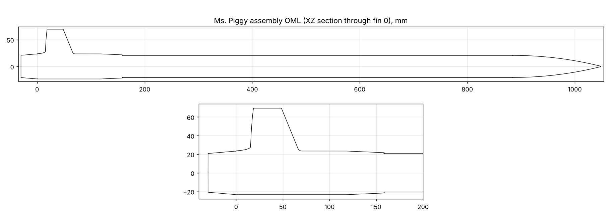{width=100%}

# CFD Method {#sec-method}

::: summary
**Summary**
Steady RANS with the k-ω SST turbulence model in OpenFOAM, on a half model with a symmetry plane through fin 0.
Forces come from integrating surface pressure. Incompressible cases run at 100 m/s (M 0.29); compressible cases run at
M 0.5 and 0.8.
:::

## Solver and domain

| Item | Setting |
|---|---|
| Solver | simpleFoam (incompressible, M 0.29); rhoPimpleFoam with local time stepping (compressible) |
| Turbulence | k-ω SST, wall functions; inlet intensity and length scale as in the project CFD tool |
| Domain | box 1 m ahead, 3 m behind, ±1 m vertical, 1 m lateral; half model, symmetry plane y = 0 through fin 0 |
| Mesh | snappyHexMesh: background 50 mm; surface level 4–5 (coarse) and 5–6 (refined); near-body box level 3 / 4; wake box level 2 |
| Cells | 0.60 M (coarse), 2.50 M (refined); maximum skewness 3.27 / 3.16 |
| Convergence | 800 iterations (coarse), 1200 (refined), 2500 (compressible); CP change over the last quarter ≤ 0.3 mm (incompressible) and 2.8 mm (compressible) |
| Reference | diameter 41.275 mm, area 1.338 × 10⁻³ m²; moments about the nose tip |

Table: CFD set-up.

## Case matrix

| Case | Mesh | α | Mach | Cells | Iterations | Raw CP (mm) |
|---|---|---|---|---|---|---|
| msp_a0 | coarse | 0° | 0.29 | 602 192 | 800 | offset only |
| msp_a2 | coarse | 2° | 0.29 | 602 192 | 800 | 842.1 |
| msp_a4 | coarse | 4° | 0.29 | 602 192 | 800 | 816.8 |
| msp_a6 | coarse | 6° | 0.29 | 602 192 | 800 | 802.5 |
| msp_a8 | coarse | 8° | 0.29 | 602 192 | 800 | 774.4 |
| msp_a4_f | refined | 4° | 0.29 | 2 499 522 | 1200 | 837.1 |
| msp_a0_f | refined | 0° | 0.29 | 2 499 522 | 1200 | offset only |
| msp_m05 | coarse | 4° | 0.50 | 602 192 | 2500 | 811.2 |
| msp_m08 | coarse | 4° | 0.80 | 602 192 | 2500 | 809.6 |

Table: CFD case matrix. Raw values before the corrections of §2.3.

## Corrections applied

- **Zero-incidence offset.** A three-fin rocket produces no normal force at α = 0 by symmetry, yet the half-model mesh
  returns CN₀ = 0.054 acting near the fin can. The offset is numerical. It is identical on both meshes (0.4447 N against
  0.4448 N) and is subtracted from every case: CN′ = CN − CN₀ and CP′ = (CN·CP − CN₀·CP₀)/CN′.
- **Mesh correction.** The refined mesh raises CN by 9.8 % and moves the CP 22.3 mm aft at α = 4°. Both corrections are applied
  to all coarse-mesh cases.
- **Compressible cases.** The compressible runs use first-order upwinding, which over-predicts pressure drag in absolute
  terms. Their normal force and CP enter as increments over the coarse M 0.29 case at the same mesh and incidence. Their
  axial force enters only as the ratio M 0.8 / M 0.5 of the same scheme, which cancels most of the numerical bias.
- **Skin friction.** Not resolved by the wall-function mesh. A turbulent flat plate with compressibility correction
  is applied on the wetted areas. The paper tube (0.094 m²) is smooth; the printed parts (0.054 m²) are fully rough
  with ks = 40 µm for 0.2 mm layers.
- **Rail guides.** Two printed guides are added as ΔCA = 0.06 [ESTIMATE]{.tag}.

# Aerodynamic Results {#sec-aero}

::: summary
**Summary**
The refined, offset-free result is CP 826.3 mm and CNα 12.74 /rad at M 0.29. The CP moves forward with incidence and Mach
number. Axial force is CA 0.59 at M 0.3, rising to 0.62 at M 0.8; friction is 64 % of it.
:::

## Mesh study

| Quantity (α = 4°, offset removed) | Coarse 0.60 M | Refined 2.50 M | Change |
|---|---|---|---|
| CNα (/rad) | 11.60 | **12.74** | +9.8 % |
| CP from tip (mm) | 804.0 | **826.3** | +22.3 mm |
| CA pressure | 0.242 | **0.169** | −30 % |

Table: Mesh study at 100 m/s, α = 4°.

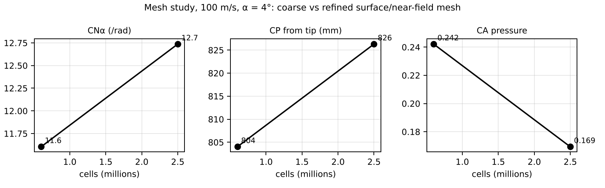{width=100%}

Two mesh levels bound the result but do not prove grid independence. If the error falls with the square of the cell size,
the converged CP lies about 7 mm aft of the refined value, about 833 mm. The refined value of 826.3 mm is therefore used as the
conservative basis.

## Normal force and CP against angle of attack

| α | CN | CN/α (/rad) | CP from tip (mm) |
|---|---|---|---|
| 2° | 0.467 | 13.38 | 843.3 |
| 4° | 0.889 | 12.74 | 826.3 |
| 6° | 1.311 | 12.52 | 815.5 |
| 8° | 1.584 | 11.34 | 787.9 |

Table: Normal force and centre of pressure against incidence (mesh- and offset-corrected, M 0.29).

{width=100%}

## Effect of Mach number

| Mach | CNα (/rad) | CP (mm) | CA forebody + fins | CA base | CA friction | CA rail guides | **CA total** |
|---|---|---|---|---|---|---|---|
| 0.29 | 12.74 | 826.3 | 0.099 | 0.051 | 0.381 | 0.060 | **0.591** |
| 0.50 | 14.77 | 820.7 | 0.109 | 0.060 | 0.353 | 0.060 | **0.582** |
| 0.80 | 14.65 | 819.1 | 0.151 | 0.080 | 0.325 | 0.060 | **0.615** |

Table: Aerodynamic coefficients against Mach number at α = 0 (axial) and α = 4° (normal), reference diameter 41.275 mm.

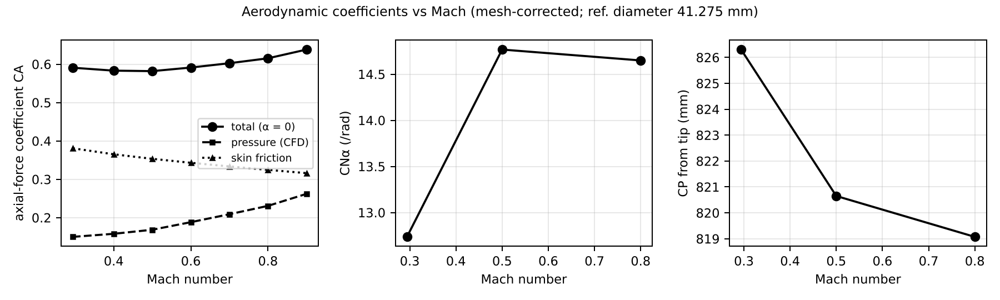{width=100%}

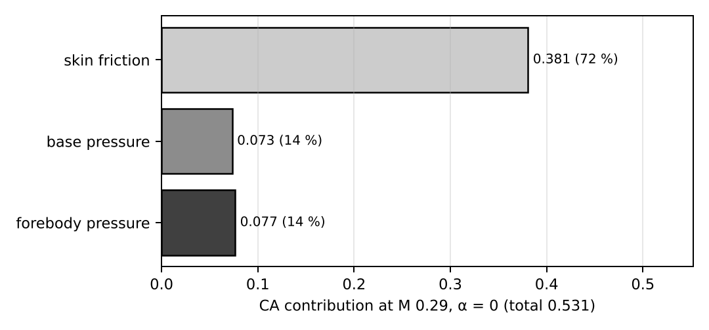{width=80%}

## Flow field

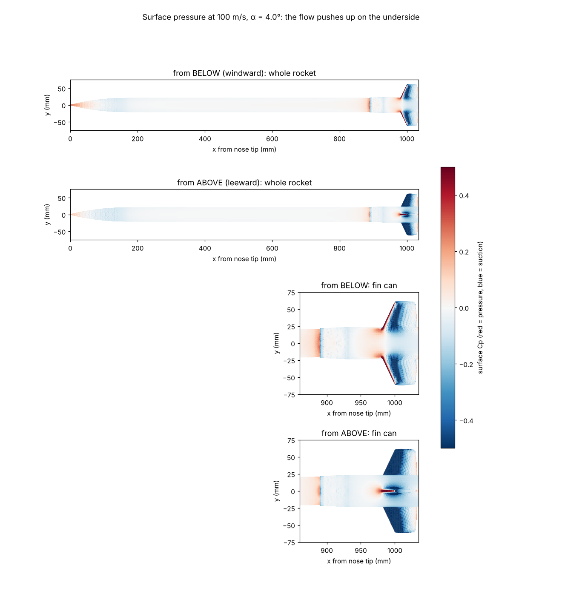{.color width=88%}

{.color width=88%}

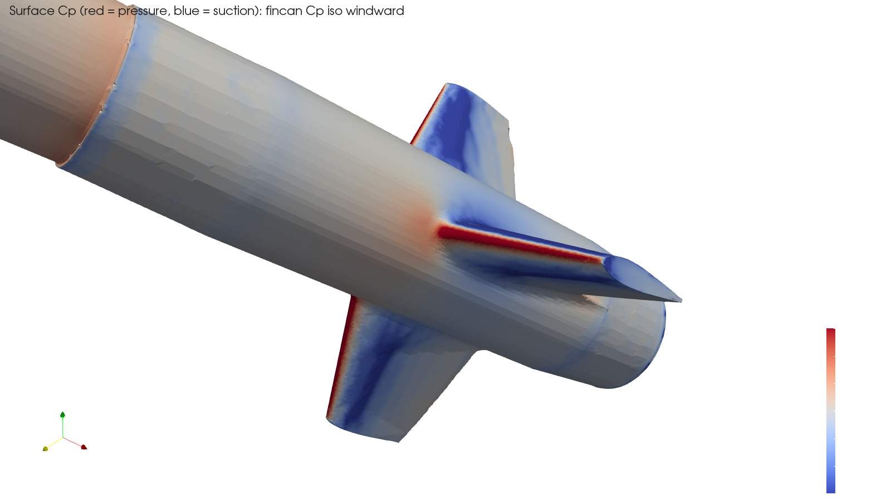{.color width=75%}

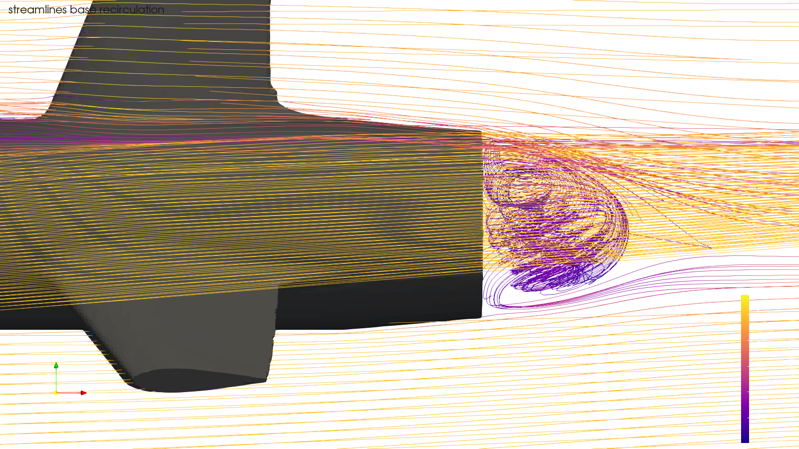{.color width=75%}

# Flight Simulation {#sec-flight}

::: summary
**Summary**
On the CFD drag, the vehicle reaches 1664 m and Mach 0.89 and leaves the 1.83 m rail at 24.7 m/s. Apogee occurs 13.1 s after
burnout. Weathercocking costs 47 m of apogee at 20 mph.
:::

## Method

- **Model.** RocketPy 6-DOF: H100W-14A thrust curve (228.4 N·s, 2.40 s burn), loaded motor 261 g, propellant 121 g.
- **Mass.** Liftoff 610 g with CG 763.3 mm from the tip without added ballast [ESTIMATE]{.tag} (L1C-EDR-001 §2.5).
  Ballast at 74.6 mm from the tip.
- **Drag.** The power-off curve is the CFD axial-force curve of §4.3. The power-on curve subtracts the base drag, because
  the exhaust fills the base wake.
- **Stability.** The static margin over the flight uses the CFD CP(Mach) and the simulated CG(t). RocketPy's internal
  Barrowman model gives lower values and is reported for comparison only.
- **Conditions.** Rail 1.83 m (6 ft), vertical launch, sea level, standard atmosphere.

## Results

| Case | Liftoff mass | CG | Margin at liftoff | Margin at burnout | Apogee | Max speed | Rail exit |
|---|---|---|---|---|---|---|---|
| No added ballast | 610 g | 763.3 mm | 1.53 cal | 2.51 cal | 1665 m | 305 m/s (M 0.90) | 24.9 m/s |
| +6.4 g ballast | 616 g | 756.1 mm | 1.70 cal | 2.72 cal | 1665 m | 303 m/s (M 0.89) | 24.8 m/s |
| **+10.2 g ballast** | **620 g** | **752.0 mm** | **1.80 cal** | **2.83 cal** | **1664 m** | **302 m/s (M 0.89)** | **24.7 m/s** |

Table: Flight simulation by ballast case (nominal drag, no wind). All masses are estimates.

Peak acceleration is 20.7 g and maximum dynamic pressure 53.8 kPa. Apogee is reached 15.5 s after liftoff.

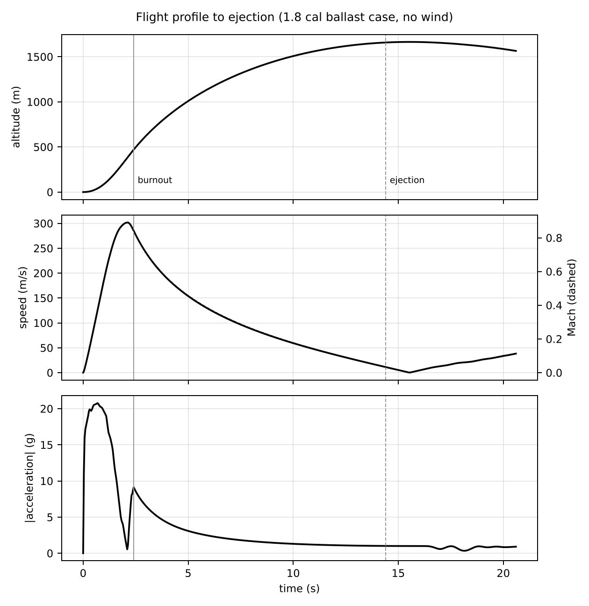{width=88%}

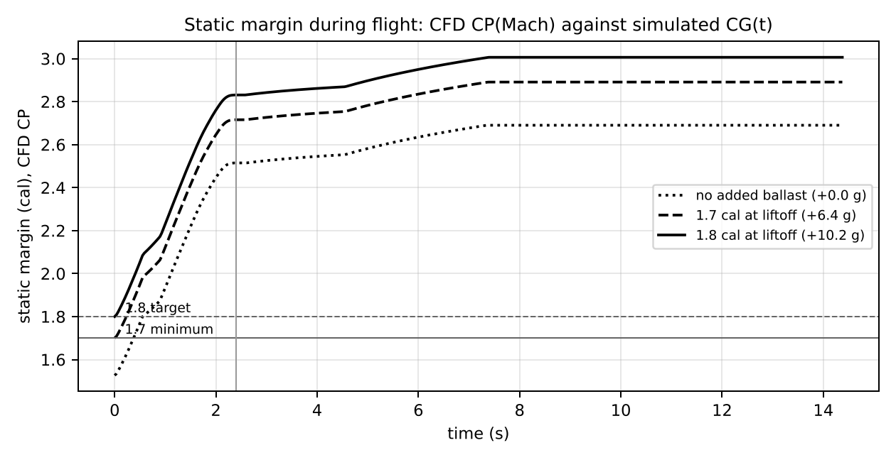{width=88%}

## Drag uncertainty and ejection delay

| Drag | Apogee | Max Mach | Ideal delay | Ejection speed at 11 / 12 / **13** / 14 s |
|---|---|---|---|---|
| CFD −15 % | 1840 m | 0.92 | 14.1 s | 31.3 / 21.1 / **11.1** / 1.3 m/s |
| CFD nominal | 1664 m | 0.89 | 13.1 s | 21.2 / 11.2 / **1.4** / 8.4 m/s |
| CFD +15 % | 1525 m | 0.86 | 12.3 s | 13.1 / 3.2 / **6.6** / 14.1 m/s |
| ×1.40 (matches OpenRocket apogee) | 1347 m | 0.83 | 11.3 s | 2.5 / 7.3 / **14.7** / 20.9 m/s |
| **Worst case** | | | | 31.3 / 21.1 / **14.7** / 20.9 m/s |

Table: Apogee and ejection speed against drag factor and drilled delay (10.2 g ballast).

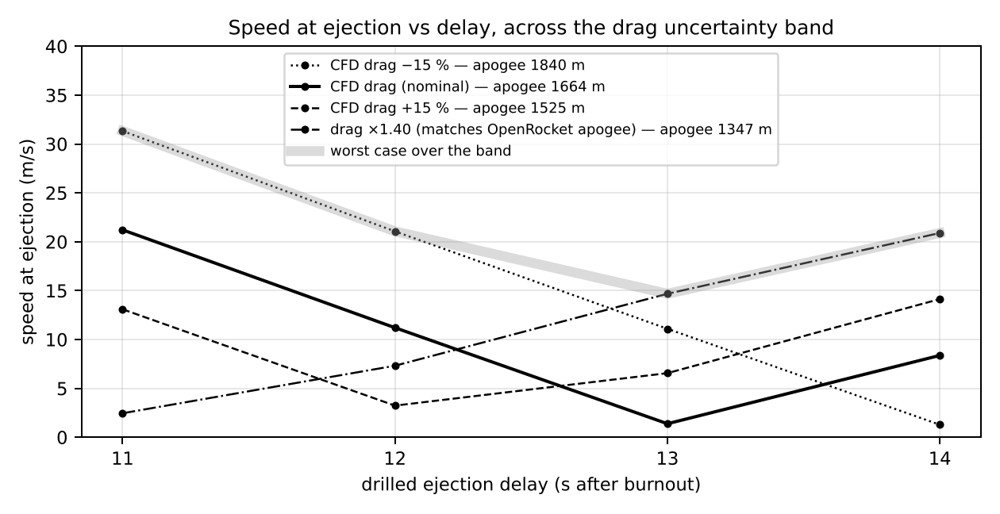{width=88%}

A 13 s delay gives the lowest worst-case ejection speed, 14.7 m/s. At that speed the opening load on the 28 in
parachute stays below 75 N (L1C-EDR-001 §7), far below the 1334 N knotted Kevlar.

## Wind

| Wind | Apogee | Apogee position | Landing position |
|---|---|---|---|
| 0 mph | 1664 m | 0 m | 0 m |
| 5 mph | 1661 m | 82 m upwind | 613 m downwind |
| 10 mph | 1653 m | 161 m upwind | 1220 m downwind |
| 15 mph | 1638 m | 240 m upwind | 1813 m downwind |
| 20 mph | 1617 m | 317 m upwind | 2386 m downwind |

Table: Weathercocking and drift, vertical launch, descent at 5.35 m/s on the 28 in parachute.

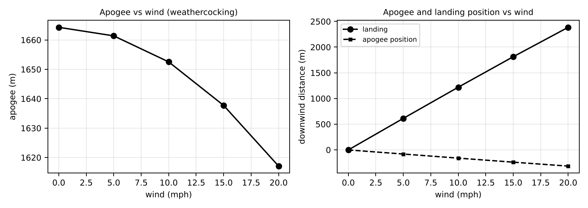{width=95%}

# Conclusions {#sec-concl}

::: summary
**Summary**
The assembly is aerodynamically sound. It needs about 10 g of nose ballast for the 1.8 cal target, and a 13 s delay best fits
the predicted coast.
:::

1. The refined CFD places the CP at 826.3 mm. With the estimated CG, 6.4 g of nose ballast meets the 1.7 cal minimum and 10.2 g meets
   the 1.8 cal target. The final amount follows from the measured CG at assembly.
2. The margin is lowest at liftoff and rises to 2.5–2.8 cal at burnout. Large gust incidence (8°) or high Mach moves the
   CP forward by up to 38 mm, which the 1.8 cal target covers.
3. The CFD drag (CA 0.59) is lower than the OpenRocket model, so the predicted apogee (1664 m) is higher than OpenRocket's
   (1256–1342 m). A delay of 13 s gives the lowest ejection speed across that difference.
4. The coarse-mesh results of earlier analyses under-predict fin lift. Results in this report supersede them for the
   assembly geometry.

# Appendix A — Flow-Field Gallery {.unnumbered .appendix}

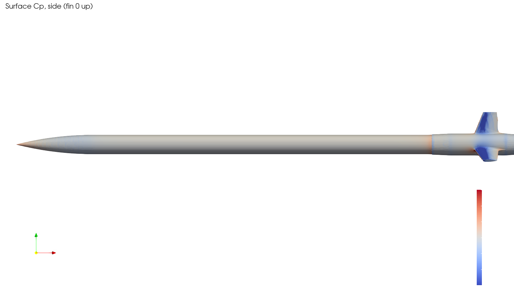{.color width=80%}

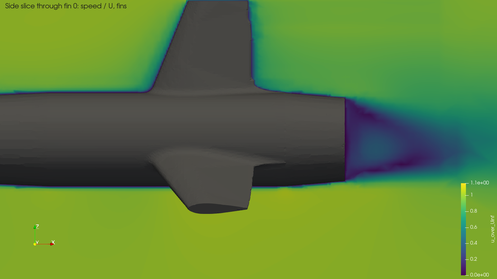{.color width=80%}

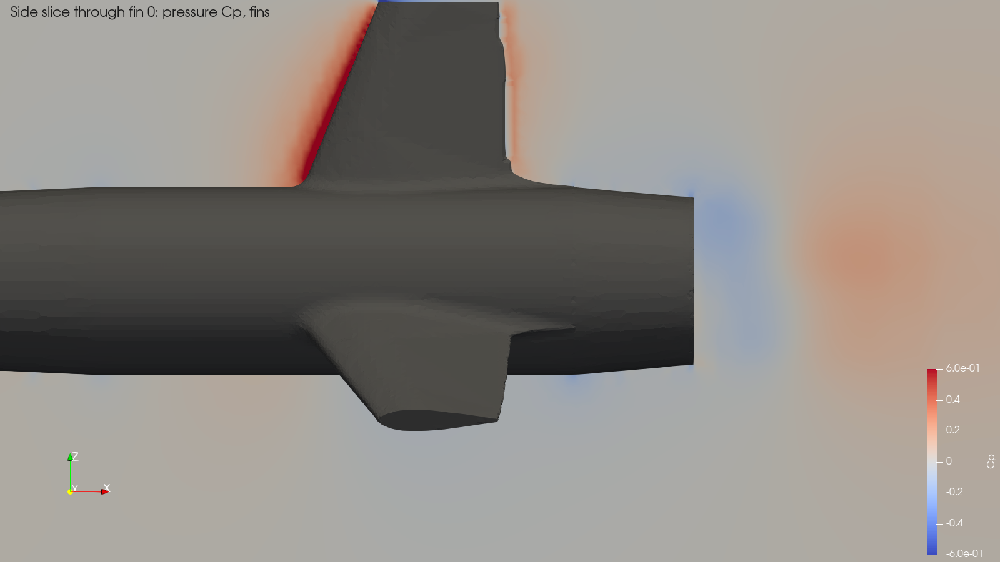{.color width=80%}

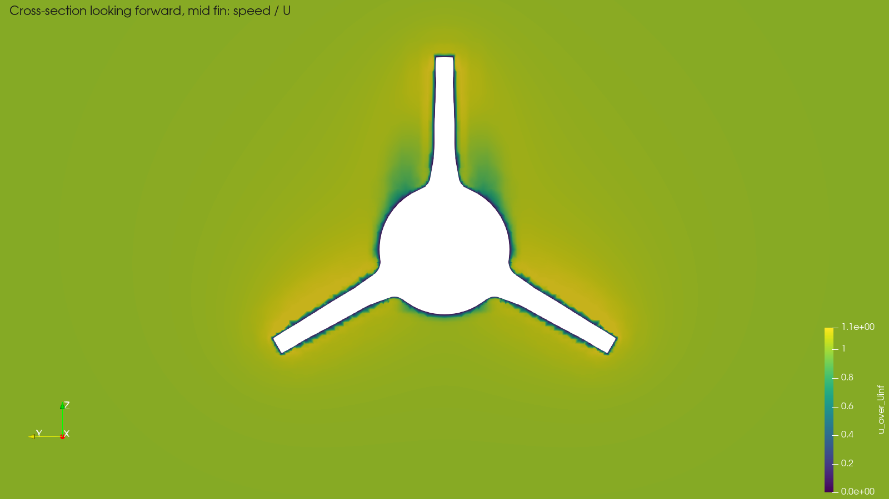{.color width=70%}

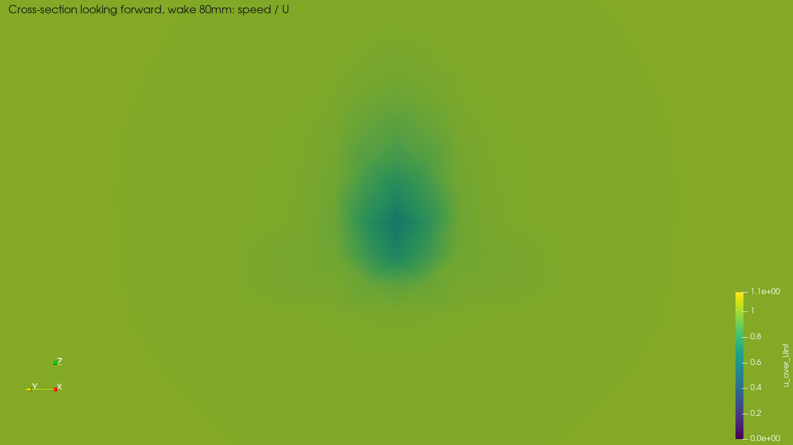{.color width=70%}

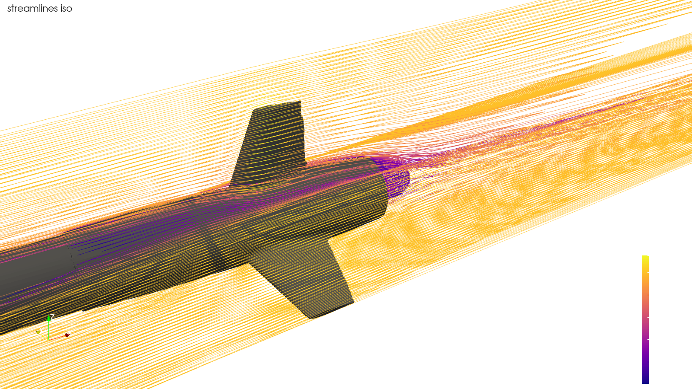{.color width=80%}

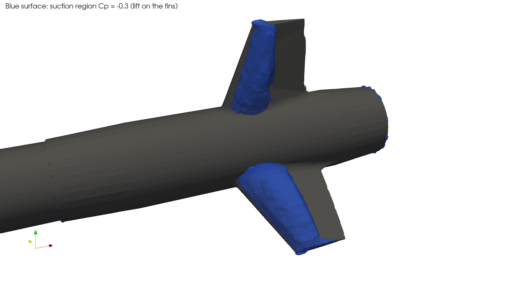{.color width=75%}

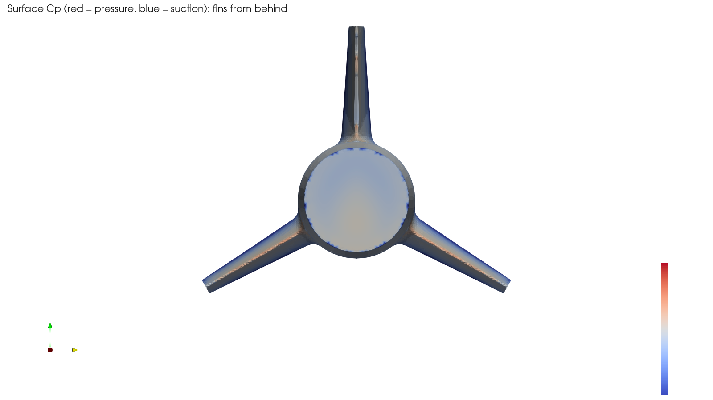{.color width=60%}

# Appendix B — Data Sources and Tools {.unnumbered .appendix}

| Item | Location |
|---|---|
| Assembly | projects/l1-cheap/owner_cad/Ms.Piggy_Assembly.STEP |
| Outer mould line | tools/rocket_oml_asm.py → out/cfd/rocket_oml_asm.stl |
| CFD cases | tools/cfd_rocket.py, tools/cfd_campaign_msp.sh, tools/cfd_campaign_msp2.sh → out/cfd/of_msp_*/ |
| Aerodynamic database | tools/msp_aero.py → out/msp/aero.json |
| Flight simulation | tools/msp_flight.py, tools/msp_delay_chart.py → out/msp/flight.json |
| Flow visualisation | tools/paraview_gallery.py (42 views, refined case) |
| Mass model | L1C-EDR-001 §2.5 and design data file (ESTIMATE) |

Table: Data sources and tools.
