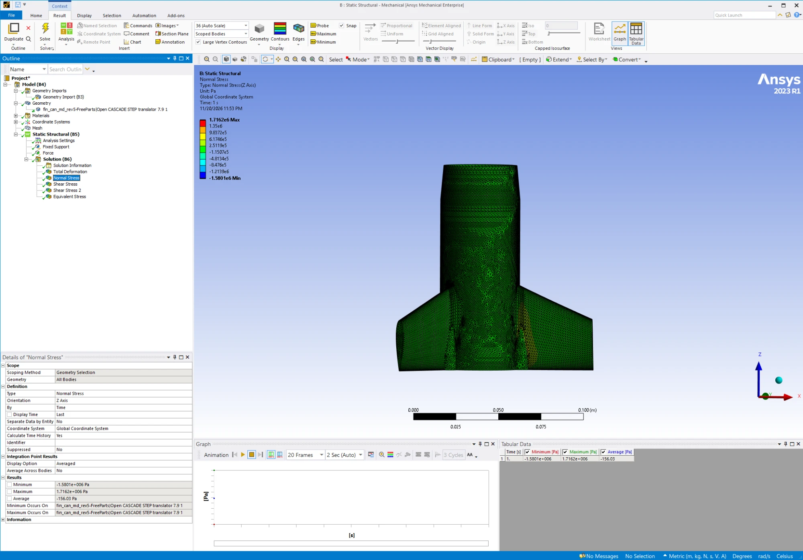
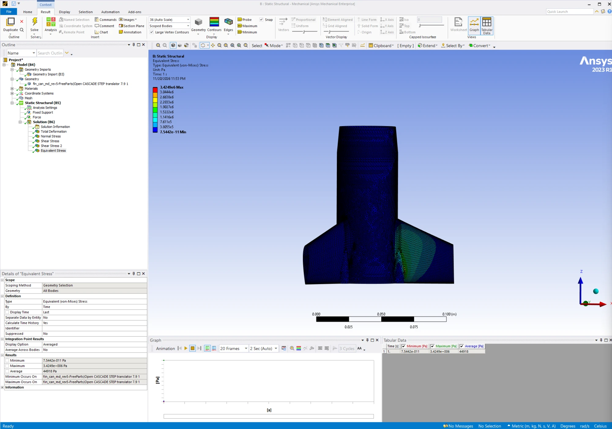
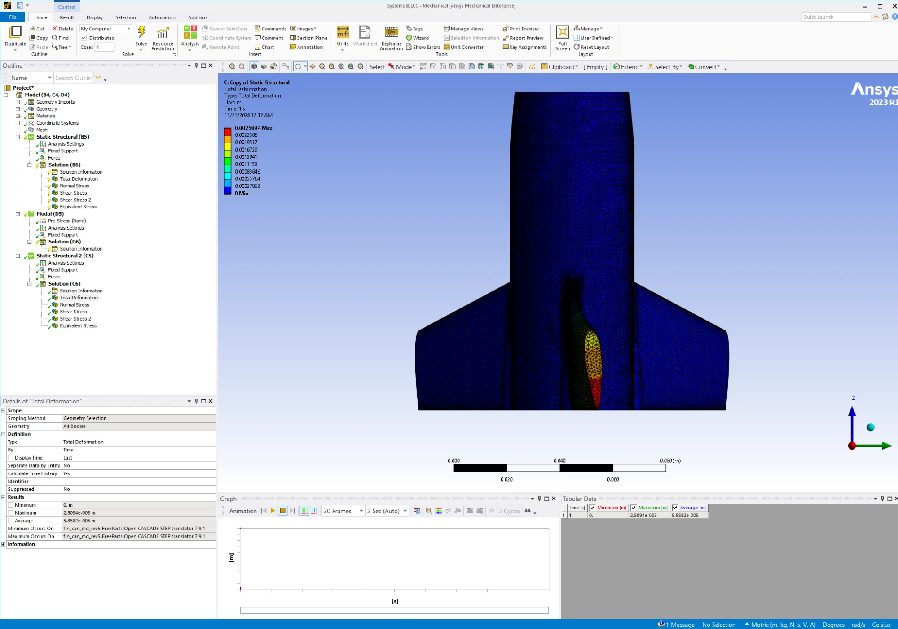
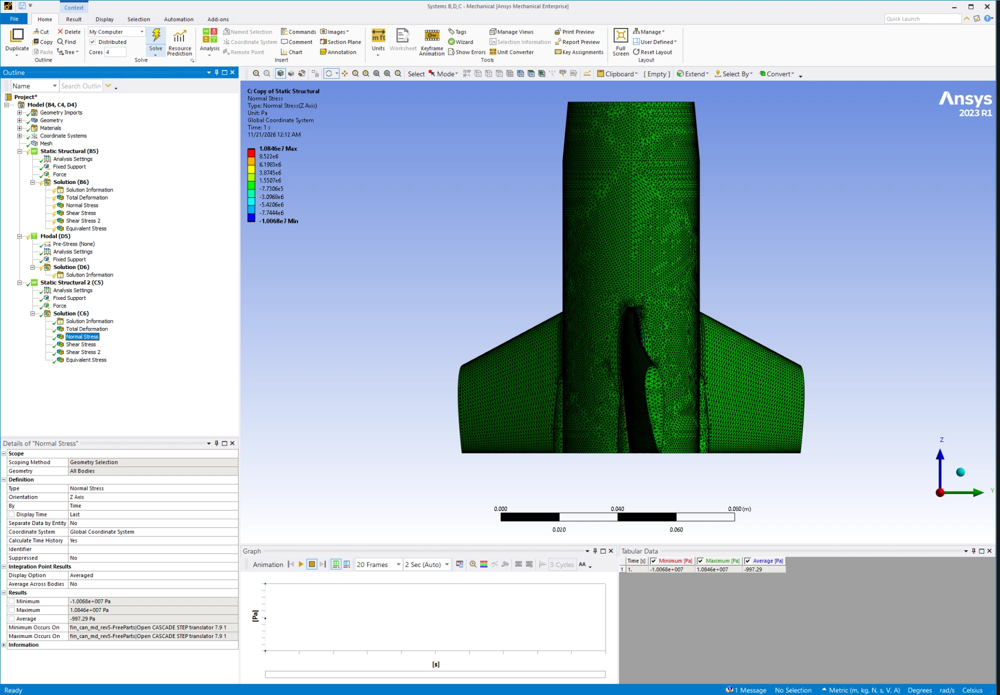
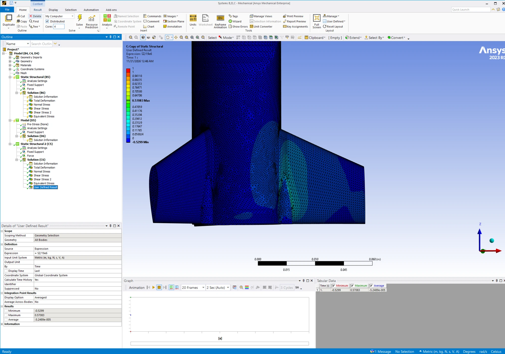
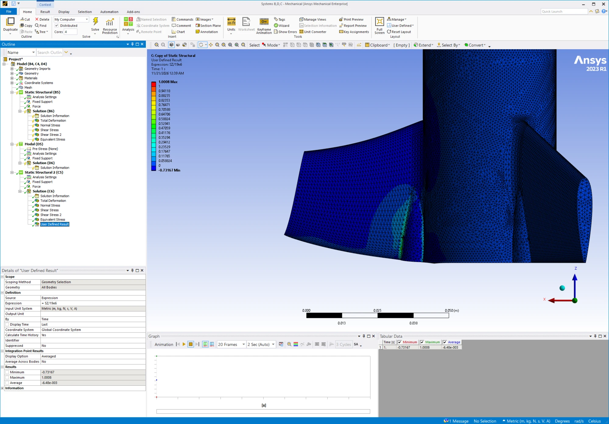
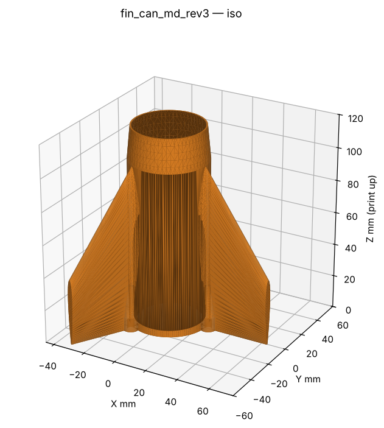
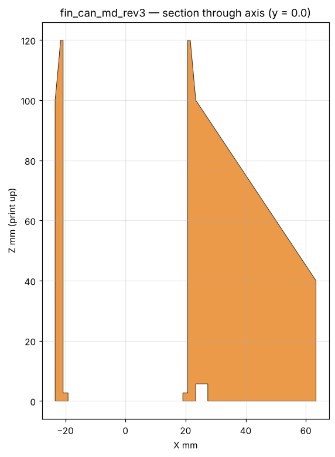

# l1-cheap — Design & Research Report
_Last updated: 2026-11-21 · 65aa51e_

> Living document, maintained by the `rocket-docs` agent. Every number is copied from a project source and cited inline. Labels ESTIMATE / PLACEHOLDER / PROPOSED / TBD are carried over from the sources.
>
> **Current basis (2026-11-21):** AeroTech H100W-14A, minimum-diameter, **fin can rev 5** with the **owner's OpenRocket fins**, 70 g nose ballast. The flight numbers come from the H100W re-sim (stability.md §0, design.yaml `stability`). H182R material is kept only as history. Where sources disagree, both values are shown and the conflict is listed in §11.

---

## Briefing

**Goal:** Tripoli Level 1 certification flight, **$100 cap including the motor**. Palm Bay, FL, **2026-12-14** (goal.md).

**Rocket at a glance**

| | |
|---|---|
| Motor | AeroTech **H100W-14A DMS, 38 mm**, $54.99, HAZMAT. Curve: 228.4 N·s, peak 130.2 N, burn 2.40 s (design.yaml `motor`) |
| Layout | Minimum-diameter: motor directly in the LOC BT-1.52, 863 mm. Length 1030.7 mm (design.yaml `stability.total_length_mm`) |
| Nose | 165 mm ogive, 52.7 g shell ESTIMATE + **70 g ballast** (design.yaml `stability.ballast_g`) |
| Fins | **Owner's OR set**: 3 × 50.0 / 30.0 / 43.18 span / 20.32 sweep / 6.0 mm (design.yaml `aero`) |
| Fin can | **Rev 5** sleeve, model 83.4–85.7 g, owner slicer **80 g**. Verify **5/5 PASS** at 80 g (re-run 2026-11-21) |
| Recovery | Motor ejection, **drill to 12 s**; owned 40 in chute; 750 lb Kevlar |

**Key performance** (stability.md §0, H100W re-sim, PROVISIONAL mass estimates)

| Margin, liftoff | Apogee | Vmax / Mach | Rail exit 1.5 / 1.83 m | Deploy at 12 s |
|---|---|---|---|---|
| **1.81 cal** (ref 41.275; 1.59 on 46.795) | **1233 m** | 250.0 m/s / **0.737** | **21.6 / 24.0 m/s** | 7.9 m/s, falling |

**Fin can structure** (ANSYS, rev 5; ansys_results.md)
- Flight loads: **PASS, ~11×** (gust case, 1.72 MPa across layers vs 19 MPa).
- Flutter: **PASS, ~5×** (Vf ≈ 1330 m/s vs Vmax 250 m/s, at G = 394 MPa).
- Sideways landing tip strike: **FAIL**, capacity ~90 N vs ~200 N realistic (ESTIMATE).

**Phase status**

| 0 Goal | 1 Feas. | 2 Design | 3 BOM | 4 Budget | 5 Sched. | 6 Parts | 7 Build | 8 Flight |
|---|---|---|---|---|---|---|---|---|
| done | Cond. GO | re-sim done; OR CP open | needs update | not started | — | fin can rev 5; nose not generated | — | — |

**Top risks**
1. **Fin root breaks on a sideways landing:** ~90 N capacity vs a ~200 N realistic estimate (§4.3).
2. **CP disagrees with OpenRocket:** 804.7 vs 836.0 mm. 70 g gives 1.81 cal on our CP, 2.57 on OR's (§3.3).
3. **Unmeasured fit and masses:** case OD, thrust ring, tube OD; tube 93.6 g ESTIMATE vs OR's 123 g.

**Next steps**
- Owner: measure the tube and motor, and weigh the parts. Then do the balance check (CG 730 mm, window 722–739).
- Owner: choose between a drop test and a landing-tough rev 6. Run the thrust FEA case.
- Owner: check the fin count in the .ork.

---

## 1. Requirements & Constraints

### 1.1 Mission and owner constraints (goal.md, design.yaml `owner`, `motor`)

| Item | Value | Source |
|---|---|---|
| Certification | Tripoli L1 (member, uncertified); age 18+ confirmed | goal.md, feasibility.md §7 |
| Motor | Goal said "cheapest 29 mm H". **Owner changed it on 2026-11-21 to the AeroTech H100W-14A DMS, 38 mm** | goal.md; design.yaml `motor.designation` |
| Airframe | 38 mm class tube (LOC BT-1.52). **Minimum-diameter since 2026-11-21** | goal.md, feasibility.md §7, motor.md status |
| Printed parts | Fin can and nose cone, PETG, Bambu P1S | goal.md |
| Stability | Target 1.8 cal, band ±0.2 cal, **gated at liftoff only** | design.yaml `owner.stability_*` |
| Budget | $100 total incl. motor; 5 % contingency held back ($95 spendable) | design.yaml `owner`, feasibility.md §4 |
| Filament | $13/kg PETG | goal.md |
| Launch / deadline | Palm Bay, FL, 2026-12-14; club/prefecture name TBD | goal.md |

- The owner wrote the stability band as "±2". It is read as ±0.2 cal (design.yaml `owner.stability_band_cal`; skills/build-planner/SKILL.md marks it "CONFIRM").
- design.yaml `owner.motor_class` still reads "29mm H", and goal.md and feasibility.md still say "not min-diameter" (§11).
- **Reference diameter:** the gate is evaluated on d = 41.275 mm (tube), the same reference as the owner's OR (1.625 in). On the 46.795 mm sleeve the same rocket reads lower (design.yaml `stability.aim_liftoff_margin_cal`).

### 1.2 Certification rules (feasibility.md §1, secondary sources; check tripoli.org/Level1 before buying)

| Requirement | H100W status (motor.md §B) |
|---|---|
| Single certified H or I motor, 160.01–640 N·s | 223.9–234 N·s, depending on source (curve file: 228.4): pass |
| Average thrust > 80 N (forum claim only) | 93.4–100 N: pass, **but with only a 13–20 N margin** |
| Rocket built by the flyer | plan |
| Witnesses: 2× L1 or 1× L2/L3; form to the prefect before the flight | arrange at launch |
| Safe recovery; rocket flyable again | design for it (see the landing-strike result, §4.3) |

### 1.3 Shop and printer constants (skills/SKILL.md)

| Constant | Value |
|---|---|
| BT-1.52 ID (measured = nominal) / OD nominal | 38.735 mm / 41.275 mm; `od_measured_mm` **TBD** |
| Fits in tube, per side | press 0.06 mm, snug-slip 0.09 mm |
| PETG density / interlayer shear | 1.27 g/cm³ / 15 MPa (approximate, weak direction) |
| Printer limit (P1S) | 256 × 256 × 256 mm, hard limit |
| Print profile | 0.2 mm layers; 6 wall loops (0.42 outer / 0.45 inner); 5 top / 3 bottom layers; elephant-foot comp. 0.15 mm |
| Verify mass tolerance | ±5 % (provisional) |
| Rail size | **TBD** (1010 or 1515, set by the club) |

---

## 2. Propulsion

### 2.1 Motor data: AeroTech H100W-14A DMS, 38 mm single-use, AT part 081014 (motor.md §A, design.yaml `motor`)

Published values were read through WebSearch on 2026-11-21. No manufacturer cert sheet could be read.

| Item | Design value | Thrust-curve file (`motor/H100W.eng`) | Other sources |
|---|---|---|---|
| Total impulse | 226.8 N·s | **228.4 N·s** | 234 (QA, manufacturer listing); 223.9 (RR) |
| Average thrust | 97.7 N | — | 100 (QA); 93.4 (RR) |
| Max thrust | **137.8 N** (structural design value) | **130.2 N** | 131 (QA); 130.2 (RR) |
| ThrustCurve "116.1 N" | **unresolved** | — | no label |
| Burn time | 2.32 s | **2.40 s** (2.398 s end of curve) | 2.3 (TC, QA); 2.40 (RR) |
| Loaded / propellant / burnout mass | 261 / 121 / 140 g | 261 / 121 (from design.yaml) | 140 g is derived (261 − 121) and ignores delay and ejection mass |
| Length | 155 mm | 155 (header) | 153 (TC); 157.5 (RR) |
| Delay | 14 s max; owner drills it shorter with the **UDDT** | 14 (header) | "6, 8, 10 s" attributed to TC (unverified) |
| Case OD | **TBD** (1.500 in = 38.10 mm nominal, from the I500T DMS page) | 38 (class) | motor.md §C |
| Thrust ring | present, factory-glued; OD and thickness **TBD** | — | AT DMS data sheet |
| HAZMAT / price | yes / **$54.99** | — | QA; Wildman; AT catalog 03.26.25 |
| MESS failure reports | 3 (details not seen) | — | ThrustCurve, quoting motorcato.org |

TC = ThrustCurve, QA = Quest Aerospace, RR = RocketReviews. The design values are the ones in design.yaml `motor`. The sim flies the .eng curve. Structural checks keep the 137.8 N maximum.

**Thrust curve source:** `projects/l1-cheap/motor/H100W.eng`, converted from the owner's ThrustCurve CSV on 2026-11-21 (`motor/AeroTech_H100W_DMS.csv`; contributor Mike Haberer). Masses in the header come from design.yaml `motor`.

*Figure 1. AeroTech H100W-14A DMS thrust vs time, plotted with matplotlib from `projects/l1-cheap/motor/H100W.eng` (owner's ThrustCurve CSV, contributor M. Haberer). The curve integrates to 228.4 N·s, peaks at 130.2 N at 0.696 s, and ends at 2.40 s. Generated 2026-11-21.*

### 2.2 Case OD and thrust ring: critical for minimum diameter (motor.md §C)
- **Case OD.** No measurement is published. If the 38.10 mm nominal holds, the case has **0.64 mm diametral clearance** in the 38.735 mm tube.
- **Ring.** Factory-glued; AeroTech's DMS thrust-ring advisory (04/2014) says to check it. In this layout **the glue joint carries all of the thrust (137.8 N)**.
- **PROPOSED:** a forward backup stop inside the tube (printed or plywood ring). The sim carries it as a 10 g ESTIMATE "stop/anchor ring" (stability.md §0.1). Owner decision.
- **Heat.** The paper tube touches the case directly, and the case is hot when the ejection charge fires (motor.md §D).

### 2.3 Selection rationale
- **2026-11-20:** owner confirmed the H182R-14A (29 mm DMS), chosen over 29 mm RMS reloads that need a $108.79–$152.99 case (feasibility.md §2–3).
- **2026-11-21:** owner switched to the **H100W-14A (38 mm DMS)**, **minimum-diameter** (design.yaml `motor`; git c717e50, 7544078).
  - The owner's reasons are not recorded in the project files (§11).
  - Cost: $54.99 is $12.70 more than the H182R's low price (motor.md §A).

### 2.4 Delay: drill to 12 s (stability.md §0.4, design.yaml `stability.recommended_delay_s`)
- The delay timer starts at burnout, so **delay = t_apogee − t_burnout** (recovery.md §6).
- Re-sim: burnout 2.398 s, apogee 13.59 s, so the coast is **11.19 s**. Over Cd ×0.7–1.3 the coast is 12.96–10.01 s.
- **Recommendation: drill the 14 s delay to 12 s.** It gives the lowest worst-case deploy speed over the Cd spread: 7.9 m/s nominal, ≤ 17 m/s worst case, falling. Full table in §6.5.
- **Why not ~7 s (the OR "−6" delay):**
  - The owner's OR and Monte Carlo fly **H100W_DMS-6**. The chute opens at about 2.3 + 6 = 8.3 s, while the rocket is still climbing. OR's 9.4–9.5 s "time to apogee" is therefore cut short by the chute.
  - OR's own deploy speed (137 mph = 61 m/s) matches our 6 s row (56 m/s).
  - OR's "optimum delay" of 11.6 s is the undisturbed coast, and it agrees with our 11.19 s.
  - A 7 s delay deploys at 31–63 m/s while climbing. recovery.md puts the knotted-Kevlar limit at about 27 m/s.
- The motor agent still has to confirm the AeroTech/UDDT drill steps (design.yaml `stability.recommended_delay_s`).

### 2.5 H182R-14A (29 mm): SUPERSEDED 2026-11-21, kept for history (motor.md, lower part)

| Item | Spec sheet | RSE / .eng | Design value then |
|---|---|---|---|
| Impulse / avg / peak thrust | 218 N·s / 182 N (derived) / 192 N stated, ~205 N plotted | 216.1 N·s / 175.0 N / 200.8 N | sim used the .eng file; 205 N structural |
| Burn / loaded / burnout / length | 1.2 s / 207 g / 92 g / 203 mm | 1.235 s | — |

*Figure 2. SUPERSEDED motor. H182R-14A thrust vs time, plotted from `projects/l1-cheap/motor/H182R.eng` (owner's ThrustCurve RSE file): 216.1 N·s, 175.0 N average, 200.8 N peak at 1.144 s. Generated 2026-11-20.*

---

## 3. Aerodynamics

### 3.1 Fins (design.yaml `aero`, aero.md §0, fin_can_md rev 5 spec)

| Item | Owner's OR set (current, rev 5) | Aero optimisation (rev 4, PROPOSED, not adopted) | Old (rev 1–3) |
|---|---|---|---|
| Count | 3 | 3 | 3 |
| Root / tip chord | **50.0 / 30.0 mm** | 50 / 30 | 100 / 40 |
| Span | **43.18 mm** | 77 | 40 |
| LE sweep (= Cr − Ct, TE flush with aft face) | **20.32 mm** | 20 | 60 |
| Thickness | **6.0 mm** | 6 | 5 |
| Section | NACA 4-digit symmetric, TE 0.84 mm | same | same |
| Fin root diameter | on the sleeve, 46.795 mm (r = 23.40) | same | rev 3: sleeve |
| Margin claimed | OR 2.08 cal (owner's mass model) | 2.00 cal at zero ballast (aero's mass model) | −0.70 (unstable, aero.md §0.3) |

- **Aero's optimisation** (aero.md §0.5) targeted 2.0 cal with zero ballast and recommended 50/30/77/6. Its 816.5 mm CG assumed the chute pack on the motor and a 52.7 g nose.
- **The owner then chose their OpenRocket fins** (design.yaml `aero`, 2026-11-21). Rev 5 builds them. The stability re-sim restores the margin with nose ballast instead (§6).
- Root fillet r = 4 mm (PROPOSED). The owner's 3–5 mm range is not confirmed.

### 3.2 Barrowman centre of pressure (stability.md §0.2, aero.md §0.3)

Reference point: the nose tip. All lengths in mm, reference diameter d = 41.275 mm.

**Nose:** CNα,n = 2 and X_n = k·Ln, with k = 0.466 for a tangent ogive.

**Body step and fairing** (aero.md §0.3):
- Step 41.275 → 43.135: CNα = 2[(d₁/d)² − 1].
- Fairing cone 43.135 → 46.795: CP at x = L/3·[1 + (1 − d₁/d₂)/(1 − (d₁/d₂)²)].

**Fins:**
- CNα,f = K_fb · 4N(s/d)² / [1 + √(1 + (2 l_m/(Cr + Ct))²)].
- K_fb = 1 + r/(s + r), with r = 23.40 mm (sleeve radius).
- l_m = √(s² + (xs + Ct/2 − Cr/2)²).

Symbols: N fin count; s span; Cr, Ct root and tip chord; xs LE sweep; l_m mid-chord line length; K_fb fin–body interference factor.

**Total:** CP = Σ(CNα,i · X_i) / Σ CNα,i.

| Component (owner fins, rev 5) | CNα | X (mm) |
|---|---|---|
| Nose | 2.000 | 76.9 |
| Step | 0.184 | 910.7 |
| Fairing | 0.386 | 920.8 |
| Fins | 7.117 | 1000.2 |
| **Total CP (Barrowman M0)** | | **804.7** (RocketPy 804.6; 810.9 at M 0.5; 822.0 at M 0.8) |

- Without the sleeve: Barrowman 792.8, RocketPy 792.7. The sleeve moves the CP 12 mm aft (stability.md §0.3).
- design.yaml `aero.cp_from_nose_tip_mm` = 899.0 is for the **77 mm-span** aero proposal, not the owner's fins (§11).

### 3.3 OpenRocket comparison (or_component_analysis.md, stability.md §0.3)

OR config H100W_DMS-6, Mach 0.300, AoA 0, ref length 1.625 in (41.275 mm). OR totals: 637 g, CG 29.442 in, **CP 32.914 in (836.0 mm)**, CNα 11.364.

| Fin CNα, same fins (50/30/43.18/20.32, 3 fins, no sleeve) | Value |
|---|---|
| Barrowman (RocketPy / our sim) | 6.97 |
| Lifting-surface slope × N/2 × interference, N = 3 | 7.08 |
| Same, **N = 4** | **9.43** |
| **OpenRocket** | **9.364** |

- OR's fin CNα is ~34 % above two independent 3-fin methods, and within 1 % of the 4-fin value. RocketPy with 4 fins gives a CP of 835.0 (M0) and 837.0 (M 0.3). **Check the fin count in the .ork.**
- The nose agrees exactly: CNα 2, CP 3.018 in.
- The CG side reconciles: with OR's mass assumptions we get 750.2 mm against OR's 750.3 (stability.md §0.3).
- **OR's model also contains:**
  - a 2 g **bulkhead** at 19.461 in, between the chute (13.992 in) and the motor (37.55 in), which holds the pack forward;
  - a 6 g inner tube at 37.45 in (there is no inner tube in the min-diameter layout);
  - a 123 g body tube (our ESTIMATE is 93.6 g);
  - owner overrides for the nose (80 g) and the fin set (120 g).
- **Plan: fly 70 g of ballast.** That gives 1.81 cal on our CP, and about **2.57 cal on OR's CP** (FAIL high on that reference). Our CP is the stable-side choice until the fin count is checked (stability.md §0.3). If OR is right, 1.8 cal needs about 40 g.

### 3.4 Drag and Mach

| Source | M 0.1 | M 0.5 | M 0.7 | Fins it describes |
|---|---|---|---|---|
| Sim input `stability.assumptions.cd_vs_mach` (ESTIMATE) | 0.70 | 0.76 | 0.83 | old 100/40/40/5 fins |
| design.yaml `aero.cd_estimate` (ESTIMATE) | 0.73 | 0.89 | 1.13 | 77 mm aero proposal |

- Neither table is for the owner's fins (§11). Above M 0.7 the sim holds Cd flat (ASSUMPTION, no transonic rise).
- **Re-sim (owner fins):** Vmax **250.0 m/s, M 0.737**, max q 37.3 kPa (design.yaml `stability`).
- **Owner's OR:** 550 mph (245.9 m/s), M 0.726. That is within 1.7 % of ours (stability.md §0.5).

### 3.5 Flutter (ansys_results.md Case 2; method aero.md §4)

Method: NACA TN 4197, via Apogee *Peak of Flight* #291.

V_f = a · √( G / [ 1.337·AR³·P·(λ + 1) / (2(AR + 2)(t/Cr)³) ] ), with AR = s²/A_fin

Symbols: V_f flutter speed (m/s); a speed of sound (m/s); G shear modulus (Pa); P air pressure (Pa); λ = Ct/Cr taper ratio; t thickness; Cr root chord; A_fin fin area.

| Owner fins 50/30/43.18/6, sea level | G | V_f | V_f / Vmax (250 m/s) |
|---|---|---|---|
| Conservative PETG set (the one ANSYS used) | 394 MPa | ≈ 1330 m/s | **≈ 5.3×** |
| Higher G | 620 MPa | ≈ 1670 m/s | ≈ 6.7× |

- The estimate comes from the main session and is recorded in ansys_results.md. The G values are not measured; see the material caveat in §4.3.
- The ANSYS modal run (§4.3) gives a first mode of 567.9 Hz.
- design.yaml `aero.fin_flutter_velocity_m_s` is still TBD. Its G_req values (71 MPa at 268 m/s) are for the 77 mm proposal.

### 3.6 CFD domain tool: `tools/fluent_domain.py`
- It writes Fluent-ready 2D C-domains around the fin root and tip sections into `out/cfd/`: STEP with named edges, airfoil CSVs, check PNGs and `fluent_setup.md`.
- The domain size defaults to 20 chords. The setup is density-based, ideal gas, Sutherland viscosity and k-ω SST, at AoA 0, 2, 4 and 6°.
- **Caveat:** the setup sheet's speeds (28.4 m/s, 283.1 m/s, "Mach 0.83") are H182R basis. It points to the rev 2 fin STEP and the old 100/40 mm chords. All of this is stale (§11).
- No CFD results exist yet.

---

## 4. Structures & Manufacturing

### 4.1 Fin can rev 5: min-diameter sleeve, owner's fins (DRAFT, NOT PRINT-READY)

`parts/fin_can_md.py`, built with `make.py fin_can_md --rev 5` on 2026-11-21 (out/fin_can_md/rev5/fin_can_md_rev5_spec.md). The part is a PETG sleeve that slides **over** the BT-1.52's aft end. It has:
- 3 fins;
- a 20 mm forward fairing;
- an **aft lip** under the tube end, which is the thrust stop;
- M3 heat-set insert bosses at the fin roots.

| Parameter | Value | Status |
|---|---|---|
| Tube OD (sets the sleeve bore) | 41.275 mm | **PLACEHOLDER**: measure |
| Sleeve bore / wall / OD | 41.455 / 2.67 / **46.795 mm** | derived / PROPOSED / derived |
| Sleeve length / fairing | 100 mm / 20 mm | derived / PROPOSED |
| Lip thickness / lip bore | 2.67 mm / 38.28 mm | PROPOSED / derived |
| Motor case OD / length | 38.10 / 155 mm | **PLACEHOLDER** / CITED |
| Thrust ring OD × thickness | 41.0 × 3.0 mm | **PLACEHOLDER** |
| Fins | 50 / 30 / 43.18 / 20.32 / 6 mm, TE 0.84, fillet r 4 | owner OR / PROPOSED fillet |
| Retention | One M3 insert per fin (Ø4.0 × 5.7 mm), insert radius 25.398 mm, washer min. OD 13.795 mm | OWNER / CITED / derived |
| Kevlar anchor | not in the part; the sim carries a 10 g stop/anchor ring ESTIMATE | open (§11) |
| Extents / print | 102.6 × 118.4 × 120.0 mm; lip down, axis vertical, no supports | verify check 5; spec |
| Mass model / target | **83.4–85.7 g** (0–100 % infill) / **80 g** owner slicer (Bambu Studio; earlier 78.87 g, before that 120 g OR override) | verify; design.yaml `fin_can_md.target_mass_g` |

*Figure 3. Fin can rev 5, iso view in print orientation (aft lip on the bed, Z up). The sleeve carries the owner's 3 fins at the aft end (Z 0–50 mm), with the root bosses at the aft face. The fairing is at Z 100–120 mm. Source: `out/fin_can_md/rev5/fin_can_md_rev5_iso.png`, `make.py fin_can_md --rev 5`, 2026-11-21. Built with the placeholder tube OD, case OD and ring.*

*Figure 4. Fin can rev 5, axial section through a fin (y = 0).*
- *Left: the 2.67 mm sleeve wall, with the lip turning inward at Z = 0.*
- *Right: the 50 mm root, 30 mm tip and 43.18 mm span, with the M3 insert hole entering from the aft face.*
- *The fairing tapers from Z = 100 to 120 mm.*

*Source: `out/fin_can_md/rev5/fin_can_md_rev5_section.png`, 2026-11-21.*

**Verify results.**

| # | Check | On-disk result (`fin_can_md_rev5_verify.json`, 01:40, target 120 g) | At the owner's 80 g target |
|---|---|---|---|
| 1 | Mesh integrity | PASS: watertight, 1 body, 67 472.7 mm³ | — |
| 2 | Mass | **FAIL**: target 120 g; model 83.4–85.7 g | **Reported as PASS by the main session; no verify file shows it** |
| 3 | Mating interference | PASS: 0 mm³ with the tube wall, case and ring (**placeholders**) | — |
| 4 | Renders | PASS: iso and section reviewed for this report | — |
| 5 | Build volume | PASS: 102.6 / 118.4 / 120.0 mm vs 256 | — |

- The main session reports **5/5 PASS** with the 80 g target (model 83.4–85.7 g; slicer 78.87 → 80 g).
- The verify JSON and spec on disk predate the 80 g target (design.yaml change, git 937c29b) and still read 120 g. **Re-run `make.py fin_can_md --rev 5`** so the record matches (§11).
- The model's upper value (85.7 g at 100 % infill) sits above 80 g + 5 %. The pass depends on the infill used.

**Loads vs layers (rev 5, printed axis-vertical, lip down).** Sources: rev 5 spec; ansys_results.md.

| Load | Direction vs layers | Bond loading |
|---|---|---|
| Motor thrust: ring pushes +Z on the lip underside | across layers | **compression** (good). FEA not yet run (§4.3) |
| Fin aero gust (side load on a fin) | root bending; ANSYS shows normal-Z stress at the root | across-layer tension/compression, low (1.72 MPa) |
| Sideways tip strike (landing) | root bending; peak normal Z at the root | **across-layer tension: the governing failure** (~88–90 N) |
| Axial tip strike (landing, Z) | pushes the fin along the layer-stacking direction | **across-layer tension at the aft root fillet** (~770 N) |
| Sleeve-to-tube epoxy joint | shear on vertical cylindrical faces | in-plane shear |
| Ejection kick (−Z): ring pulls the screws out of the inserts | across layers | **pull-out: shear + tension (weak direction)** |

### 4.2 Structural hand checks (rev 3/5 geometry, H100W)

**Thrust bearing on the lip** (motor.md §D): σ = F / A, with A = π/4 · (ring OD² − lip ID²).
- σ is bearing stress (MPa), F force (N), A bearing area (mm²).
- F = 137.8 N. A is TBD until the ring is measured. The 15 MPa reference is reached at A = 9.2 mm².
- 15 MPa is the interlayer *shear* figure, used as a conservative reference because the shop has no PETG compressive allowable.

**Retention pull-out** (motor.md §E, PROPOSAL)
- Design load (ESTIMATE): 15 psi × 1178.4 mm² = **122 N**; ×3 margin gives **366 N** (design.yaml `motor.retention_design_load_n`).
- Capacity per insert, plug shear: τ·π·D·L = 15 × π × 4.0 × 5.7 = 1074 N. τ is interlayer shear (MPa), D the hole diameter (mm), L the insert length (mm).
- SPIROL's installation knock-down to 25 % gives 269 N per insert. Three inserts give 807 N, so **SF 2.2**.

**Fin root bending (hand calc, aero.md §0.4)**
- σ = M/Z with Z = Cr·t²/6, at α 5° and q 44.0 kPa.
- design.yaml `aero.fin_root_bending_mpa` = 6.5 MPa is for the **77 mm** proposal. No hand value is recorded for the owner's fins; ANSYS (§4.3) replaces it.

**Interlayer net-area check for printed anchors** (recovery.md §4): A_net ≥ F·SF / 15.
- **191 mm²** for a 40 m/s deploy on the 40 in chute; **48 mm²** for a deploy at ≤ 20 m/s.
- The 12 s delay deploys at ≤ 17 m/s (§6.5), so the 48 mm² case applies. No anchor part exists yet.

### 4.3 Structural analysis: ANSYS FEA of fin can rev 5 (ansys_results.md)

**Tool:** Ansys Mechanical Enterprise 2023 R1. Owner's runs, 2026-11-20/21.
- Geometry: `out/fin_can_md/rev5/fin_can_md_rev5.step`. Units mm; Z = rocket axis = print direction.
- **Boundary condition (all static cases):** one Fixed Support on the sleeve bore (R 20.727 mm), standing in for the epoxied joint to the tube.

#### 4.3.1 Material: orthotropic `3D_Printed_PETG` (Z = across layers)

| Property | Owner's earlier entry (figure 5) | **Conservative set, used in the runs** | Nominal set |
|---|---|---|---|
| Ex = Ey (in-plane) | 1880 MPa | **1472 MPa** | 1939 MPa |
| Ez (across layers) | 500 MPa | **1087 MPa** | 1711 MPa |
| ν | νxy 0.35, νyz = νxz 0.3 | **0.38 (assumed)** | — |
| Gxy / Gyz = Gxz | 696 / 500 MPa | **533 / 394 MPa** | — |
| Density | 1270 kg/m³ | — | — |
| Source | owner | JuggerBot PETG review | Ultimaker PETG TDS |

- **The owner confirmed on 2026-11-21 that the runs used the conservative set.**
- **Caveat:** both recommended sets were picked off search-result summaries, not read from the documents. Confirm them before relying on them (ansys_results.md).
- **Failure limits** used to judge results:
  - Z tensile (across layers) ~19 MPa (Ultimaker TDS, upright);
  - interlayer shear ~15 MPa (shop constant);
  - in-plane tensile ~38.5 MPa (Ultimaker TDS, flat).

*Figure 5. ANSYS Engineering Data for `3D_Printed_PETG`. This screenshot shows the **owner's earlier values** (Exy 1880, Ez 500 MPa). They were replaced before the runs by the conservative set in the table above. Source: `report/figures/ansys/00_material_table.webp`, owner, 2026-11-21.*

**Mesh:** tetrahedral, 1 mm element size, **422,598 nodes, 244,392 elements**. An earlier default mesh had 42,442 nodes.

*Figure 6. 1 mm tetrahedral mesh of fin can rev 5. Source: `report/figures/ansys/01_mesh_1mm.webp`, owner, 2026-11-21.*

#### 4.3.2 Case 1: flight side gust

Force Y = 15 N on one side of the +X fin (ESTIMATE: 5° AoA at max q ≈ 37 kPa). Linear static.

| Result | Max | Limit | Factor |
|---|---|---|---|
| Total deformation | 0.274 mm | — | — |
| Normal Z (across layers) | +1.72 / −1.58 MPa | 19 MPa | **~11×** |
| Shear XZ | 0.354 MPa | 15 MPa | ~42× |
| Shear YZ | 0.192 MPa | 15 MPa | ~78× |
| Von Mises | 3.42 MPa (fin root) | 38.5 MPa | ~11× |

*Figure 7. Gust case, total deformation, max 0.274 mm. Source: `report/figures/ansys/10_gust_deformation.webp`, fin can rev 5, owner, 2026-11-21.*

*Figure 8. Gust case, normal stress Z (across layers), +1.72 / −1.58 MPa. Source: `report/figures/ansys/11_gust_normalZ.webp`, fin can rev 5.*

*Figure 9. Gust case, von Mises stress, max 3.42 MPa at the fin root. Source: `report/figures/ansys/14_gust_vonmises.webp`, fin can rev 5.*

#### 4.3.3 Case 2: modal (free vibration, same support)

| Modes | Frequency | Shape |
|---|---|---|
| 1–3 (one per fin) | **567.9 Hz** | likely 1st bending |
| 4–6 | 1530 Hz | torsion or 2nd bending: **not yet identified** |
| 7–9 | 2677 Hz | — |

The flutter estimate (≈ 5.3× at G = 394 MPa) is in §3.5.

*Figure 10. Modal analysis, first 9 frequencies (three groups of three). Source: `report/figures/ansys/20_modal_frequencies.webp`, fin can rev 5, owner, 2026-11-21.*

#### 4.3.4 Case 3: landing tip strike, sideways (Y)

Force Y = 50 N on the +X fin's tip face.

| Result | Max | Limit | Factor |
|---|---|---|---|
| Total deformation | 2.51 mm | — | — |
| Normal Z (across layers) | 10.8 MPa (root) | 19 MPa | 1.75× → **fails at ~88 N** |
| Shear YZ / XZ | 1.48 / 2.77 MPa | 15 MPa | 5.4–10× |
| Von Mises | 21.4 MPa | 38.5 MPa | 1.8× → ~90 N |

*Figure 11. Sideways tip strike, 50 N in Y: total deformation, max 2.51 mm. Source: `report/figures/ansys/30_tipY50_deformation.webp`, fin can rev 5.*

*Figure 12. Sideways tip strike, 50 N in Y: normal stress Z (across layers), max 10.8 MPa at the root. Scaled to 19 MPa, the fin fails at ~88 N. Source: `report/figures/ansys/31_tipY50_normalZ.webp`, fin can rev 5.*

*Figure 12b. Sideways tip strike, 50 N in Y: failure index σ_Z/19 MPa (legend 0–1), max **0.571** (= 10.85 MPa). This confirms the ~88 N sideways failure load (50 / 0.571 = 87.6 N). Source: `report/figures/ansys/35_tipY50_failure_index.webp`, owner, 2026-11-21.*

#### 4.3.5 Case 4: landing tip strike, axial (Z)

Force in Z on the tip face. The response is linear: **σ_Z,max = k·F**, with k = 0.0247 MPa per N at the fin root, aft end.

Failure index: **FI = σ_Z / 19 MPa** (ANSYS expression `SZ/19e6`). FI ≥ 1 means across-layer tensile failure.
- σ_Z is the normal stress across the layers (MPa).
- F is the applied tip force (N).

| Load | Normal Z max | FI (ratio to 19 MPa) |
|---|---|---|
| 400 N | 9.88 MPa | 0.52 |
| 770 N | 19.0 MPa | 1.0008 |
| 900 N | 22.2 MPa | 1.17 |
| 2000 N | 49.4 MPa | 2.60 (max 2.5994) |

**Axial failure point: 770 N** (FI = 1.0008, figure 15). The 2000 N run shows how the crack spreads: a **thin strip along the fin-root fillet at the aft end** (figure 13).

*Figure 13. **Where it breaks.** Axial tip strike, 2000 N in Z: failure index σ_Z/19 MPa, legend fixed at 0–1 (red = failed), max 2.5994. The failed band is a thin strip along the fin-root fillet at the aft end. Source: `report/figures/ansys/43_tipZ2000_failure_index.webp`, fin can rev 5, owner, 2026-11-21.*

*Figure 14. Axial tip strike, 400 N in Z: normal stress Z, max 9.88 MPa (FI 0.52). Source: `report/figures/ansys/40_tipZ400_normalZ.webp`, fin can rev 5.*

*Figure 15. **FAILURE POINT: 770 N axial tip load.** Failure index σ_Z/19 MPa with the legend fixed at 0–1, max **1.0008**: the first elements reach the across-layer strength. Failure starts at the **fin-root fillet, aft end**; the rest of the fin and the sleeve stay blue (FI < 0.1). Source: `report/figures/ansys/45_tipZ770_failure_point.webp`, fin can rev 5, owner, 2026-11-21.*

*Figure 16. Axial tip strike, 900 N in Z: normal stress Z, max 22.2 MPa (FI 1.17). Source: `report/figures/ansys/42_tipZ900_normalZ.webp`, fin can rev 5.*

#### 4.3.5b Combined landing load: 200 N sideways (Y) + 770 N axial (Z)

Owner run, 2026-11-21: a tip force of Y = +200 N and Z = +770 N applied together (a tilted landing).

| Case | Failure index max (σ_Z/19 MPa) |
|---|---|
| 50 N Y alone | 0.571 |
| 200 N Y alone (scaled ×4) | 2.28 |
| 770 N Z alone | 1.00 |
| **200 N Y + 770 N Z, combined run** | **3.28** (= 2.28 + 1.00, both peak at the root fillet) |

- The combined result equals the sum of the two single loads. The model is linear and both loads peak at the same spot, the **fin-root fillet**, so any landing angle can be checked by adding the scaled single-load results.
- **The sideways part dominates:** 200 N sideways alone is already 2.3× over the limit.

*Figure 17. Combined tip load, 200 N Y + 770 N Z: failure index (legend 0–1), max **3.28**. Red = failed, along the fin-root fillet of the loaded fin. Source: `report/figures/ansys/50_combined_Y200_Z770_failure_index.webp`, owner, 2026-11-21.*

#### 4.3.6 Landing-load context (main-session ESTIMATE, ansys_results.md)

Method:
- Landing energy E = ½·m·v², with m the descent mass (kg) and v the descent rate (m/s).
- Average impact force F ≈ E / s, where s is the ground stopping distance (m), taken as 2–5 cm.
- Masses: 540–600 g, chute Cd 0.75.

| | **40 in chute (kept)** | 28 in chute (considered) |
|---|---|---|
| Landing energy | 3.8–4.7 J | 7.8–9.7 J |
| Average impact force | 90–220 N | 180–450 N |
| Peak impact force | to ~450 N | to ~900 N |
| Drop-test height to reproduce | 0.8 m | 1.5 m |

- **Realistic design value: ~200 N.**
  - Axial: OK, ~3.8× margin against the ~770 N failure load.
  - Sideways: **fails** (~90 N capacity).
- **Mitigations** (ansys_results.md):
  1. Fly the 40 in chute unreefed (conflicts with recovery.md's reefing advice; §11).
  2. Drop-test the fit-test print: 0.8 m for the 40 in chute, 1.5 m for the 28 in.
  3. Or a landing-tough **rev 6**, which needs ~2.3× root bending strength: a thicker fin, a bigger fillet or a shorter span. Owner decision.

#### 4.3.7 Not yet run
- **Motor thrust:** +138 N on the lip underside.
- **Mode-shape identification** for modes 4–6.

### 4.4 Mass model (walls + infill): skills/SKILL.md, verify check 2

m = ρ · (V_shell + f · V_interior)

Symbols:
- ρ = 1.27 g/cm³ (PETG).
- V_shell: walls (2.67 mm band) plus top/bottom skins (cm³).
- V_interior: infill region (cm³).
- f: infill fraction (0–1).

| Rev | V_shell (cm³) | V_interior (cm³) | m at f = 0 / f = 1 |
|---|---|---|---|
| rev 2 | 134.67 | 2.39 | 171.0 / 174.1 g |
| rev 3 | 76.84 | 0.54 | 97.6 / 98.3 g |
| **rev 5** | **65.70** | **1.76** | **83.4 / 85.7 g** |

The owner's slicer (Bambu Studio) estimates **80 g** for rev 5 (design.yaml `fin_can_md.target_mass_g`). The sim uses the model's 84.0 g at 25 % infill (§11).

### 4.5 Fin can revision history

| Rev | Part / layout | Change | Mass (0–100 % infill) | Verify | Status |
|---|---|---|---|---|---|
| rev 1 | `fin_can.py`, 29 mm + liner | First geometry | 170.5–173.0 g | 5/5 (171.1 g) | superseded |
| rev 2 | `fin_can.py`, 29 mm | Option A insert bosses | 171.0–174.1 g | 5/5 | **SUPERSEDED** (29 mm dropped) |
| rev 3 | `fin_can_md.py`, sleeve | Sleeve, aft lip, fairing; old 100/40/40/5 fins | 97.6–98.3 g | 4/5 (no target) | superseded (unstable fins, aero.md §0.3) |
| rev 4 | `fin_can_md.py` | Aero-optimised fins 50/30/77/6 | 105.2–108.7 g | 5/5 (target 108.7 g) | PROPOSED, not adopted |
| **rev 5** | **`fin_can_md.py`** | **Owner's OR fins 50/30/43.18/20.32/6** | **83.4–85.7 g** | **on disk 4/5 (120 g); reported 5/5 at 80 g** (§4.1) | **current DRAFT** |

*Figure 17. SUPERSEDED. Fin can rev 3 (old 100/40/40/5 fins), iso view in print orientation. Source: `out/fin_can_md/rev3/fin_can_md_rev3_iso.png`, 2026-11-21.*

*Figure 18. SUPERSEDED. Fin can rev 3, axial section through a fin. Source: `out/fin_can_md/rev3/fin_can_md_rev3_section.png`, 2026-11-21.*

*Figure 19. SUPERSEDED. Fin can rev 2 (29 mm mount), iso view. Source: `out/fin_can/rev2/fin_can_rev2_iso.png`, 2026-11-20.*

*Figure 20. SUPERSEDED. Fin can rev 2, axial section through a fin. Source: `out/fin_can/rev2/fin_can_rev2_section.png`, 2026-11-20.*

### 4.6 Nose cone: PROPOSED, part module not written (nosecone.md)

| Item | Value | Status |
|---|---|---|
| Shape / length | Tangent ogive, 165 mm, fineness 4.0 | PROPOSED |
| Base OD | 41.275 mm | nominal; reset to the measured tube OD |
| Shoulder | OD 38.555 mm, 40 mm long | PROPOSED |
| Wall | 2.2 mm (fully solid) | PROPOSED |
| Aft bulkhead | 5 mm, integral; Kevlar strap holes and a ballast fill port (sizes TBD) | PROPOSED |
| Shell mass / CG | **52.7 g ESTIMATE**, CG 119.9 mm from the tip | ESTIMATE |
| Ballast | **70 g** at 74.6 mm; filling tip → 100 mm (27.2 cm³) needs ≥ 2.57 g/cm³ packed; material TBD | design.yaml `stability.ballast_*` |
| Owner's nose target | **80 g** whole nose (OR); the plan is 52.7 + 70 = 122.7 g | design.yaml `nosecone.mass_g`, `stability.target_mass_g` (§11) |
| Print | Tip up, bulkhead on the bed, 41.3 × 41.3 × 205 mm, no supports | |

**Loads vs layers (nose, printed tip-up)**, nosecone.md §4. The snatch load pulls the strap aft (−Z).
- The bulkhead web bends in-plane.
- The shoulder wall carries the load in **Z tension across the layers**, the weak link. Its 251 mm² annulus reaches 15 MPa at 3.77 kN.
- 70 g of ballast adds inertia load at deploy. That is not checked yet.

`parts/nose_cone.py` does not exist, so the nose has no verify run.

---

## 5. Recovery

> recovery.md has not been re-run for the H100W. design.yaml `recovery.deployment` still names the H182R-14A charge.

### 5.1 Scheme (recovery.md §1, design.yaml `recovery`)
- **Single deploy on the H100W-14A's own ejection charge, drilled to 12 s** (§2.4). PROPOSED; no electronics are flown.
- The charge size is unpublished, and a DMS charge can't be ground-tested on its own.
- **Pack position:** the sim puts the pack on the stop ring ahead of the motor (stability.md §0.2). OR's model holds it at 18 in with a bulkhead (§3.3). This is worth +0.99 cal, or about 37 g of ballast.
- **Aft anchor:** not designed. The sim carries a 10 g ring ESTIMATE (§11).
- **Heat:** the paper tube touches the motor case directly (motor.md §D).

### 5.2 Parachute: owned 40 in, kept (28 in considered)

Descent rate, flat canopy: **v = √( 2·m·g / (ρ·Cd·A) )**

Symbols:
- v: descent rate (m/s).
- m: descent mass (kg).
- g = 9.80665 m/s².
- ρ = 1.225 kg/m³.
- Cd: canopy drag coefficient (0.75 design, 1.5 optimistic).
- A = πD²/4: canopy area (m²).

| 40 in chute (recovery.md §7) | 450 g | 575 g | 700 g |
|---|---|---|---|
| Cd 0.75 | 3.44 m/s | 3.89 m/s | 4.29 m/s |
| Cd 1.5 | 2.43 m/s | 2.75 m/s | 3.04 m/s |
| Reefed to ~30 in, Cd 0.75 | 4.59 m/s | 5.19 m/s | 5.72 m/s |

- The new burnout mass is **539 g** (design.yaml `stability.burnout_mass_g`), between the 450 g and 575 g columns. recovery.md has not tabulated it.
- **Chute decision:** the 40 in chute is kept. A 28 in chute was considered; it roughly doubles the landing energy (§4.3.6).
- **Reefing:** recovery.md recommends reefing in wind. The ANSYS mitigation is to fly unreefed for gentler landings (§11).

### 5.3 Opening load (recovery.md §3, §7)

**F = ½ · ρ · v² · Cd · A · Cx**, where Cx = 1.6 is the opening-shock factor (Knacke 1992), F is in N and v is the deploy speed (m/s).

| v at deploy (40 in, Cd 0.75) | 10 m/s | 20 | 30 | 40 |
|---|---|---|---|---|
| F | 60 N | 238 N | 536 N | 953 N |

- With the 12 s delay, deploy is 7.9 m/s nominal and ≤ 17 m/s over the Cd spread (§6.5). That is inside the ≤ 20 m/s column.
- An undrilled 14 s delay would deploy at 10–28 m/s.

### 5.4 Shock cord
- **9KM DWLIFE Kevlar, 750 lb (3336 N), 2.3 mm, 2.91 g/m; 16 m owned.**
- Cut length rule: 3 × rocket length + 300 mm, with rocket length 1030.7 mm. The sim carries **9.9 g** of Kevlar (stability.md §0.1).
- Knotted at 40 % efficiency, the cord holds 1334 N, which is enough up to a ~27 m/s deploy. **Splice or sew the loops.**

### 5.5 Ejection protection
Estes recovery wadding is PROPOSED ($5.43–5.99). A Nomex 6×6 (~$5) is the reusable alternative (recovery.md §5).

---

## 6. Stability & Flight Simulation

**Tool:** RocketPy 1.13.0, `sims/l1_cheap.py --allow-tbd --margin-plot out/sims/l1_cheap_margin_vs_time.png` (stability.md §0).
- The sim models the sleeve step and fairing as RocketPy tails, with the fins on the sleeve radius.
- Each value is taken in this order:
  1. the owner value, if it is a number;
  2. otherwise the `stability.assumptions` value;
  3. otherwise the item is left out and the run is stamped PROVISIONAL.
- Conditions: standard atmosphere, vertical rail, no wind unless stated.
- The run is **PROVISIONAL**: the tube, chute, stop ring, epoxy, buttons, retention and nose shell masses are ESTIMATES.

### 6.1 Static margin
**SM = (CP − CG) / d**

Symbols: SM static margin (calibers); CP and CG measured from the nose tip (mm); d reference diameter, 41.275 mm (tube) for the gate. 46.795 mm (sleeve) is shown for comparison.

Liftoff: (804.7 − 730.1) / 41.275 = **1.81 cal, PASS** (1.8 ± 0.2). On the 46.795 reference it is 1.59, FAIL low on that reference (design.yaml `stability.margin_liftoff_cal`).

| Case (liftoff) | Ballast g | CG mm | ref 41.275 | ref 46.795 |
|---|---|---|---|---|
| Zero ballast, pack on motor | 0 | 807.8 | **−0.08 UNSTABLE** | −0.07 |
| Owner 80 g nose (27.3 g ballast), pack on motor | 27.3 | 775.4 | 0.71 FAIL | 0.63 FAIL |
| Owner 80 g nose, pack at OR 457 mm | 27.3 | 736.4 | 1.66 PASS | 1.46 FAIL |
| **Solved 1.8, pack on motor (design value)** | **69.7 → 70** | **730.1** | **1.81 PASS** | **1.59** |
| Solved 2.0, pack on motor | 78.1 | 722.2 | 2.00 PASS | 1.76 PASS |
| Solved 1.8 / 2.0, pack at OR 457 mm | 32.9 / 40.9 | 730 / 722 | 1.80 / 2.00 | 1.59 / 1.76 |

- **On OR's CP (836.0 mm)** the 70 g build reads about **2.57 cal** (§3.3).
- **Fin can at 120 g** (the old owner target) instead of 84 g: the CG moves 10.4 mm aft (−0.25 cal), and 83.8 g of ballast would be needed (stability.md §0.2).

### 6.2 Mass budget: liftoff, pack on the motor (stability.md §0.1; x from the nose tip)

| Item | g | x (mm) | Basis |
|---|---|---|---|
| Nose shell | 52.7 | 119.9 | nosecone.md ESTIMATE |
| **Ballast** | **70** | 74.6 | solved for 1.8 cal |
| Tube 863 mm | 93.6 | 596.5 | ESTIMATE 0.1085 g/mm (OR "LOC avg" gives 150.6 g; OR model 123 g; weigh it) |
| Fin can rev 5 | 84.0 | 987.4 | model at 25 % infill; CG 43.3 mm forward of the aft face (owner slicer: 80 g) |
| Stop/anchor ring | 10 | 870.7 | ESTIMATE, not designed |
| Chute 57 + Kevlar 9.9 | 66.9 | 805.7 | ESTIMATES; pack rests on the ring |
| Wadding / epoxy / buttons / retention | 2 / 10 / 5 / 5 | 855.7 / 980.7 / 730.7 / 1028.7 | ESTIMATES |
| Motor H100W | 261 → 140 | 953.2 | CG at mid-length ASSUMED |
| **Liftoff / burnout** | **660 / 539** | **CG 730.1 / 680.0** | |

**Balance check (ready to fly):** the CG must be at **730 mm (window 722–739)**. If it is aft of 739, add ballast at about 1.1 g per mm (design.yaml `stability.balance_check_cg_from_nose_mm`).

### 6.3 Margin vs time

*Figure 21. Static margin CP(Mach) − CG(t) for the H100W, fin can rev 5 and 70 g ballast, on a 1.83 m rail. It is plotted from liftoff to apogee with 0 / 5 / 10 g of delay and ejection mass loss; the dotted line is Mach. The shaded band is the owner's 1.8 ± 0.2 liftoff gate. Source: `out/sims/l1_cheap_margin_vs_time.png`, `sims/l1_cheap.py`, 2026-11-21.*

Method (stability.md §3a):
- CP(M) comes from RocketPy's Mach-dependent Barrowman.
- Propellant m(t) is impulse-proportional.
- The propellant CG is at the motor midpoint.

| Event | t (s) | Mach | SM (cal) | Source |
|---|---|---|---|---|
| Liftoff | 0 | 0 | **1.81 (min)** | design.yaml `stability.margin_liftoff_cal` |
| Rail exit (1.83 m) | — | 0.07 | 1.88 | `margin_rail_exit_cal` |
| Max margin | ~2.2 | ~0.7 | 3.34 | `margin_max_in_flight_cal` |
| Vmax | 1.93 | 0.737 | — | `max_velocity_m_s` |
| Burnout | 2.398 | — | 3.02 (static M0) | `margin_burnout_cal` |
| Apogee | 13.59 | 0 | 3.02–3.11 (0–10 g loss) | `margin_burnout_cal` note |

### 6.4 Flight summary (stability.md §0.4)

| Quantity | Value | Owner's OR |
|---|---|---|
| Apogee | **1233 m (4044 ft)** at 13.59 s, no deployment before apogee | 3327 ft (1014 m), flown with the −6 delay |
| Burnout / coast to apogee | 2.398 s / **11.19 s** | "optimum delay" 11.6 s |
| Vmax / Mach / max q | 250.0 m/s / **0.737** / 37.3 kPa | 245.9 m/s / 0.726 |
| Rail exit 1.5 m / 1.83 m | **21.6 / 24.0 m/s** (no rail-button geometry modelled) | — |
| Liftoff / burnout mass | 660 / 539 g | 637 g |

- **Apogee gap:** if OR still uses the −6 delay, its apogee is cut short. Ours is not; at 6 s we are at 1095 m, still climbing at 56 m/s. The rest of the gap is coast drag: our Cd is an ESTIMATE, and OR's Cd is unknown.
- The owner's Monte Carlo (1199–1213 m, balsa 3 mm fins, −6 delay) is not comparable to the printed 6 mm fins.

### 6.5 Delay table (stability.md §0.4)

| Delay (s) | Deploy t (s) | Alt (m) | Speed, nominal (m/s) | Direction | Speed over Cd ×0.7–1.3 (m/s) |
|---|---|---|---|---|---|
| 14 (undrilled) | 16.40 | 1199 | 21.2 | falling | 10–28 |
| 13 | 15.40 | 1218 | 15.2 | falling | 0–22 |
| **12 (DRILL)** | **14.40** | **1230** | **7.9** | falling | **≤ 17** |
| 11 | 13.40 | 1233 | 1.9 | at apogee | ≤ 19 |
| 10 | 12.40 | 1226 | 11.7 | climbing | ≤ 30 |
| 9 | 11.40 | 1209 | 21.8 | climbing | 10–40 |
| 8 | 10.40 | 1182 | 32.3 | climbing | 20–51 |
| 7 | 9.40 | 1144 | 43.5 | climbing | 31–63 |
| 6 (OR's "−6") | 8.40 | 1095 | 55.8 | climbing | 42–77 |
| 5 | 7.40 | 1032 | 69.5 | climbing | — |
| 4 | 6.40 | 955 | 85.4 | climbing | — |

The pack-position, 80 g-nose, 120 g-can and wind cases all deploy at 5–11 m/s with 12 s (stability.md §0.4).

### 6.6 Sensitivity
- **Cd ×0.7 / 0.85 / 1.3:** apogee 1509 / 1352 / 1061 m; coast 12.96 / 11.97 / 10.01 s. A 4.5 m/s wind gives 1224 m (design.yaml `stability.apogee_m`).
- **Pack position:** moving the pack from 805.7 to 457 mm gives +0.99 cal, about 37 g of ballast (stability.md §0.2).
- **Ballast vs CG:** about 1.1 g per mm of CG shift (design.yaml `stability.balance_check_cg_from_nose_mm`).
- **Mass estimates** (aero.md §0.6): +10 g nose → +0.27 cal; +10 g tube → +0.09 cal; tube at 151 g → +0.46 cal.
- **Delay/ejection mass loss** of 0–10 g moves the apogee margin from 3.02 to 3.11 cal.

---

## 7. Bill of Materials & Budget

### 7.1 BOM (bom.csv, Phase 3; **not yet updated for the H100W**)

| Tag | Item | Qty | Mass (g) | Unit price (USD) | Current-design change |
|---|---|---|---|---|---|
| buy | Motor: bom.csv lists the H182R-14A | 1 | 207 | 42.29–56.40 | **H100W-14A DMS, 261 g, $54.99, HAZMAT** (motor.md §A) |
| buy | LOC BT-1.52 tube, 34 in | 1 | 93.6 ESTIMATE | 9.30 | OR model: 123 g |
| buy | Estes recovery wadding | 1 pack | 2 ESTIMATE | 5.43–5.99 | — |
| buy | M3 brass heat-set inserts | 2 (pack of 100) | ~1 ESTIMATE | 10.99 / 100 | rev 5 uses 3 |
| TBD | M3 screws + washers | 2 + 2 | ~3 ESTIMATE | TBD | 3 + 3; washer min. OD 13.795 mm (placeholder ring) |
| print | Nose cone | 1 | 52.7 | 0.69 | owner target 80 g whole nose |
| print | Fin can | 1 | 197.3 (stale) | 2.56 | **rev 5: model 83.4–85.7 g, slicer 80 g** |
| have | Ballast, 40 in chute, Kevlar, epoxy, PETG, glue stick, calipers, scale | — | — | 0 | **ballast 70 g** |
| borrow | AeroTech delay tool; pad, rail, controller | — | — | 0 | **UDDT**; source TBD |
| owner-handled | Rail buttons, igniter, soldering iron | — | — | excluded | — |
| — | MMT-1.14 liner | — | — | — | **dropped** (min-diameter) |
| PROPOSED | Forward stop / aft anchor ring | — | 10 ESTIMATE (sim) | — | owner decision (motor.md §C) |

### 7.2 Budget: Phase 4 not started
- Cap $100 incl. motor; 5 % contingency leaves **$95 spendable** (feasibility.md §4).
- The motor is $54.99 (motor.md §A).
- Excluded: the altimeter (git 392a135) and the owner-handled items (bom.csv).
- No total yet: screws, washers, UDDT access and shipping or vendor terms are unpriced.

---

## 8. Schedule

Phase 5 has not started, and there is no `schedule.md`.
- Deadline: launch on 2026-12-14 (goal.md).
- **Ordering constraints:**
  - measure the tube OD and the motor → regenerate the fin can (rev 5 or rev 6) → print;
  - weigh the parts → re-sim → set the final ballast → balance check;
  - drop test or rev 6 decision → final fin can print;
  - drill the delay to 12 s once the motor is in hand.
- The motor is HAZMAT. If it is bought at the field, its dimensions may not be known before printing (fin_can_design.md, Risks).
- Project difficulty is 3 / 5 (feasibility.md §5).

---

## 9. Verification & Test Plan

### 9.1 verify.py (skills/SKILL.md)

| # | Check | Pass condition | Fin can rev 5 | Nose cone |
|---|---|---|---|---|
| 1 | Mesh integrity | watertight, manifold, one body | PASS | not generated |
| 2 | Mass | within ±5 % of target | on disk FAIL (120 g target); **reported PASS at 80 g, re-run to record it** | — |
| 3 | Mating interference | 0 mm³ with each mating solid | PASS (vs placeholders) | — |
| 4 | Renders | written and looked at | PASS (iso and section reviewed) | — |
| 5 | Build volume | ≤ 256 mm on each axis | PASS | — |

A part is not "good" until every check passes and its renders have been reviewed (CLAUDE.md).

### 9.2 FEA (ANSYS, §4.3)
- Done: flight gust, modal, sideways tip strike (50 N), and axial tip strike (400 / 770 / 900 / 2000 N).
- **To do:** the thrust case (+138 N on the lip underside); identify the mode shapes for modes 4–6; confirm the material source data.

### 9.3 Measurements and fit tests before printing
- **Tube OD** (calipers): sets the sleeve bore and the nose base OD.
- **Motor, in hand** (motor.md §C):
  1. Case OD at the label, in 3 places.
  2. Ring OD.
  3. Ring axial thickness.
  4. Ring-to-nozzle-exit offset.
  5. Overall length.
- **Thrust ring glue:** inspect per the AT 2014 advisory.
- **Fit test:** slide the motor into the BT-1.52, and the sleeve onto the tube.

### 9.4 Drop test (PROPOSED, ansys_results.md)
- Drop the fit-test print from **0.8 m** (40 in chute equivalent) or **1.5 m** (28 in equivalent).
- Land it on a fin tip sideways. Inspect the root fillet at the aft end (figure 13).

### 9.5 Weigh-and-balance
- Weigh the nose, tube, fin can, chute and Kevlar, then re-run the sim with the as-built masses.
- Set the ballast from the weighed parts. **Ready-to-fly CG 730 mm, window 722–739** (design.yaml `stability.balance_check_cg_from_nose_mm`).
- A swing test checks CP qualitatively.

### 9.6 Recovery and pre-flight
- Pack-test the chute, cord and wadding (recovery.md §6). Splice or sew the Kevlar loops.
- **Drill the H100W delay to 12 s with the UDDT** (§2.4).
- Arrange witnesses and give the cert form to the prefect (feasibility.md §1).

### 9.7 Analysis tools
- `sims/l1_cheap.py`: RocketPy flight and stability (§6).
- `tools/fluent_domain.py`: 2D fin-section CFD domains (§3.6). No results yet.
- Ansys Mechanical 2023 R1 (owner): FEA (§4.3).

---

## 10. Decision Log

| Date | Decision | By | Rationale / source |
|---|---|---|---|
| 2026-11-20 | Goal: Tripoli L1, $100 incl. motor, 29 mm H, 38 mm tube, printed PETG fin can and nose, 1.8 cal | owner | goal.md |
| 2026-11-20 | Owner is 18+; launch at Palm Bay, FL, on 2026-12-14 | owner | feasibility.md §7 |
| 2026-11-20 | Airframe: buy a LOC BT-1.52 34 in ($9.30) | owner | feasibility.md §7 |
| 2026-11-20 | Motor: AeroTech H182R-14A. **Superseded 2026-11-21** | owner | git f1494d0 |
| 2026-11-20 | Recovery: owned 40 in chute and 750 lb Kevlar | owner | recovery.md §7 |
| 2026-11-20 | No payload; altimeter cost outside the budget | owner | payload.md; git b0bd19e, 392a135 |
| 2026-11-20 | Rail buttons, igniter and soldering iron owner-handled; owner has ballast, calipers and scale | owner | bom.csv |
| 2026-11-20 | Stability band gates **liftoff only** | owner | design.yaml `owner.stability_band_applies` |
| 2026-11-20 | Liftoff aim 1.8 cal, accept 1.6–2.0 | stability (PROPOSED) | stability.md §3b |
| 2026-11-20 | Motor liner LOC MMT-1.14. **Dropped 2026-11-21** | owner | design.yaml `fin_can.liner` |
| 2026-11-20 | Retention: **Option A**, one M3 insert per fin in a root boss | owner | design.yaml `fin_can.retention` |
| 2026-11-20 | Ballast 90.5 g and delay 12 s (H182R). **Superseded** | stability (PROPOSED) | stability.md §3 |
| 2026-11-20 | Single deploy on motor ejection | recovery (PROPOSED) | design.yaml `recovery.deployment` |
| 2026-11-21 | **Motor: AeroTech H100W-14A DMS (38 mm)**; owner drills the delay with the UDDT | owner | design.yaml `motor.designation`; git c717e50. Reason not recorded |
| 2026-11-21 | **Minimum-diameter**: motor directly in the BT-1.52, liner dropped | owner | motor.md; design.yaml `fin_can_md`. Reason not recorded |
| 2026-11-21 | Fin can becomes a sleeve with an aft-lip thrust stop (`fin_can_md.py`) | main session / owner | git cfd68fc |
| 2026-11-21 | Forward backup motor stop inside the tube | motor (PROPOSED) | motor.md §C; owner decision pending |
| 2026-11-21 | H100W thrust curve from the owner's ThrustCurve CSV → `motor/H100W.eng` | owner | design.yaml `motor.thrust_curve_source`; git c94c472 |
| 2026-11-21 | Aero optimisation proposes fins 50/30/77/6 (rev 4, 2.0 cal at zero ballast). **Not adopted** | aero (PROPOSED) | aero.md §0.5 |
| 2026-11-21 | **Fins: the owner's OpenRocket set, 50.0 / 30.0 / 43.18 / 20.32 / 6.0 mm** → fin can rev 5 | owner | design.yaml `aero`; git 94b621b |
| 2026-11-21 | **Fin can target mass 80 g** from the owner's Bambu Studio slicer (was 120 g OR override, then 78.87 g) | owner | design.yaml `fin_can_md.target_mass_g`; git aa0c1ba, 937c29b |
| 2026-11-21 | **Fly 70 g ballast**: 1.81 cal on our CP, ~2.57 on OR's CP; our CP is the stable-side choice | owner plan / stability (PROPOSED) | design.yaml `stability.ballast_g`; stability.md §0.3 |
| 2026-11-21 | **Drill the delay to 12 s** (not ~7 s) | stability (PROPOSED) | stability.md §0.4 |
| 2026-11-21 | **Keep the 40 in chute**; a 28 in chute was considered and roughly doubles the landing energy | owner | ansys_results.md landing context |
| 2026-11-21 | ANSYS runs use the **conservative PETG set** (Exy 1472, Ez 1087, Gyz = Gxz 394 MPa) | owner (confirmed) | ansys_results.md; git b467173 |

---

## 11. Open Items & Placeholders

### 11.1 Structures and FEA
- **Thrust FEA case:** +138 N on the lip underside, not yet run.
- **Mode shapes:** identify modes 4–6 (1530 Hz) as torsion or 2nd bending.
- **PETG properties:** ANSYS used the conservative set, but both recommended sets came from search-result summaries. Read the JuggerBot and Ultimaker sources and confirm them.
- **Drop test** of the fit-test print (0.8 m / 1.5 m).
- **Rev 6 (landing-tough) decision:** sideways capacity ~90 N vs ~200 N realistic. It needs ~2.3× root bending strength.
- **Re-run the rev 5 verify** at 80 g. The on-disk JSON and spec still record the 120 g target (4/5).

### 11.2 Placeholders that block printing
- `tube_od_mm` 41.275: measure the tube.
- `motor_case_od_mm` 38.10, `thrust_ring_od_mm` 41.0, `thrust_ring_thk_mm` 3.0, motor length 155: measure the motor.
- No aft Kevlar anchor or forward stop part yet (the sim carries a 10 g ESTIMATE).
- Nose cone: `parts/nose_cone.py` not written; ballast material for ≥ 2.57 g/cm³ packed is TBD.

### 11.3 Weigh the parts
Tube (93.6 g ESTIMATE vs OR's 123 g), nose shell (52.7 g ESTIMATE), fin can (80 g slicer vs 84.0 g model), chute (≤ 57 g ESTIMATE) and Kevlar. Then re-sim and do the balance check.

### 11.4 OR CP discrepancy
- Our CP is 804.7 mm; OR's is 836.0 mm. OR's fin CNα is 9.364, against 6.97 / 7.08 for 3 fins and 9.43 for 4 fins. **Check the fin count in the .ork.**
- OR has a 2 g bulkhead at 19.461 in that holds the pack forward. Is that a planned part? Without it the pack sits on the motor (−0.99 cal).
- OR has a 6 g inner tube, which does not exist in the min-diameter layout.
- Needed from OR: its delay setting and the "optimum delay" for the current config.

### 11.5 Stale or conflicting source entries
1. **Rev 5 verify JSON (120 g, 4/5) vs design.yaml `fin_can_md.target_mass_g` 80 g** and the main session's 5/5 report.
2. **Fin can mass:** `stability.target_mass_g.fin_can_md` and `fin_can_model_mass_g` are 84.0 g; the owner's slicer says 80 g.
3. **Nose mass:** the owner's `nosecone.mass_g` is 80 g; stability's planned nose with ballast is 122.7 g.
4. **design.yaml `aero`:** `cp_from_nose_tip_mm` 899.0, `cg_liftoff` 816.5, `margin_liftoff_cal` 2.00, `cd_estimate`, `fin_root_bending_mpa` 6.5 and `max_velocity_m_s` 268 are all for the 77 mm proposal or the owner's OR, not the rev 5 sim.
5. **Drag inputs:** the sim uses `cd_vs_mach` for the old 100/40/40/5 fins (0.70–0.83); aero's estimate for the 77 mm fins is 0.73–1.13. Neither is for the owner's fins.
6. **H100W data disagree:** impulse 226.8 / 228.4 (curve) / 234 / 223.9 N·s; max thrust 137.8 / 130.2 (curve) / 131 N; burn 2.32 / 2.40 (curve) / 2.3 s; length 155 / 153 / 157.5 mm; the unlabelled TC 116.1 N.
7. **Reefing:** recovery.md recommends reefing in wind; ansys_results.md recommends flying the 40 in unreefed.
8. **design.yaml `owner.motor_class` "29mm H"**, goal.md and feasibility.md ("not min-diameter") conflict with the 2026-11-21 change.
9. **design.yaml `recovery.deployment`** names the H182R-14A; `recovery.descent_mass_range_g` is still the 450–700 g PLACEHOLDER (burnout is now 539 g).
10. **out/cfd/fluent_setup.md** uses H182R speeds and the rev 2 fin STEP.
11. **design.yaml `motor.retention`** says "sleeve geometry TBD", but rev 5 defines it (insert radius 25.398 mm).
12. **bom.csv:** the motor row is the H182R; inserts and screws are qty 2; fin can 197.3 g; the delay tool row is for the AeroTech tool, not the UDDT.
13. **fin_can_design.md** describes the 29 mm design. **payload.md** has two contradictory banners.
14. **Ballast packing density:** ≥ 2.57 g/cm³ (current, design.yaml) vs the H182R-era ≥ 3.27 (stability.md) and ≥ 3.54 g/cm³ (bom.csv).

### 11.6 Owner inputs still TBD
- Approve or reject the forward backup stop; choose the aft Kevlar anchor.
- **UDDT:** do you own one, or who has one? What are its step sizes?
- Minimum thrust-to-weight and rail-exit-speed thresholds (rail exit is 21.6 / 24.0 m/s).
- Reasons for the H100W switch and for min-diameter; motor vendor (HAZMAT).
- Heat protection for the paper tube around the case.
- Carried over:
  - club rail size, club name, waiver altitude (apogee 1233 m);
  - descent-rate target; chute brand and mass; cord SF; fillet radius;
  - confirm the ±0.2 cal reading and single deploy on motor ejection;
  - epoxy type; whether M3 screws and washers are owned;
  - check the Tripoli L1 rules on tripoli.org.

---

## 12. References

Accessed 2026-11-20 unless noted (as recorded in the project files).

**Motor: H100W (searched 2026-11-21)**
- ThrustCurve H100W_DMS — https://www.thrustcurve.org/motors/AeroTech/H100W_DMS
- ThrustCurve sim file (M. Haberer), source of `motor/H100W.eng` — https://www.thrustcurve.org/simfiles/5f9242581bca58000417172e/
- Wildman H100W — https://wildmanrocketry.com/products/h100w
- Quest Aerospace H100W — https://questaerospace.com/products/product_f89c2d4d-4c3c-9a99-bfd8-b2d0b1dcef8a
- AeroTech catalog 03.26.25 — https://cdn.shopify.com/s/files/1/0615/7592/1878/files/Model_and_HP_03.26.25.pdf
- eRockets H100W — https://www.erockets.biz/aerotech-38mm-composite-model-rocket-motor-dms-h100w-14a-1pk-aer-081014-required-to-pay-for-ups-ground-shipping-requires-level-1-certification/
- RocketReviews H100W — https://www.pirate.rocketreviews.com/h100w.html
- AeroTech generic DMS data sheet — https://cdn.shopify.com/s/files/1/0615/7592/1878/files/genericdms_1648304178571.pdf
- AeroTech I500T DMS page (1.500 in nominal; URL not recorded in motor.md)
- NAR notices (AT DMS thrust-ring advisory) — https://nar.org/?p=16459
- MESS failure reports — motorcato.org (not seen)
- Rocketry Forum: 38 mm DMS OD — https://www.rocketryforum.com/threads/can-someone-measure-the-od-of-a-38mm-dms-motor-for-me.145958/ ; ring — https://www.rocketryforum.com/threads/38mm-aerotech-dms-thrust-ring-dimensions.146365/ ; drawings — https://www.rocketryforum.com/threads/aerotech-dms-dimensional-drawings.181755/

**Motor: H182R and options (superseded) & certification**
- AeroTech DMS H182R-14A spec sheet (owner-supplied); ThrustCurve RSE `motor/AeroTech_HP-H182R.rse` (owner)
- ThrustCurve HP-H182R — https://www.thrustcurve.org/motors/AeroTech/HP-H182R
- AeroTech H182R — https://aerotech-rocketry.com/products/product_907feaa5-d1fd-0d12-e28f-37e0cfa3bb8f
- AeroTech H128W — https://aerotech-rocketry.com/products/product_2df7f4ec-4f83-4bb0-01ce-b9a1932c0541
- AeroTech H13ST — https://aerotech-rocketry.com/products/product_b7697119-7d82-3db0-694e-7de6ea74dd90
- AeroTech RMS-29 hardware — https://aerotech-rocketry.com/collections/a-rms-29-hardware
- RouseTech RMS-29 — https://rousetech.net/collections/hardware/rms-29-mm/
- Sirius Rocketry H182R — https://www.siriusrocketry.biz/ishop/aerotech-high-power-h182r-14a-29mm-dms-hazmat-1509.html
- Apogee H182R — https://www.apogeerockets.com/Rocket_Motors/AeroTech_Motors/29mm_Motors_Single_Use/Aerotech_29mm_Motor_H182R-14A_SU
- rocket.supplies H182R — https://rocket.supplies/proddetail.php?prod=A081814
- Wildman H128W — https://wildmanrocketry.com/products/h128w
- TRA Certification Rules 2009 — https://laulima.hawaii.edu/access/content/group/7f13b953-c1b5-4532-00fe-072e1311e8a4/uslipub/USLI%20KFC%20Editor/DOCUMENTS/ROCKETRY%20RELATED/TRA_Certification_Rules_2009.pdf
- BYU Rocketry L1 — https://rocketry.byu.edu/join-us/level-1-cert
- Rocketry Forum (L1 avg thrust) — https://www.rocketryforum.com/goto/post?id=1926841
- NAR motor shipping — https://thisistheoldsite.nar.org/wp-content/uploads/2014/05/Shipping-Rocket-Motors.pdf

**Retention & inserts**
- Ejection charge calc — https://tonuonu.github.io/MyLevel1Peregrine/calculations/ejection-charges
- NAU capstone ejection/parachute — https://ceias.nau.edu/capstone/projects/ME/2026/F25toSp26_Rocket/files/AislinnJoyGacayan-ME476C-001-EjectionChargeandParachuteAnalysis.pdf
- 3D People inserts white paper — https://felix-manley-n4jm.squarespace.com/s/Threaded-Inserts-White-Paper-V1.pdf
- Sculpteo insert pull-out — https://www.sculpteo.com/en/3d-learning-hub/design-guidelines/pull-out-resistance-of-threaded-inserts-testing-and-results/
- SPIROL inserts in plastic — https://www.spirol.com/resources/white-papers/performance-expectations-for-threaded-inserts-in-plastic-assemblies/
- McMaster inserts — https://www.mcmaster.com/products/threaded-inserts/performance~any-orientation/ ; https://www.mcmaster.com/product/94459A769/
- accu-components hole chart — https://accu-components.com/p/488-threaded-insert-hole-size-charts-for-3d-printing-pla-petg-resin
- Prusa / CNC Kitchen M3 inserts — https://www.prusa3d.com/en/product/heat-set-inserts-m3-standard-100-pcs/
- Zoro 94459A130 — https://zoro.com/bsc-preferred-heat-set-inserts-for-plastic-brass-m3-x-05-mm-43-mm-installed-length-50pk-94459a130/i/G111638281
- MMT-1.14 ID, OpenRocket catalogue (third-party) — github.com/nrdptel/fusionspace-eridanus/issues/280

**Structures & materials (2026-11-21)**
- Ansys Mechanical Enterprise 2023 R1 (owner's runs) — ansys_results.md
- JuggerBot PETG filament review (conservative PETG moduli) — https://juggerbot3d.com/petg-filament-review/
- Ultimaker PETG TDS v1.00 (nominal moduli; Z tensile ~19 MPa, in-plane ~38.5 MPa) — https://um-support-files.ultimaker.com/materials/2.85mm/tds/PETG/Ultimaker-PETG-TDS-v1.00.pdf

**Aerodynamics, CFD & stability**
- Barrowman CP method; OpenRocket technical documentation (drag buildup) — aero.md
- NACA TN 4197 flutter, via Apogee *Peak of Flight* #291 — aero.md, ansys_results.md
- RocketPy 1.13.0 — sims/l1_cheap.py
- OpenRocket (owner's model, component analysis) — or_component_analysis.md
- Fluent domain sizing (20 chords) and flat-plate Cf = 0.026 Re^-1/7 — tools/fluent_domain.py, out/cfd/fluent_setup.md
- RocketReviews, over-stability — https://rocketreviews.com/over-stability-230702231653.html
- NASA GRC, Rocket stability (searched 2026-11-21) — https://www1.grc.nasa.gov/beginners-guide-to-aeronautics/rocket-stability/
- Rocketry Forum, caliber reference — https://www.rocketryforum.com/threads/caliber.185262/
- MIT Rocket Team wiki (stability) — https://wikis.mit.edu/confluence/x/JGf_Bg
- NASA SL "Rocketry by the Numbers" (2023) — https://www.nasa.gov/wp-content/uploads/2023/09/nasa-sl-2024-arw-rocketry-by-the-numbers-508.pdf
- OpenRocket cardboard density — https://www.rocketryforum.com/goto/post?id=2317962 ; https://hub.wsu.edu/aerospace/wp-content/uploads/sites/204/2015/02/OpenRocket-Model.pdf

**Airframe**
- LOC BT-1.52 — https://wildmanrocketry.com/products/bt-1-52 ; https://www.csrocketry.com/building-supplies/loc-precision/cardboard-airframes/1.52-loc-airframe-38mm.html ; https://locprecision.com/products/cardboard-airframes

**Recovery**
- Instructables parachute calc — https://www.instructables.com/Calculating-the-Performance-of-a-Parachute
- NASA GRC recovery — https://www.grc.nasa.gov/WWW/k-12/VirtualAero/BottleRocket/airplane/rktvrecv.html
- Nakka App. K — https://nakka-rocketry.net/Appendix-K.htm
- Knacke 1992 opening factor, cited in — https://www.redalyc.org/journal/3094/309456744012/html
- Estes 24 in rip-stop — https://edu.estesrockets.com/products/rip-stop-parachute-24-inch
- Estes Pro Series II 24 / 30 in — https://estesrockets.com/products/pro-series-ii-24-inch-nylon-parachute ; https://estesrockets.com/products/pro-series-ii%e2%84%a2-30-inch-nylon-parachute
- Arizona Hobbies 24 / 30 in — https://arizonahobbies.com/products/pro-series-ii%E2%84%A2-24-inch-nylon-parachute ; https://arizonahobbies.com/products/pro-series-ii%e2%84%a2-30-inch-nylon-parachute
- 42 in chute mass — https://the-rocketman.com/?p=3121
- Shock-cord length — https://www.extension.purdue.edu/county/boone/4-H-Youth-Development/rocketry2011.pdf ; https://www.rocketryforum.com/threads/why-4x-the-length-of-rocket-for-shock-cord.129201/ ; https://ssi-wiki.stanford.edu/Special:MobileDiff/1557
- Knot strength — https://wikis.mit.edu/confluence/x/ckP_Bg ; https://link.springer.com/article/10.1007%2Fs40870-015-0015-5 ; https://www.cmcpro.com/?p=121806
- Wadding — https://www.schoolspecialty.com/estes-model-rocket-recovery-wadding-1006149 ; https://stemfinity.com/collections/estes-rockets/products/estes-recovery-wadding ; https://rainbowresource.com/product/000597/Recovery-Wadding-for-rockets.html ; https://store.hobbyetc.com/parts/view/123056
- Nomex protector — https://www.rocketryforum.com/threads/a-cornucopia-of-nomex-parachute-and-shock-cord-protectors.169577/
- Kevlar chute protector — https://giantleaprocketry.com/products/kevlar-chute-protector-up-to-2-6-airframe

**Payload (scoping only; not flown)**
- Eggtimer Quasar FAQ — https://eggtimerrocketry.com/quasar/
- Quasar User's Guide 1.02S — https://eggtimerrocketry.com/wp-content/uploads/2024/02/Eggtimer-Quasar-1_02s.pdf
- Quasar forum thread — https://www.rocketryforum.com/threads/the-eggtimer-quasar-a-wifi-enabled-gps-altimeter.175766/
- Eggtimer Apogee — https://www.rocketryforum.com/goto/post?id=2051607 ; https://contrailrockets.com/product/eggtimer-apogee-altimeter
- Estes Altimeter 2246 — https://estesrockets.com/product/002246-estes-altimeter/ ; https://edu.estesrockets.com/products/altimeter
- Jolly Logic AltimeterOne — https://locprecision.com/products/jolly-logic-altimeterone ; https://aeroconsystems.com/product/altimeter-one-by-jolly-logic
- Lucid RB02 beeper — https://lucidtechnologies.info/rb02_11.htm

---

## Changelog

- **2026-11-21 (65aa51e)**: owner's fins, fin can rev 5, H100W re-sim, OR comparison, ANSYS (rocket-docs).
  - Briefing: rev 5 and owner fins; new key-performance table; three ANSYS result lines; new top risks and next steps.
  - §2: H100W thrust curve (figure 1, replotted from `motor/H100W.eng`); curve values; delay drilled to 12 s, with the OR "−6" explanation.
  - §3: owner's fins vs aero's rev 4 proposal; Barrowman CP 804.7 with sleeve; new §3.3 OR comparison; drag sources flagged; flutter from the ANSYS note.
  - §4: fin can rev 5 (figures 3–4), verify-record discrepancy, loads vs layers. **New §4.3 Structural analysis (ANSYS)** with figures 5–16, including the 2000 N "where it breaks" figure (13) and linearity table. Old §4.3–4.5 renumbered to §4.4–4.6.
  - §5: 12 s delay, 539 g burnout, 40 in kept vs 28 in, reefing conflict.
  - §6: replaced all "H182R basis — superseded" placeholders with the H100W re-sim: margin table, mass budget, margin-vs-time (figure 21), flight summary, delay table, sensitivity.
  - §7–§9: BOM change column, schedule ordering, FEA and drop test in the test plan, balance check 730 mm.
  - §10: owner fins, 80 g slicer target, 70 g ballast plan, 40 in chute, 12 s delay, conservative PETG set, thrust-curve source.
  - §11 rebuilt; §12 gains the materials sources, the ThrustCurve sim file and NASA GRC stability.
  - Figures added or refreshed: `h100w_thrust.png`, `fin_can_md_rev5_iso.png`, `fin_can_md_rev5_section.png`, `l1_cheap_margin_vs_time.png`; `ansys/*.webp` linked.
- **2026-11-21 (b0dd66b)**: motor change to the H100W, minimum-diameter (rocket-docs). Briefing rewritten; fin can rev 3; H182R material moved to history; §11 rebuilt.
- **2026-11-20 (5741954)**: first full build of this report (rocket-docs). Figures: H182R thrust curve, fin can rev 2 iso and section, margin vs time.

Project history (git log):
- 2026-11-20:
  - 6d16bdd → 095784c: repo skeleton, shop rules, Phase 0 goal, Phase 1 feasibility.
  - 44c87a1 → 8437b9b: subagents, design.yaml, RocketPy; Phase 2 motor (H182R), nosecone, aero.
  - f1494d0, 9c72e0a: owner confirms the H182R, Kevlar and 40 in chute.
  - 7f29410 → b0bd19e: payload scoped, then no payload.
  - 415a24e, c7feb6c: retention sizing; stability sim.
  - b789686 → aa449c0: Phase 3 BOM.
  - 5465fab → 7e1d2cd: fin can design, verify.py and make.py, rev 1, rev 2 (Option A); 90.5 g ballast.
  - 5741954, a8eaef5, eee4948, 51644a5: rocket-docs agent; report PDF tooling; first report build.
- 2026-11-21:
  - a5b9da7: `tools/fluent_domain.py`.
  - c717e50, cfd68fc, 7544078, b0dd66b: H100W motor change; fin can rev 3 sleeve; motor data.
  - 50fc4a6: living report, H100W / min-diameter update.
  - c94c472: fin can rev 4 (aero fins 50/30/77/6); H100W thrust curve from the owner's CSV.
  - 94b621b: fin can rev 5, owner's OR fins; owner mass targets (fins 120 g, nose 80 g).
  - d824073: stability re-sim, 70 g ballast → 1.81 cal, drill delay 12 s.
  - 3911aa5: OR component analysis and fin CNα comparison.
  - aa0c1ba, 937c29b: fin can target 78.87 g, then 80 g (owner slicer).
  - ec9cbab: ChatGPT handoff prompt.
  - 51d28f4, b467173, 65aa51e: owner's ANSYS results (gust, modal, landing); conservative PETG set confirmed; 2000 N axial failure-index run.
