# l1-cheap — Design & Research Report
_Last updated: 2026-11-23 · 6674b87_

> Living document, maintained by the `rocket-docs` agent. Every number is copied from a project source and cited inline. Labels ESTIMATE / PLACEHOLDER / PROPOSED / TBD / PREDICTION / INTERIM / UNCONFIRMED are carried over from the sources. Values marked "main session" were reported in the session and are not yet in a project file.
>
> **Current basis (2026-11-23):** AeroTech H100W-14A, minimum-diameter, nose rev 1 at **65 g total**, **28 in chute**, 12 s delay.
> - **Owner's design basis:** the owner's own **SolidWorks fin can + tail cone** ("Pepto B. #2", `owner_cad/*.STEP`, fin span 46.1 mm, intentional). Masses are not weighed yet (§4.0.4).
> - **Design-side candidate:** **fin can rev 9 + screw-on tail cone rev 9** (no insert bosses, R6 TE skirt, 30 mm boattail). FEA C1–C4 PASS, CFD CP 827.4 mm (§4.0.1, §3.6.3).
> - **Threads validated:** the owner's test print of the 2.5 mm pitch / 0.2 mm clearance thread "screws great" (2026-11-23, §4.0.5).
> - **Open CFD question:** the owner model's CFD gives CNα 9 % lower than rev 9. This is within the coarse-mesh uncertainty and is **UNCONFIRMED**; the fine-mesh check was stopped unfinished. **Interim: use the rev 9 CFD CP (827 mm) for both designs, PROVISIONAL** (§3.6.4).
> - Rev 7, rev 6 and the 836.3 mm rev 7 CFD CP are superseded for flight. They stay below as history.

---

## Briefing

**Goal:** Tripoli Level 1 certification flight, **$100 cap including the motor**. Palm Bay, FL, **2026-12-14** (goal.md).

**Rocket at a glance**

| | |
|---|---|
| Motor | AeroTech **H100W-14A DMS, 38 mm**, $54.99, HAZMAT. Curve: 228.4 N·s, peak 130.2 N, burn 2.40 s (design.yaml `motor`) |
| Layout | Minimum-diameter: motor in the LOC BT-1.52. A **screw-on tail cone traps the thrust ring** and forms the boattail (design.yaml `fin_can_md.retention`). CFD OML length 1077.5 mm (rev 9) / 1077.4 mm (owner) (`cfd_r9a4_result.json`, `cfd_own_a4_result.json` `case.L`) |
| Nose | **Rev 1**, 165 mm ogive + screw-on Kevlar cap + ballast plug: **63 g + 2 g ballast = 65 g** (OWNER DECISION; design.yaml `stability.ballast_g`) |
| Fin can (owner basis) | **Owner SolidWorks**: span 46.1 mm (INTENTIONAL), root ~52 / tip 30 / sweep 18.8 mm, sleeve 118 mm, tail cone 46.8 → 41.6 mm. Mass ~95 g ESTIMATE, slicer mass pending (main session) |
| Fin can (design side) | **Rev 9**: OR planform 50 / 30 / 43.18 / 20.32 mm, 12 → 6 mm, TE root 2.5 mm, R6 TE skirt, collar 18.5 mm; ~97.9 g ESTIMATE + tail cone 16.0 g model (fin_design_criteria.md Rev 9) |
| Thread | 45° trapezoid, pitch 2.5, depth 1.0, clearance 0.2 mm: **VALIDATED by test print 2026-11-23** (design.yaml `fin_can_md.thread_*`) |
| Recovery | Motor ejection, **drill to 12 s**; **28 in ripstop chute, 38 g**; 750 lb Kevlar (design.yaml `recovery`) |

**Stability: two fin cans, one open question** (100 m/s, α 4°, ref 41.275 mm; 65 g nose)

| Basis | CP from tip | CG from tip | Margin | Source |
|---|---|---|---|---|
| Rev 9, CFD r9a4 | 827.4 mm | 761.0 mm (sim) | **1.61 cal**; +7.4 g ballast → 1.8 | fin_design_criteria.md Rev 9 |
| Owner STEP, CFD own_a4 | 809.9 mm | 759 mm ESTIMATE | ≈ 1.23 cal | or_component_analysis.md |
| Owner STEP CFD CP, OR v2 CG | 809.9 mm | 750.6 mm | **1.44 cal**; +15 g ballast ESTIMATE → 1.8 | or_component_analysis.md |
| OR v2 (owner's own model) | 835.6 mm | 750.6 mm | 1.82 cal | owner_cad/OR_Pepto_B_2.pdf |

- **Correction (main session, 2026-11-23):** at true scale the owner fin can and rev 9 are almost identical. The earlier explanation (sharp root corner, earlier taper) was **wrong and is retracted**.
- The 9 % CNα gap is comparable to the coarse-mesh uncertainty (±5–8 %), so it is **UNCONFIRMED**. **Interim: rev 9 CP 827 mm for both, PROVISIONAL.**
- OR's CP sits 26–50 mm aft of the CFD (main session). OR v3 has model errors (§3.3.2).

**Key performance** (simulations; masses are ESTIMATES until the parts are weighed)

| Case | Apogee | Vmax / Mach | Rail exit | Source |
|---|---|---|---|---|
| Rev 9 sim, OR weights + extras | **1383 m** | — | — | fin_design_criteria.md Rev 9 |
| Flight video sim (OR-matched, 1.83 m rail) | 1337 m (4388 ft) at 14.0 s | 269 m/s / M 0.79 | 24.9 m/s | out/video/flight.json; main session |
| Owner OR v2 | 4404 ft | 614 mph / M 0.80 | — | OR_Pepto_B_2.pdf |

**Fin can structure** (in-house CalculiX FEA, ANSYS-scaled FI / limit; out/fea/rev9/criteria.json)

| C1 sideways 200 N | C2 tilted 200 N at 45° | C3 axial 200 N | C4 gust 15 N |
|---|---|---|---|
| **0.34** / 0.5 PASS | **0.27** / 0.5 PASS | **0.15** / 0.5 PASS | **0.026** / 0.1 PASS |

- Rev 9 (above) and rev 8 (0.30 / 0.33 / 0.11 / 0.023) both pass. **The owner's SolidWorks fin can has no FEA.**

**Phase status**

| 0 Goal | 1 Feas. | 2 Design | 3 BOM | 4 Budget | 5 Sched. | 6 Parts | 7 Build | 8 Flight |
|---|---|---|---|---|---|---|---|---|
| done | Cond. GO | rev 9 done (FEA + CFD); owner design CFD done; fine-mesh check open | needs update | not started | — | rev 9 STEP/STL, drawings, guides; verify 4/5 (mass target stale) | **thread test print PASS** | — |

**Top risks**
1. **Stability margin below target.** Every CFD-based margin (1.23–1.61 cal) sits under 1.8. The CP question is unsettled. With the chute pack on the motor the RocketPy basis reads **0.15 cal** and the sim stalls (§6.7).
2. **Unmeasured hardware.** Tube OD, case OD and thrust ring (9.5 mm forum estimate sets the 18.5 mm collar) are PLACEHOLDERS. No slicer masses for the owner parts.
3. **Tail cone heat and landing.** The cone surrounds the nozzle (ABS/ASA or foil-lined bore advised). The 28 in chute's landing load can exceed the 200 N criterion (§4.3.6).

**Next steps**
- Owner: slicer masses of the SolidWorks fin can and tail cone; caliper the tube OD, case OD and thrust ring (OD, length).
- Owner: fix the OR file (fin offset, hollow fairing, delay 12 s, nose 0.143 lb, Kevlar); hold the chute pack forward.
- Sim lab: finish the fine-mesh CFD (`--refine 1`, cases r9a4_f / own_a4_f) to settle the CNα gap.
- Owner (optional): 6 mm root fillets on the SolidWorks fins. Then balance check and ballast.

---

## 1. Requirements & Constraints

### 1.1 Mission and owner constraints (goal.md, design.yaml `owner`, `motor`)

| Item | Value | Source |
|---|---|---|
| Certification | Tripoli L1 (member, uncertified); age 18+ confirmed | goal.md, feasibility.md §7 |
| Motor | Goal said "cheapest 29 mm H". **Owner changed it on 2026-11-21 to the AeroTech H100W-14A DMS, 38 mm** | goal.md; design.yaml `motor.designation` |
| Airframe | 38 mm class tube (LOC BT-1.52). **Minimum-diameter since 2026-11-21** | goal.md, feasibility.md §7, motor.md status |
| Printed parts | Fin can and nose cone, PETG, Bambu P1S | goal.md |
| Stability | Target 1.8 cal, band ±0.2 cal, **gated at liftoff only** | design.yaml `owner.stability_*` |
| Budget | $100 total incl. motor; 5 % contingency held back ($95 spendable) | design.yaml `owner`, feasibility.md §4 |
| Filament | $13/kg PETG | goal.md |
| Launch / deadline | Palm Bay, FL, 2026-12-14; club/prefecture name TBD | goal.md |

- The owner wrote the stability band as "±2". It is read as ±0.2 cal (design.yaml `owner.stability_band_cal`; skills/build-planner/SKILL.md marks it "CONFIRM").
- design.yaml `owner.motor_class` still reads "29mm H", and goal.md and feasibility.md still say "not min-diameter" (§11).
- **Reference diameter:** the gate is evaluated on d = 41.275 mm (tube), the same reference as the owner's OR (1.625 in). On the 46.795 mm sleeve the same rocket reads lower (design.yaml `stability.aim_liftoff_margin_cal`).

### 1.2 Certification rules (feasibility.md §1, secondary sources; check tripoli.org/Level1 before buying)

| Requirement | H100W status (motor.md §B) |
|---|---|
| Single certified H or I motor, 160.01–640 N·s | 223.9–234 N·s, depending on source (curve file: 228.4): pass |
| Average thrust > 80 N (forum claim only) | 93.4–100 N: pass, **but with only a 13–20 N margin** |
| Rocket built by the flyer | plan |
| Witnesses: 2× L1 or 1× L2/L3; form to the prefect before the flight | arrange at launch |
| Safe recovery; rocket flyable again | design for it (see the landing-strike results, §4.3–4.4) |

### 1.3 Shop and printer constants (skills/SKILL.md)

| Constant | Value |
|---|---|
| BT-1.52 ID (measured = nominal) / OD nominal | 38.735 mm / 41.275 mm; `od_measured_mm` **TBD** |
| Fits in tube, per side | press 0.06 mm, snug-slip 0.09 mm |
| PETG density / interlayer shear | 1.27 g/cm³ / 15 MPa (approximate, weak direction) |
| Printer limit (P1S) | 256 × 256 × 256 mm, hard limit |
| Print profile | 0.2 mm layers; 6 wall loops (0.42 outer / 0.45 inner); 5 top / 3 bottom layers; elephant-foot comp. 0.15 mm |
| Verify mass tolerance | ±5 % (provisional) |
| Rail size | **TBD** (1010 or 1515, set by the club) |

---

## 2. Propulsion

### 2.1 Motor data: AeroTech H100W-14A DMS, 38 mm single-use, AT part 081014 (motor.md §A, design.yaml `motor`)

Published values were read through WebSearch on 2026-11-21. No manufacturer cert sheet could be read.

| Item | Design value | Thrust-curve file (`motor/H100W.eng`) | Other sources |
|---|---|---|---|
| Total impulse | 226.8 N·s | **228.4 N·s** | 234 (QA, manufacturer listing); 223.9 (RR) |
| Average thrust | 97.7 N | — | 100 (QA); 93.4 (RR) |
| Max thrust | **137.8 N** (structural design value) | **130.2 N** | 131 (QA); 130.2 (RR) |
| ThrustCurve "116.1 N" | **unresolved** | — | no label |
| Burn time | 2.32 s | **2.40 s** (2.398 s end of curve) | 2.3 (TC, QA); 2.40 (RR) |
| Loaded / propellant / burnout mass | 261 / 121 / 140 g | 261 / 121 (from design.yaml) | 140 g is derived (261 − 121) and ignores delay and ejection mass |
| Length | 155 mm | 155 (header) | 153 (TC); 157.5 (RR) |
| Delay | 14 s max; owner drills it shorter with the **UDDT** | 14 (header) | "6, 8, 10 s" attributed to TC (unverified) |
| Case OD | **TBD** (1.500 in = 38.10 mm nominal, from the I500T DMS page) | 38 (class) | motor.md §C |
| Thrust ring | present, factory-glued; OD and thickness **TBD** | — | AT DMS data sheet |
| HAZMAT / price | yes / **$54.99** | — | QA; Wildman; AT catalog 03.26.25 |
| MESS failure reports | 3 (details not seen) | — | ThrustCurve, quoting motorcato.org |

TC = ThrustCurve, QA = Quest Aerospace, RR = RocketReviews. The design values are the ones in design.yaml `motor`. The sim flies the .eng curve. Structural checks keep the 137.8 N maximum.

**Thrust curve source:** `projects/l1-cheap/motor/H100W.eng`, converted from the owner's ThrustCurve CSV on 2026-11-21 (`motor/AeroTech_H100W_DMS.csv`; contributor Mike Haberer). Masses in the header come from design.yaml `motor`.

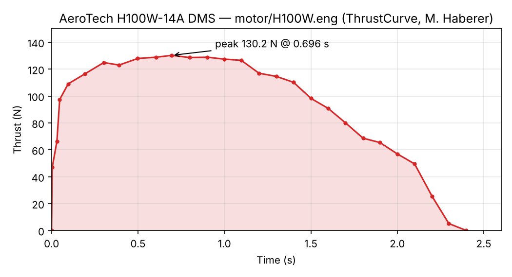

*Figure 1. AeroTech H100W-14A DMS thrust vs time, plotted with matplotlib from `projects/l1-cheap/motor/H100W.eng` (owner's ThrustCurve CSV, contributor M. Haberer). The curve integrates to 228.4 N·s, peaks at 130.2 N at 0.696 s, and ends at 2.40 s. Generated 2026-11-21.*

### 2.2 Case OD and thrust ring: critical for minimum diameter (motor.md §C)
- **Case OD.** No measurement is published. If the 38.10 mm nominal holds, the case has **0.64 mm diametral clearance** in the 38.735 mm tube.
- **Ring.** Factory-glued; AeroTech's DMS thrust-ring advisory (04/2014) says to check it. In this layout **the glue joint carries all of the thrust (137.8 N)**.
- **PROPOSED:** a forward backup stop inside the tube (printed or plywood ring). The sim carries it as a 10 g ESTIMATE "stop/anchor ring" (stability.md §0.1). Owner decision.
- **Heat.** The paper tube touches the case directly, and the case is hot when the ejection charge fires (motor.md §D).
- **Ring length, 2026-11-22:** the fin can now models the ring as **9.525 mm (3/8 in)**, a Rocketry Forum estimate for 38 mm DMS rings. No official AeroTech drawing was found; the owner's photo "agrees (long black aft band)". **PLACEHOLDER, MEASURE** (design.yaml `fin_can_md.thrust_ring_thk_mm`). It sets the 18.5 mm collar (§4.0.1).
- **Retention since rev 8:** the screw-on tail cone's shank face bears on the ring annulus (38.6–41.0 mm) and traps the motor. The M3 insert retention is dropped (design.yaml `fin_can_md.retention`, `tail_cone_bore_d_mm`). design.yaml `motor.retention` still describes the insert proposal (§11.5).

### 2.3 Selection rationale
- **2026-11-20:** owner confirmed the H182R-14A (29 mm DMS), chosen over 29 mm RMS reloads that need a $108.79–$152.99 case (feasibility.md §2–3).
- **2026-11-21:** owner switched to the **H100W-14A (38 mm DMS)**, **minimum-diameter** (design.yaml `motor`; git c717e50, 7544078).
  - The owner's reasons are not recorded in the project files (§11).
  - Cost: $54.99 is $12.70 more than the H182R's low price (motor.md §A).

### 2.4 Delay: drill to 12 s (stability.md §0.4, design.yaml `stability.recommended_delay_s`)
- The delay timer starts at burnout, so **delay = t_apogee − t_burnout** (recovery.md §6).
- **Rev 7 re-solve** (design.yaml `stability`): burnout 2.398 s, apogee 13.64 s, so the coast is **11.24 s**.
  - The Cd ×0.7–1.3 coast range of 12.96–10.01 s is carried over from the rev 5 run (11.19 s nominal then).
- **Recommendation: drill the 14 s delay to 12 s.** Rev 7: deploys at **7.4 m/s nominal, 1231 m, falling** (`deploy_velocity_m_s`, `deploy_altitude_m`).
  - Over the Cd spread: ≤ 17 m/s worst case (rev 5 run). Full table in §6.5.
- **Why not ~7 s (the OR "−6" delay):**
  - The owner's OR and Monte Carlo fly **H100W_DMS-6**. The chute opens at about 2.3 + 6 = 8.3 s, while the rocket is still climbing. OR's 9.4–9.5 s "time to apogee" is therefore cut short by the chute.
  - OR's own deploy speed (137 mph = 61 m/s) matches our 6 s row (56 m/s, rev 5 run).
  - OR's "optimum delay" of 11.6 s is the undisturbed coast, and it agrees with our 11.24 s (rev 7).
  - A 7 s delay deploys at 31–63 m/s while climbing. recovery.md puts the knotted-Kevlar limit at about 27 m/s.
- The motor agent still has to confirm the AeroTech/UDDT drill steps (design.yaml `stability.recommended_delay_s`).
- **Rev 8 / rev 9 and owner checks (2026-11-22/23) all keep 12 s:**

| Basis | Coast to apogee | 12 s delay deploys at | Source |
|---|---|---|---|
| Rev 8 sim (OR weights + extras) | 11.75 s | 2.4 m/s | fin_design_criteria.md Rev 8 |
| Rev 9 sim (OR weights + extras) | 12.09 s | 0.9 m/s | fin_design_criteria.md Rev 9 |
| Flight video sim | apogee 14.0 s, burnout 2.4 s | deploy 14.4 s, "≈ apogee" | out/video/flight.json; main session |
| Owner OR v2 | "optimum delay" 11.5 s | — | OR_Pepto_B_2.pdf |

- **The owner's OR v3 is still set to a 14 s delay; it should be 12 s** (main session; or_component_analysis.md "Owner OR v3").

### 2.5 H182R-14A (29 mm): SUPERSEDED 2026-11-21, kept for history (motor.md, lower part)

| Item | Spec sheet | RSE / .eng | Design value then |
|---|---|---|---|
| Impulse / avg / peak thrust | 218 N·s / 182 N (derived) / 192 N stated, ~205 N plotted | 216.1 N·s / 175.0 N / 200.8 N | sim used the .eng file; 205 N structural |
| Burn / loaded / burnout / length | 1.2 s / 207 g / 92 g / 203 mm | 1.235 s | — |

*Figure 2. SUPERSEDED motor. H182R-14A thrust vs time, plotted from `projects/l1-cheap/motor/H182R.eng` (owner's ThrustCurve RSE file): 216.1 N·s, 175.0 N average, 200.8 N peak at 1.144 s. Generated 2026-11-20.*

---

## 3. Aerodynamics

### 3.1 Fins (design.yaml `aero`, `fin_can_md`, aero.md §0, fin_can_md rev 5–9 specs, owner STEP)

| Item | Rev 7 (SUPERSEDED 2026-11-22 by rev 8/9), owner's OR planform | Rev 6 (superseded) | Rev 5 (ANSYS basis) | Aero rev 4 (PROPOSED, not adopted) | Old (rev 1–3) |
|---|---|---|---|---|---|
| Count | 3 | 3 | 3 | 3 | 3 |
| Root / tip chord | **50.0 / 30.0 mm** | 50.0 / 30.0 | 50.0 / 30.0 | 50 / 30 | 100 / 40 |
| Span | **43.18 mm** | 43.18 | 43.18 | 77 | 40 |
| LE sweep (= Cr − Ct, TE flush with aft face) | **20.32 mm** | 20.32 | 20.32 | 20 | 60 |
| Thickness | **12 mm root → 6 mm tip, linear** (`aero.fin_thickness_mm`, `fin_tip_thickness_mm`) | same | 6.0 constant | 6 | 5 |
| Section / TE | NACA 4-digit symmetric; **blunt TE 8.0 mm at the root → 0.84 mm at the tip** (`fin_can_md.te_root_thickness_mm`, PROPOSED) | TE 2.0 → 0.84 | TE 0.84 | same | same |
| Root fillet | **r 6 mm** (PROPOSED) | r 6 | r 4 (PROPOSED) | — | — |
| Insert-boss wall | **3.67 mm** (2.67 + `boss_extra_wall_mm` 1.0, PROPOSED) | 2.67 | 2.67 | — | — |
| Fin root diameter | on the sleeve, 46.795 mm (r = 23.40) | same | same | same | rev 3: sleeve |
| Margin claimed | **2.08 cal with the 65 g nose** on the CFD CP and the OR CG (or_component_analysis.md). In-house: 1.81 cal with 73 g on Barrowman (design.yaml `stability`, superseded basis) | 1.82 cal with 71 g (main session) | OR 2.08 cal (owner's mass model) | 2.00 cal at zero ballast (aero's mass model) | −0.70 (unstable, aero.md §0.3) |

- **Aero's optimisation** (aero.md §0.5) targeted 2.0 cal with zero ballast and recommended 50/30/77/6. Its 816.5 mm CG assumed the chute pack on the motor and a 52.7 g nose.
- **The owner then chose their OpenRocket fins** (design.yaml `aero`, 2026-11-21). Rev 5 builds them; rev 6 keeps the planform and thickens the root for landing loads (§4.3.7).
- **Rev 7** keeps the rev 6 planform and thickness. It blunts the root TE to 8 mm and adds 1 mm around the insert boss, where the FEA peaks sat (§4.1, §4.4.7). Criterion C7 requires the owner's planform to be kept (fin_design_criteria.md).
- **Fillet:** 6 mm is the largest that does not collide with the sleeve bore geometry (spec `root_fillet_r_mm`). The owner's 3–5 mm range is not confirmed.
- Barrowman CP does not depend on thickness, so the rev 7 Barrowman CP is unchanged at 804.7 mm (design.yaml `stability.cp_from_nose_mm`). The 3D CFD on the rev 7 OML gives **836.3 mm** (§3.6.2).
- Thicker fins and the blunt TE, now **8 mm at the root**, add drag that the sim's Cd table does not model (§3.4).

**Current fins (2026-11-22/23): rev 9 (design side) vs the owner's SolidWorks fin can (owner basis)**

| Item | **Rev 9** (fin_can_md rev 9 spec, design.yaml) | **Owner SolidWorks** (`owner_cad/L1-Rocket-FinCan.STEP`; main session overlay) |
|---|---|---|
| Count | 3 | 3 |
| Root / tip chord | 50 / 30 mm | **~52** / 30 mm |
| Span | 43.18 mm (on r 23.40) | **46.1 mm** (fin tip r 69.5 on the r 23.40 sleeve), **INTENTIONAL (owner)** |
| LE sweep | 20.32 mm | 18.8 mm |
| Thickness | 12 mm root → 6 mm tip | not stated in the sources |
| Root fillet | r 6 mm (PROPOSED) | **none** (root-fillet region thickness 11.1 mm vs rev 9 13.4 mm, main session; or_component_analysis.md gives 11.2 vs 13.6) |
| TE at the root | **2.5 mm** (OWNER), tapering to 0.84 | **1.0 mm** (main session) |
| TE junction | concave **R6 skirt** into the collar (PROPOSED) | not described |
| Insert bosses | **none** (OWNER) | none (tail cone retention) |

- **Rev 8** kept the rev 7 fins (8 mm blunt root TE, solid bosses) and added 45° TE gussets (fin_design_criteria.md Rev 8).
- **Rev 9** removed the bosses and thinned the root TE to 2.5 mm, because "the 8 mm blunt TE only existed to bury the insert bosses" (design.yaml `fin_can_md.te_root_thickness_mm`).
- **Overlay result (main session, 2026-11-23):** at true scale the two fin cans are "geometrically almost identical". The differences are span +2.9 mm, root 52 vs 50 mm, root-fillet thickness 11.1 vs 13.4 mm, and TE 1.0 vs 2.5 mm. CFD comparison in §3.6.4.

### 3.2 Barrowman centre of pressure (stability.md §0.2, aero.md §0.3)

Reference point: the nose tip. All lengths in mm, reference diameter d = 41.275 mm.

**Nose:** CNα,n = 2 and X_n = k·Ln, with k = 0.466 for a tangent ogive.

**Body step and fairing** (aero.md §0.3):
- Step 41.275 → 43.135: CNα = 2[(d₁/d)² − 1].
- Fairing cone 43.135 → 46.795: CP at x = L/3·[1 + (1 − d₁/d₂)/(1 − (d₁/d₂)²)].

**Fins:**
- CNα,f = K_fb · 4N(s/d)² / [1 + √(1 + (2 l_m/(Cr + Ct))²)].
- K_fb = 1 + r/(s + r), with r = 23.40 mm (sleeve radius).
- l_m = √(s² + (xs + Ct/2 − Cr/2)²).

Symbols: N fin count; s span; Cr, Ct root and tip chord; xs LE sweep; l_m mid-chord line length; K_fb fin–body interference factor.

**Total:** CP = Σ(CNα,i · X_i) / Σ CNα,i.

| Component (owner planform, rev 5 = rev 6 = rev 7) | CNα | X (mm) |
|---|---|---|
| Nose | 2.000 | 76.9 |
| Step | 0.184 | 910.7 |
| Fairing | 0.386 | 920.8 |
| Fins | 7.117 | 1000.2 |
| **Total CP (Barrowman M0)** | | **804.7** (RocketPy 804.6; 810.9 at M 0.5; 822.0 at M 0.8) |

- Without the sleeve: Barrowman 792.8, RocketPy 792.7. The sleeve moves the CP 12 mm aft (stability.md §0.3).
- The components sum to a **total CNα of 9.69** (or_component_analysis.md, CFD table).
- design.yaml `aero.cp_from_nose_tip_mm` = 899.0 is for the **77 mm-span** aero proposal, not the owner's fins (§11).

**What the 3D CFD says about this method (§3.6.2).** The CFD CP is **836.3 mm**, 31 mm aft of Barrowman's.
- The nose term checks out: CFD 2.01 at 78.0 mm against 2.00 at 76.9 mm here.
- The fins alone are close: CFD 7.70 against 7.117 (which includes K_fb).
- **What Barrowman lacks:** the body around the fins carries 3.01 in the CFD, and the tube plus fairing step carry 1.34 against 0.57 here. Both act far aft, so the CP moves aft.
- **Barrowman's CP is therefore conservative** (too far forward) for this rocket. The 804.7 mm value stays in design.yaml as the stable-side figure.

### 3.3 OpenRocket comparison (or_component_analysis.md, stability.md §0.3)

OR config H100W_DMS-6, Mach 0.300, AoA 0, ref length 1.625 in (41.275 mm). OR totals: 637 g, CG 29.442 in, **CP 32.914 in (836.0 mm)**, CNα 11.364.

| Fin CNα, same fins (50/30/43.18/20.32, 3 fins, no sleeve) | Value |
|---|---|
| Barrowman (RocketPy / our sim) | 6.97 |
| Lifting-surface slope × N/2 × interference, N = 3 | 7.08 |
| Same, **N = 4** | **9.43** |
| **OpenRocket** | **9.364** |

- OR's fin CNα is ~34 % above two independent 3-fin methods, and within 1 % of the 4-fin value. RocketPy with 4 fins gives a CP of 835.0 (M0) and 837.0 (M 0.3). **Check the fin count in the .ork.**
- The nose agrees exactly: CNα 2, CP 3.018 in.
- The CG side reconciles: with OR's mass assumptions we get 750.2 mm against OR's 750.3 (stability.md §0.3).
- **OR's model also contains:**
  - a 2 g **bulkhead** at 19.461 in, between the chute (13.992 in) and the motor (37.55 in), which holds the pack forward;
  - a 6 g inner tube at 37.45 in (there is no inner tube in the min-diameter layout);
  - a 123 g body tube (our ESTIMATE is 93.6 g);
  - owner overrides for the nose (80 g) and the fin set (120 g).
- **Rev 5 basis (stability.md §0.3):** 70 g gave 1.81 cal on our CP and about **2.57 cal on OR's CP** (FAIL high on that reference); if OR is right, 1.8 cal needs about 40 g. The OR-CP margin was not re-stated for rev 6 / 71 g or rev 7 / 73 g.
- **RESOLVED 2026-11-22 in favour of OpenRocket.** The 3D CFD on the 3-fin rev 7 OML gives **836.3 mm** against OR's 836.0 mm (§3.6.2).
  - A 3-fin CFD model reproduces OR's CP, so a fin-count error is no longer needed to explain the gap. The .ork fin count is still unconfirmed.
  - The CNα totals still differ: CFD 14.06, OR 11.364 (§11.4).
- **Headless OpenRocket** (sim lab, `.claude/agents/rocket-simlab.md`) can read the fin count, delay and CP directly from the owner's model. It is **pending the .ork upload** to `projects/l1-cheap/openrocket/` (§11.4).

**OpenRocket export, 2026-11-22** (owner "test.pdf", Pepto B. #2; or_component_analysis.md)
- **Inputs:**
  - nose **65 g TOTAL** (PETG ogive, 6.5 in);
  - tube 34 in / 123 g;
  - 3 fins 0.35 in thick, mass override **90 g** (= rev 7 fin can);
  - **28 in ripstop chute, 38 g**;
  - elastic shock cord 122 in (a placeholder: the owner keeps the Kevlar);
  - ABS bulkhead; inner tube 6.1 in.
- **Results, H100W_DMS-6:**

| Mass | CG | CP | Margin | Apogee | Vmax | Off pad | Optimum delay | Landing |
|---|---|---|---|---|---|---|---|---|
| 594 g | 29.545 in (750.4 mm) | 32.914 in (836.0 mm) | **2.07 cal** | 3945 ft (1202 m) | 615 mph | 41.5 mph | 11.6 s | 11.8 mph |

- The H182R-6 run gives 3420 ft (superseded motor).
- **SUPERSEDED 2026-11-23** by the owner's OR files `OR_Pepto_B_2.pdf` and `OR_Pepto_B_3.pdf` (§3.3.1–3.3.2).

#### 3.3.1 Owner OpenRocket "Pepto B. #2", v2 (2026-11-23; owner_cad/OR_Pepto_B_2.pdf, or_component_analysis.md)

**Inputs** (OR components):
- nose cone 6.5 in, 0.132 lb (59.9 g); tube 29.25 in exposed;
- transition 1.625 → 1.842 in over 0.75 in (34.9 g); sleeve 1.842 in OD × 4 in (45.8 g);
- 3 trapezoidal fins, 0.315 in thick (15.9 g); tail transition 1.842 → 1.638 in over 1.909 in (15.9 g);
- 28 in chute. Total length 1077 mm, "the same as the CFD OML".

| Mass | CG | CP | Margin (ref 1.625 in) | Apogee | Max speed | Optimum delay | Landing |
|---|---|---|---|---|---|---|---|
| 594 g (1.31 lb) | 29.552 in (750.6 mm) | 32.896 in (835.6 mm) | **1.82 cal** | 4404 ft | 614 mph (M 0.80) | 11.5 s | 11.9 mph |

- **Against the CFD of the owner STEP** (CP 809.9 mm, §3.6.4) the OR CP is **25.7 mm aft**. With OR's CG that gives **1.44 cal**.
- For 1.8 cal on the CFD CP the CG must be 735.6 mm: about **+15 g of nose ballast** (ESTIMATE, lever about 610 mm, 594 g).

#### 3.3.2 Owner OR v3 (2026-11-23; owner_cad/OR_Pepto_B_3.pdf): geometry updated toward the STEP

| Mass | CG | CP | Margin as OR reports it | Apogee |
|---|---|---|---|---|
| 649 g (1.43 lb) | 30.502 in (774.8 mm) | 33.918 in (861.5 mm) | "1.85 cal" | 4122 ft |

**Issues found** (or_component_analysis.md "Owner OR v3"; main session):
1. **Caliber reference changed.** OR now uses the maximum diameter, the 1.842 in sleeve, as its reference. The owner's OR has no reference-length option. On the 1.625 in tube the same rocket is **2.10 cal**. Convert with **SM = (CP − CG) / 1.625 in**.
2. **Fin offset missing.** The −0.59 in offset was not applied, so the fins sit **15 mm too far aft** (TE flush with the sleeve bottom).
3. **Solid fairing.** The fairing transition is filled solid (0.17 lb, 77 g). The OR fin can totals **146 g against ~95 g** for the real part, so the CG is too far aft.
4. **Still set:** delay 14 s (should be 12), nose 0.132 lb (should be 0.143), elastic cords (should be Kevlar).

- **With the CFD CP (809.9 mm):** the v3 CG gives 0.85 cal (tube ref). After the mass fix (CG ≈ 752 mm, ESTIMATE) it is **≈ 1.40 cal**, ESTIMATE; about **+15 g** of nose ballast for 1.8 cal (main session).
- **OR's CP sits 26–50 mm aft of the CFD** across v2 and v3 (main session).

**Recommended OR component mapping** (main session summary given to the owner; not in a project file):

| OR component | Recommended entry |
|---|---|
| Body tube | 28.57 in exposed |
| Fairing transition | 1.704 → 1.842 in over 1.594 in (hollow, not solid) |
| Sleeve | 4.646 in |
| Fins | root 2.05 / tip 1.18 / height 1.815 / sweep 0.74 / thickness 0.35 in; offset −0.59 in |
| Inner tube | 5.4 in at −0.83 in, mass 0.043 lb |
| Tail transition | 1.841 → 1.638 in over 1.177 in |

- The v2 entries (tube 29.25 in, transition over 0.75 in, sleeve 4 in, tail over 1.909 in) differ from this mapping. The mapping is the main session's recommendation for the next OR revision.

### 3.4 Drag and Mach

| Source | M 0.1 | M 0.5 | M 0.7 | Fins it describes |
|---|---|---|---|---|
| Sim input `stability.assumptions.cd_vs_mach` (ESTIMATE) | 0.70 | 0.76 | 0.83 | old 100/40/40/5 fins |
| design.yaml `aero.cd_estimate` (ESTIMATE) | 0.73 | 0.89 | 1.13 | 77 mm aero proposal |

- Neither table is for the owner's fins, and neither includes the thick 12 mm root or the rev 7 **8 mm blunt root TE** (§11). Above M 0.7 the sim holds Cd flat (ASSUMPTION, no transonic rise).
- **Rev 7 re-solve:** Vmax **248.3 m/s, M 0.732**, max q 36.7 kPa (design.yaml `stability`). Rev 5 run: 250.0 m/s, M 0.737, 37.3 kPa.
- **Owner's OR:** 550 mph (245.9 m/s), M 0.726. That was within 1.7 % of the rev 5 run (stability.md §0.5). The 2026-11-22 export (594 g) gives **Vmax 615 mph**. The in-house sim with OR weights gives **M 0.785** (main session, case A).
- **3D CFD axial force at 100 m/s (M 0.29), α 4° (§3.6.2):**
  - CA ≈ **0.71**, made up of 0.375 from surface pressure and 0.33 from a **flat-plate friction ESTIMATE**;
  - aero's Cd ESTIMATE at M 0.1 is 0.73.
  - The CFD figure is only rough: wall functions, no prism layers. It does model the rev 7 thick root and the 8 mm blunt TE.
- **Mach 0.8 CFD (first-order, not yet trusted):** pressure CA 0.958 at 2500 iterations (1.138 at 500); total ≈ 1.23 with the flat-plate friction ESTIMATE (§3.6.2).
- **Boattail designs, same CFD method (100 m/s, α 4°; §3.6.3–3.6.4):**

| OML | CA pressure | CA total (with flat-plate friction ESTIMATE) | vs rev 7 | Source |
|---|---|---|---|---|
| Rev 7 (flat base) | 0.375 | 0.709 | — | `cfd_a4_result.json` |
| Rev 8 (20 mm boattail to 43.0) | 0.266 | **0.608** | −14 % | `cfd_r8a4_result.json` |
| **Rev 9** (30 mm boattail to 41.6, 40 mm fairing) | 0.232 | **0.578** | **−18 %** | `cfd_r9a4_result.json` |
| Owner STEP (own_a4) | 0.252 | **0.600** | — | `cfd_own_a4_result.json` |

- Rev 8: "base + fin pressure drag 0.360 → 0.236" (fin_design_criteria.md Rev 8).
- The rev 8 and rev 9 sims scale Cd by **×0.857** (fin_design_criteria.md; `tools/flight_export.py`). The sources do not state how the factor was derived (§11.5).

### 3.5 Flutter (ansys_results.md Case 2; method aero.md §4)

Method: NACA TN 4197, via Apogee *Peak of Flight* #291.

V_f = a · √( G / [ 1.337·AR³·P·(λ + 1) / (2(AR + 2)(t/Cr)³) ] ), with AR = s²/A_fin

Symbols: V_f flutter speed (m/s); a speed of sound (m/s); G shear modulus (Pa); P air pressure (Pa); λ = Ct/Cr taper ratio; t thickness; Cr root chord; A_fin fin area.

| Owner fins 50/30/43.18/6 (rev 5), sea level | G | V_f | V_f / Vmax (250 m/s) |
|---|---|---|---|
| Conservative PETG set (the one ANSYS used) | 394 MPa | ≈ 1330 m/s | **≈ 5.3×** |
| Higher G | 620 MPa | ≈ 1670 m/s | ≈ 6.7× |

- The estimate comes from the main session and is recorded in ansys_results.md. The G values are not measured; see the material caveat in §4.3.
- **Rev 6 and rev 7:** not recomputed. The tip stays 6 mm and the root doubles to 12 mm (design.yaml notes the taper is for flutter and mass).
- **Criterion C5** asks for V_f ≥ 1.5 × Vmax (250 m/s) at G = 394 MPa. fin_design_criteria.md argues that extra thickness only raises V_f, so C5 holds by argument from the rev 5 value; no rev 7 calculation exists.
- The ANSYS modal run (§4.3, rev 5) gives a first mode of 567.9 Hz.
- design.yaml `aero.fin_flutter_velocity_m_s` is still TBD. Its G_req values (71 MPa at 268 m/s) are for the 77 mm proposal.

### 3.6 CFD: tools and results

#### 3.6.1 2D fin-section domains: `tools/fluent_domain.py` (generated for rev 6)
- Writes Fluent-ready 2D C-domains around the fin root and tip sections into `out/cfd/`: STEP with named edges, airfoil CSVs, check PNGs and `fluent_setup.md`.
- **Rev 6 sections:** root 50 × 12 mm with a 2.0 mm TE; tip 30 × 6 mm (TE 0.84). The tool reads `fin_tip_thickness_mm` and `te_root_thickness_mm` from design.yaml.
- **Not regenerated for rev 7:** the `out/cfd/` files predate the rev 7 build, so the root domain still has the 2.0 mm TE, not 8 mm (§11).
- Domain size defaults to 20 chords. Setup: density-based, ideal gas, Sutherland viscosity, k-ω SST, AoA 0, 2, 4 and 6°.
- First-cell heights (y+ ≈ 1, ESTIMATE from flat-plate Cf = 0.026 Re^-1/7) use H100W speeds from the rev 5 run: rail exit 24.0 m/s to Vmax 250.0 m/s (out/cfd/fluent_setup.md). Rev 7: 23.8 to 248.3 m/s (§6.4).
- **Still stale in fluent_setup.md:** "compressible up to Mach 0.83" (H182R basis; H100W Vmax is M 0.732 in the rev 7 re-solve), and it points to `fin_can_rev2_fin_only.step` for 3D (§11).

#### 3.6.2 3D CFD of the whole rocket: OpenFOAM, 100 m/s, α 4° (2026-11-22; rev 7 OML, SUPERSEDED for flight)

> The rev 7 CP of 836.3 mm is superseded for flight by the boattail designs: rev 9 827.4 mm (§3.6.3) and the owner model 809.9 mm (§3.6.4). The method, validation and imagery below still apply.

Sources: or_component_analysis.md ("3D CFD settles the CP", "Mach 0.8 CFD: INTERIM"); `out/cfd/of_a4/result.json` (= `report/figures/cfd/cfd_a4_result.json`); `out/cfd/of_m08/result_interim.json`; docstrings of `tools/cfd_rocket.py`, `tools/cfd_post.py`, `tools/cfd_figures_extra.py`, `tools/paraview_views.py`, `tools/paraview_gallery.py`.

**Result in one line:** the CFD puts the CP at **836.3 mm from the tip**. OpenRocket gives 836.0 mm and Barrowman/RocketPy 804.7 mm. **The OR–Barrowman gap is settled in favour of OpenRocket.**
- This replaces the 2026-11-21 plan for an owner Fluent run (M 0.3, α 0/2/4°). The run was done in-house with OpenFOAM at one angle.
- The cases are `out/cfd/of_a4` (100 m/s) and `out/cfd/of_m08` (Mach 0.8, INTERIM).

##### Geometry: whole-rocket OML
- `tools/rocket_oml.py` → `out/cfd/rocket_oml.step` and `.stl`: a solid, watertight outer mould line of the nose, tube and fin can.
- **Rev 7 fin can:** `tools/cfd_rocket.py` builds from "current design.yaml: rev 7 fin can"; or_component_analysis.md calls it the "rev 7 fin can OML". The STL on disk is dated 2026-11-22, after the rev 7 STEP.
- Length **1029.02 mm** (`result.json` `case.L` = 1.02902 m). design.yaml `stability.total_length_mm` is 1030.7 (§11.5).
- Meshing conventions (not part dimensions): **0.3 mm tip flat** (`TIP_FLAT_R_MM`); insert holes, motor and bore filled.

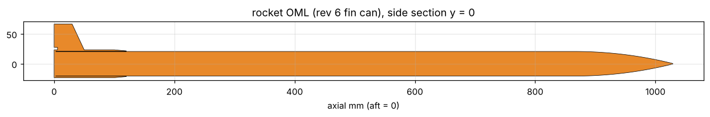

*Figure 22. Whole-rocket OML, side section y = 0, aft face at 0 mm. This image is the **rev 6** render of 2026-11-21. It was not regenerated when the OML was rebuilt for rev 7, which has the 8 mm blunt root TE and the thicker boss. Source: `out/cfd/rocket_oml_side.png`, `tools/rocket_oml.py`.*

##### Method

| Item | Value | Source |
|---|---|---|
| Solver | **OpenFOAM v1912 `simpleFoam`**: steady, incompressible RANS | `out/cfd/of_a4/log.simpleFoam` header; or_component_analysis.md |
| Turbulence model | **k-ω SST**, **wall functions, no prism layers** (y+ ~100–300). Pressure (normal force, CP) is the target; skin friction and drag are rough | `tools/cfd_rocket.py` docstring |
| Domain | **Half model**: a symmetry plane at y = 0 through fin 0. Fin 0 lies in the plane, and fins 1 and 2 mirror each other. Forces are doubled in post | `tools/cfd_rocket.py` |
| Frame | x aft from the nose tip; z in the pitch plane through fin 0 (fin 0 points +z) | `tools/cfd_rocket.py` |
| Mesh | `snappyHexMesh`, **590,365 cells** ("Mesh OK", max skewness 3.17), **~1.6 mm cells on the fins**. Surface refinement level 4–5, feature edges level 5, near-body region level 3, wake region level 2 | `log.checkMesh`; or_component_analysis.md; `tools/cfd_rocket.py` |
| Flow | **100 m/s (M 0.29)**, **α = 4°**: U = (99.756, 0, 6.976) m/s. Sea-level air, ρ = 1.225 kg/m³, ν = 1.5e-5 m²/s. Re_L = 6.86e6 | `result.json`; `tools/cfd_rocket.py` |
| Reference | d = **41.275 mm** (owner/OR reference), A = π d²/4. Moments about the nose tip | `tools/cfd_rocket.py` |
| Iterations | 800. Results read at 600 and 800 | `result.json` |
| Forces | **Integrated from surface pressure** in `tools/cfd_post.py`, because the `forces` and `wallShearStress` function objects crash in this OpenFOAM build | `tools/cfd_post.py` docstring |
| Friction | **Flat-plate ESTIMATE** added to the axial force only: turbulent Cf = 0.074 Re^-0.2 on the wetted area (0.1405 m²) | `tools/cfd_post.py`; `result.json` |

**Equations** (`tools/cfd_rocket.py`, `tools/cfd_post.py`)
- Surface force: **F = Σ ρ · p_k · n · A_f** over the wall faces, then doubled for the half model.
  - p_k is OpenFOAM's kinematic pressure (m²/s²), n the face unit normal (it points into the rocket), A_f the face area (m²) and ρ = 1.225 kg/m³.
- Coefficients: **C_N = F_z / (q · A)** and **C_A,p = F_x / (q · A)**, with **q = ½ ρ U²**.
  - F_z is the normal force in the body frame and F_x the axial force (N); U = 100 m/s; A = π d²/4 (m²).
- Normal-force slope: **CN_α = C_N / α**, with α in rad.
  - This is a one-angle estimate: it assumes C_N = 0 at α = 0, which holds by symmetry, and a linear slope up to 4°.
- Centre of pressure: **X_CP = −M_y / F_z**, measured from the tip (m).
  - M_y is the pitching moment about the tip (N·m).
- Friction: **C_A,f = C_f · S_wet / A**, with **C_f = 0.074 Re_L^-0.2** and **Re_L = U L / ν**.
  - S_wet is the wetted area (m²) and L the rocket length (m).
- Static margin: **SM = (X_CP − X_CG) / d**, in calibers (§6.1).

The 2026-11-21 plan (CNα from a slope over α = 0, 2, 4°, and X_CP from C_m) was not used. Only α = 4° was run.

##### Convergence and validation
- **Converged.** Initial residuals fell to 1e-7 (p) and 1e-8 (U, k, ω). The CP moved **−5.25e-5 mm** between iterations 600 and 800 (`cfd_a4_result.json` `CP_change_600_800_mm`; `CP_change_last_quarter_mm` in `out/cfd/of_a4/result.json`), which is below 0.001 mm.
- **Nose check (validation):** the CFD nose gives CNα **2.01 at 78.0 mm**. Slender-body / Barrowman theory gives **2.00 at 76.9 mm** (§3.2).
- **Reproduced on the owner's PC:** WSL Ubuntu, OpenFOAM 2406, 8 cores gave **CP 836.30 mm, CNα 14.058**, agreeing to 0.01 mm (main session, 2026-11-22). These values are not recorded in a project file yet (§11.4).
- **Not done:** a grid study, a second angle of attack, and a comparison with experiment.

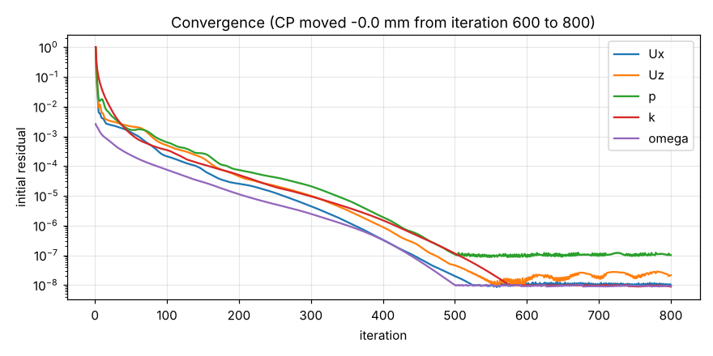

*Figure 32. Initial residuals vs iteration for Ux, Uz, p, k and ω. All fall steadily to a plateau after about 500–600 iterations: p near 1e-7, the rest near 1e-8. **Look at** the flat tails from 600 to 800. Over that span the CP moved less than 0.001 mm (the title rounds it to "−0.0 mm"). Source: `out/cfd/of_a4/figures/cfd_convergence.png`, `tools/cfd_post.py`, case a4, 2026-11-22.*

##### Results: CP and normal force (100 m/s, α 4°, ref 41.275 mm)

| Item | **CFD** | Barrowman / RocketPy | OpenRocket |
|---|---|---|---|
| CP from the tip | **836.3 mm** (836.313 at iteration 800) | 804.7 mm | 836.0 mm |
| CNα total (/rad) | **14.06** (14.0586) | 9.69 | 11.364 (§3.3, M 0.3, AoA 0) |
| Nose CNα (check) | 2.01 at 78.0 mm | 2.00 at 76.9 mm | 2 at 3.018 in |
| Fins only | **7.70** | 7.12 (incl. interference) | 9.364 (fin set) |
| Body around the fins (sleeve, carry-over) | **3.01** | (inside the 7.12 factor) | — |
| Tube + fairing step | **1.34** | 0.57 (step + fairing only) | — |
| CA | 0.375 pressure + 0.33 flat-plate friction **ESTIMATE** = **0.71** | Cd 0.73 ESTIMATE (`aero.cd_estimate`, M 0.1) | — |

Sources: or_component_analysis.md CFD table; `result.json` (CN 0.98148, Fz 8.044 N, My −6.727 N·m, Fx 3.075 N, CA_friction_flatplate 0.3336).

- **Why the CFD CP is further aft:** of the 14.06 total, 3.01 comes from the body around the fin can and 1.34 from the tube and fairing step. That lift sits near the tail. Barrowman leaves out most of it, which puts its CP **31 mm too far forward (conservative)**.
- **CNα does not match OR (14.06 vs 11.364)**, even though the CP does. OR's run is at M 0.3 and AoA 0; the CFD is at α 4°. The sources do not reconcile the totals (§11.4).

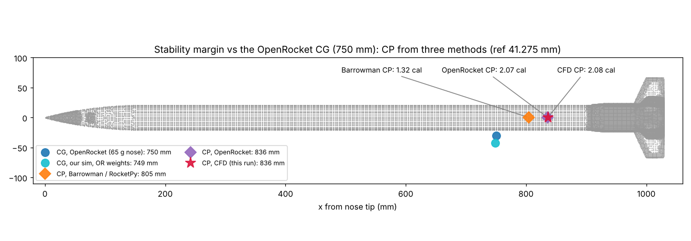

*Figure 33. The rocket outline with the CG and CP markers, and the margin on the OpenRocket CG (750 mm, 65 g nose).*
- *Two CG markers: OpenRocket 750 mm and our sim with OR weights 749 mm.*
- *Three CP markers: Barrowman/RocketPy 805 mm (1.32 cal), OpenRocket 836 mm (2.07 cal) and the CFD 836 mm (2.08 cal).*
- ***Look at** how the CFD star sits on the OR diamond, while the Barrowman CP is about 31 mm forward.*

*Source: `out/cfd/of_a4/figures/cfd_cp_comparison.png`, `tools/cfd_post.py`, case a4, 2026-11-22.*

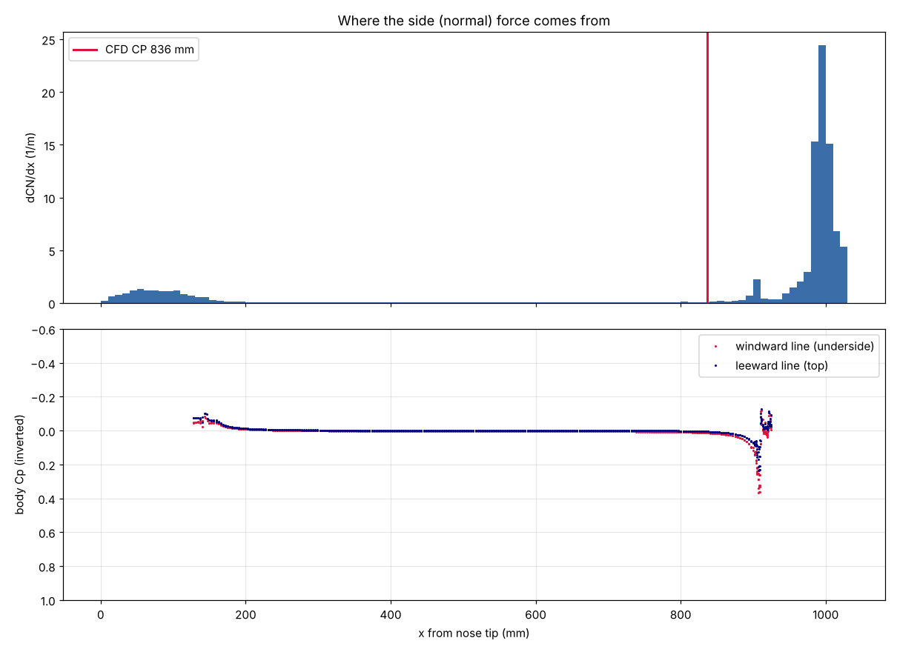

*Figure 34. Where the normal force comes from.*
- *Top: dCN/dx along the rocket, with the CFD CP marked at 836 mm. There is a small hump on the nose and almost nothing along the tube. A spike at the fairing step is followed by the large peak over the fins.*
- *Bottom: body-surface Cp along the windward and leeward lines. The two lines separate only at the nose shoulder and at the fin can.*
- ***Look at** how most of the side force is concentrated at the fin can. That is why the CP sits so far aft.*

*Source: `out/cfd/of_a4/figures/cfd_force_distribution.png`, `tools/cfd_post.py`, case a4, 2026-11-22.*

##### Per-fin loads (`tools/cfd_figures_extra.py`; or_component_analysis.md)
- **Fin 0** lies in the pitch plane, edge-on to the crossflow. It produces **no lift**: both of its faces see the same pressure by symmetry.
- **Fin 1** (at 120°; fin 2 is its mirror) gives **4.42 /rad normal to the fin**, of which **3.82 /rad acts in the pitch plane**.
- **Fins 1 + 2: CNα 7.65 /rad.** The component table's "fins only" value is 7.70 /rad. The sources do not explain the 0.05 difference between the two integrations.

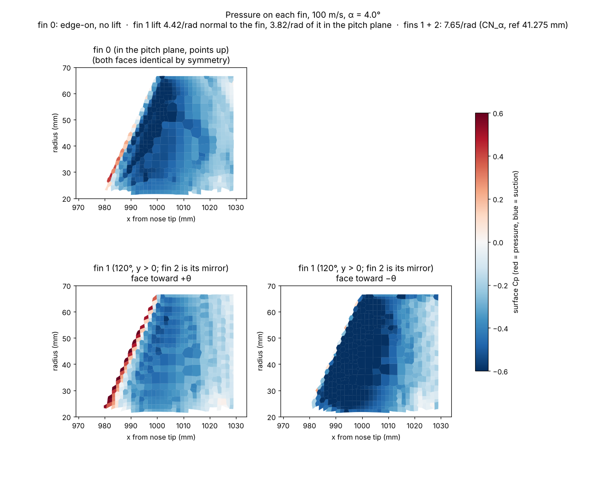

*Figure 35. Surface Cp on each fin, plotted as x vs radius.*
- *Fin 0 (top): symmetric suction. Both faces are identical, so it makes no lift.*
- *Fin 1, face toward +θ (bottom left): a thin high-pressure band along the leading edge, with moderate suction behind it.*
- *Fin 1, face toward −θ (bottom right): strong suction, saturating the −0.6 end of the colour scale, over the forward half.*
- ***Look at** the difference between the two fin 1 faces: that is the lift, 4.42 /rad normal to the fin.*

*Source: `out/cfd/of_a4/figures/cfd_fin_pressure.png`, `tools/cfd_figures_extra.py`, case a4, 2026-11-22.*

##### Stability with the owner's 65 g nose (or_component_analysis.md)

| CG case (65 g nose) | CG from tip | Margin on the **CFD CP** (836.3) | Owner band 1.6–2.0 |
|---|---|---|---|
| OpenRocket CG | 750.4 mm | **2.08 cal** | above the 2.0 upper edge |
| With the real extras | 753 mm | **2.01 cal** | above the 2.0 upper edge |
| Chute pack slides onto the motor | 788 mm | **1.17 cal** (still stable) | below the band |
| Same OR CG on the Barrowman CP (804.7) | 750.4 mm | 1.32 cal (figure 33) | below the band (conservative) |

- The CFD is incompressible. The source expects the CP to move aft with Mach, which would add margin. The Mach 0.8 run below does not yet confirm this.
- The flight numbers with OR weights are in §6.0.

##### Flow-field figures (case a4, 100 m/s, α 4°; matplotlib)

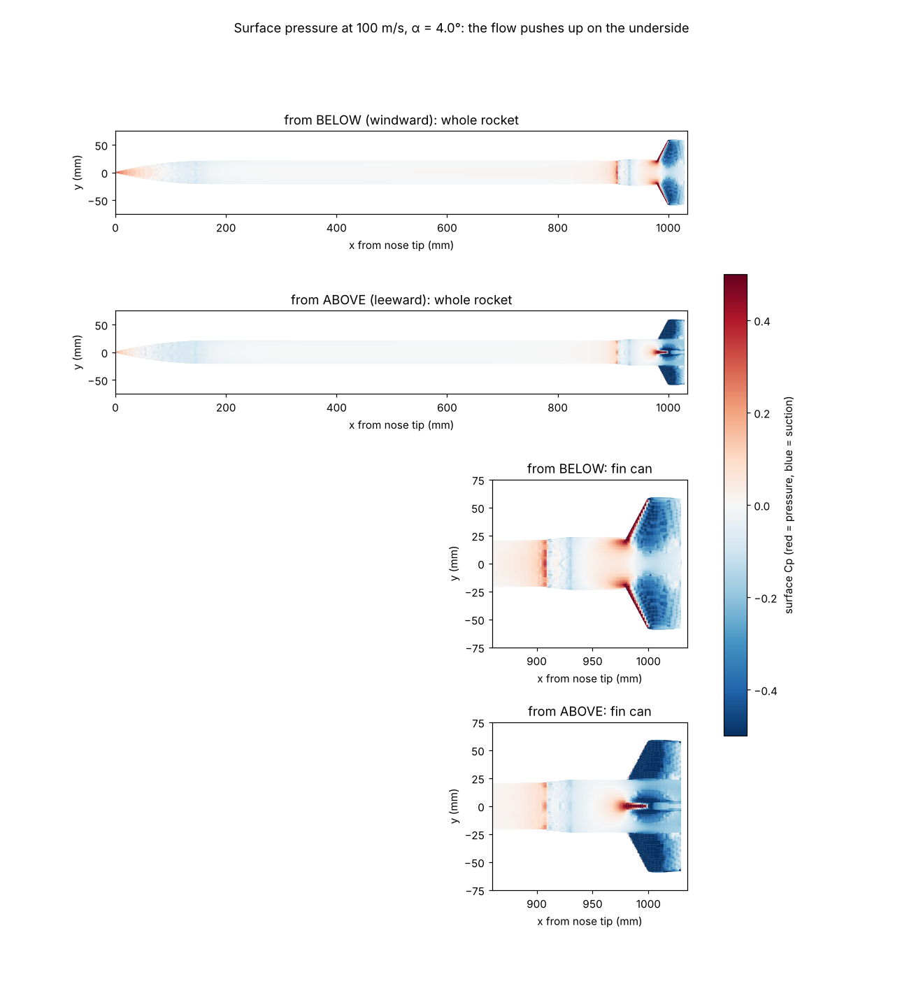

*Figure 36. Surface Cp on the whole rocket and the fin can, seen from below (windward) and from above (leeward). Red is pressure and blue is suction.*
- *From below: red along the fin leading edges and at the fairing step.*
- *From above: strong blue suction over the fins.*
- ***Look at** the red underside and blue topside of the fin can. Together they push the tail up, and that is the restoring force.*

*Source: `out/cfd/of_a4/figures/cfd_surface_cp.png`, `tools/cfd_post.py`, case a4, 2026-11-22.*

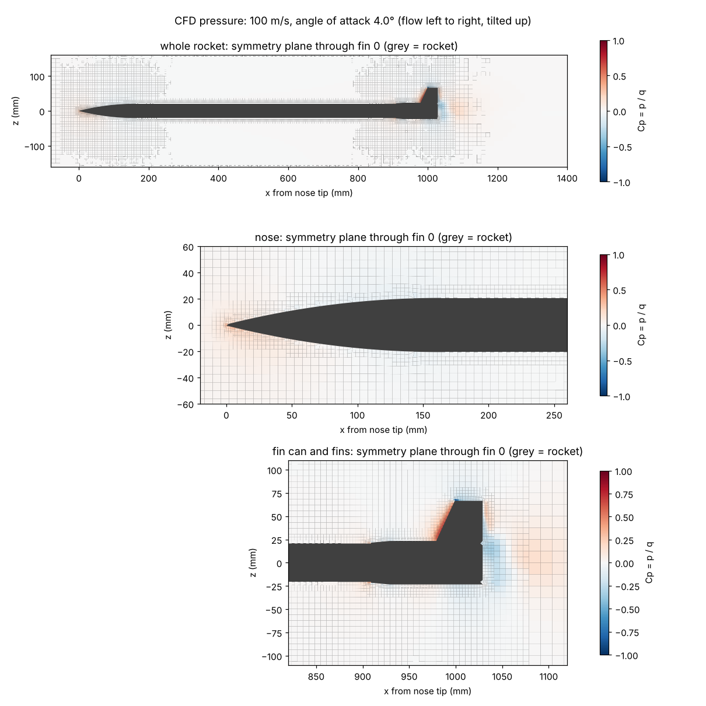

*Figure 37. Pressure Cp = p/q in the symmetry plane through fin 0: whole rocket, nose, and fin can, each with the mesh drawn.*
- *There is a stagnation zone at the tip.*
- *The fin 0 leading edge is red (high pressure).*
- *Behind the base there is blue suction, then a mild recovery.*
- ***Look at** the mesh refinement boxes around the nose and the fin can, and how small the pressure disturbance along the tube is.*

*Source: `out/cfd/of_a4/figures/cfd_pressure_plane.png`, `tools/cfd_post.py`, case a4, 2026-11-22.*

*Figure 38. Speed |U| in the symmetry plane through fin 0, in the same three views as figure 37.*
- *The flow speeds up slightly over the nose shoulder and around the fin tip (yellow).*
- *A slow wake (dark) trails behind the blunt base.*
- ***Look at** the wake: it starts at the full base diameter and is still clearly visible at the right edge of the plot. That is base drag.*

*Source: `out/cfd/of_a4/figures/cfd_velocity_plane.png`, `tools/cfd_post.py`, case a4, 2026-11-22.*

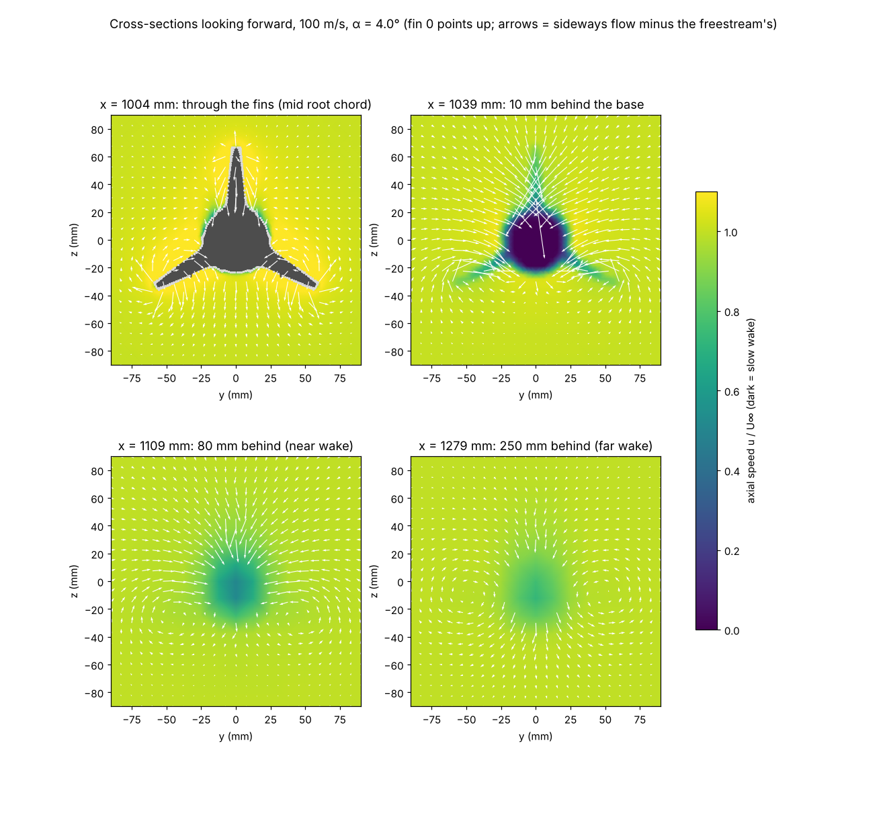

*Figure 39. Cross-sections looking forward, at x = 1004 mm (mid root chord), 1039 mm (10 mm behind the base), 1109 mm (80 mm behind) and 1279 mm (250 mm behind). Colour is axial speed u/U∞; arrows are the sideways flow minus the freestream.*
- *At mid-chord the flow goes around the three fins.*
- *Behind the base there is a dark dead-air core with fin-wake arms.*
- *Further aft, a pair of counter-rotating vortices forms and the wake drifts downward.*
- ***Look at** the vortex pair in the lower panels. It is the trailing-vortex signature of the lift.*

*Source: `out/cfd/of_a4/figures/cfd_cross_sections.png`, `tools/cfd_figures_extra.py`, case a4, 2026-11-22.*

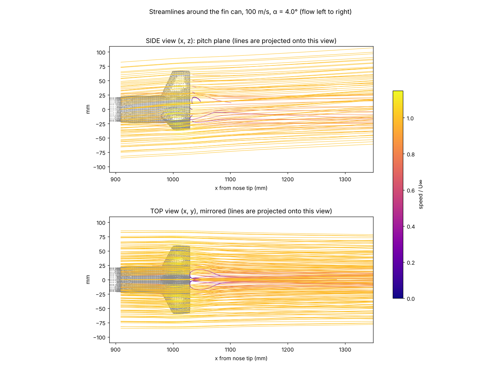

*Figure 40. Streamlines around the fin can, in side view (pitch plane) and top view (mirrored), coloured by speed / U∞. The lines tilt up at 4° and pass the fins almost undisturbed. Only the lines that enter the base region slow down (purple) and curl.*
- ***Look at** the small purple loops just aft of the base: that is the recirculation bubble.*

*Source: `out/cfd/of_a4/figures/cfd_streamlines.png`, `tools/cfd_figures_extra.py`, case a4, 2026-11-22.*

##### ParaView views (`tools/paraview_views.py`, pvbatch 5.11; case a4)

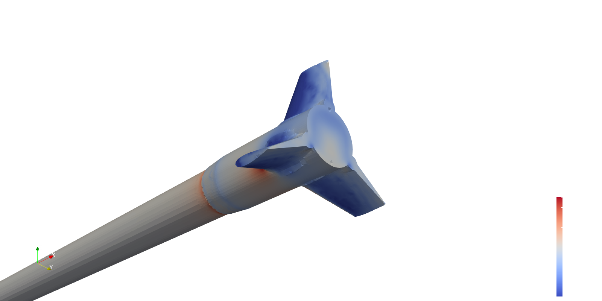

*Figure 41. Fin can surface coloured by pressure (half model reflected; blue = low, red = high), seen from aft and below. There is a red ring where the tube meets the fairing step. The fin faces and the base are blue.*
- ***Look at** the red band at the step: this is the pressure rise that the CFD counts as body lift and Barrowman mostly omits.*

*Source: `out/cfd/of_a4/figures/paraview_fins_pressure.png`, `tools/paraview_views.py`, 2026-11-22. The colour bar has no tick labels in this render.*

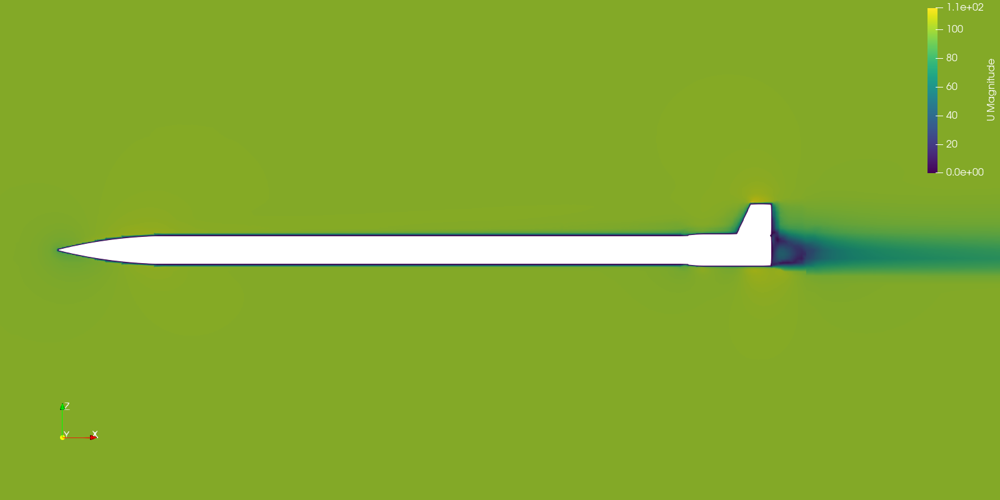

*Figure 42. Side slice (y = 0) coloured by speed magnitude (0–110 m/s), whole rocket. The thin dark line along the body is the boundary layer, and the wake leaves the blunt base. Same physics as figure 38, at higher resolution. Source: `out/cfd/of_a4/figures/paraview_side_speed.png`, `tools/paraview_views.py`, 2026-11-22.*

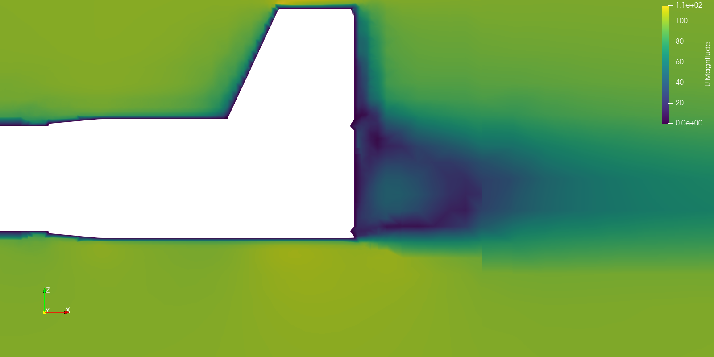

*Figure 43. Close-up of figure 42 at the fin can. The boundary layer thickens along the fin leading edge and root. Behind the base, a dark (near-zero speed) recirculation zone sits behind the aft face and the wake widens downstream.*
- ***Look at** the dark triangle right behind the base: the dead-air region that sets the base drag.*

*Source: `out/cfd/of_a4/figures/paraview_side_speed_fins.png`, `tools/paraview_views.py`, 2026-11-22.*

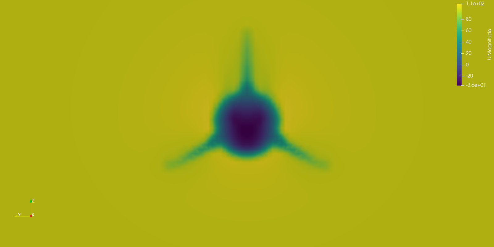

*Figure 44. Cross-section 10 mm behind the base, looking forward, coloured by the **axial velocity component** (the script colours by U_x; the legend is labelled "U Magnitude"). The range runs from −36 to 110 m/s.*
- *The dark core is **reverse flow** (negative U_x) behind the base.*
- *The three arms are the fin wakes.*
- ***Look at** the dark core, which is about one base diameter wide.*

*Source: `out/cfd/of_a4/figures/paraview_cross_section_wake.png`, `tools/paraview_views.py`, 2026-11-22.*

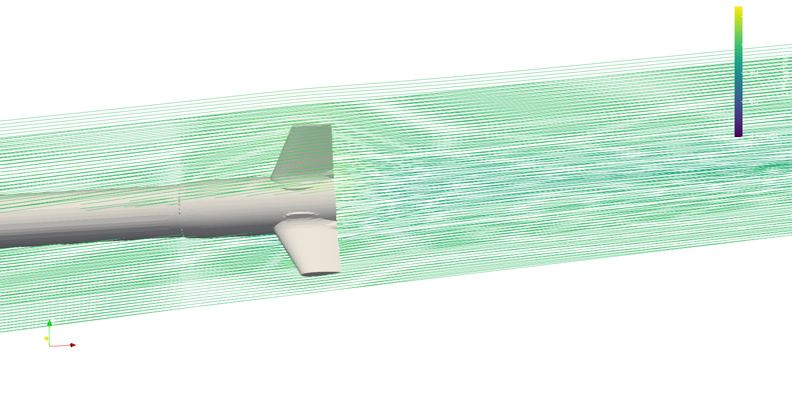

*Figure 45. Streamlines seeded upstream, passing the fin can, coloured by speed. They tilt at the 4° angle of attack. The paler lines behind the base mark the slower wake. Source: `out/cfd/of_a4/figures/paraview_streamlines.png`, `tools/paraview_views.py`, 2026-11-22. The colour-bar labels are not legible in this render.*

##### ParaView gallery: selected views (`tools/paraview_gallery.py`; 43 images in `out/cfd/of_a4/figures/gallery/`, 11 shown)

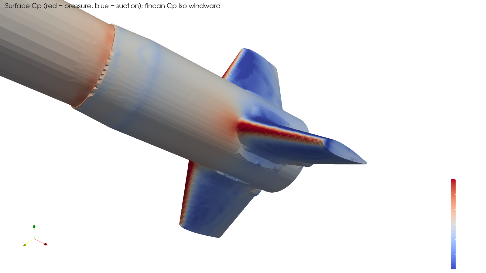

*Figure 46. Fin can surface Cp, iso view from the windward side (red = pressure, blue = suction).*
- *Bright red stagnation lines run along the fin leading edges, with blue suction just behind them.*
- *The pressure ring at the tube-to-fairing step is also visible.*
- ***Look at** the leading edges: the 4° flow hits them hardest on the windward fin.*

*Source: `out/cfd/of_a4/figures/gallery/06_fincan_Cp_iso_windward.png`, `tools/paraview_gallery.py`, 2026-11-22.*

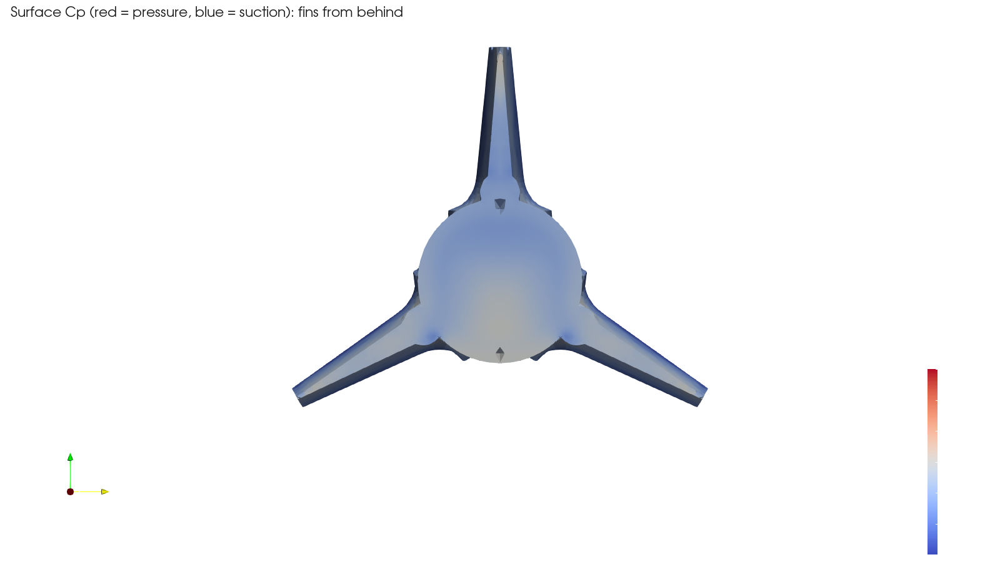

*Figure 47. The three fins and the base seen from directly behind, coloured by surface Cp. The base is mildly blue (suction). The blunt fin trailing edges show as dark bands along each fin, and the insert-boss fairings show at the fin roots.*
- ***Look at** the thick root ends of the fins (8 mm blunt TE, rev 7). Each is a small extra base area that adds drag.*

*Source: `out/cfd/of_a4/figures/gallery/08_fins_from_behind.png`, `tools/paraview_gallery.py`, 2026-11-22.*

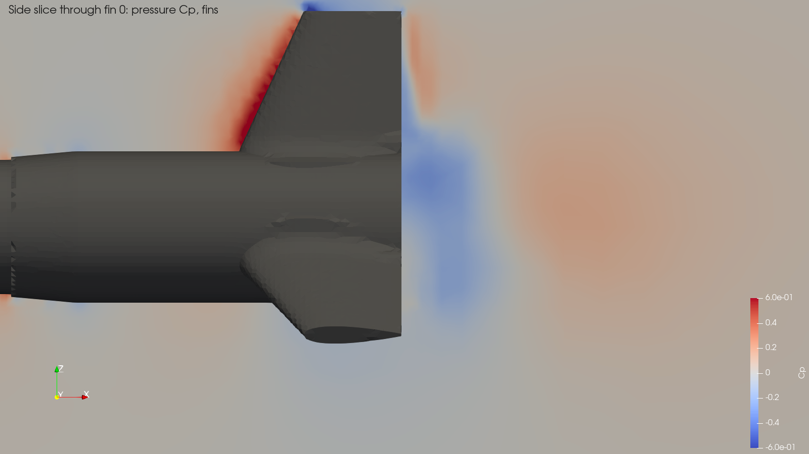

*Figure 48. Side slice through fin 0, pressure Cp (−0.6 to +0.6), fin can close-up.*
- *Red high pressure runs along the swept leading edge of fin 0.*
- *Blue suction sits just behind the base corner, with mild positive pressure further back in the wake.*
- ***Look at** the leading-edge band: it is the same feature as the red isosurface in figure 56.*

*Source: `out/cfd/of_a4/figures/gallery/16_side_Cp_fins.png`, `tools/paraview_gallery.py`, 2026-11-22.*

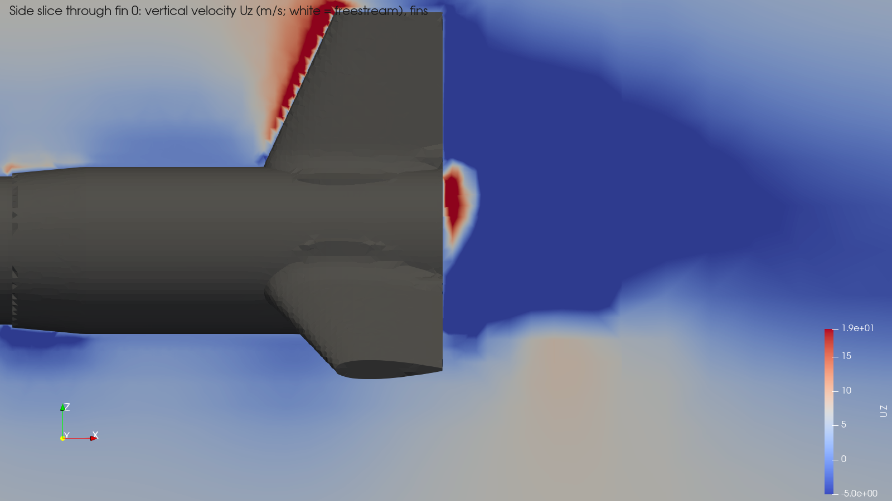

*Figure 49. Side slice through fin 0, vertical velocity Uz (−5 to 19 m/s). The freestream Uz is 6.98 m/s (`result.json` U_z), which is white on this scale.*
- *Red is upwash at the fin 0 leading edge and at the base corner.*
- *Blue is downwash behind the tail.*
- ***Look at** the large blue region aft of the fins: the tail turns the flow down, the reaction to the lift it makes.*

*Source: `out/cfd/of_a4/figures/gallery/19_side_upwash_Uz_fins.png`, `tools/paraview_gallery.py`, 2026-11-22.*

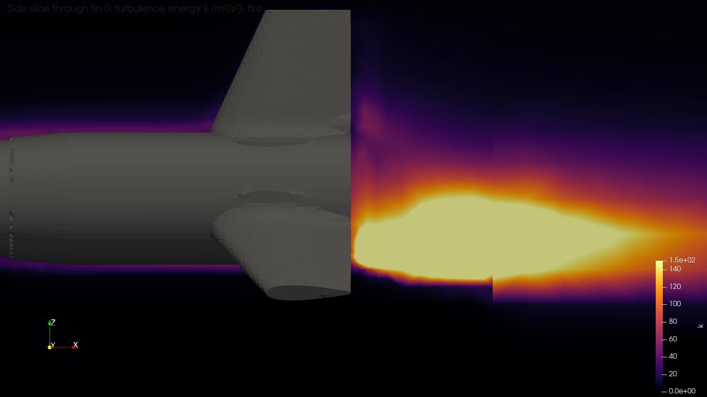

*Figure 50. Side slice through fin 0, turbulence kinetic energy k (0–150 m²/s²). k is low along the body and fins and very high in the base wake.*
- ***Look at** the wake plume, which sits low (toward the windward side) at 4°.*
- *The vertical step in the colour partway along the wake is most likely a mesh-refinement boundary, not physics (docs agent's reading).*

*Source: `out/cfd/of_a4/figures/gallery/22_side_turbulence_k_fins.png`, `tools/paraview_gallery.py`, 2026-11-22.*

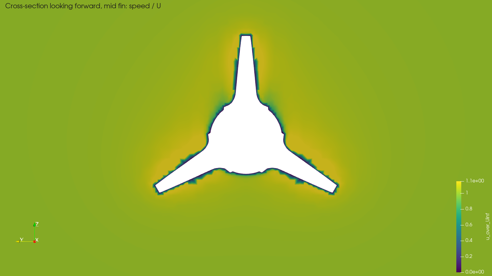

*Figure 51. Cross-section at mid fin chord, looking forward, speed / U∞ (0–1.1). Flow speeds up (yellow) next to the fins and the sleeve, and the boundary layer is a thin dark rim.*
- ***Look at** the stepped "staircase" along the fin surfaces: it is the snappyHexMesh cell size (~1.6 mm on the fins) without prism layers. That is why the friction is taken from a flat-plate estimate.*

*Source: `out/cfd/of_a4/figures/gallery/28_xsec_speed_mid_fin.png`, `tools/paraview_gallery.py`, 2026-11-22.*

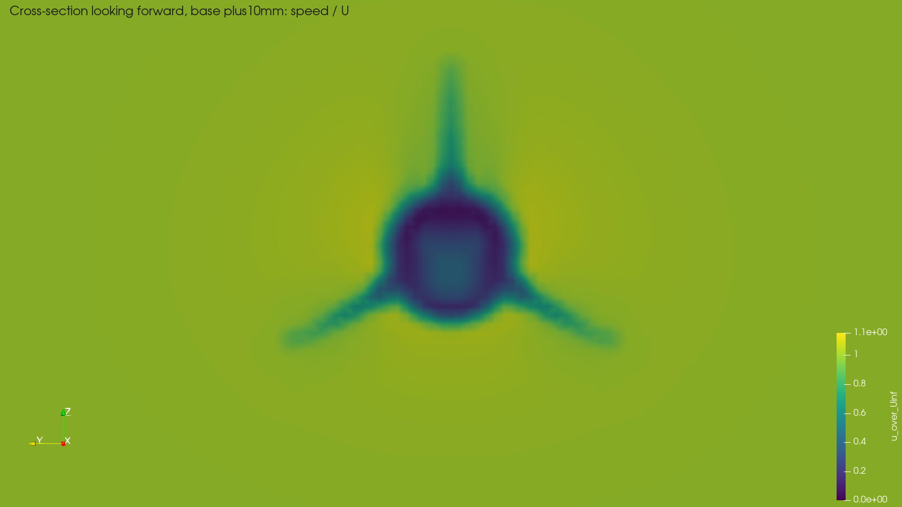

*Figure 52. Cross-section 10 mm behind the base, speed / U∞. A slow ring surrounds a slightly faster core, the shape of a recirculating base flow, and the three fin wakes form arms. This is the same plane as figure 44, shown as speed magnitude instead of axial velocity. Source: `out/cfd/of_a4/figures/gallery/30_xsec_speed_base_plus10mm.png`, `tools/paraview_gallery.py`, 2026-11-22.*

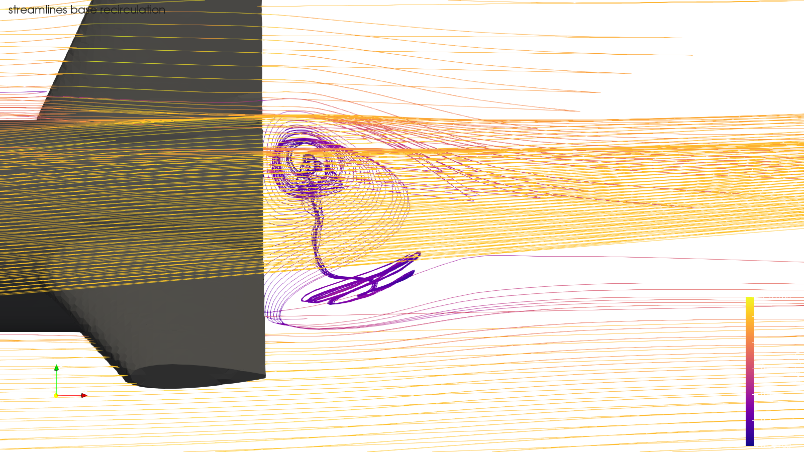

*Figure 53. Streamlines seeded at the base, side view. The purple (slow) lines spiral in a recirculation vortex just aft of the base, then leave downstream and downward. Yellow lines pass outside.*
- ***Look at** the spiral: it is the dead-air bubble whose low pressure is the base drag.*

*Source: `out/cfd/of_a4/figures/gallery/37_streamlines_base_recirculation.png`, `tools/paraview_gallery.py`, 2026-11-22. The colour-bar labels are not legible in this render.*

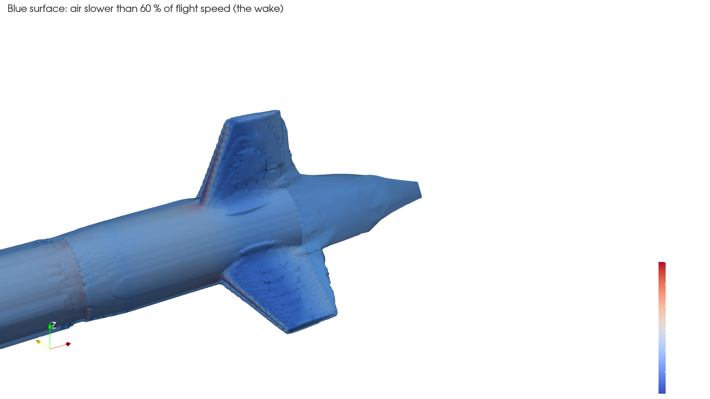

*Figure 54. Isosurface where the air is slower than 60 % of flight speed (the gallery's own caption). Close to the body it wraps the boundary layer, and behind the base it closes into a short cone.*
- ***Look at** the cone behind the base: it shows how far the slow wake reaches.*

*Source: `out/cfd/of_a4/figures/gallery/40_wake_isosurface_iso.png`, `tools/paraview_gallery.py`, 2026-11-22.*

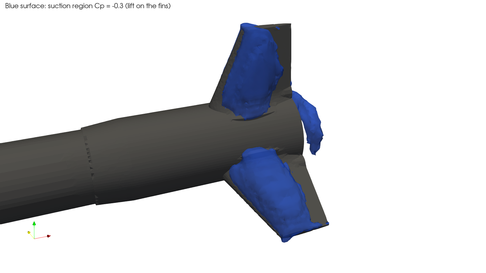

*Figure 55. Isosurface Cp = −0.3, the suction region (blue). It covers most of the forward part of the two visible fins, and a smaller lobe sits off the third fin behind the base.*
- ***Look at** how much of each fin is under strong suction. This, together with the leading-edge pressure in figure 56, is the fin lift (fins 1 + 2: CNα 7.65 /rad).*

*Source: `out/cfd/of_a4/figures/gallery/41_suction_isosurface_fins.png`, `tools/paraview_gallery.py`, 2026-11-22.*

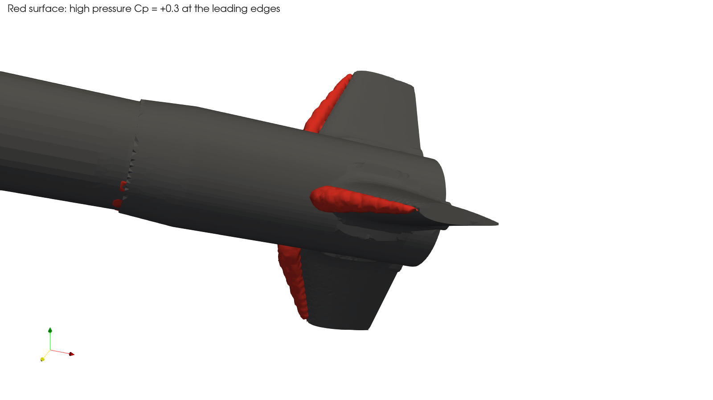

*Figure 56. Isosurface Cp = +0.3, high pressure (red). It hugs the fin leading edges, with small spots at the tube-to-fairing step.*
- ***Look at** how thin the bands are: the stagnation pressure is confined to the leading edges.*

*Source: `out/cfd/of_a4/figures/gallery/42_pressure_isosurface_fin_leading_edges.png`, `tools/paraview_gallery.py`, 2026-11-22.*

##### Mach 0.8: first-order result, NOT YET TRUSTED (or_component_analysis.md; `out/cfd/of_m08/result.json`)

**Setup**
- Solver: **`rhoPimpleFoam`** with local time stepping (LTS), first-order upwind and a temperature limiter.
- Flow: **M 0.8 = 272 m/s** (272.23 m/s), α 4°, ISA sea level (101325 Pa, 288.15 K). Same mesh as the 100 m/s run.
- **The steady `rhoSimpleFoam` start diverged twice** (negative temperature). LTS was stable.
- The run completed all **2500 iterations** (main session, 2026-11-22).

| Iteration | CP from tip | CNα (/rad) | CA, pressure | Surface T |
|---|---|---|---|---|
| 500 | 822.0 mm | 15.21 | 1.138 | 260–352 K |
| 1000 | 821.1 mm | 15.17 | 0.957 | 260–350 K |
| 2000 | 817.7 mm | 14.88 | 0.952 | 262–350 K |
| **2500 (final)** | **818.3 mm** | **14.89** | **0.958** | 261–350 K |

- CP moved 0.6 mm over the last 500 iterations: converged **for this first-order scheme**. CA total ≈ 1.23 (pressure 0.958 + flat-plate friction 0.273, ESTIMATE).
- On the OR CG (750.4 mm) this CP would give **1.64 cal** at M 0.8 (vs 2.08 cal at 100 m/s). Treat as a lower bound until the second-order run.
- **Why it is not trusted:**
  - The CP sits **~15 mm forward** of the 100 m/s result (836 mm). The expected trend is an aft shift with Mach.
  - The surface temperature peak of 350 K is above the **~321 K adiabatic wall** temperature, so the solution is numerically smeared. First-order upwind is the suspected cause.
- **Next step:** continue from the 2500-iteration solution in **second order** and compare the CP. Re-run with `tools/cfd_rocket.py setup --name m08 --mach 0.8`, then `bash Allrun`.
- **Do not use these values for stability.** The flight reaches M 0.785 with OR weights (case A) and M 0.732 on the 73 g basis.

##### Caveats (100 m/s result)
- **One angle of attack** (4°). CNα assumes linearity and C_N(0) = 0.
- **One speed, incompressible** (M 0.29). The Mach 0.8 check is unfinished.
- **One mesh, no grid study.** The ~1.6 mm fin cells give stair-stepped surfaces (figure 51).
- **Wall functions, no prism layers** (y+ ~100–300). Friction comes from a **flat-plate ESTIMATE**, not from the CFD. Treat CA ≈ 0.71 as rough.
- Forces come from surface pressure, integrated outside OpenFOAM (the function objects crash in this build).
- **Validation is limited** to the nose term against theory, plus a reproduction on a second machine and OpenFOAM version. There is no experimental comparison.
- The OML is the rev 7 nominal geometry with the tube-OD and ring PLACEHOLDERS (§4.1). The figure 22 render is still rev 6.

#### 3.6.3 3D CFD of the boattail designs: rev 8 and rev 9 (2026-11-22)

Sources: fin_design_criteria.md (Rev 8, Rev 9); `report/figures/cfd/rev8/cfd_r8a4_result.json`, `rev9/cfd_r9a4_result.json`.
- **Same tools and settings as §3.6.2:** `simpleFoam`, k-ω SST with wall functions, half model, 100 m/s (M 0.29), α 4°, 800 iterations, forces from surface pressure plus a flat-plate friction ESTIMATE. The equations are those of §3.6.2.
- **The OML now includes the screw-on tail cone.** OML length 1061.0 mm (rev 8) and 1077.5 mm (rev 9) (`case.L`).
- **Converged:** the CP moved 0.013 mm (rev 8) and −0.017 mm (rev 9) over the last quarter (`CP_change_last_quarter_mm`).

| Item (ref 41.275 mm) | Rev 7 (§3.6.2) | Rev 8 | **Rev 9** |
|---|---|---|---|
| CP from tip | 836.3 mm | 834.4 mm | **827.4 mm** |
| CNα total (/rad) | 14.06 | 13.67 | **13.12** |
| Fin 1 lift (/rad, normal to the fin) | 4.42 | 4.26 | **4.00** (3.46 in the pitch plane; fins 1 + 2: 6.92) |
| CA pressure / total ESTIMATE | 0.375 / 0.709 | 0.266 / 0.608 | **0.232 / 0.578** |
| Drag vs rev 7 | — | −14 % | **−18 %** |

- **Trend:** each boattail step cuts drag, and the CP moves forward (836.3 → 834.4 → 827.4 mm). Rev 9's 40 mm fairing was chosen because "the sleeve step was 2–4 % of pressure drag in CFD" (design.yaml `fin_can_md.fairing_length_mm`).
- **Flight consequences** (sims with OR weights and extras, Cd ×0.857; fin_design_criteria.md):
  - rev 8: CG 758.8 mm, **1.83 cal on the CFD CP**, apogee **1341 m**, M 0.781;
  - rev 9: CG 761.0 mm, **1.61 cal** with the 65 g nose, **+7.4 g ballast (nose 72 g) for 1.8 cal**, apogee **1383 m**.
- **Caveats:** the same as §3.6.2 (one angle, one speed, one mesh, wall functions, flat-plate friction). The fine-mesh check of rev 9 (case r9a4_f) is unfinished (§3.6.4).

*Figure 57. Rev 8 CFD (case r8a4, 100 m/s, α 4°): speed |U| in the symmetry plane through fin 0, whole rocket, nose and fin can.*
- *The 20 mm boattail behind the fins narrows the base, and the dark wake starts from a smaller diameter than in rev 7 (figure 38).*
- ***Look at** the fin can panel: the dead-air zone behind the base is the drag the boattail reduces (CA total 0.608 vs 0.709).*

*Source: `report/figures/cfd/rev8/cfd_velocity_plane.png`, `tools/cfd_post.py`, fin can rev 8, 2026-11-22. Other rev 8 figures (surface Cp, pressure plane, fin pressure, force distribution, cross-sections, streamlines) are in `report/figures/cfd/rev8/`.*

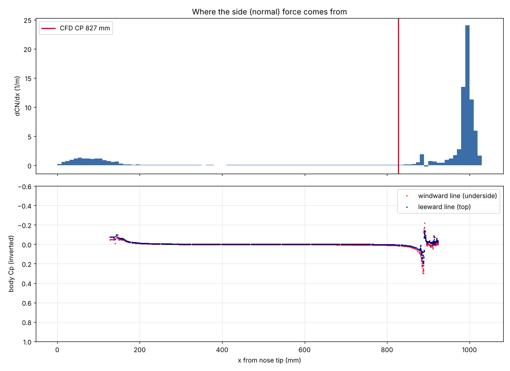

*Figure 58. Rev 9 CFD (case r9a4): where the normal force comes from.*
- *Top: dCN/dx along the rocket with the CFD CP at 827 mm. A small hump on the nose, a spike at the 40 mm fairing (x ≈ 890 mm), and the large peak over the fins near x ≈ 1000 mm.*
- *Bottom: body Cp on the windward and leeward lines; they separate only at the fairing and the fin can.*
- ***Look at** the gap between the fin peak and the CP line: the nose and fairing lift pull the CP forward of the fins.*

*Source: `report/figures/cfd/rev9/cfd_force_distribution.png`, `tools/cfd_post.py`, fin can rev 9, 2026-11-22.*

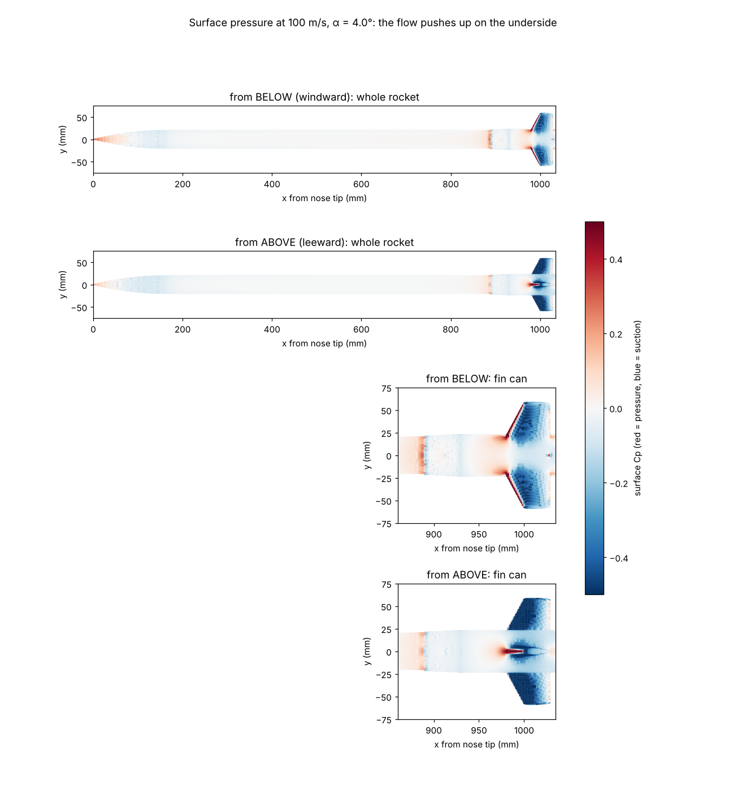

*Figure 59. Rev 9 surface Cp, from below (windward) and above (leeward), whole rocket and fin can close-ups. Red = pressure, blue = suction.*
- *From below: red at the fairing start (x ≈ 890 mm) and along the fin leading edges.*
- *From above: deep blue suction over the fins and a red streak at the fin 0 root.*
- ***Look at** the red underside and blue topside of the fins: the restoring force.*

*Source: `report/figures/cfd/rev9/cfd_surface_cp.png`, `tools/cfd_post.py`, fin can rev 9, 2026-11-22.*

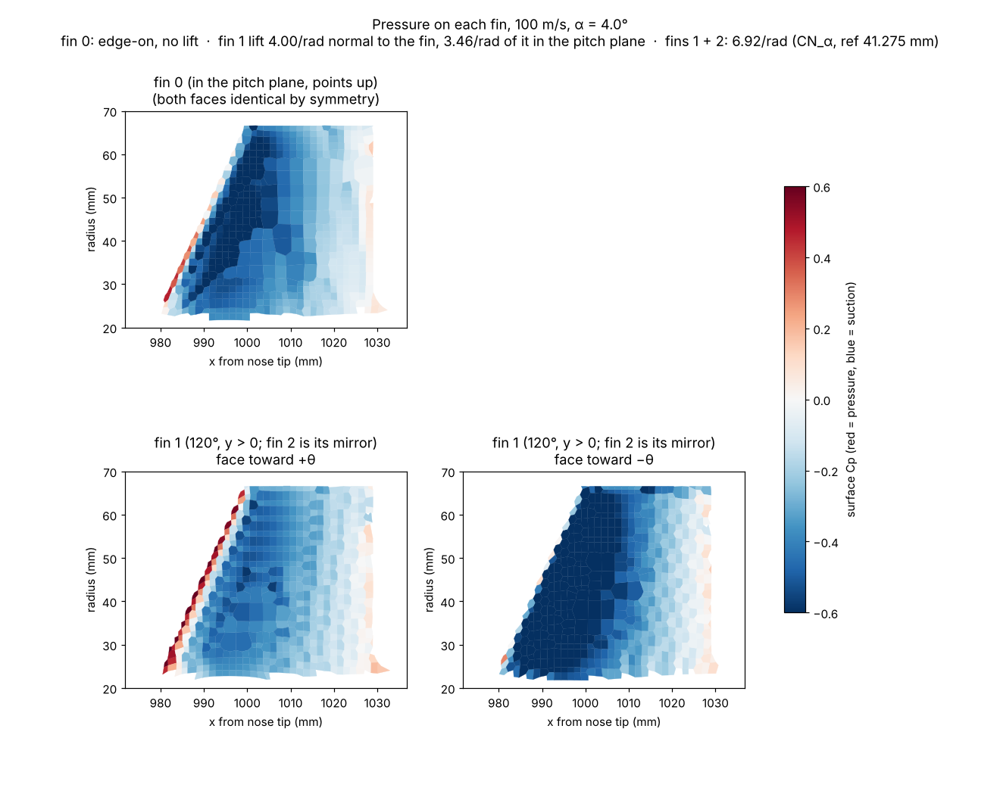

*Figure 60. Rev 9 surface Cp on each fin (x vs radius). Title values: fin 1 lift 4.00/rad normal to the fin, 3.46/rad in the pitch plane; fins 1 + 2: 6.92/rad.*
- *Fin 0 (top) is edge-on and makes no lift. Fin 1's −θ face (bottom right) carries strong suction over the forward half.*
- ***Look at** the two fin 1 faces: their difference is the lift. Compare with the owner fins in figure 66.*

*Source: `report/figures/cfd/rev9/cfd_fin_pressure.png`, `tools/cfd_figures_extra.py`, fin can rev 9, 2026-11-22.*

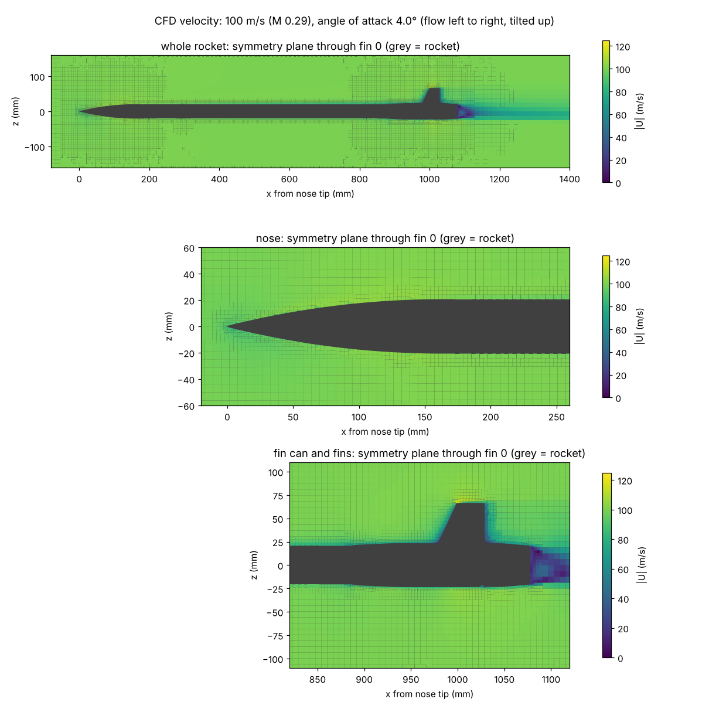

*Figure 61. Rev 9 speed |U| in the symmetry plane through fin 0. The 30 mm boattail ends at 41.6 mm, and the slow wake behind it is narrower than in rev 8 (figure 57).*
- ***Look at** the fin can panel: the long gentle 40 mm fairing ahead of the fins and the tapered tail behind them.*

*Source: `report/figures/cfd/rev9/cfd_velocity_plane.png`, `tools/cfd_post.py`, fin can rev 9, 2026-11-22. More rev 9 figures are in `report/figures/cfd/rev9/`.*

#### 3.6.4 3D CFD of the owner's SolidWorks model (case own_a4, 2026-11-23)

Sources: or_component_analysis.md ("Owner STEP model CFD", "Why the owner fins make less lift"); `report/figures/cfd/owner/cfd_own_a4_result.json`; docstrings of `tools/rocket_oml_owner.py`, `tools/cfd_lift_breakdown.py`; main session.

**Geometry** (`tools/rocket_oml_owner.py`)
- The OML is built from the owner's STEP files `L1-Rocket-FinCan.STEP` and `FinCanBottom.STEP` (fin tip r 69.5, span 46.1 mm, intentional).
- The tail cone is seated as in the thread review (dz = −29.89 mm). The tube starts on the owner's lip; the nose is the design.yaml tangent ogive. Bores, threads and the motor cavity are filled.
- **Owner geometry** (main session): sleeve 118 mm; fairing 46.8 → 43.3 mm over 40.5 mm; tail cone 46.8 → 41.6 mm over 29.9 mm; threads right-hand, seated with 0 overlap.
- Mesh **633k cells**, 1 skewed face (4.37). The CP moved −0.11 mm over the last quarter.

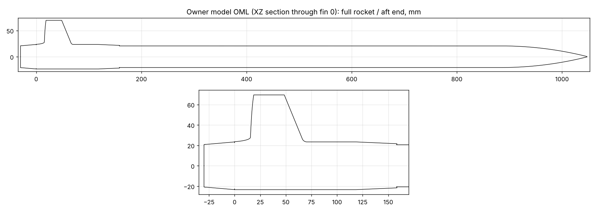

*Figure 62. Owner model OML, XZ section through fin 0: full rocket (top) and aft end (bottom), mm, fin-can aft face at 0. The fin reaches r ≈ 70 mm; the tail cone runs from z = 0 to about −30 mm, and the fairing to about z = 158 mm. Source: `report/figures/cfd/owner/rocket_oml_owner_side.png`, `tools/rocket_oml_owner.py`, owner STEP 2026-11-23.*

**Results (100 m/s, α 4°, ref 41.275 mm)**

| | Rev 9 (r9a4) | **Owner model (own_a4)** |
|---|---|---|
| CP from tip | 827.4 mm | **809.9 mm** |
| CNα | 13.12 /rad | **11.89 /rad** |
| Per-fin pitch-plane lift slope | 3.46 /rad | 3.19 /rad |
| CA total ESTIMATE | 0.578 | 0.600 |
| Margin, 65 g nose (CG ESTIMATE 761 / 759 mm) | 1.61 cal | **≈ 1.23 cal** |

- The larger span did not raise the lift: CNα is **9 % lower**.
- or_component_analysis.md estimates about **+23 g of nose ballast** for 1.8 cal (ESTIMATE, at ≈ 1.05 mm CG per g), to be redone with the owner's slicer masses. The OR-CG basis gives +15 g instead (§3.3.1).

**Where the lift difference sits** (`tools/cfd_lift_breakdown.py`; CNα difference −1.23)

| Region | Owner − rev 9 (/rad) |
|---|---|
| Fin roots (fillets, LE/TE caps, skirt) | **−0.53** |
| Aft body / tail cone | −0.25 |
| Fin panels (side faces) | −0.19 (even with +10 % panel area) |
| Body between the fins | −0.17 |
| Nose and tube | −0.08 |

- **Chordwise fin Cp at r = 30 / 45 / 60 mm is almost the same for both** (figure 65). The panels themselves work the same way.

**CORRECTION (main session, 2026-11-23): the earlier explanation is RETRACTED**
- or_component_analysis.md still gives two causes: the owner fins meet the sleeve with no root fillet, and the owner tail cone starts its taper ~16 mm behind the fin TE where rev 9's collar keeps full diameter for 18.5 mm.
- A later **overlay at true scale** showed the two fin cans are **geometrically almost identical**: span +2.9 mm, root 52 vs 50 mm, root-fillet thickness 11.1 vs 13.4 mm, TE 1.0 vs 2.5 mm. **The "sharp root corner" and "tail cone tapers sooner" explanation given to the owner was wrong** and was retracted.
- **The 9 % CNα deficit is comparable to the single coarse mesh's uncertainty (±5–8 %, ~1.6 mm cells on the fins). It is UNCONFIRMED.**
- **Fine-mesh check:** `tools/cfd_rocket.py --refine 1` (one extra refinement level on the surface and near box), cases **r9a4_f** and **own_a4_f**. It was started but **stopped before finishing** (git 4ce7a83; §11.4).
- **Interim guidance (main session): use the rev 9 CFD CP (827 mm) for both designs, PROVISIONAL.**
- or_component_analysis.md also says "the aft ~40 % of the owner fins carry almost no load". The chordwise comparison (figure 65) shows the same pattern on rev 9, so this is not a difference between the designs (docs agent's reading of figures 60, 65, 66).

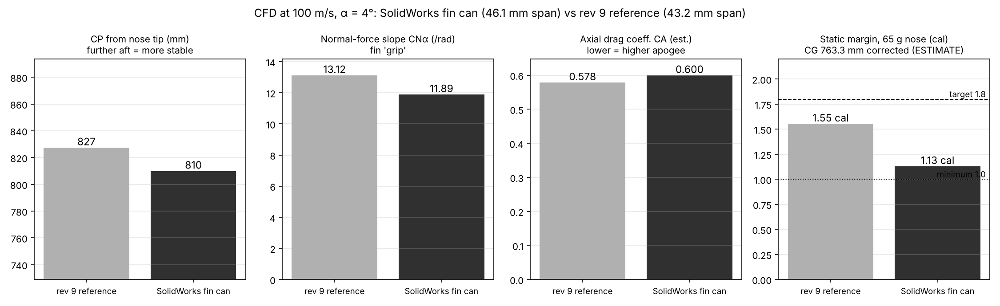

*Figure 63. CFD at 100 m/s, α 4°: owner fin can (46.1 mm span) vs rev 9 (43.2 mm). Panels: CP 827 vs 810 mm; CNα 13.12 vs 11.89; CA 0.578 vs 0.600; margin with the 65 g nose 1.61 vs 1.23 cal.*
- ***Caution:** the margin panel uses **ESTIMATED CGs**: the rev 9 sim CG (761.0 mm), shifted 2 mm forward for the owner model "for the owner model's motor sitting 9 mm further forward (ESTIMATE until the owner's slicer masses are in)". Nothing is weighed. The CNα gap is UNCONFIRMED (see the correction above).*

*Source: `report/figures/cfd/owner/cfd_owner_vs_rev9.png`, `tools/cfd_compare_owner.py`, 2026-11-23.*

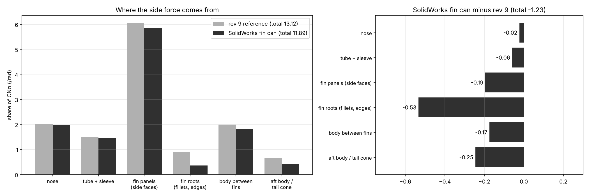

*Figure 64. Share of CNα by region, rev 9 (total 13.12) vs owner (11.89), and the difference (total −1.23). Fin panels carry the most in both (about 6 /rad). The largest difference is at the fin roots (−0.53).*
- ***Look at** the right panel: the losses are spread over roots, aft body, panels and the body between the fins. No single region explains the gap.*

*Source: `report/figures/cfd/owner/cfd_lift_breakdown.png`, `tools/cfd_lift_breakdown.py`, 2026-11-23.*

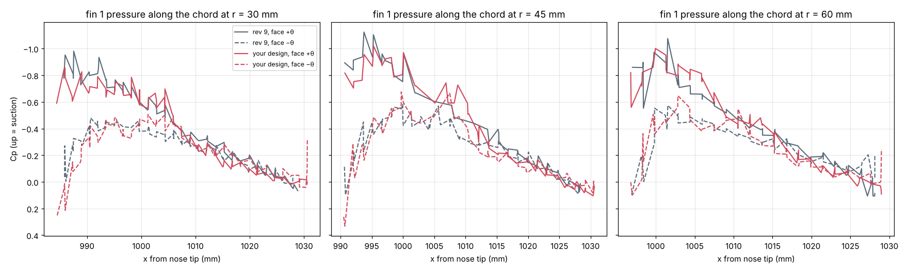

*Figure 65. Fin 1 pressure along the chord at r = 30, 45 and 60 mm, both faces, rev 9 (grey) vs owner (red). The curves lie almost on top of each other.*
- ***Look at** how close the solid (+θ) and dashed (−θ) lines of both designs are: the panels make the same lift per unit area.*

*Source: `report/figures/cfd/owner/cfd_fin_chord_pressure.png`, `tools/cfd_fin_chord_compare.py`, 2026-11-23.*

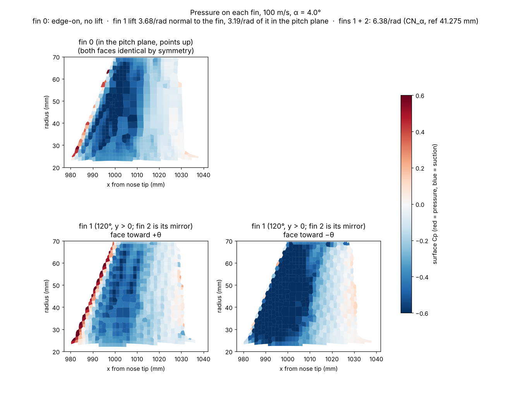

*Figure 66. Owner model surface Cp on each fin. Title values: fin 1 lift 3.68/rad normal to the fin, 3.19/rad in the pitch plane; fins 1 + 2: 6.38/rad. Same layout as figure 60 (rev 9: 4.00 / 3.46 / 6.92).*
- ***Look at** the radius axis, which reaches r ≈ 70 mm: the owner fin is taller, yet the lift is lower.*

*Source: `report/figures/cfd/owner/cfd_fin_pressure.png`, `tools/cfd_figures_extra.py`, case own_a4, 2026-11-23.*

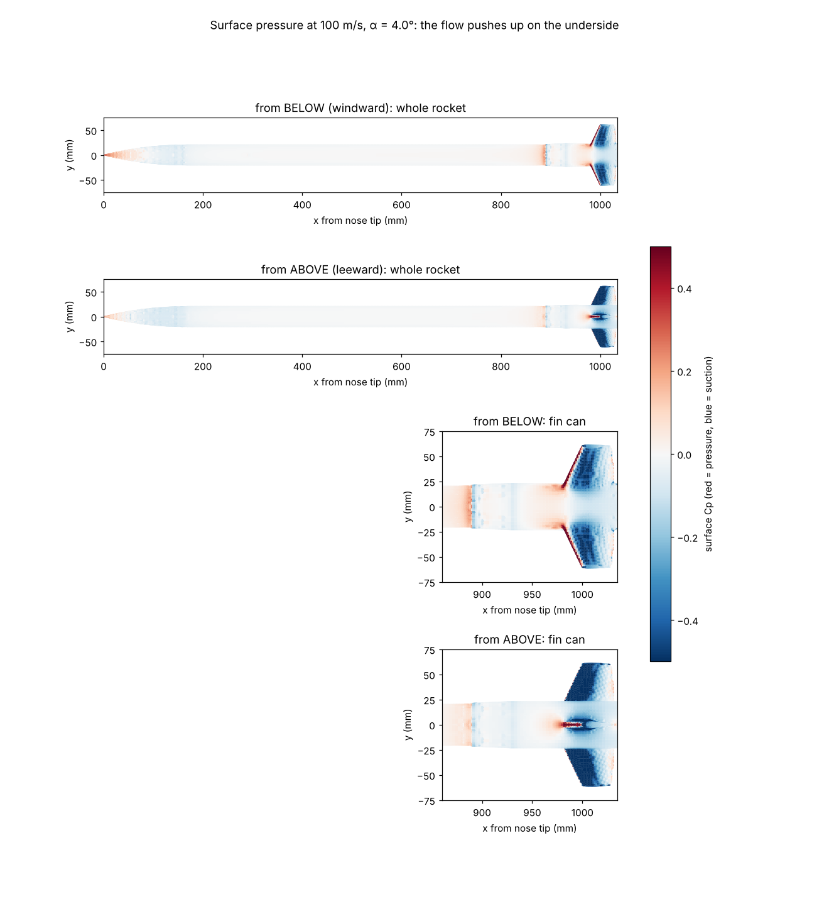

*Figure 67. Owner model surface Cp from below and above, whole rocket and fin can. The pattern matches rev 9 (figure 59): red along the windward fin leading edges, blue suction over the leeward fins.*

*Source: `report/figures/cfd/owner/cfd_surface_cp.png`, `tools/cfd_post.py`, case own_a4, 2026-11-23.*

**ParaView gallery, owner model** (42 views in `report/figures/cfd/owner/gallery/`; 3 shown)

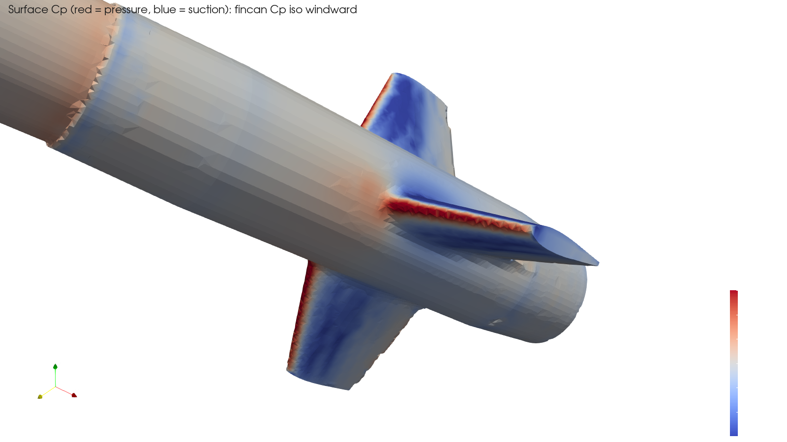

*Figure 68. Owner fin can surface Cp, iso view from the windward side. Red stagnation lines run along the fin leading edges, with blue suction behind them. A pressure ring marks the start of the fairing.*
- ***Look at** the fin-to-sleeve junction: it has no fillet, as described in §3.1.*

*Source: `report/figures/cfd/owner/gallery/06_fincan_Cp_iso_windward.png`, `tools/paraview_gallery.py`, case own_a4, 2026-11-23. The colour bar has no tick labels in this render.*

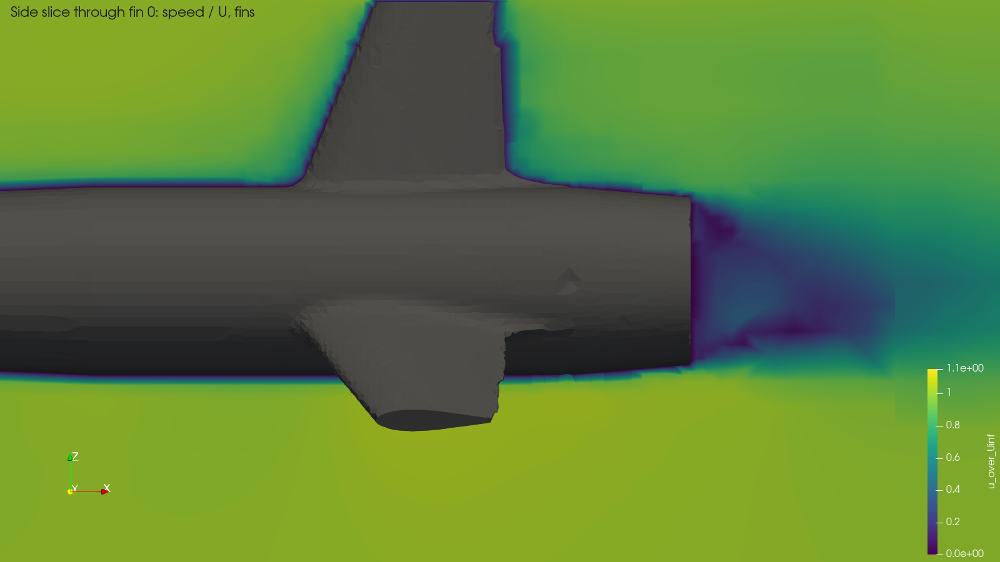

*Figure 69. Side slice through fin 0, speed / U∞ (0–1.1), fin can close-up. A thin dark boundary layer wraps the body and fins; behind the tail cone a slow (dark) wake forms.*
- ***Look at** the wake: it starts from the narrowed tail cone base, not the full sleeve diameter.*

*Source: `report/figures/cfd/owner/gallery/12_side_speed_fins.png`, `tools/paraview_gallery.py`, case own_a4, 2026-11-23.*

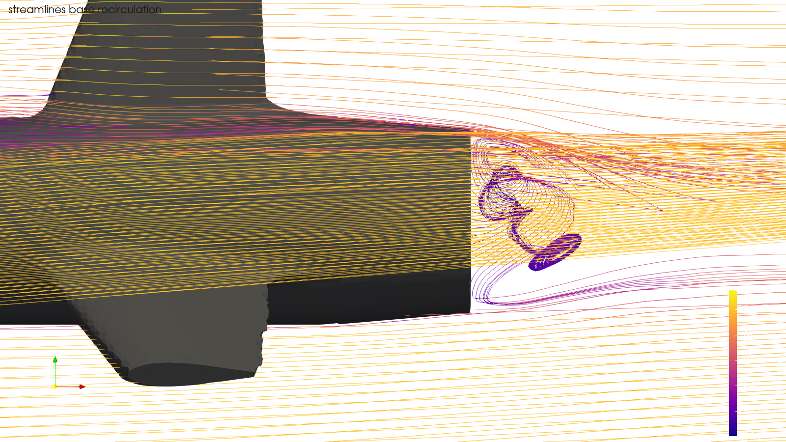

*Figure 70. Streamlines seeded at the base, side view. Purple (slow) lines spiral in a recirculation bubble just aft of the tail cone, then leave downstream.*
- ***Look at** the bubble's size against the rev 7 flat base (figure 53).*

*Source: `report/figures/cfd/owner/gallery/37_streamlines_base_recirculation.png`, `tools/paraview_gallery.py`, case own_a4, 2026-11-23. The colour-bar labels are not legible in this render.*

---

## 4. Structures & Manufacturing

### 4.0 Current fin cans (2026-11-22/23): rev 9 (design side) and the owner's SolidWorks part (owner basis)

**Status at a glance**

| | **Rev 9 fin can + tail cone** | **Owner SolidWorks fin can + tail cone** |
|---|---|---|
| Role | Design-side flight candidate; CFD reference (CP 827.4 mm) | **Owner's design basis (Pepto B. #2)** |
| Source | `make.py fin_can_md --rev 9`, `make.py tail_cone --rev 9` | `owner_cad/L1-Rocket-FinCan.STEP`, `FinCanBottom.STEP` |
| FEA C1–C4 | **PASS** (0.34 / 0.27 / 0.15 / 0.026) | not run |
| CFD | CP 827.4 mm, CNα 13.12, CA 0.578 | CP 809.9 mm, CNα 11.89, CA 0.600 (gap UNCONFIRMED, §3.6.4) |
| Mass | fin can ~97.9 g ESTIMATE + tail cone 16.0 g model | ~95 g ESTIMATE (main session); **slicer mass pending** |
| Thread | 2.5 / 1.0 / 0.2 mm, validated | test pieces cut from this STEP: **PASS** |

#### 4.0.1 Fin can rev 9 (DRAFT, NOT PRINT-READY; out/fin_can_md/rev9/fin_can_md_rev9_spec.md, design.yaml `fin_can_md`)

**Changes vs rev 8** (fin_design_criteria.md Rev 9; owner request 2026-11-22):

| Change | Rev 8 | **Rev 9** | Status / why |
|---|---|---|---|
| M3 insert bosses | solid bosses, no holes | **removed** | OWNER: the tail cone retains the motor |
| Root TE (`te_root_thickness_mm`) | 8.0 mm | **2.5 mm** → 0.84 at the tip | OWNER: the 8 mm TE "only existed to bury the insert bosses" |
| TE-to-collar junction | 45° gusset (4 mm) | **concave R6 skirt** following the fin footprint (`te_fillet_r_mm` 6) | PROPOSED; owner: "conform smoothly, no harsh triangle" |
| Boattail | 20 mm to 43.0 mm (5.4°) | **30 mm to 41.6 mm (5.0°)** | OWNER (length) / PROPOSED (end OD) |
| Forward fairing | 20 mm | **40 mm** | OWNER: the sleeve step was "2–4 % of pressure drag in CFD" |
| Collar | 18.5 mm | 18.5 mm | PROPOSED: 9.5 mm ring + 6.5 mm thread + 2.5 mm run-out |

| Parameter | Value | Status |
|---|---|---|
| Tube OD (sets the sleeve bore) | 41.275 mm | **PLACEHOLDER**: measure |
| Sleeve bore / wall / OD / length | 41.455 / 2.67 / 46.795 / 100 mm | derived / PROPOSED / derived / derived |
| Lip thickness / bore | 2.67 / 38.28 mm | PROPOSED / derived |
| Motor case OD / length | 38.10 / 155 mm | **PLACEHOLDER** / CITED |
| Thrust ring OD × length | **41.0 × 9.525 mm** | **PLACEHOLDER** (3/8 in forum estimate) |
| Fins | 50 / 30 / 43.18 / 20.32 mm, 12 → 6 mm, root fillet r 6 | owner OR planform / PROPOSED fillet |
| Collar length / bore | **18.5 / 41.6 mm** (wall behind the groove 1.6 mm) | PROPOSED |
| Thread | 45° trapezoid, pitch 2.5, depth 1.0, clearance 0.2 mm | **OWNER, VALIDATED 2026-11-23** (§4.0.5) |
| Extents | 102.6 × 118.4 × 158.5 mm | verify check 5 |
| Volumes | mesh 91.53 cm³; walls and skins 79.52 cm³; infill region 12.05 cm³ | spec |
| Mass | model **101.0–116.3 g** (0–100 % infill); sim ESTIMATE **97.9 g**; no slicer value | spec; fin_design_criteria.md |
| CG (fin can + tail cone) | **31.5 mm** forward of the fin-can aft face | fin_design_criteria.md Rev 9 |

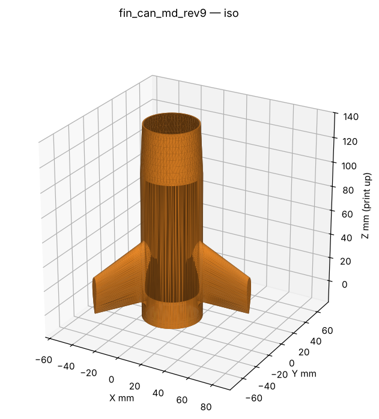

*Figure 71. Fin can rev 9, iso view in print orientation (collar on the bed, Z up). There are no insert bosses; the fins have thin trailing edges; the 40 mm fairing tapers at the top. Source: `out/fin_can_md/rev9/fin_can_md_rev9_iso.png`, `make.py fin_can_md --rev 9`, 2026-11-22. Built with the placeholder tube OD, case OD and ring. Reviewed for this report.*

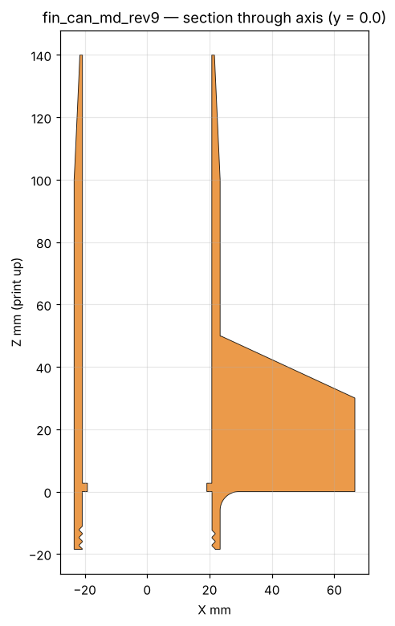

*Figure 72. Fin can rev 9, axial section through a fin (y = 0).*
- *The sleeve wall runs from the lip at Z = 0 to the fairing top at Z ≈ 140 mm, with the 40 mm taper from Z = 100.*
- *Below Z = 0 the collar carries the internal thread down to Z = −18.5 mm.*
- *Right: the fin (root 50 mm at Z 0–50, tip at Z 30–50) and the concave R6 skirt that turns the fin root into the collar.*

*Source: `out/fin_can_md/rev9/fin_can_md_rev9_section.png`, 2026-11-22.*

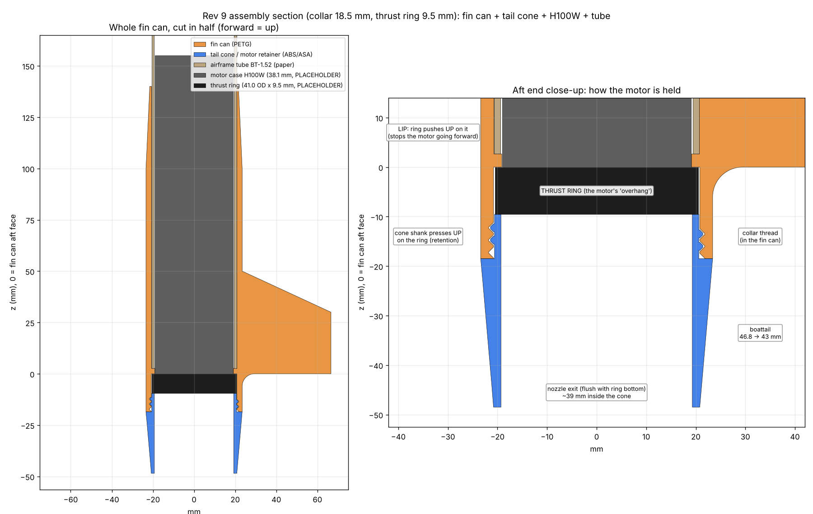

*Figure 73. Rev 9 assembly half-section: fin can (orange, PETG), tail cone / motor retainer (blue, ABS/ASA), BT-1.52 tube, H100W case and thrust ring (both PLACEHOLDERS, 38.1 mm and 41.0 × 9.5 mm).*
- *Right close-up: the ring pushes up on the lip; the cone shank presses up on the ring; the nozzle exit sits ~39 mm inside the cone.*
- ***Look at** how the motor is held: lip above, cone shank below, thread in the collar.*
- *Note: the "boattail 46.8 → 43 mm" label in the figure is the rev 8 value; rev 9 tapers to 41.6 mm (§11.5).*

*Source: `out/fin_can_md/rev9/fin_can_md_rev9_assembly_section.png`, `tools/assembly_section.py`, 2026-11-22.*

**Print orientation** (spec): aft face (collar) down, axis vertical. **The fin TEs overhang the collar and need light tree supports outboard of the skirt** (fin_design_criteria.md Rev 9). The spec's "no supports" sentence and its "hang 12 mm" note are rev 7/8 text (§11.5).

**Verify, rev 9** (`fin_can_md_rev9_verify.json`): **4/5**

| # | Check | Result |
|---|---|---|
| 1 | Mesh integrity | PASS: watertight, 1 body, 91 534.8 mm³ |
| 2 | Mass | **FAIL**: the target is still the rev 7 slicer 90.0 g; model 101.0–116.3 g |
| 3 | Mating interference | PASS: 0 mm³ with the tube wall, case, ring and tail cone (**placeholders**) |
| 4 | Renders | written, "VISUAL REVIEW REQUIRED"; iso and section reviewed for this report |
| 5 | Build volume | PASS: 102.6 / 118.4 / 158.5 mm |

- Check 2 needs the owner's slicer mass for rev 9 as the new target. Under CLAUDE.md the part is not "good" until it passes.

**Loads vs layers (rev 9, printed axis-vertical, collar down).** Sources: rev 9 spec; out/fea/rev9 `result.json`; tail cone rev 9 spec.

| Load | Direction vs layers | Bond loading |
|---|---|---|
| Motor thrust: ring pushes +Z on the lip underside | across layers | **compression** (good) |
| Fin sideways / tilted / gust (C1, C2, C4) | root bending; peaks at r ≈ 23.0–23.2 mm, z ≈ 8.7–9.9 mm, where the root fillet meets the sleeve | **across-layer tension**: C1 0.34, C2 0.27, C4 0.026 |
| Fin axial tip strike (C3) | push along Z; root-zone peak at (23.3, 1.6, 0.0) mm, the aft face | **across-layer tension**: C3 0.15 |
| Ejection kick (−Z): ring pulls aft onto the tail-cone shank | collar thread flanks loaded along Z | **thread shear across layers** (~6 kN capacity, tail cone spec) |
| Tail-first landing | cone → ring → motor → lip | compression across layers |
| Sleeve-to-tube epoxy joint | shear on vertical cylindrical faces | in-plane shear |

- The rev 9 spec still says fin root bending is "within the layers" and the ejection kick pulls "screws ... out of their bosses". Rev 9 has no bosses or screws; this report follows the FEA and the part (§11.5).

#### 4.0.2 Tail cone rev 9 (`parts/tail_cone.py`; out/tail_cone/rev9/tail_cone_rev9_spec.md)

- **Function:** screws into the fin can collar, **traps the thrust ring (motor retainer)** and forms the 30 mm boattail, 46.8 → 41.6 mm (5.0° half-angle).
- **Bore 38.6 mm** clears the 38.10 mm case and nozzle; the shank face bears on the ring annulus 38.6–41.0 mm (PROPOSED).
- **Mass:** 12.59 cm³, **16.0 g** (no infill region: prints solid). No target declared.
- **Print:** narrow aft end on the bed, shank up, no supports; 45° thread flanks.
- **HEAT:** "the cone bore surrounds the nozzle exit during the 2.4 s burn. PETG softens near 80 C; print this part in **ABS/ASA** or line the bore with **aluminium tape**" (spec). The thread test pieces were PETG (§4.0.5); the flight material is open (§11.6).

**Verify, tail cone rev 9:** 4/5. Checks 1, 3, 4 (written, review required) and 5 PASS (46.8 × 46.8 × 39.0 mm); check 2 **FAIL: no target mass declared**.

**Loads vs layers (tail cone rev 9, printed aft end down)** (spec)

| Load | Path | Direction vs layers |
|---|---|---|
| Tail-first landing | cone pushed forward → shank → ring → motor → fin-can lip | **compression across layers** |
| Ejection kick | motor pulls the ring aft onto the shank face; the thread shears | **shear across layers**: π × 41.6 × 6.5 × 0.5 = 425 mm² × 15 MPa ≈ **6 kN** |

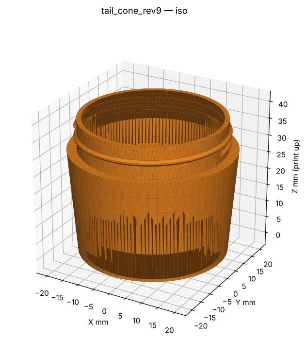

*Figure 74. Tail cone rev 9, iso view in print orientation (narrow aft end on the bed, threaded shank up). Source: `out/tail_cone/rev9/tail_cone_rev9_iso.png`, `make.py tail_cone --rev 9`, 2026-11-22.*

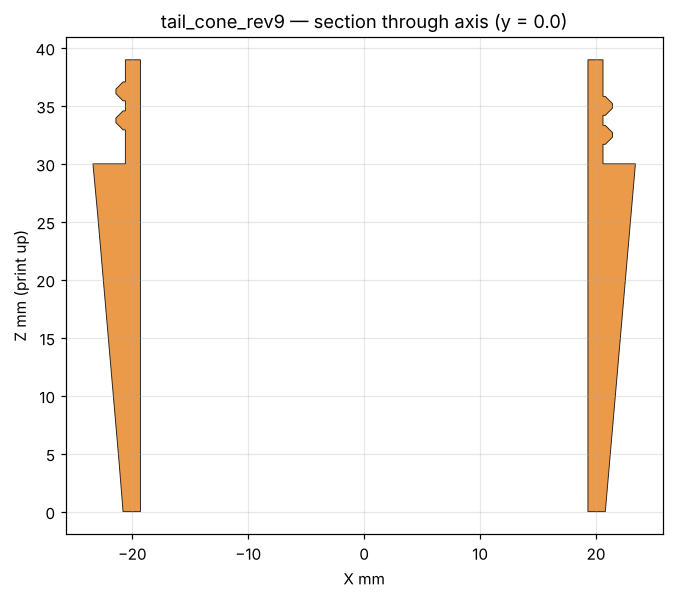

*Figure 75. Tail cone rev 9, axial section. The taper runs from Z = 0 (narrow end) to the shoulder at Z = 30 mm; the external thread is on the shank from Z 30 to 39 mm.*
- ***Look at** the wall: thin at the aft end (1.5 mm over the 38.6 mm bore, design.yaml) and thickest at the shoulder.*

*Source: `out/tail_cone/rev9/tail_cone_rev9_section.png`, 2026-11-22.*

#### 4.0.3 Fin can rev 8: screw-on tail cone, gusseted (SUPERSEDED by rev 9, 2026-11-22)

- **Concept (owner request 2026-11-22):** rev 7 fins unchanged; a **threaded collar** behind the aft face and a **screw-on tail cone** that traps the thrust ring. The insert holes were removed and the bosses left solid (fin_design_criteria.md Rev 8).
- **Boattail:** 46.8 → 43.0 mm over 20 mm (5.4°). Tail cone model 12.6 g (tail_cone rev 8 spec).
- **45° gussets** under each fin root TE onto the collar. The first rev 8 FEA peaked at that 90° corner (C1 0.46).
- **Collar:** first 12 mm (3 mm ring assumption), then **18.5 mm** for a **9.5 mm (3/8 in, forum estimate) ring**, PLACEHOLDER (git 74c09ac).
  - The rev 8 FEA (git 45e3419) and CFD (c4680a4) commits precede the collar change, and fin_design_criteria.md describes rev 8 with a 12 mm collar. Whether they were re-run with 18.5 mm is not recorded.
- **Results:** FEA C1–C4 all pass, **0.30 / 0.33 / 0.11 / 0.023** (gusseted). CFD **−14 % drag** vs rev 7, CP **834.4 mm**; sim **1.83 cal on the CFD CP**, apogee **1341 m** (§3.6.3).
- **Verify:** 4/5; check 2 FAIL against the 90 g rev 7 target (model 98.4–122.3 g).
- **Print:** collar on the bed; the blunt fin TEs overhang, so small supports go under the three TEs.

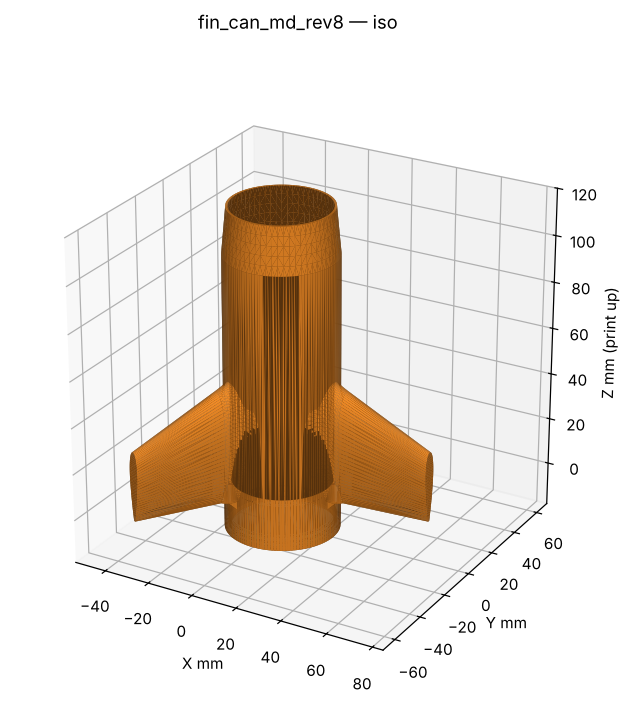

*Figure 76. SUPERSEDED. Fin can rev 8, iso view in print orientation. The blunt rev 7 TEs and the gussets sit above the collar at the bottom. Source: `out/fin_can_md/rev8/fin_can_md_rev8_iso.png`, `make.py fin_can_md --rev 8`, 2026-11-22.*

#### 4.0.4 Owner's SolidWorks fin can and tail cone (owner basis, 2026-11-23)

- **Files:** `projects/l1-cheap/owner_cad/L1-Rocket-FinCan.STEP` and `FinCanBottom.STEP`.
- **Geometry** (main session; `tools/rocket_oml_owner.py`): fin tip r 69.5 → **span 46.1 mm** on the r 23.40 sleeve (**INTENTIONAL**, owner); root ~52, tip 30, sweep 18.8 mm; sleeve 118 mm; fairing 46.8 → 43.3 mm over 40.5 mm; tail cone 46.8 → 41.6 mm over 29.9 mm. Threads right-hand, seated with 0 overlap.
- **Compared with rev 9:** almost identical at true scale; differences in §3.1.
- **Not yet available:** slicer masses, FEA, print orientation, loads-vs-layers statement. **Optional:** 6 mm root fillets on the owner fins (main session suggestion, open).
- **Loads vs layers:** not stated in any source for the owner part. If it is printed like rev 9 (axis vertical), the same paths apply (§4.0.1); this is an assumption to confirm with the owner.

#### 4.0.5 Printed thread validation (OWNER, 2026-11-23)

- **Thread:** 45° trapezoid, **pitch 2.5 mm, depth 1.0 mm, clearance 0.2 mm** (design.yaml `fin_can_md.thread_*`, now OWNER status). The nose cap uses the same thread.
- **Test pieces:** a collar ring and a tail-cone stub **cut from the owner's own STEP** (`out/test_pieces/collar_test_ring.*`, `tailcone_test_stub.*`).
- **Print settings:** 0.20 mm "Strength" profile, 6 walls, PETG (main session; design.yaml: "0.20 mm layers, PETG").
- **Result: "the screw works great"** (owner, 2026-11-23). design.yaml: "test-fit PASSED ... Keep 0.2".

#### 4.0.6 Deliverables (rev 9, nose rev 1)

| Item | File | Source tool |
|---|---|---|
| Rev 9 fin can STEP / STL (+ fin-only STEP, airfoil .dat) | `out/fin_can_md/rev9/` | `make.py` |
| Tail cone rev 9 STEP / STL | `out/tail_cone/rev9/` | `make.py` |
| 8-sheet dimensioned blueprint | `out/fin_can_md/rev9/fin_can_md_rev9_blueprint.pdf` | `tools/blueprint.py` |
| ISO A3 engineering drawing set (true scale, hatched sections, title block, datums/GD&T) | `out/fin_can_md/rev9/fin_can_md_rev9_drawings.pdf` | `tools/drawing.py` |
| Nose cone drawing set (section, details, ogive table, cap + plug) | `out/nose_cone/rev1/nose_cone_rev1_drawings.pdf` | `tools/drawing_nose.py` |
| SolidWorks fin guide (sketched airfoil + loft) | `out/guides/fin/fin_modelling_guide_rev9.pdf` | `tools/fin_guide.py` |
| SolidWorks thread guide (helix + sweep, tail cone and collar) | `out/guides/thread/thread_modelling_guide_rev9.pdf` | `tools/thread_guide.py` |
| Thread test pieces | `out/test_pieces/` | main session |

### 4.1 Fin can rev 7 (SUPERSEDED by rev 8, then rev 9, 2026-11-22)

`parts/fin_can_md.py` (fin and boss geometry in `parts/fin_can.py`), built with `make.py fin_can_md --rev 7` on 2026-11-21 (out/fin_can_md/rev7/fin_can_md_rev7_spec.md; git 2438d93).
- It is the outcome of the owner's fin loop (fin_design_criteria.md, §4.4.7). **The owner stopped the loop at rev 7.**
- Same sleeve, lip, fairing, planform, 12 → 6 mm taper and 6 mm fillet as rev 6. **Two changes**, both at the aft end of the fin root:

| Change vs rev 6 | Rev 6 | **Rev 7** | Why (design.yaml fin_can_md notes) |
|---|---|---|---|
| Blunt TE at the root (`te_root_thickness_mm`) | 2.0 mm | **8.0 mm**, tapering to 0.84 mm at the tip | "so the aft root envelops the insert boss; both FEA peaks sat in the boss outer wall near the TE" |
| Extra wall around the insert boss (`boss_extra_wall_mm`) | 0 (wall 2.67 mm) | **1.0 mm** (wall 2.67 → 3.67 mm) | "where the in-house FEA peaks sit" |

Both values are PROPOSED. fea_results.md §5 had suggested boss-cap and aft-root fillets instead (§4.4.6); those fillets were not built.

| Parameter | Value | Status |
|---|---|---|
| Tube OD (sets the sleeve bore) | 41.275 mm | **PLACEHOLDER**: measure |
| Sleeve bore / wall / OD | 41.455 / 2.67 / **46.795 mm** | derived / PROPOSED / derived |
| Sleeve length / fairing | 100 mm / 20 mm | derived / PROPOSED |
| Lip thickness / lip bore | 2.67 mm / 38.28 mm | PROPOSED / derived |
| Motor case OD / length | 38.10 / 155 mm | **PLACEHOLDER** / CITED |
| Thrust ring OD × thickness | 41.0 × 3.0 mm | **PLACEHOLDER** |
| Fins | 50 / 30 / 43.18 / 20.32 mm, **12 mm root → 6 mm tip** | owner OR planform / rev 6 taper |
| TE | **8.0 mm at the root → 0.84 mm at the tip** | PROPOSED |
| Root fillet | r 6 mm | PROPOSED |
| Insert boss | wall 2.67 + **1.0** mm around the Ø4.0 mm hole | derived + PROPOSED |
| Retention | One M3 insert per fin (Ø4.0 × 5.7 mm), insert radius 25.398 mm, washer min. OD 13.795 mm | OWNER / CITED / derived |
| Kevlar anchor | not in the part; the sim carries a 10 g stop/anchor ring ESTIMATE | open (§11) |
| Extents / print | 102.6 × 118.4 × 120.0 mm; lip down, axis vertical, no supports | verify check 5; spec |
| Volumes | mesh 89.53 cm³; walls and skins 71.36 cm³; infill region 18.17 cm³ | spec, mass model |
| Mass model / target | **90.6–113.7 g** (0–100 % infill) / **90 g owner slicer at 25 % gyroid** | verify; design.yaml `fin_can_md.target_mass_g` (OWNER) |
| CG | **38.0 mm** forward of the aft face (rev 6: 40.5; rev 5: 43.3) | design.yaml `stability.fin_can_model_cg_from_aft_mm` |

*Figure 28. Fin can rev 7, iso view in print orientation (aft lip on the bed, Z up). The fins blend into the sleeve with the 6 mm fillet. The aft ends of the fin roots, where they meet the aft face, are blunt. Source: `out/fin_can_md/rev7/fin_can_md_rev7_iso.png`, `make.py fin_can_md --rev 7`, 2026-11-21. Built with the placeholder tube OD, case OD and ring. Renders reviewed by the main session.*

*Figure 29. Fin can rev 7, axial section through a fin (y = 0).*
- *Left: the 2.67 mm sleeve wall with the inward lip at Z = 0.*
- *Right: the 50 mm root, 30 mm tip and 43.18 mm span, with the M3 insert hole entering from the aft face.*
- *The fairing tapers from Z = 100 to 120 mm.*

*Source: `out/fin_can_md/rev7/fin_can_md_rev7_section.png`, 2026-11-21.*

*Figure 30. Rev 6 (grey) vs rev 7 (orange) fin-root cross-sections at print layers z = 3 mm (through the insert boss) and z = 25 mm (mid-root). Rev 6 was orange in figure 3c.*
- *At z = 3 mm, rev 7 is much thicker aft of the boss (8 mm blunt root TE), and the boss ring is larger (+1 mm wall).*
- *At z = 25 mm the two sections differ only slightly.*

*Source: sliced by rocket-docs from `out/fin_can_md/rev6/fin_can_md_rev6.stl` and `out/fin_can_md/rev7/fin_can_md_rev7.stl` (trimesh), 2026-11-21. Geometry only; no values derived.*

**Verify results, rev 7** (`fin_can_md_rev7_verify.json`): **5/5 PASS**.

| # | Check | Result |
|---|---|---|
| 1 | Mesh integrity | PASS: watertight, 1 body, 89 534.5 mm³ |
| 2 | Mass | PASS: target 90.0 g (±5 %); model 90.6 g (0 %) – 113.7 g (100 %); "infill to hit target" −2.7 % |
| 3 | Mating interference | PASS: 0 mm³ with the tube wall, case and ring (**placeholders**) |
| 4 | Renders | PASS: iso, front and section written; reviewed by the main session; iso and section reviewed for this report |
| 5 | Build volume | PASS: 102.6 / 118.4 / 120.0 mm vs 256 |

- As for rev 6, the mass pass relies on the ±5 % tolerance: the model's **0 % infill value (90.6 g) is above the slicer's 90 g** (§4.5).
- **Fin criteria** C1–C7 are met (C5 by argument). C8, "lowest mass", is not demonstrated, because the lighter rev 8 was never scored (§4.4.7–4.4.9).

**Loads vs layers (rev 7, printed axis-vertical, lip down).** Sources: rev 7 spec; out/fea/rev7 `result.json` and `criteria.json`; ansys_results.md.

| Load | Direction vs layers | Bond loading (rev 7, ANSYS-scaled FI) |
|---|---|---|
| Motor thrust: ring pushes +Z on the lip underside | across layers | **compression** (good). FEA not yet run (§4.3.8) |
| Fin aero gust, 15 N Y | root bending; peak normal Z at (29.3, −4.2, 3.5) mm | across-layer tension, low: **C4 FI 0.022** (limit 0.1). Rev 5 ANSYS: 1.72 MPa |
| Sideways tip strike (landing, Y) | root bending; peak normal Z at (29.3, −4.2, 3.5) mm, aft end of the root where the boss meets the fin flank (figure 30) | **across-layer tension, the governing case: C1 FI 0.28 at 200 N** (limit 0.5) |
| Tilted tip strike, 200 N at 45° | bending plus axial push; peak at (29.4, −4.1, 3.1) mm | across-layer tension: **C2 FI 0.25** (limit 0.5) |
| Axial tip strike (landing, Z) | pushes the fin along the layer-stacking direction; root-zone peak at (29.4, −4.0, 2.6) mm | across-layer tension: **C3 FI 0.084 at 200 N** (limit 0.5) |
| Sleeve-to-tube epoxy joint | shear on vertical cylindrical faces | in-plane shear |
| Ejection kick (−Z): ring pulls the screws out of the inserts | across layers | **pull-out: shear + tension (weak direction)** |

- All four peaks now sit at the **aft end of the root, z ≈ 2.6–3.5 mm**, on the −Y flank near the insert boss. In rev 6 they were at the boss/fillet corner, the aft-face root corner or the fillet-to-sleeve junction (§4.4.3–4.4.4).
- That the peaks sit where the boss meets the fin flank is the docs agent's reading of the coordinates against figure 30. The sim lab has not stated it.
- Note: the rev 5, 6 and 7 spec sheets all say fin root bending is carried "within the layers". The ANSYS and CalculiX results show the peak stress is normal-Z (across layers) at the fin root. This report follows the FEA (§11).

### 4.1b Fin can rev 6: landing-tough (SUPERSEDED by rev 7 for flight)

`parts/fin_can_md.py` (taper support in `parts/fin_can.py`), built with `make.py fin_can_md --rev 6` on 2026-11-21 (out/fin_can_md/rev6/fin_can_md_rev6_spec.md). Same sleeve, lip, fairing and insert bosses as rev 5; only the fins changed (§4.3.7).
- **Superseded:** rev 6 fails criterion C1 (FI 0.785 vs 0.5, out/fea/rev6/criteria.json, §4.4.8). It is kept as the basis of the rev 6 FEA (§4.4.3–4.4.5).

| Parameter | Value | Status |
|---|---|---|
| Tube OD (sets the sleeve bore) | 41.275 mm | **PLACEHOLDER**: measure |
| Sleeve bore / wall / OD | 41.455 / 2.67 / **46.795 mm** | derived / PROPOSED / derived |
| Sleeve length / fairing | 100 mm / 20 mm | derived / PROPOSED |
| Lip thickness / lip bore | 2.67 mm / 38.28 mm | PROPOSED / derived |
| Motor case OD / length | 38.10 / 155 mm | **PLACEHOLDER** / CITED |
| Thrust ring OD × thickness | 41.0 × 3.0 mm | **PLACEHOLDER** |
| Fins | 50 / 30 / 43.18 / 20.32 mm, **12 mm root → 6 mm tip** | owner OR planform / rev 6 |
| TE | **2.0 mm at the root → 0.84 mm at the tip** | PROPOSED |
| Root fillet | **r 6 mm** (was 4) | PROPOSED |
| Retention | One M3 insert per fin (Ø4.0 × 5.7 mm), insert radius 25.398 mm, washer min. OD 13.795 mm | OWNER / CITED / derived |
| Kevlar anchor | not in the part; the sim carries a 10 g stop/anchor ring ESTIMATE | open (§11) |
| Extents / print | 102.6 × 118.4 × 120.0 mm; lip down, axis vertical, no supports | verify check 5; spec |
| Mass model / target | **87.0–101.9 g** (0–100 % infill) / **84.83 g owner slicer at 25 % gyroid** (88.43 g at the other settings tried) | verify; design.yaml `fin_can_md.target_mass_g` (OWNER) |
| CG | 40.5 mm forward of the aft face (rev 5: 43.3) | design.yaml `stability.fin_can_model_cg_from_aft_mm` |

*Figure 3a. Fin can rev 6, iso view in print orientation (aft lip on the bed, Z up). The fins are visibly thicker at the root and blend into the sleeve with the 6 mm fillet. Source: `out/fin_can_md/rev6/fin_can_md_rev6_iso.png`, `make.py fin_can_md --rev 6`, 2026-11-21. Built with the placeholder tube OD, case OD and ring.*

*Figure 3b. Fin can rev 6, axial section through a fin (y = 0).*
- *Left: the 2.67 mm sleeve wall with the inward lip at Z = 0.*
- *Right: the 50 mm root, 30 mm tip and 43.18 mm span, with the M3 insert hole entering from the aft face.*

*Source: `out/fin_can_md/rev6/fin_can_md_rev6_section.png`, 2026-11-21.*

*Figure 3c. Rev 5 (grey) vs rev 6 (orange) fin-root cross-sections at print layers z = 3 mm (through the insert boss) and z = 25 mm (mid-root). Rev 6 has about twice the root thickness and a larger fillet blend into the sleeve. Source: main-session scratchpad `rev5_vs_rev6.png`, copied 2026-11-21.*

**Verify results, rev 6** (`fin_can_md_rev6_verify.json`): **5/5 PASS**.

| # | Check | Result |
|---|---|---|
| 1 | Mesh integrity | PASS: watertight, 1 body, 80 276.6 mm³ |
| 2 | Mass | PASS: target 84.83 g (±5 %); model 87.0 g (0 %) – 101.9 g (100 %); "infill to hit target" −14.6 % |
| 3 | Mating interference | PASS: 0 mm³ with the tube wall, case and ring (**placeholders**) |
| 4 | Renders | PASS: iso, front and section written; iso and section reviewed for this report |
| 5 | Build volume | PASS: 102.6 / 118.4 / 120.0 mm vs 256 |

- The mass pass relies on the ±5 % tolerance: the model's **0 % infill value (87.0 g) is already above the slicer's 84.83 g**. The main session puts the model ~6 % high vs the slicer (§4.5).

**Loads vs layers (rev 6, superseded; printed axis-vertical, lip down).** Sources: rev 6 spec; ansys_results.md; fea_results.md.

| Load | Direction vs layers | Bond loading |
|---|---|---|
| Motor thrust: ring pushes +Z on the lip underside | across layers | **compression** (good). FEA not yet run (§4.3.8) |
| Fin aero gust (side load on a fin) | root bending; ANSYS shows normal-Z stress at the root | across-layer tension/compression, low (rev 5: 1.72 MPa) |
| Sideways tip strike (landing) | root bending; rev 6 peak normal Z at the **insert-boss / fillet corner** | **across-layer tension: the governing failure** (rev 5 ~88 N; rev 6 **~252 N ANSYS-scaled / ~308 N raw**, in-house FEA §4.4) |
| Axial tip strike (landing, Z) | pushes the fin along the layer-stacking direction | **across-layer tension at the aft-face root corner** (rev 5 ~770 N; rev 6 **~913 / ~947 N**, §4.4) |
| Sleeve-to-tube epoxy joint | shear on vertical cylindrical faces | in-plane shear |
| Ejection kick (−Z): ring pulls the screws out of the inserts | across layers | **pull-out: shear + tension (weak direction)** |

Note: the rev 5 and rev 6 spec sheets say fin root bending is carried "within the layers". The ANSYS and CalculiX results both show the peak stress is normal-Z (across layers) at the fin root. This report follows the FEA (§11).

### 4.1c Fin can rev 5: ANSYS basis (superseded by rev 6, then rev 7, for flight)

`make.py fin_can_md --rev 5`, 2026-11-21 (out/fin_can_md/rev5/fin_can_md_rev5_spec.md). Same sleeve as rev 6; fins 50 / 30 / 43.18 / 20.32 / **6 mm constant**, TE 0.84, fillet r 4. Model mass 83.4–85.7 g; owner slicer 80 g.

*Figure 3. Fin can rev 5, iso view in print orientation (aft lip on the bed, Z up). The sleeve carries the owner's 3 fins at the aft end (Z 0–50 mm), with the root bosses at the aft face. The fairing is at Z 100–120 mm. Source: `out/fin_can_md/rev5/fin_can_md_rev5_iso.png`, `make.py fin_can_md --rev 5`, 2026-11-21. Built with the placeholder tube OD, case OD and ring.*

*Figure 4. Fin can rev 5, axial section through a fin (y = 0).*
- *Left: the 2.67 mm sleeve wall, with the lip turning inward at Z = 0.*
- *Right: the 50 mm root, 30 mm tip and 43.18 mm span, with the M3 insert hole entering from the aft face.*
- *The fairing tapers from Z = 100 to 120 mm.*

*Source: `out/fin_can_md/rev5/fin_can_md_rev5_section.png`, 2026-11-21.*

**Verify (rev 5):** the on-disk `fin_can_md_rev5_verify.json` has been re-run at the **80.0 g** target (model 83.4–85.7 g), so the earlier 120 g record conflict is resolved. 5/5 PASS as reported by the main session.

### 4.2 Structural hand checks (rev 3/5/6/7 geometry, H100W)

**Thrust bearing on the lip** (motor.md §D): σ = F / A, with A = π/4 · (ring OD² − lip ID²).
- σ is bearing stress (MPa), F force (N), A bearing area (mm²).
- F = 137.8 N. A is TBD until the ring is measured. The 15 MPa reference is reached at A = 9.2 mm².
- 15 MPa is the interlayer *shear* figure, used as a conservative reference because the shop has no PETG compressive allowable.

**Retention pull-out** (motor.md §E, PROPOSAL)
- Design load (ESTIMATE): 15 psi × 1178.4 mm² = **122 N**; ×3 margin gives **366 N** (design.yaml `motor.retention_design_load_n`).
- Capacity per insert, plug shear: τ·π·D·L = 15 × π × 4.0 × 5.7 = 1074 N. τ is interlayer shear (MPa), D the hole diameter (mm), L the insert length (mm).
- SPIROL's installation knock-down to 25 % gives 269 N per insert. Three inserts give 807 N, so **SF 2.2**.

**Fin root bending (hand calc, aero.md §0.4)**
- σ = M/Z with Z = Cr·t²/6, at α 5° and q 44.0 kPa.
- Symbols: σ root bending stress (MPa); M root bending moment (N·mm); Z section modulus (mm³); Cr root chord (mm); t root thickness (mm).
- design.yaml `aero.fin_root_bending_mpa` = 6.5 MPa is for the **77 mm** proposal. No hand value is recorded for the owner's fins; ANSYS (§4.3) replaces it. The same Z ∝ t² relation is the basis of the rev 6 sizing (§4.3.7).

**Interlayer net-area check for printed anchors** (recovery.md §4): A_net ≥ F·SF / 15.
- **191 mm²** for a 40 m/s deploy on the 40 in chute; **48 mm²** for a deploy at ≤ 20 m/s.
- The 12 s delay deploys at ≤ 17 m/s (§6.5), so the 48 mm² case applies. No anchor part exists yet.

### 4.3 Structural analysis: ANSYS FEA of fin can rev 5 (ansys_results.md)

**Tool:** Ansys Mechanical Enterprise 2023 R1. Owner's runs, 2026-11-20/21.
- Geometry: `out/fin_can_md/rev5/fin_can_md_rev5.step`. Units mm; Z = rocket axis = print direction.
- **Boundary condition (all static cases):** one Fixed Support on the sleeve bore (R 20.727 mm), standing in for the epoxied joint to the tube.
- **All results in §4.3.1–4.3.6 are for rev 5.** Neither rev 6 nor rev 7 has been run in ANSYS. The rev 6 pre-build prediction (§4.3.7) is **superseded** by the in-house CalculiX results in §4.4.

#### 4.3.1 Material: orthotropic `3D_Printed_PETG` (Z = across layers)

| Property | Owner's earlier entry (figure 5) | **Conservative set, used in the runs** | Nominal set |
|---|---|---|---|
| Ex = Ey (in-plane) | 1880 MPa | **1472 MPa** | 1939 MPa |
| Ez (across layers) | 500 MPa | **1087 MPa** | 1711 MPa |
| ν | νxy 0.35, νyz = νxz 0.3 | **0.38 (assumed)** | — |
| Gxy / Gyz = Gxz | 696 / 500 MPa | **533 / 394 MPa** | — |
| Density | 1270 kg/m³ | — | — |
| Source | owner | JuggerBot PETG review | Ultimaker PETG TDS |

- **The owner confirmed on 2026-11-21 that the runs used the conservative set.**
- **Caveat:** both recommended sets were picked off search-result summaries, not read from the documents. Confirm them before relying on them (ansys_results.md).
- **Failure limits** used to judge results:
  - Z tensile (across layers) ~19 MPa (Ultimaker TDS, upright);
  - interlayer shear ~15 MPa (shop constant);
  - in-plane tensile ~38.5 MPa (Ultimaker TDS, flat).

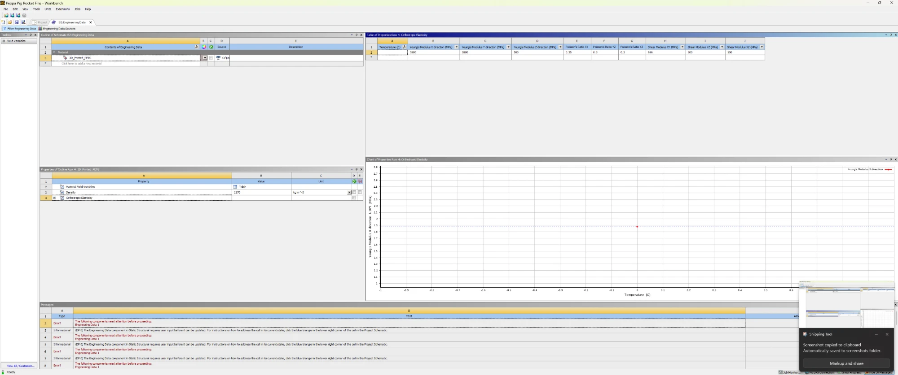

*Figure 5. ANSYS Engineering Data for `3D_Printed_PETG`. This screenshot shows the **owner's earlier values** (Exy 1880, Ez 500 MPa). They were replaced before the runs by the conservative set in the table above. Source: `report/figures/ansys/00_material_table.webp`, owner, 2026-11-21.*

**Mesh:** tetrahedral, 1 mm element size, **422,598 nodes, 244,392 elements**. An earlier default mesh had 42,442 nodes.

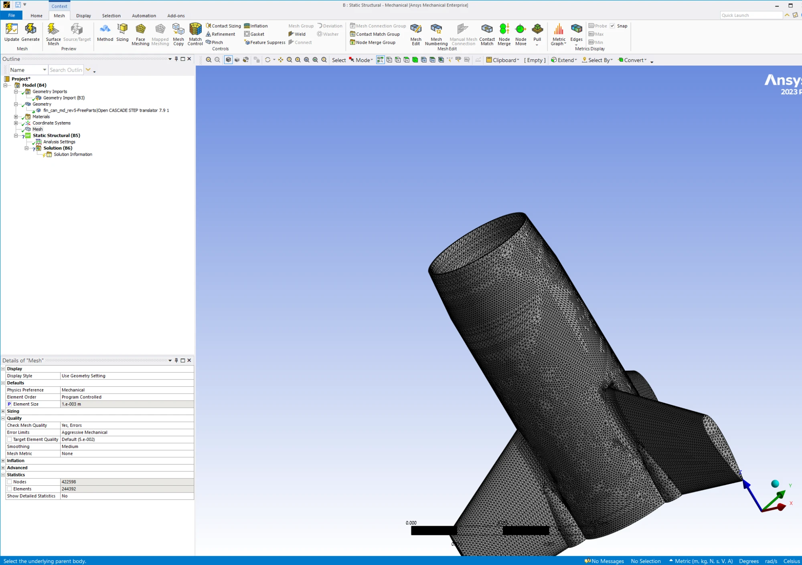

*Figure 6. 1 mm tetrahedral mesh of fin can rev 5. Source: `report/figures/ansys/01_mesh_1mm.webp`, owner, 2026-11-21.*

#### 4.3.2 Case 1: flight side gust

Force Y = 15 N on one side of the +X fin (ESTIMATE: 5° AoA at max q ≈ 37 kPa). Linear static.

| Result | Max | Limit | Factor |
|---|---|---|---|
| Total deformation | 0.274 mm | — | — |
| Normal Z (across layers) | +1.72 / −1.58 MPa | 19 MPa | **~11×** |
| Shear XZ | 0.354 MPa | 15 MPa | ~42× |
| Shear YZ | 0.192 MPa | 15 MPa | ~78× |
| Von Mises | 3.42 MPa (fin root) | 38.5 MPa | ~11× |

*Figure 7. Gust case, total deformation, max 0.274 mm. Source: `report/figures/ansys/10_gust_deformation.webp`, fin can rev 5, owner, 2026-11-21.*

*Figure 8. Gust case, normal stress Z (across layers), +1.72 / −1.58 MPa. Source: `report/figures/ansys/11_gust_normalZ.webp`, fin can rev 5.*

*Figure 9. Gust case, von Mises stress, max 3.42 MPa at the fin root. Source: `report/figures/ansys/14_gust_vonmises.webp`, fin can rev 5.*

#### 4.3.3 Case 2: modal (free vibration, same support)

| Modes | Frequency | Shape |
|---|---|---|
| 1–3 (one per fin) | **567.9 Hz** | likely 1st bending |
| 4–6 | 1530 Hz | torsion or 2nd bending: **not yet identified** |
| 7–9 | 2677 Hz | — |

The flutter estimate (≈ 5.3× at G = 394 MPa) is in §3.5.

*Figure 10. Modal analysis, first 9 frequencies (three groups of three). Source: `report/figures/ansys/20_modal_frequencies.webp`, fin can rev 5, owner, 2026-11-21.*

#### 4.3.4 Case 3: landing tip strike, sideways (Y)

Force Y = 50 N on the +X fin's tip face.

| Result | Max | Limit | Factor |
|---|---|---|---|
| Total deformation | 2.51 mm | — | — |
| Normal Z (across layers) | 10.8 MPa (root) | 19 MPa | 1.75× → **fails at ~88 N** |
| Shear YZ / XZ | 1.48 / 2.77 MPa | 15 MPa | 5.4–10× |
| Von Mises | 21.4 MPa | 38.5 MPa | 1.8× → ~90 N |

*Figure 11. Sideways tip strike, 50 N in Y: total deformation, max 2.51 mm. Source: `report/figures/ansys/30_tipY50_deformation.webp`, fin can rev 5.*

*Figure 12. Sideways tip strike, 50 N in Y: normal stress Z (across layers), max 10.8 MPa at the root. Scaled to 19 MPa, the fin fails at ~88 N. Source: `report/figures/ansys/31_tipY50_normalZ.webp`, fin can rev 5.*

*Figure 12b. Sideways tip strike, 50 N in Y: failure index σ_Z/19 MPa (legend 0–1), max **0.571** (= 10.85 MPa). This confirms the ~88 N sideways failure load (50 / 0.571 = 87.6 N). Source: `report/figures/ansys/35_tipY50_failure_index.webp`, owner, 2026-11-21.*

#### 4.3.5 Case 4: landing tip strike, axial (Z)

Force in Z on the tip face. The response is linear: **σ_Z,max = k·F**, with k = 0.0247 MPa per N at the fin root, aft end.

Failure index: **FI = σ_Z / 19 MPa** (ANSYS expression `SZ/19e6`). FI ≥ 1 means across-layer tensile failure.
- σ_Z is the normal stress across the layers (MPa).
- F is the applied tip force (N).

| Load | Normal Z max | FI (ratio to 19 MPa) |
|---|---|---|
| 400 N | 9.88 MPa | 0.52 |
| 770 N | 19.0 MPa | 1.0008 |
| 900 N | 22.2 MPa | 1.17 |
| 2000 N | 49.4 MPa | 2.60 (max 2.5994) |

**Axial failure point: 770 N** (FI = 1.0008, figure 15). The 2000 N run shows how the crack spreads: a **thin strip along the fin-root fillet at the aft end** (figure 13).

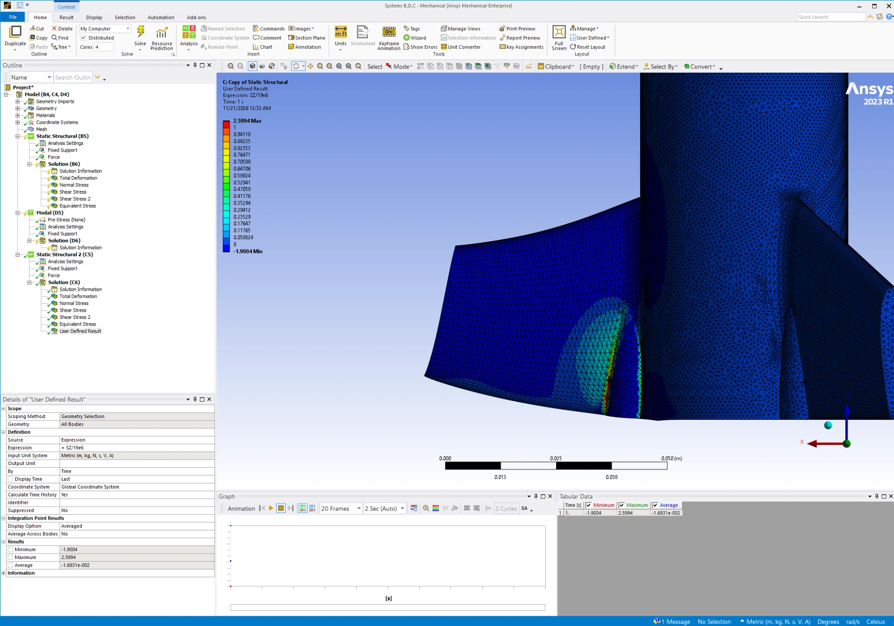

*Figure 13. **Where it breaks.** Axial tip strike, 2000 N in Z: failure index σ_Z/19 MPa, legend fixed at 0–1 (red = failed), max 2.5994. The failed band is a thin strip along the fin-root fillet at the aft end. Source: `report/figures/ansys/43_tipZ2000_failure_index.webp`, fin can rev 5, owner, 2026-11-21.*

*Figure 14. Axial tip strike, 400 N in Z: normal stress Z, max 9.88 MPa (FI 0.52). Source: `report/figures/ansys/40_tipZ400_normalZ.webp`, fin can rev 5.*

*Figure 15. **FAILURE POINT: 770 N axial tip load.** Failure index σ_Z/19 MPa with the legend fixed at 0–1, max **1.0008**: the first elements reach the across-layer strength. Failure starts at the **fin-root fillet, aft end**; the rest of the fin and the sleeve stay blue (FI < 0.1). Source: `report/figures/ansys/45_tipZ770_failure_point.webp`, fin can rev 5, owner, 2026-11-21.*

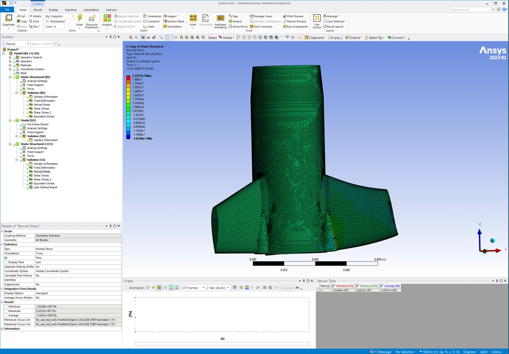

*Figure 16. Axial tip strike, 900 N in Z: normal stress Z, max 22.2 MPa (FI 1.17). Source: `report/figures/ansys/42_tipZ900_normalZ.webp`, fin can rev 5.*

#### 4.3.5b Combined landing load: 200 N sideways (Y) + 770 N axial (Z)

Owner run, 2026-11-21: a tip force of Y = +200 N and Z = +770 N applied together (a tilted landing).

| Case | Failure index max (σ_Z/19 MPa) |
|---|---|
| 50 N Y alone | 0.571 |
| 200 N Y alone (scaled ×4) | 2.28 |
| 770 N Z alone | 1.00 |
| **200 N Y + 770 N Z, combined run** | **3.28** (= 2.28 + 1.00, both peak at the root fillet) |

- The combined result equals the sum of the two single loads. The model is linear and both loads peak at the same spot, the **fin-root fillet**, so any landing angle can be checked by adding the scaled single-load results.
- **The sideways part dominates:** 200 N sideways alone is already 2.3× over the limit.
- **Rev 6 is different:** its Y and Z peaks sit at different spots, so adding the single-load results overestimates the combined FI. The combined runs in §4.4.4 are the real numbers (fea_results.md §4).

*Figure 17. Combined tip load, 200 N Y + 770 N Z: failure index (legend 0–1), max **3.28**. Red = failed, along the fin-root fillet of the loaded fin. Source: `report/figures/ansys/50_combined_Y200_Z770_failure_index.webp`, owner, 2026-11-21.*

#### 4.3.6 Landing-load context (main-session ESTIMATE, ansys_results.md)

Method:
- Landing energy E = ½·m·v², with m the descent mass (kg) and v the descent rate (m/s).
- Average impact force F ≈ E / s, where s is the ground stopping distance (m), taken as 2–5 cm.
- Masses: 540–600 g, chute Cd 0.75.

| | 40 in chute (previous) | **28 in chute (owner's choice since 2026-11-22)** |
|---|---|---|
| Landing energy | 3.8–4.7 J | **7.8–9.7 J** |
| Average impact force | 90–220 N | **180–450 N** |
| Peak impact force | to ~450 N | **to ~900 N** |
| Drop-test height to reproduce | 0.8 m | **1.5 m** |

- **2026-11-22: the owner switched to the 28 in chute** (design.yaml `recovery.chute`). This table was written for 540–600 g; design.yaml gives a 469 g descent mass for the 28 in, and OR gives 594 g at liftoff. The table has not been re-run (§11.5).
- **Realistic design value: ~200 N.** It was set when the 40 in chute was kept. With the 28 in, the average-impact range (180–450 N) brackets it, and the peak bound is higher.
  - Axial: OK, ~3.8× margin against the ~770 N failure load (rev 5).
  - Sideways: rev 5 **fails** (~90 N capacity).
  - **Rev 6 (in-house FEA, §4.4):** sideways capacity ~252 N (ANSYS-scaled) / ~308 N (raw), so the 200 N hit survives at FI 0.65–0.80. Axial capacity ~913 / ~947 N.
  - The ~450 N peak-impact bound for the 40 in chute (table above) is above the rev 6 sideways capacity.
  - **Rev 7 (in-house FEA, §4.4.8):** at 200 N, FI 0.28 sideways, 0.25 tilted at 45° and 0.084 axial (ANSYS-scaled). All are within the owner's 2× criterion (FI ≤ 0.5). Rev 7 capacities (FI = 1) have not been stated by the sim lab (§11.1).
- **Mitigations** (ansys_results.md):
  1. Fly the 40 in chute unreefed (conflicts with recovery.md's reefing advice; §11).
  2. Drop-test the fit-test print: 0.8 m for the 40 in chute, 1.5 m for the 28 in.
  3. A landing-tough **rev 6** (~2.3× root bending strength needed). **Chosen by the owner and built 2026-11-21** (§4.3.7). In-house FEA gives rev 6 **2.87×** the rev 5 sideways strength (§4.4.3).
  4. **Rev 7** (owner fin loop, §4.4.7): blunt 8 mm root TE and a thicker insert boss. It meets C1–C4; it was the flight candidate until rev 8/9 superseded it on 2026-11-22 (§4.0, §4.1).

#### 4.3.7 Rev 6 design rationale: sizing from the owner's ANSYS data (PREDICTION, SUPERSEDED)

> **SUPERSEDED 2026-11-21 by the in-house FEA (§4.4, fea_results.md §3).** The prediction below (~350–400 N; FI 0.50–0.57 at 200 N) was **optimistic**. The actual sideways gain is **2.9×**, not the 4× from thickness² scaling, because the peak sits at the boss/fillet corner rather than in plain fin bending. The text is kept as the sizing record.

**All rev 6 strength values below are PREDICTIONS** by the main session (design.yaml `aero.fin_thickness_mm` note; git 2c62fb5). An owner ANSYS run on rev 6 is no longer needed, because rev 7 supersedes it (§4.3.8).

**Sizing steps:**
1. Rev 5 sideways FI per unit load: 0.571 / 50 N = **0.01142 per N** (figure 12b).
2. At 200 N sideways (the realistic landing value, §4.3.6): 0.01142 × 200 = **2.28** on rev 5.
3. Root bending stress scales as σ = M/Z with Z = Cr·t²/6 (§4.2), so at a fixed load and chord **σ ∝ 1/t²**.
4. Doubling the root from 6 to 12 mm: (12/6)² = **4**, so FI at 200 N Y ≈ 2.28 / 4 = **0.57** (~1.75× margin) before fillet credit.
5. The fillet increase (4 → 6 mm) and the 2.0 mm blunt root TE (at the aft-end crack origin, figure 13) are credited to about **FI 0.50 (~2×)**.

Symbols: FI failure index σ_Z / 19 MPa (–); σ_Z across-layer normal stress (MPa); M root bending moment (N·mm); Z section modulus (mm³); Cr root chord (mm); t root thickness (mm).

| Predicted (rev 6) vs ANSYS (rev 5) | Rev 5 (ANSYS) | Rev 6 (PREDICTION, **superseded**) | Rev 6 in-house FEA (§4.4) |
|---|---|---|---|
| 50 N Y, FI | 0.571 | ~0.14 | 0.162 (raw) |
| 200 N Y, FI | 2.28 (scaled) | ~0.5–0.57 | **0.65 (raw) – 0.80 (ANSYS-scaled)** |
| Sideways capacity (FI = 1) | ~88 N | ~350–400 N | **~252 N (scaled) / ~308 N (raw)** |
| 200 N Y + 770 N Z, FI | 3.28 | ~0.75–0.8 | **1.38 (raw) / ~1.69 (scaled)** |

**Changes rev 5 → rev 6** (design.yaml, rev 6 spec):

| Item | Rev 5 | Rev 6 | Why |
|---|---|---|---|
| Planform | 50 / 30 / 43.18 / 20.32 | same | owner OR set, keeps the CP |
| Root thickness | 6 mm | **12 mm** | 4× root section-modulus factor |
| Tip thickness | 6 mm | 6 mm (linear taper) | flutter and mass |
| Root fillet | r 4 mm | **r 6 mm** | at the ANSYS failure site; larger collides with the sleeve bore |
| TE | 0.84 mm | **2.0 mm root → 0.84 tip** | aft-end root is the ANSYS crack origin |
| Mass | 80 g slicer | **84.83 g slicer, 25 % gyroid** | owner |
| Verify | 5/5 at 80 g | **5/5 at 84.83 g** | — |

**Caveats on the prediction:**
- The 1/t² rule assumes the same solid section. The rev 5 fin (6 mm) was almost all wall; the 12 mm rev 6 root is wider than two 2.67 mm wall bands, so it has a **25 % gyroid core**. The verify model's infill region grew from 1.76 cm³ (rev 5) to 11.76 cm³ (rev 6). ANSYS models the part as solid, so it will not capture this. (The same applies to the CalculiX model, §4.4.10.)
- The fillet credit (0.57 → ~0.50) is a judgement, not a calculation.
- The axial part of the combined prediction is not derived in the sources.
- **Outcome:** the 1/t² rule missed because the sideways peak is at the insert-boss / fillet corner, not in plain fin bending (§4.4.5).

#### 4.3.8 Not yet run in ANSYS
- **Rev 7 cross-check, OPTIONAL (owner):** run ANSYS on `out/fin_can_md/rev7/fin_can_md_rev7.step` at the in-house run loads. Raw CalculiX root FI to compare against (out/fea/rev7 `result.json`; mesh 3.0 / 0.8 mm):
  - 50 N Y: 0.054.
  - 400 N Z: 0.138.
  - 200 N at 45° (141.4 N Y + 141.4 N Z): 0.193.
  - 15 N Y (gust): 0.017.
  - The in-house criteria values multiply these by ×1.294 (sideways) or ×1.222 (axial) (§4.4.7).
- **Rev 6 ANSYS re-run:** no longer needed (rev 6 superseded).
- **Motor thrust:** +138 N on the lip underside (not run in-house either).
- **Mode-shape identification** for modes 4–6 (and a rev 7 modal run).

### 4.4 In-house FEA (CalculiX): validation, rev 6, 7, 8 and 9 results (fea_results.md; fin_design_criteria.md; out/fea)

The sim lab is `tools/fea_ccx.py` (gmsh 4.15.2 + CalculiX 2.21), run in the project container by the main session on 2026-11-21. The `rocket-simlab` agent (`.claude/agents/rocket-simlab.md`) now owns these runs.
- Its rule is **validate before predicting**: reproduce an owner reference first and report the % difference.
- **These results supersede the rev 6 PREDICTION in §4.3.7.**
- **Rev 7** was scored against the owner's fin criteria at a fixed mesh (§4.4.7–4.4.9). Its results are only in `out/fea/rev7/` and fin_design_criteria.md; fea_results.md has no rev 7 section yet (§11). The owner's ANSYS cross-check of rev 7 is optional.

#### 4.4.1 Method (fea_results.md; `tools/fea_ccx.py` docstring)

The setup mirrors the owner's ANSYS runs (§4.3).

| Item | In-house (CalculiX) | Owner ANSYS (§4.3) |
|---|---|---|
| Geometry | `out/fin_can_md/rev<N>/fin_can_md_rev<N>.step`, mm, Z = rocket axis = print direction | same (rev 5) |
| Support | fixed sleeve bore | Fixed Support on the sleeve bore (R 20.727 mm) |
| Load | total force spread over the **+X fin's tip face** | force on the +X fin's tip face |
| Material | **conservative** orthotropic PETG: E 1472 / 1472 / 1087 MPa, ν 0.38, G 533 / 394 / 394 MPa | same set (§4.3.1) |
| Elements | **C3D10** (quadratic tetrahedra) | tetrahedral |
| Mesh | **2.5 mm global, 0.7 mm in a box around the +X fin root** (validation and rev 6, §4.4.2–4.4.4). **Fin loop: 3.0 mm global, 0.8 mm root box** for rev 5 calibration, rev 6 and rev 7 (§4.4.7–4.4.8) | 1 mm, 422,598 nodes |
| Nodes (run `result.json`) | 2.5 / 0.7 mesh: rev 5 validation 212,241–218,440; rev 6 runs 254,576–255,113. 3.0 / 0.8 mesh: rev 5 159,789–159,913; rev 6 183,337–183,427; **rev 7 205,231–206,185** | — |
| Solver | **direct** (SPOOLES) | — |
| Read-out | FI in the fin-root zone (8 mm band above the sleeve OD); nodes within 5 mm of the loaded tip face excluded | FI expression `SZ/19e6` |

Run records: `out/fea/rev<N>/<case>/result.json`, with renders `fi_overview.png` and `fi_root_zoom.png`.

**Equations** (linear static):
- Failure index: **FI = σ_Z / σ_allow**, with σ_allow = 19 MPa (across-layer tensile, Ultimaker TDS, upright).
- Capacity: **F₁ = F / FI**, the tip load at which FI reaches 1.
- ANSYS-scaled values: **FI_A = k · FI_C** and **F₁,A = F₁,C / k**. Here **k = σ_Z,ANSYS / σ_Z,CCX** on the matching rev 5 case, at the 2.5 / 0.7 mesh:
  - sideways: k = 10.85 / 8.85 (fea_results.md uses ×1.22);
  - axial: k = 9.88 / 9.52.
- The fin loop re-derives k at its own 3.0 / 0.8 mesh: ×1.294 sideways, ×1.222 axial (§4.4.7).

Symbols: σ_Z normal stress across the layers (MPa); F applied tip force (N); FI_C raw CalculiX failure index (–); FI_A ANSYS-scaled failure index (–); k calibration ratio (–).

**Loads vs layers.** Z is the print direction, so every FI here checks **across-layer (interlayer) tension**:
- **Sideways tip load (Y):** root bending puts across-layer tension at the insert-boss / fillet corner.
- **Axial tip load (Z):** across-layer tension at the aft-face root corner.
- **Combined loads:** the peak is at the fillet-to-sleeve junction (200 N at 45°) or at the boss/fillet (200 N Y + 770 N Z).
- **Rev 7, all four criteria loads:** across-layer tension at the aft end of the root near the insert boss, z ≈ 2.6–3.5 mm (§4.1, §4.4.8).

#### 4.4.2 Validation against the owner's ANSYS (rev 5; fea_results.md §1)

| Case | Owner ANSYS | CalculiX (0.7 mm root mesh) | Difference |
|---|---|---|---|
| 50 N Y: root σ_Z | 10.85 MPa (FI 0.571) | 8.85 MPa (FI 0.466) | −18 % |
| 50 N Y: root σ_Z (uniform 2.0 mm mesh) | 10.85 MPa | 10.25 MPa (FI 0.540) | −5.5 % |
| 50 N Y: tip deflection | 2.51 mm | 2.84 mm | +13 % |
| 400 N Z: root σ_Z | 9.88 MPa | 9.52 MPa (FI 0.501) | **−3.6 %** |

- **Axial: within 3.6 %.**
- **Sideways: 5.5–18 % low, and mesh-dependent.** The peak sits on a sharp concave edge at the top of the insert-boss cap, near (29.8, −1.5, 8.3) mm. There it ranged from 7.5 to 10.3 MPa across the meshes tried. This is expected at a sharp corner, in ANSYS too.
- **Consequence:** rev-to-rev comparisons use **identical settings**, and absolute values are **scaled to the owner's ANSYS calibration** (§4.4.1).

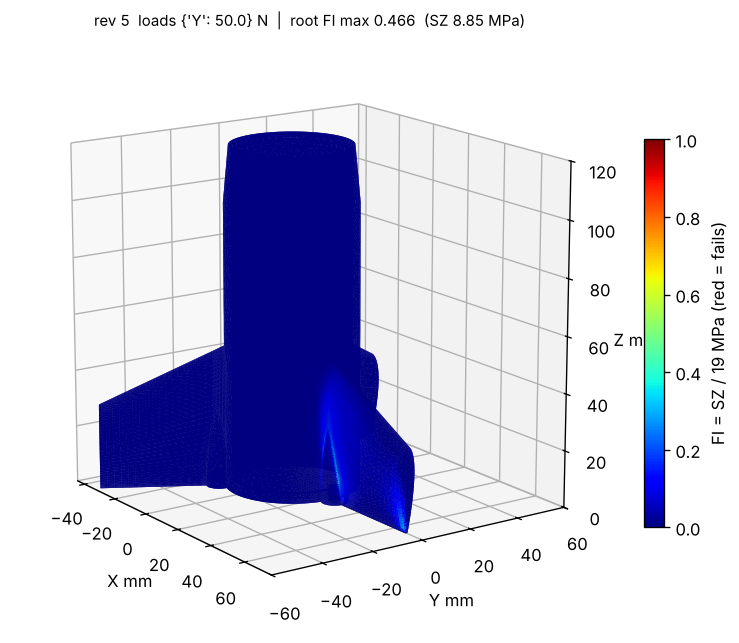

*Figure 23. In-house FEA validation, fin can **rev 5**, 50 N Y on the +X fin tip. Failure index σ_Z/19 MPa, legend 0–1. Root FI max **0.466** (σ_Z 8.85 MPa) vs the owner's ANSYS 0.571 (figure 12b). Mesh 2.5 mm global / 0.7 mm root, C3D10, direct solver. The bright spot at the fin tip is the load-face spike, excluded from the read. Source: `out/fea/rev5/val_tipY50_r0.7_direct/fi_overview.png`, `tools/fea_ccx.py`, 2026-11-21.*

#### 4.4.3 Rev 6 vs rev 5, identical settings (fea_results.md §2–3)

| Case | Rev 5 FI | Rev 6 FI | Ratio | Rev 6 peak location (mm) |
|---|---|---|---|---|
| 50 N Y (sideways) | 0.466 | **0.162** | 0.348: **2.87× stronger** | (29.4, −2.5, 6.8): boss/fillet |
| 400 N Z (axial) | 0.501 | **0.422** | 0.843: **1.19× stronger** | (29.9, 1.1, 0.8): aft face, root corner |
| Max deflection, 50 N Y | 2.84 mm | 0.90 mm | 3.2× stiffer | tip |

**Rev 6 capacities (FI = 1)**

| Load | Raw CalculiX | Scaled to the owner's ANSYS rev 5 calibration | Rev 5 (owner ANSYS) |
|---|---|---|---|
| **Sideways (Y)** | **~308 N** | **~252 N** | ~88 N |
| **Axial (Z)** | ~947 N | ~913 N | ~770 N |

- **Realistic sideways landing hit, ~200 N (ESTIMATE): FI 0.65 (raw) to 0.80 (ANSYS-scaled). Rev 6 survives, with a 1.25–1.5× margin.**
- Rev 5 at the same 200 N: FI 1.86–2.28 (fails).
- ansys_results.md asked for ~2.3× root bending strength; the sideways ratio is 2.87×.
- **The axial capacity barely changed.** The axial peak is at the aft-face root corner, which the thickness taper does not reinforce.

*Figure 24. In-house FEA, fin can **rev 6**, 50 N Y on the +X fin tip. Failure index σ_Z/19 MPa, legend 0–1. Root FI max **0.162** (σ_Z 3.08 MPa), at the boss/fillet (29.4, −2.5, 6.8) mm. That is 2.87× below rev 5 at identical settings (figure 23). The tip spike is the load face, excluded. Source: `out/fea/rev6/tipY50/fi_overview.png`, `tools/fea_ccx.py`, 2026-11-21.*

*Figure 25. In-house FEA, fin can **rev 6**, 400 N Z (axial) on the +X fin tip. Failure index σ_Z/19 MPa, legend 0–1. Root FI max **0.422** (σ_Z 8.03 MPa), at the aft-face root corner (29.9, 1.1, 0.8) mm; rev 5 at identical settings: 0.501. The bright spot at the fin tip is the load-face spike, excluded. Source: `out/fea/rev6/tipZ400/fi_overview.png`, `tools/fea_ccx.py`, 2026-11-21.*

#### 4.4.4 Combined landing loads (rev 6, actual runs; fea_results.md §4)

| Case | Rev 6 FI (raw) | Rev 6 FI (ANSYS-scaled ×1.22) | Rev 5 reference | Verdict |
|---|---|---|---|---|
| **200 N at 45°** (141 N Y + 141 N Z): a realistic tilted landing | **0.56** at (23.1, −4.2, 9.9), where the fillet meets the sleeve | ~0.69 | ~1.4 (superposed estimate) | **survives, 1.45–1.8×** |
| 200 N Y + 770 N Z (the owner's severe rev 5 ANSYS case) | **1.38** at (29.4, −2.4, 6.4), boss/fillet | ~1.69 | **3.28** (owner ANSYS) | **fails**, but ~1.9× (scaled) to 2.4× (raw) better than rev 5 |

- **The 200 N Y + 770 N Z case is extreme.** It totals about 800 N: rev 5's axial *failure* load plus a full sideways hit. It is not the realistic landing estimate (~200 N, main-session ESTIMATE).
- **Superposing single loads overestimates rev 6**, because its Y and Z peaks are at different spots. The combined runs are the real numbers.
- fea_results.md now labels the two ratios: **~1.9× on the ANSYS-scaled FI** (like-for-like with the owner's 3.28) and 2.4× on the raw FI. This closes the earlier like-for-like query.
- **Not re-run on rev 7** (§4.4.8).

*Figure 26. In-house FEA, fin can **rev 6**, 200 N at 45° (141.4 N Y + 141.4 N Z) on the +X fin tip. Failure index σ_Z/19 MPa, legend 0–1. Root FI max **0.561** (σ_Z 10.67 MPa), where the fillet meets the sleeve; ~0.69 ANSYS-scaled, so it survives. The bright spot at the fin tip is the load-face spike, excluded. Source: `out/fea/rev6/combined_200N_at45/fi_overview.png`, `tools/fea_ccx.py`, 2026-11-21.*

*Figure 27. In-house FEA, fin can **rev 6**, 200 N Y + 770 N Z (extreme case) on the +X fin tip. Failure index σ_Z/19 MPa, legend 0–1 (red = failed). Root FI max **1.380** (σ_Z 26.22 MPa) at the boss/fillet; ~1.69 ANSYS-scaled, so it **fails**. Rev 5 ANSYS for the same case: 3.28 (figure 17). The bright spot at the fin tip is the load-face spike, excluded. Source: `out/fea/rev6/combined_Y200_Z770/fi_overview.png`, `tools/fea_ccx.py`, 2026-11-21.*

#### 4.4.5 Correction: the rev 6 pre-build prediction was optimistic

| Quantity | Pre-build PREDICTION (§4.3.7, superseded) | In-house FEA (this section) |
|---|---|---|
| Sideways capacity | ~350–400 N | **~252 N (ANSYS-scaled) / ~308 N (raw)** |
| 200 N Y, FI | 0.50–0.57 | **0.65–0.80** |
| 200 N Y + 770 N Z, FI | ~0.75–0.8 | **1.38 (raw) / ~1.69 (scaled)** |
| Sideways gain vs rev 5 | 4× (thickness², 6 → 12 mm) | **2.87×** |

- **Why:** the actual gain is 2.9×, not 4×, because the peak sits at the **boss/fillet corner**, not in plain fin bending (fea_results.md §3).
- The §4.3.7 PREDICTION text is marked **SUPERSEDED**; it stays as the sizing record.
- **Verdict:** rev 6 still survives the realistic 200 N sideways and 200 N at 45° landings.

#### 4.4.6 Suggested geometric fixes (fea_results.md §5; NOT BUILT)
1. **Fillet the top edge of the insert-boss cap.** That sharp concave edge carries the sideways peak.
2. **Fillet or chamfer the fin root where it meets the aft face.** That corner carries the axial peak.

- The sources give no predicted gain for either fix.
- **Rev 7 took a different route:** it buried the boss in an 8 mm blunt root TE and added 1 mm of boss wall (§4.1). Neither fillet was built.

#### 4.4.7 Fin acceptance criteria and the rev 7 loop (fin_design_criteria.md; `tools/fin_iter.py`)

**Owner request (2026-11-21):** iterate rev 7, 8, 9 … "until the fins are right for this rocket".
- Each revision is generated with `make.py fin_can_md`, then analysed with `tools/fea_ccx.py` at the **same settings**: mesh 3.0 mm global / 0.8 mm root box, C3D10, direct solver.
- Failure indices are scaled to the owner's ANSYS calibration, using rev 5 run at those same settings.
- `tools/fin_iter.py --rev N` scores a revision and writes `out/fea/rev<N>/criteria.json`.

| # | Criterion | Requirement | Basis (fin_design_criteria.md) | **Rev 7 status** |
|---|---|---|---|---|
| C1 | Sideways landing hit, 200 N at the tip (Y) | **FI ≤ 0.5** (ANSYS-scaled): a 2× margin | 200 N = main-session realistic landing ESTIMATE (ansys_results.md); 2× covers print variability | **PASS, 0.28** |
| C2 | Tilted landing, 200 N at 45° (Y + Z) | FI ≤ 0.5 (scaled) | same | **PASS, 0.25** |
| C3 | Tail-first landing, 200 N axial (Z) | FI ≤ 0.5 (scaled) | same | **PASS, 0.084** |
| C4 | Flight gust (15 N Y) | FI ≤ 0.1 | ansys_results.md case 1 | **PASS, 0.022** |
| C5 | Flutter | Vf ≥ 1.5 × Vmax (250 m/s) at G = 394 MPa | NACA TN 4197; "thickness only increases Vf" | PASS by argument; not recomputed (§3.5) |
| C6 | Printable and verified | verify checks 1, 3, 4, 5 PASS; no overhang (TE flush, planform shrinks going up); check 2 once the owner gives the slicer mass | shop rules | **PASS:** verify 5/5 at the 90 g slicer mass (§4.1) |
| C7 | Aero and stability unchanged | owner's OR planform kept (50/30/43.18/20.32); ballast re-solved for 1.8 cal | owner decision | **PASS:** planform kept; 73 g → 1.81 cal (§6.1) |
| C8 | **Mass** | the **lowest** fin-can mass that meets C1–C7 | "every gram at the tail costs ~0.4 g of nose ballast" | **NOT DEMONSTRATED:** the lighter rev 8 was never scored (§4.4.9) |

- **Stop rule:** stop when a revision meets C1–C7 and the next, lighter step fails one of them. Hard cap: rev 10. Then hand off to stability, docs and the owner.
- **Outcome (2026-11-21):** the **owner stopped the loop at rev 7**. Rev 8 was not analysed (§4.4.9). The stop was the owner's choice, not the stop rule's C8 test.

**Scaling method** (`tools/fin_iter.py` docstring and code). The model is linear static, so FI scales with load:

**FI_crit = k · FI_C,run · (F_crit / F_run)**

- **k_side = FI_ANSYS,rev5(50 N Y) / FI_C,rev5(50 N Y) = 0.571 / 0.441 = ×1.294.**
- **k_ax = FI_ANSYS,rev5(400 N Z) / FI_C,rev5(400 N Z) = (400 / 770) / 0.425 = ×1.222.** The owner's ANSYS fails at 770 N axial (FI 1.0, §4.3.5).
- C1 uses the 50 N Y run (F_crit / F_run = 200 / 50) with k_side. C3 uses the 400 N Z run (200 / 400) with k_ax.
- C2 runs at 200 N at 45° and C4 at 15 N Y (ratio 1). C2 uses the larger of the two k values (×1.294); C4 uses k_side.

Symbols: FI_crit failure index at the criterion load, ANSYS-scaled (–); FI_C,run raw CalculiX root-zone FI at the run load (–); F_crit criterion load (N); F_run run load (N); k calibration ratio (–); FI_C,rev5 rev 5 raw FI at the same mesh (out/fea/rev5/m30r08_* `result.json`).

- At the 2.5 / 0.7 mesh the sideways k was ×1.22 (§4.4.1). The difference comes from the mesh-dependent corner peak (§4.4.2). Values from the two meshes are not mixed in the tables below.

#### 4.4.8 Rev 7 results (out/fea/rev7/criteria.json and `result.json`; out/fea/rev6/criteria.json)

**Criteria scores, rev 7 vs rev 6 at identical settings** (mesh 3.0 / 0.8, calibration ×1.294 sideways / ×1.222 axial)

| Criterion | Rev 7 FI raw (at criterion load) | **Rev 7 FI scaled** | Limit | Rev 7 | Rev 6 FI scaled | Rev 6 |
|---|---|---|---|---|---|---|
| C1 sideways 200 N | 0.217 | **0.28** | 0.5 | **PASS** | 0.785 | **FAIL** |
| C2 tilted 200 N at 45° | 0.193 | **0.25** | 0.5 | **PASS** | not run at this mesh | MISSING |
| C3 axial 200 N | 0.069 | **0.084** | 0.5 | **PASS** | 0.218 | PASS |
| C4 flight gust 15 N | 0.017 | **0.022** | 0.1 | **PASS** | not run at this mesh | MISSING |

- **Rev 7: C1–C4 ALL PASS** (`all_pass_C1_C4: true`). Rev 6 fails C1.
- Rev 6's earlier 200 N at 45° result was ~0.69 ANSYS-scaled (§4.4.4). That is above the C2 limit, but it used the 2.5 / 0.7 mesh and ×1.22, so it is not directly comparable.

**Raw runs at identical settings** (root-zone FI = σ_Z / 19 MPa; load face excluded)

| Run | Rev 5 FI | Rev 6 FI (peak, mm) | **Rev 7 FI** (σ_Z) | Rev 7 peak (mm) | Rev 7 max deflection |
|---|---|---|---|---|---|
| 50 N Y (sideways) | 0.441 | 0.152 (23.1, −4.2, 9.9) | **0.054** (1.03 MPa) | (29.3, −4.2, 3.5) | 0.50 mm (rev 6: 0.91) |
| 400 N Z (axial) | 0.425 | 0.356 (29.6, −2.1, 4.8) | **0.138** (2.63 MPa) | (29.4, −4.0, 2.6) | 0.56 mm (rev 6: 0.69) |
| 200 N at 45° | — | — | **0.193** (3.66 MPa) | (29.4, −4.1, 3.1) | 1.44 mm |
| 15 N Y (gust) | — | — | **0.017** (0.33 MPa) | (29.3, −4.2, 3.5) | 0.15 mm |

- **Rev 7 is ~2.6–2.8× better than rev 6** on identical meshes: 0.152 → 0.054 sideways and 0.356 → 0.138 axial (main session).
- **Peak location moved.** The rev 6 sideways peak on this mesh was where the fillet meets the sleeve (the same spot as the rev 6 45° case, §4.4.4). The rev 7 peaks all sit at the aft end of the root near the insert boss (§4.1).
- **Axial run, global peak:** outside the root read-out zone, the 400 N Z run's global FI (load face excluded) is **0.191** (σ_Z 3.62 MPa) at (20.6, 2.6, 3.0) mm. That is above its root-zone 0.138.
  - Those coordinates appear to lie on the sleeve bore (R 20.727 mm), which is the fixed support.
  - C3 uses the root-zone value. This run is at twice the C3 load.
  - The sim lab should confirm whether this is a support artifact (§11.1).
- **Not run on rev 7:** the extreme 200 N Y + 770 N Z case, capacities (FI = 1), motor thrust and modal.

*Figure 31. In-house FEA, fin can **rev 7**, the four criteria runs on the +X fin tip. Mesh 3.0 mm global / 0.8 mm root, C3D10, direct solver. Failure index σ_Z/19 MPa, legend 0–1, **raw** (not ANSYS-scaled).*
- *Top left: 50 N Y, root FI 0.054. C1 = 0.054 × (200/50) × 1.294 = 0.28.*
- *Top right: 200 N at 45°, root FI 0.193 (C2 0.25).*
- *Bottom left: 400 N Z, root FI 0.138 (C3 0.084). The bright spot at the fin tip is the load face, which is excluded.*
- *Bottom right: 15 N Y gust, root FI 0.017 (C4 0.022).*

*Source: `out/fea/rev7/m30r08_{tipY50,200N_at45,tipZ400,gust15}/fi_overview.png`, `tools/fea_ccx.py`, 2026-11-21. Assembled 2 × 2 by rocket-docs, with panel labels added and pixels unchanged.*

#### 4.4.9 Original rev 8 (root 10 mm): generated, not analysed, dropped (fin_design_criteria.md Outcome; main session)

> The rev 8 number was **reused on 2026-11-22** for the screw-on tail cone design (§4.0.3, §4.4.11). This subsection is about the earlier 10 mm-root step only.
- **Rev 8** was the next, lighter step: **root 10 mm** (rev 7: 12 mm).
- It was generated, but its FEA mesh failed in gmsh: "Failed to reach critical value ... ScaledJac".
- **The owner chose rev 7.** Rev 8 is dropped and design.yaml is back at rev 7.
- No rev 8 output is kept in `out/fin_can_md/` or `out/fea/`. Its mass and verify results are not recorded.
- **Consequence:** C8 (lowest mass) is not demonstrated. Whether a 10 mm root would also pass C1–C4 is unknown.

#### 4.4.10 Caveats
- **Sharp-corner peaks are mesh-dependent** (7.5–10.3 MPa across meshes on rev 5). Ratios at identical settings are more reliable than absolute values. The sideways k differs between meshes: ×1.22 at 2.5 / 0.7 and ×1.294 at 3.0 / 0.8.
- **Solid model.** The STEP solid is meshed with one orthotropic material, as in ANSYS. It does not capture the 25 % gyroid core in the 12 mm root (§4.3.7).
  - Rev 7's infill region is larger: 18.17 cm³ (rev 6: 11.76).
  - Whether the extra boss wall and the thick blunt-TE region print as solid walls or as infill depends on the slicer. The FE model treats them as solid. Check the slicer preview (owner).
  - The drop test (§9.4) is the check.
- **Material inputs** are the conservative set from search-result summaries (§4.3.1). The limits come from ansys_results.md; changing them is the owner's call (rocket-simlab.md).
- **The landing load (~200 N) is an ESTIMATE.** The 40 in chute's peak-impact bound (to ~450 N, §4.3.6) is above the rev 6 sideways capacity. No rev 7 capacity has been stated.
- **Not run in-house:** motor thrust on the lip; modal (rev 6 or rev 7); rev 7 200 N Y + 770 N Z.

#### 4.4.11 Rev 8 and rev 9 results (fin_design_criteria.md; out/fea/rev8, out/fea/rev9 `criteria.json` and `result.json`)

Same settings as the rev 7 loop: mesh 3.0 mm global / 0.8 mm root box, C3D10, direct solver, calibration ×1.294 sideways / ×1.222 axial (`criteria.json` `calibration`). Rev 9 meshes have 200,532–201,046 nodes.

| Criterion (ANSYS-scaled FI) | Rev 7 | Rev 8, no gusset | **Rev 8, gusseted** | **Rev 9** | Limit |
|---|---|---|---|---|---|
| C1 sideways 200 N | 0.28 | 0.46 | **0.30** | **0.34** | 0.5 |
| C2 tilted 200 N at 45° | 0.25 | 0.39 | **0.33** | **0.27** | 0.5 |
| C3 axial 200 N | 0.084 | 0.20 | **0.11** | **0.15** | 0.5 |
| C4 gust 15 N | 0.022 | 0.031 | **0.023** | **0.026** | 0.1 |

- **Rev 8 (gusseted) and rev 9: C1–C4 ALL PASS** (`all_pass_C1_C4: true`). The main session quotes rev 9 C4 as "0.03"; `criteria.json` gives 0.0257.
- Rev 9 is slightly weaker than rev 7 sideways and axially (it lost the 8 mm blunt TE), but stays within the 2× criterion.

**Rev 9 raw runs** (root-zone FI = σ_Z / 19 MPa; load face excluded)

| Run | Root FI (σ_Z) | Root peak (mm) | Global FI, load face excluded (location) | Max deflection |
|---|---|---|---|---|
| 50 N Y | 0.065 (1.24 MPa) | (23.0, −4.3, 9.1) | 0.073 at (60.7, −2.4, 9.5) | 0.88 mm |
| 400 N Z | 0.240 (4.56 MPa) | (23.3, 1.6, 0.0) | 0.264 at (20.7, 1.0, 3.0) | 0.67 mm |
| 200 N at 45° | 0.207 (3.93 MPa) | (23.2, −4.1, 8.7) | 0.212 at (60.7, −2.3, 8.9) | 2.50 mm |
| 15 N Y (gust) | 0.020 (0.38 MPa) | (23.0, −4.5, 9.9) | 0.022 at (60.7, −2.4, 10.1) | 0.26 mm |

- **Peak location moved again:** rev 7 peaked at the aft end near the insert boss (z ≈ 3 mm). Rev 9 has no boss; its bending peaks sit where the root fillet meets the sleeve (r ≈ 23 mm, z ≈ 9–10 mm), and the axial peak at the aft face.
- **Global peaks outside the root zone:**
  - Three runs peak at x ≈ 60.7 mm, out on the fin near the loaded tip, slightly above the root value. They lie outside the 5 mm load-face exclusion; whether they are load-introduction effects is not stated (§11.1).
  - The 400 N Z run's global peak (20.7, 1.0, 3.0) mm again appears to lie on the fixed sleeve bore, as in rev 7 (§4.4.8).
- **Rev 8 raw runs:** 50 N Y 0.058, 400 N Z 0.186, 200 N at 45° 0.257, 15 N Y 0.018; all root peaks at the aft face, r ≈ 22.8–22.9 mm, z ≈ 0, where the gusset meets the collar.

*Figure 77. In-house FEA, fin can **rev 9**, 50 N Y on the +X fin tip. Failure index σ_Z/19 MPa, legend 0–1, raw. Root FI max **0.065** (σ_Z 1.24 MPa). The whole part is dark blue; only a faint lighter patch shows at the loaded fin root. C1 = 0.34 after scaling to 200 N and ×1.294. Source: `out/fea/rev9/m30r08_tipY50/fi_overview.png`, `tools/fea_ccx.py`, 2026-11-22.*

*Figure 78. Rev 9, 50 N Y, close-up of the loaded fin root. The lighter band follows the root fillet where it meets the sleeve.*
- ***Look at** the fillet-to-sleeve line: that is the C1/C2/C4 peak location (z ≈ 9 mm), now that the insert boss is gone.*

*Source: `out/fea/rev9/m30r08_tipY50/fi_root_zoom.png`, 2026-11-22.*

*Figure 79. Rev 9, 200 N at 45° (141.4 N Y + 141.4 N Z), root close-up. Root FI max **0.207** (σ_Z 3.93 MPa) → C2 0.27. A light-blue streak runs along the fillet-to-sleeve line, and the fin's aft lower corner is lighter.*
- ***Look at** the aft lower corner of the fin: the axial part of the load adds there.*

*Source: `out/fea/rev9/m30r08_200N_at45/fi_root_zoom.png`, 2026-11-22.*

- **Not run on rev 8/9:** capacities (FI = 1), the extreme 200 N Y + 770 N Z case, motor thrust on the lip, ejection load on the collar thread, modal. **The owner's SolidWorks fin can has not been analysed.**

### 4.5 Mass model (walls + infill): skills/SKILL.md, verify check 2

m = ρ · (V_shell + f · V_interior)

Symbols:
- ρ = 1.27 g/cm³ (PETG).
- V_shell: walls (2.67 mm band) plus top/bottom skins (cm³).
- V_interior: infill region (cm³).
- f: infill fraction (0–1).

| Rev | V_shell (cm³) | V_interior (cm³) | m at f = 0 / f = 1 | Owner slicer |
|---|---|---|---|---|
| rev 2 | 134.67 | 2.39 | 171.0 / 174.1 g | — |
| rev 3 | 76.84 | 0.54 | 97.6 / 98.3 g | — |
| rev 5 | 65.70 | 1.76 | 83.4 / 85.7 g | 80 g |
| rev 6 | 68.51 | 11.76 | 87.0 / 101.9 g | 84.83 g at 25 % gyroid (88.43 g at other settings) |
| rev 7 | 71.36 | 18.17 | 90.6 / 113.7 g | 90 g at 25 % gyroid |
| rev 8 | 77.50 | 18.78 | 98.4 / 122.3 g | — (sim ESTIMATE 94.6 g, "scaled from the rev 7 slicer") |
| **rev 9** | **79.52** | **12.05** | **101.0 / 116.3 g** | — (sim ESTIMATE **97.9 g**) |
| tail cone rev 8 / **rev 9** | 9.91 / **12.59** | 0 / 0 | 12.6 / **16.0 g** (solid) | — |
| owner SolidWorks fin can | — | — | — | **pending** (~95 g ESTIMATE, main session) |

- The model reads **~6 % high** vs the slicer (main session, rev 6). For rev 6 even its 0 % value (87.0 g) is above the slicer figure, so the verify's "infill to hit target" is −14.6 %.
- **Rev 7:** the 0 % value (90.6 g) is again above the slicer's 90 g; "infill to hit target" is −2.7 % (rev 7 verify).
- Rev 7 adds mass at the aft end: 8 mm blunt root TE and +1 mm boss wall. The CG moves aft, from 40.5 to 38.0 mm forward of the aft face (design.yaml `stability.fin_can_model_cg_from_aft_mm`).
- The stability re-solve uses the slicer's **90.0 g** (design.yaml `stability.fin_can_model_mass_g`).
- **Rev 8 / rev 9:** no slicer masses. The sims used fin can + tail cone ESTIMATES of 94.6 + 12.6 g (rev 8, CG 29.6 mm forward of the aft face, design.yaml note) and **97.9 + 16.0 = 113.9 g** (rev 9, CG 31.5 mm; fin_design_criteria.md, `tools/flight_export.py`). design.yaml `stability.fin_can_model_mass_g` still reads the rev 7 90.0 g (§11.5).

### 4.6 Fin can revision history

| Rev | Part / layout | Change | Mass (0–100 % infill) | Verify | Status |
|---|---|---|---|---|---|
| rev 1 | `fin_can.py`, 29 mm + liner | First geometry | 170.5–173.0 g | 5/5 (171.1 g) | superseded |
| rev 2 | `fin_can.py`, 29 mm | Option A insert bosses | 171.0–174.1 g | 5/5 | **SUPERSEDED** (29 mm dropped) |
| rev 3 | `fin_can_md.py`, sleeve | Sleeve, aft lip, fairing; old 100/40/40/5 fins | 97.6–98.3 g | 4/5 (no target) | superseded (unstable fins, aero.md §0.3) |
| rev 4 | `fin_can_md.py` | Aero-optimised fins 50/30/77/6 | 105.2–108.7 g | 5/5 (target 108.7 g) | PROPOSED, not adopted |
| rev 5 | `fin_can_md.py` | Owner's OR fins 50/30/43.18/20.32/6 | 83.4–85.7 g (slicer 80 g) | 5/5 at 80 g (re-run) | superseded for flight; ANSYS basis (§4.3); CalculiX validation basis (§4.4.2) |
| rev 6 | `fin_can_md.py` + taper in `fin_can.py` | Landing-tough: root 12 → tip 6 mm, fillet 6, TE 2.0 → 0.84; same planform | 87.0–101.9 g (slicer 84.83 g, 25 % gyroid) | 5/5 at 84.83 g | **SUPERSEDED by rev 7**; in-house FEA: sideways ~252–308 N (§4.4.3); fails C1 at 0.785 (§4.4.8) |
| rev 7 | `fin_can_md.py` + `boss_extra_wall_mm` in `fin_can.py` | Blunt root TE 8.0 → 0.84 mm; insert-boss wall +1.0 mm (2.67 → 3.67); rev 6 planform, taper and fillet | 90.6–113.7 g (slicer 90 g, 25 % gyroid) | 5/5 at 90 g | **SUPERSEDED 2026-11-22 by rev 8/9**; FEA C1–C4 PASS (§4.4.8); CFD CP 836.3 mm |
| rev 8 (original) | `fin_can_md.py` | Root 10 mm (next lighter step of the fin loop) | not recorded | not recorded | **DROPPED:** gmsh mesh failed (ScaledJac), never analysed; owner chose rev 7 (§4.4.9) |
| rev 8 (2026-11-22) | `fin_can_md.py` + `parts/tail_cone.py` | Threaded collar (12 → 18.5 mm) + screw-on tail cone retainer (20 mm boattail to 43.0); solid bosses; rev 7 fins; 45° TE gussets | 98.4–122.3 g; cone 12.6 g | 4/5 (mass vs 90 g) | **SUPERSEDED by rev 9**; FEA 0.30 / 0.33 / 0.11 / 0.023; CFD CP 834.4 mm, −14 % drag (§4.0.3) |
| **rev 9** | **`fin_can_md.py` + `parts/tail_cone.py`** | **No bosses; TE root 2.5 mm; concave R6 TE skirt; 30 mm boattail to 41.6; 40 mm fairing; collar 18.5 mm** | **101.0–116.3 g (sim ESTIMATE 97.9 g); cone 16.0 g** | **4/5 (mass target stale)** | **design-side flight candidate, DRAFT**; FEA 0.34 / 0.27 / 0.15 / 0.026; CFD CP 827.4 mm, −18 % drag (§4.0.1) |
| owner | SolidWorks (`owner_cad/`) | Owner's own fin can + tail cone, span 46.1 mm | slicer pending | — | **owner's design basis**; CFD CP 809.9 mm (UNCONFIRMED gap); no FEA (§4.0.4) |

*Figure 18a. SUPERSEDED. Fin can rev 3 (old 100/40/40/5 fins), iso view in print orientation. Source: `out/fin_can_md/rev3/fin_can_md_rev3_iso.png`, 2026-11-21.*

*Figure 18. SUPERSEDED. Fin can rev 3, axial section through a fin. Source: `out/fin_can_md/rev3/fin_can_md_rev3_section.png`, 2026-11-21.*

*Figure 19. SUPERSEDED. Fin can rev 2 (29 mm mount), iso view. Source: `out/fin_can/rev2/fin_can_rev2_iso.png`, 2026-11-20.*

*Figure 20. SUPERSEDED. Fin can rev 2, axial section through a fin. Source: `out/fin_can/rev2/fin_can_rev2_section.png`, 2026-11-20.*

### 4.7 Nose cone rev 1: cone + cap + plug (DRAFT; design.yaml `nosecone`, out/nose_*/rev1 specs)

Owner layout (2026-11-22): an empty payload bay is reserved, the ballast goes in a tip pocket closed by a screw-in plug, and a screw-on bottom cap carries the Kevlar. All three parts use printed coarse threads. The part values are main-session design choices and can be edited (design.yaml `nosecone.part`).

| Item | Value | Status / source |
|---|---|---|
| Shape / length | Tangent ogive, 165 mm, fineness 4.0 | PROPOSED |
| Base OD | 41.275 mm | nominal; reset to the measured tube OD |
| Shoulder | OD 38.555 mm, 40 mm long | PROPOSED |
| Wall | 2.2 mm | PROPOSED |
| Ballast pocket | tip → 100 mm (27.2 cm³, uniform-fill CG 74.6 mm); 6 mm bulkhead with a Ø20 mm threaded fill hole | `nosecone.part` |
| Plug | head Ø23 × 3 mm, screwdriver slot 2 × 1.5 mm | `nosecone.part` |
| Cap | thread ring Ø30 bore × 15 mm in the shoulder; **5 mm floor**; two Ø5 mm Kevlar holes at 14 mm spacing (9 × 5 mm web, ~2.1 kN, "6× the 343 N opening ESTIMATE") | `nosecone.part` |
| Threads | pitch 2.5 mm, depth 1.0 mm, clearance 0.2 mm, 45° flanks | `nosecone.part` |
| **Printed mass** | **63 g** for cone + cap + plug (owner Bambu slicer, 3 wall loops, 20 % gyroid). Model at 6 walls, 25 %: 72.8 g | OWNER; `stability.nose_shell_mass_g` |
| CG (no ballast) | 137.8 mm from the tip (assembly, solid-mesh CGs) | `nosecone.cg_from_tip_mm` |
| **Ballast** | **2 g** → **65 g nose total**, OWNER DECISION per OpenRocket | `stability.ballast_g` |
| Print | cone tip up on the shoulder face, 41.3 × 41.3 × 203.3 mm; cap flange down; plug head down. No supports | specs |

**Verify (make.py, 2026-11-22)**

| Part | Result | Note |
|---|---|---|
| `nose_cone` rev 1 | **4/5: check 2 mass FAIL** | target 52.7 g (a guessed per-part split); model 61.2–62.4 g. design.yaml notes that verify runs the shop's 6-wall profile, so it cannot match the owner's 3-wall print |
| `nose_cap` rev 1 | 5/5 (auto) | target 10.0 g, model 8.0–11.3 g |
| `nose_plug` rev 1 | 5/5 (auto) | target 3.0 g, model 2.1–3.6 g |

- All three spec sheets say "VISUAL REVIEW REQUIRED". The renders have **not** been reviewed for this report.
- **Drawing set (2026-11-23):** `out/nose_cone/rev1/nose_cone_rev1_drawings.pdf`, A3: section A-A and view from aft; base thread ring and ballast bulkhead details with an ogive table; bottom cap and ballast plug (`tools/drawing_nose.py`; git 8f76d8c).
- **Thread:** the cap uses the same 2.5 / 1.0 / 0.2 mm thread that passed the owner's fin-can test print (§4.0.5). The nose cap itself was not test-printed (not recorded).
- Under CLAUDE.md the nose parts are not "good" yet.

**Loads vs layers (nose rev 1; spec sheets, nosecone.md §4)**

| Load | Path | Direction vs layers |
|---|---|---|
| Recovery snatch: Kevlar pulls the cap aft (−Z) | the cap floor web bends; the cap thread shears the nose's thread ring (~10 kN per spec) | floor: **within** the layers; ring thread: **across** the layers |
| Same load, onward | the shoulder wall carries it forward in **Z tension across the layers** (251 mm² annulus, 15 MPa at 3.77 kN) | **across layers: the weak link** |
| Ballast inertia at deploy or landing | pushes aft onto the plug and bulkhead; the bulkhead's 45° cone carries it to the wall | compression and bending **within** the layers |

---

### 4.8 Nose cone mass sweep (RocketPy, rev 7 fin can 90 g, 2026-11-21; SUPERSEDED by the 65 g owner decision)

Ballast varied with everything else from design.yaml (nose shell 52.7 g ESTIMATE, ballast CG 74.6 mm from the tip).
Run: `sims/l1_cheap_sweep.py` `case()` with `stability.ballast_g` overrides.

| Nose total (shell + ballast) | Ballast | Margin liftoff / burnout (cal) | Apogee | Mach max | Rail exit 1.83 m | Deploy speed, 12 s delay |
|---|---|---|---|---|---|---|
| 108 g | 55.0 g | 1.37 / 2.50 (below band) | 1231 m | 0.743 | 24.1 m/s | 8.4 m/s |
| 117 g | 64.4 g | 1.60 / 2.76 (band low edge) | 1233 m | 0.737 | 24.0 m/s | 7.9 m/s |
| **126 g** | **73.0 g** | **1.81 / 3.00 (target)** | **1234 m** | **0.732** | **23.8 m/s** | **7.4 m/s** |
| 134 g | 81.3 g | 2.00 / 3.22 (band high edge) | 1235 m | 0.727 | 23.7 m/s | 6.9 m/s |
| 143 g | 90.0 g | 2.20 / 3.44 (above band) | 1236 m | 0.723 | 23.5 m/s | 6.5 m/s |

- **Recommendation at the time: 126 g nose total (window 117–134 g).** Apogee is insensitive (5 m across the range), so the 1.8 cal target alone sets the mass.
- **SUPERSEDED 2026-11-22:** the owner chose a **65 g nose total per OpenRocket** (§6.0). This sweep sits on the Barrowman CP with the pack on the motor. The CFD shows that CP is conservative by 31 mm (§3.6.2).

## 5. Recovery

> recovery.md has not been re-run for the H100W. design.yaml `recovery.deployment` still names the H182R-14A charge.

### 5.1 Scheme (recovery.md §1, design.yaml `recovery`)
- **Single deploy on the H100W-14A's own ejection charge, drilled to 12 s** (§2.4). PROPOSED; no electronics are flown.
- The charge size is unpublished, and a DMS charge can't be ground-tested on its own.
- **Pack position:** the sim puts the pack on the stop ring ahead of the motor (stability.md §0.2). OR's model holds it forward with a 2 g bulkhead (§3.3). On the rev 5 basis this was worth +0.99 cal, or about 37 g of ballast.
- **With the 65 g nose and the rev 7 CFD CP (SUPERSEDED basis):** 2.08 cal with OR's pack position, but **1.17 cal if the pack slides onto the motor** (CG 788 mm; or_component_analysis.md). **Pack the chute toward the nose.** No part holds it there yet (§11.4).
- **WARNING (main session, 2026-11-23):** on the current boattail basis, the default design.yaml mass model with the **pack sliding onto the motor simulates at 0.15 cal and stalls the RocketPy integrator**. The flight sim only runs with the pack held forward, **~300 mm from the tip, as in OR** (§6.7). This is now a pre-flight check (§9.6).
- **Motor retention and ejection (rev 8+):** the ejection kick pulls the motor aft onto the tail-cone shank; the collar thread carries it (~6 kN shear capacity, tail cone rev 9 spec).
- **Aft anchor:** not designed. The sim carries a 10 g ring ESTIMATE (§11).
- **Heat:** the paper tube touches the motor case directly (motor.md §D).

### 5.2 Parachute: 28 in ripstop (owner, 2026-11-22); 40 in previously

Descent rate, flat canopy: **v = √( 2·m·g / (ρ·Cd·A) )**

Symbols:
- v: descent rate (m/s).
- m: descent mass (kg).
- g = 9.80665 m/s².
- ρ = 1.225 kg/m³.
- Cd: canopy drag coefficient (0.75 design, 1.5 optimistic).
- A = πD²/4: canopy area (m²).

| 40 in chute (recovery.md §7; previous choice) | 450 g | 575 g | 700 g |
|---|---|---|---|
| Cd 0.75 | 3.44 m/s | 3.89 m/s | 4.29 m/s |
| Cd 1.5 | 2.43 m/s | 2.75 m/s | 3.04 m/s |
| Reefed to ~30 in, Cd 0.75 | 4.59 m/s | 5.19 m/s | 5.72 m/s |

- The burnout mass is **548 g** (design.yaml `stability.burnout_mass_g`, rev 7 basis; rev 5 run: 539 g), between the 450 g and 575 g columns. recovery.md has not tabulated it.
- **Chute decision (2026-11-22): 28 in ripstop nylon, 38 g** (design.yaml `recovery.chute`, `chute_diameter_in`, `chute_mass_g`; OWNER, from the OR file; weigh it).
  - design.yaml gives **5.0 m/s at Cd 0.75 for a 469 g descent mass**. OR gives a landing speed of 11.8 mph (5.3 m/s).
  - recovery.md has no 28 in table. The 40 in table above is kept for reference.
  - The 28 in chute roughly **doubles the landing energy** compared with the 40 in (§4.3.6).
  - Whether the owner already has a 28 in chute is not recorded (§11.6).
  - **Flight video sim (2026-11-23):** analytic descent at **5.5 m/s** (`tools/flight_video.py`: "OR 12.3 mph"), deploy at 14.4 s, **landing at ~258 s**, drifting in a 4.5 m/s wind (main session; figure 81). OR v2 gives landing 11.9 mph (§3.3.1).
- **Reefing:** recovery.md recommends reefing in wind. The ANSYS mitigation is to fly unreefed for gentler landings (§11).

### 5.3 Opening load (recovery.md §3, §7)

**F = ½ · ρ · v² · Cd · A · Cx**, where Cx = 1.6 is the opening-shock factor (Knacke 1992), F is in N and v is the deploy speed (m/s).

| v at deploy (40 in, Cd 0.75; not re-run for the 28 in) | 10 m/s | 20 | 30 | 40 |
|---|---|---|---|---|
| F | 60 N | 238 N | 536 N | 953 N |

- With the 12 s delay, deploy is 7.4 m/s nominal (rev 7) and ≤ 17 m/s over the Cd spread (rev 5 run, §6.5). That is inside the ≤ 20 m/s column.
- An undrilled 14 s delay would deploy at 10–28 m/s.
- F is proportional to A, so the smaller 28 in canopy gives a lower opening load at the same speed. recovery.md has not tabulated it, and design.yaml `recovery.shock_cord_min_rating_n` and `anchor_min_net_area_mm2` are still the 40 in values (§11.5).
- The nose cap web is sized against a 343 N opening ESTIMATE (design.yaml `nosecone.part`, §4.7).

### 5.4 Shock cord
- **9KM DWLIFE Kevlar, 750 lb (3336 N), 2.3 mm, 2.91 g/m; 16 m owned.**
- Cut length rule: 3 × rocket length + 300 mm, with rocket length 1030.7 mm. The sim carries **9.9 g** of Kevlar (stability.md §0.1).
- Knotted at 40 % efficiency, the cord holds 1334 N, which is enough up to a ~27 m/s deploy. **Splice or sew the loops.**

### 5.5 Ejection protection
Estes recovery wadding is PROPOSED ($5.43–5.99). A Nomex 6×6 (~$5) is the reusable alternative (recovery.md §5).

---

## 6. Stability & Flight Simulation

**Tool:** RocketPy 1.13.0, `sims/l1_cheap.py --allow-tbd --margin-plot out/sims/l1_cheap_margin_vs_time.png` (stability.md §0).
- The sim models the sleeve step and fairing as RocketPy tails, with the fins on the sleeve radius.
- Each value is taken in this order:
  1. the owner value, if it is a number;
  2. otherwise the `stability.assumptions` value;
  3. otherwise the item is left out and the run is stamped PROVISIONAL.
- Conditions: standard atmosphere, vertical rail, no wind unless stated.
- The run is **PROVISIONAL**: the tube, chute, stop ring, epoxy, buttons, retention and nose shell masses are ESTIMATES.
- **Basis:** the design.yaml `stability` result block is **rev 7: fin can 90 g, CG 38.0 mm forward of the aft face, 73 g ballast** (main session re-solve, 2026-11-21; git 370cebe).
  - It sits on the **Barrowman CP (804.7 mm)**. It has **not** been re-solved for the owner's 2 g ballast (`stability.ballast_g`).
  - **The current basis is §6.0a** (boattail fin cans, CFD CP, 65 g nose). §6.0 (rev 7, OR export 2026-11-22) is superseded. §6.1–6.6 are kept as the in-house record on the superseded 73 g basis.
  - **The rev 8/9 sims and the flight video sim** use the same script with overrides (OR weights + extras, fin can + cone mass and CG, pack position, Cd ×0.857). They are not written back into the design.yaml `stability` block (§11.5).
  - stability.md §0, the delay table (§6.5) and the margin plot (figure 21) are still the **rev 5 / 70 g** run. Rev 5 and rev 6 rows are kept for reference.

### 6.0a Current basis (2026-11-23): boattail fin cans, 65 g nose, CFD CP

**Owner basis:** the owner flies the SolidWorks fin can (Pepto B. #2, §4.0.4) with the 65 g nose. **Design-side reference:** rev 9. The CP question between the two is open (§3.6.4).

**Margins on the current fin cans** (ref 41.275 mm; SM = (CP − CG)/d, §6.1; all CGs are sims or ESTIMATES, nothing is weighed)

| Case | CP (source) | CG from tip | Margin | Ballast for 1.8 cal | Source |
|---|---|---|---|---|---|
| Rev 8, OR weights + extras | 834.4 (CFD r8a4) | 758.8 mm | **1.83 cal** | — | fin_design_criteria.md Rev 8 |
| **Rev 9**, OR weights + extras, 65 g nose | **827.4 (CFD r9a4)** | **761.0 mm** | **1.61 cal** | **+7.4 g** (nose 72 g) | fin_design_criteria.md Rev 9 |
| Owner STEP, CG ESTIMATE | 809.9 (CFD own_a4) | 759 mm ESTIMATE | ≈ 1.23 cal | ~+23 g ESTIMATE | or_component_analysis.md |
| Owner STEP, OR v2 CG | 809.9 (CFD own_a4) | 750.6 mm | **1.44 cal** | ~+15 g ESTIMATE | or_component_analysis.md |
| Owner STEP, OR v3 after the mass fixes | 809.9 (CFD own_a4) | ≈ 752 mm ESTIMATE | **≈ 1.40 cal** ESTIMATE | ~+15 g ESTIMATE | or_component_analysis.md; main session |
| OR v2 as exported | 835.6 (OR) | 750.6 mm | 1.82 cal | — | OR_Pepto_B_2.pdf |
| OR v3 as exported, tube ref | 861.5 (OR) | 774.8 mm | 2.10 cal (OR: "1.85" on the sleeve ref) | — | or_component_analysis.md |

- **Interim CP for both designs: 827 mm (rev 9 CFD), PROVISIONAL** until the fine-mesh check finishes (main session). The margin of the owner design on that CP has not been computed in any source (§11.4).
- **For the current designs, every CFD-based margin (1.23–1.61 cal) is below the 1.8 cal target.** Only rev 9's 1.61 cal is inside the 1.6–2.0 band, at its lower edge (rev 8's 1.83 cal is superseded). The ballast numbers above depend on the basis; the final value comes from the weighed balance check.
- **Pack position matters more than before:** with the pack on the motor the RocketPy basis reads 0.15 cal (§5.1, §6.7).
- The rev 7 / 836.3 mm basis in §6.0 is **SUPERSEDED**.

### 6.0 Owner basis (2026-11-22): 65 g nose per OpenRocket, CP from 3D CFD (rev 7; SUPERSEDED 2026-11-22/23)

**Owner decision** (design.yaml `stability.ballast_g`, git fbb269f):
- The nose is **65 g TOTAL**: 63 g printed plus **2 g ballast**, per OpenRocket (2.07 cal, CG 29.545 in, CP 32.914 in).
- The owner accepts OpenRocket over the in-house sim.
- **Balance check per OR: CG ≤ 29.5 in (750 mm) from the tip**, with the motor in and the chute packed.

**Margins with the 65 g nose** (or_component_analysis.md; ref 41.275 mm; SM = (CP − CG)/d, §6.1)

| Case | CG from tip | On the CFD CP 836.3 mm | On the Barrowman CP 804.7 mm |
|---|---|---|---|
| OpenRocket model (594 g) | 750.4 mm | **2.08 cal** (OR itself: 2.07) | 1.32 cal (figure 33) |
| With the real extras | 753 mm | **2.01 cal** | not stated |
| Chute pack slides onto the motor | 788 mm | **1.17 cal**, still stable | not stated |
| In-house sim, OR weights (case A) | 749.2 mm (figure 33; main session) | not stated | not stated |

**In-house sim before the CFD** (sims/l1_cheap.py, same 65 g nose, 28 in chute; Barrowman CP; or_component_analysis.md)

| Case | Margin at liftoff | Ballast for 1.8 cal |
|---|---|---|
| Chute pack on the motor stop (where boost pushes it) | **0.16 cal: UNSTABLE** | 62.7 g (nose 126 g) |
| Chute pack held 300 mm from the tip (OR-like) | 1.20 cal | 24.1 g (nose 89 g) |

- The source puts this gap down to two things: **pack position** (~45 mm of CG) and **the CP** (836 vs 805 mm, ~0.75 cal). The CFD settles the CP side in favour of OR (§3.6.2).
- **The pack-position risk remains.** With the pack forward the margin is 2.08 cal, and on the motor it is 1.17 cal (CFD CP). Pack the chute toward the nose.
- **Owner band 1.6–2.0 cal:** 2.08 and 2.01 cal are **just above** the upper edge, and 1.17 cal is below the lower edge (§11.6).

**Flight sim with OR weights, case A** (main session, 2026-11-22; not yet in a project file)
- CG 749.2 mm (OR: 750.4); **apogee 1212 m** (OR: 3945 ft = 1202 m); **Mach 0.785**; rail exit **25.5 m/s** (rail length not stated).
- The deploy speed and the delay table were not re-stated for this basis. OR's "optimum delay" is 11.6 s, close to the 11.24 s coast on the 73 g basis (§2.4). **12 s stays the plan** (design.yaml `stability.recommended_delay_s`).

### 6.1 Static margin
**SM = (CP − CG) / d**

Symbols: SM static margin (calibers); CP and CG measured from the nose tip (mm); d reference diameter, 41.275 mm (tube) for the gate. 46.795 mm (sleeve) is shown for comparison.

**Rev 7, 73 g (superseded basis, Barrowman CP):** (804.7 − 730.2) / 41.275 = **1.81 cal, PASS** (1.8 ± 0.2) (design.yaml `stability.margin_liftoff_cal`). **Owner basis:** (836.3 − 750.4) / 41.275 = **2.08 cal** (§6.0).

| Case (liftoff) | Ballast g | CG mm | ref 41.275 | ref 46.795 |
|---|---|---|---|---|
| **Rev 7, design value (pack on motor)** | **73** | **730.2** | **1.81 PASS** | 1.59 FAIL (low on that ref; `margin_liftoff_cal` note) |
| Rev 7, solved 1.6 / 1.80 / 2.0 | 64.4 / 72.8 / 81.3 | — | 1.60 / 1.80 / 2.00 | — |
| Rev 6 (superseded), design value | 71 | 729.8 | 1.82 PASS | — |
| Rev 6, solved 1.80 / 2.0 | 70.4 / 78.8 | — | 1.80 / 2.00 | — |
| Rev 5: zero ballast, pack on motor | 0 | 807.8 | **−0.08 UNSTABLE** | −0.07 |
| Rev 5: owner 80 g nose (27.3 g ballast), pack on motor | 27.3 | 775.4 | 0.71 FAIL | 0.63 FAIL |
| Rev 5: owner 80 g nose, pack at OR 457 mm | 27.3 | 736.4 | 1.66 PASS | 1.46 FAIL |
| Rev 5: solved 1.8, pack on motor | 69.7 → 70 | 730.1 | 1.81 PASS | 1.59 |
| Rev 5: solved 2.0, pack on motor | 78.1 | 722.2 | 2.00 PASS | 1.76 PASS |
| Rev 5: solved 1.8 / 2.0, pack at OR 457 mm | 32.9 / 40.9 | 730 / 722 | 1.80 / 2.00 | 1.59 / 1.76 |

- **On OR's CP (836.0 mm)** the rev 5 / 70 g build read about **2.57 cal** (§3.3). The CFD CP (836.3 mm) confirms OR's, so ballast at this level would over-stabilise the rocket. That is why the owner moved to 2 g (§6.0).
- **Fin can at 120 g** (the old owner target) instead of 84 g: the CG moves 10.4 mm aft (−0.25 cal), and 83.8 g of ballast would be needed (stability.md §0.2, rev 5).
- design.yaml `stability.ballast_g` note: "solved 72.8 g for 1.80 cal (ref 41.275); 1.6 cal 64.4 g, 2.0 cal 81.3 g". **73 g** is the design value; the final value comes from the balance check.
- **Tail mass costs ballast:** "every gram at the tail costs ~0.4 g of nose ballast" (fin_design_criteria.md C8). Rev 6 → rev 7: fin can 84.83 → 90 g, ballast 71 → 73 g.

### 6.2 Mass budget: liftoff, pack on the motor (stability.md §0.1; design.yaml `stability` for rev 7 / 73 g, SUPERSEDED basis; x from the nose tip)

On the owner's basis the nose is 65 g in total (63 g printed, CG 137.8 mm without ballast, plus 2 g of ballast) and the chute is 38 g (§4.7, §5.2). The OR model totals 594 g at a CG of 750.4 mm (§3.3). The table below has not been re-run with these inputs.

| Item | g | x (mm) | Basis |
|---|---|---|---|
| Nose shell | 52.7 | 119.9 | nosecone.md ESTIMATE |
| **Ballast** | **73** (rev 5 run: 70) | 74.6 | solved for 1.8 cal; final value from the balance check |
| Tube 863 mm | 93.6 | 596.5 | ESTIMATE 0.1085 g/mm (OR "LOC avg" gives 150.6 g; OR model 123 g; weigh it) |
| **Fin can rev 7** | **90.0** | CG 38.0 mm forward of the aft face | owner slicer, 25 % gyroid (rev 6: 84.83 g, CG 40.5; rev 5 run: 84.0 g at 987.4 mm, CG 43.3 mm fwd of aft face) |
| Stop/anchor ring | 10 | 870.7 | ESTIMATE, not designed |
| Chute 57 + Kevlar 9.9 | 66.9 | 805.7 | ESTIMATES; pack rests on the ring |
| Wadding / epoxy / buttons / retention | 2 / 10 / 5 / 5 | 855.7 / 980.7 / 730.7 / 1028.7 | ESTIMATES |
| Motor H100W | 261 → 140 | 953.2 | CG at mid-length ASSUMED |
| **Liftoff / burnout** | **669 / 548** (rev 7; rev 5 run 660 / 539) | **CG 730.2 / 680.9** (rev 7); rev 5 run 730.1 / 680.0 | design.yaml: "structure 408 (incl. 73 g ballast, rev 7 fin can 90 g) + motor 261" |

**Balance check (ready to fly), owner basis:** **CG ≤ 750 mm (29.5 in)** from the tip, with the motor in and the chute packed toward the nose (design.yaml `stability.ballast_g`).
- The older 73 g basis value is **730 mm (window 722–739)**, with about 1.1 g of ballast per mm of CG shift (design.yaml `stability.balance_check_cg_from_nose_mm`, not yet updated; §11.5).

### 6.3 Margin vs time

*Figure 21. Static margin CP(Mach) − CG(t) for the H100W, **fin can rev 5 and 70 g ballast** (not regenerated for rev 6 or rev 7), on a 1.83 m rail. It is plotted from liftoff to apogee with 0 / 5 / 10 g of delay and ejection mass loss; the dotted line is Mach. The shaded band is the owner's 1.8 ± 0.2 liftoff gate. Source: `out/sims/l1_cheap_margin_vs_time.png`, `sims/l1_cheap.py`, 2026-11-21.*

Method (stability.md §3a):
- CP(M) comes from RocketPy's Mach-dependent Barrowman, which the CFD shows is conservative by 31 mm at M 0.29 (§3.6.2).
- Propellant m(t) is impulse-proportional.
- The propellant CG is at the motor midpoint.

| Event | t (s) | Mach | **SM rev 7 / 73 g (cal)** | Rev 5 run / 70 g | Source (design.yaml stability) |
|---|---|---|---|---|---|
| Liftoff | 0 | 0 | **1.81 (min)** | 1.81 | `margin_liftoff_cal`, `margin_min_in_flight_cal` |
| Rail exit (1.83 m) | — | 0.07 | **1.87** | 1.88 | `margin_rail_exit_cal` |
| Max margin | ~2.2 | ~0.7 | **3.31** | 3.34 | `margin_max_in_flight_cal` |
| Vmax | 1.93 | **0.732** (rev 5: 0.737) | — | — | `max_velocity_m_s`, `max_mach` |
| Burnout | 2.398 | — | **3.00** (static M0) | 3.02 | `margin_burnout_cal` |
| Apogee | **13.64** (rev 5: 13.59) | 0 | not re-stated | 3.02–3.11 (0–10 g loss) | `time_to_apogee_s`; `margin_burnout_cal` note (rev 5 text) |

### 6.4 Flight summary (design.yaml `stability`, rev 7 / 73 g; rev 5 run from stability.md §0.4; owner basis from §6.0)

| Quantity | **OR export 2026-11-22 (65 g nose, 28 in)** | **In-house, OR weights (case A)** | Rev 7 / 73 g (superseded) | Rev 5 run / 70 g | Owner's OR (2026-11-21) |
|---|---|---|---|---|---|
| Apogee | **3945 ft (1202 m)**, H100W_DMS-6 | **1212 m** | 1234 m at 13.64 s, no deployment before apogee | 1233 m (4044 ft) at 13.59 s | 3327 ft (1014 m), flown with the −6 delay |
| Burnout / coast to apogee | "optimum delay" 11.6 s | — | 2.398 s / 11.24 s | 2.398 s / 11.19 s | "optimum delay" 11.6 s |
| Vmax / Mach / max q | 615 mph | M **0.785** | 248.3 m/s / 0.732 / 36.7 kPa | 250.0 m/s / 0.737 / 37.3 kPa | 245.9 m/s / 0.726 |
| Rail exit | 41.5 mph off the pad | **25.5 m/s** (rail length not stated) | 21.4 / 23.8 m/s (1.5 / 1.83 m) | 21.6 / 24.0 m/s | — |
| Liftoff mass / CG | 594 g / 750.4 mm | — / 749.2 mm | 669 g / 730.2 mm | 660 g / 730.1 mm | 637 g |
| Deploy, 12 s delay | — | not stated | 7.4 m/s at 1231 m, falling | 7.9 m/s at 1230 m | — |
| Landing | 11.8 mph | — | — | — | — |

Case A values are from the main session (2026-11-22) and are not yet recorded in a project file (§11.4).

- **Apogee gap:** if OR still uses the −6 delay, its apogee is cut short. Ours is not; at 6 s we are at 1095 m, still climbing at 56 m/s (rev 5 run). The rest of the gap is coast drag: our Cd is an ESTIMATE, and OR's Cd is unknown.
- The owner's Monte Carlo (1199–1213 m, balsa 3 mm fins, −6 delay) is not comparable to the printed fins.

### 6.5 Delay table (stability.md §0.4, rev 5 run / 70 g)

| Delay (s) | Deploy t (s) | Alt (m) | Speed, nominal (m/s) | Direction | Speed over Cd ×0.7–1.3 (m/s) |
|---|---|---|---|---|---|
| 14 (undrilled) | 16.40 | 1199 | 21.2 | falling | 10–28 |
| 13 | 15.40 | 1218 | 15.2 | falling | 0–22 |
| **12 (DRILL)** | **14.40** | **1230** | **7.9** | falling | **≤ 17** |
| 11 | 13.40 | 1233 | 1.9 | at apogee | ≤ 19 |
| 10 | 12.40 | 1226 | 11.7 | climbing | ≤ 30 |
| 9 | 11.40 | 1209 | 21.8 | climbing | 10–40 |
| 8 | 10.40 | 1182 | 32.3 | climbing | 20–51 |
| 7 | 9.40 | 1144 | 43.5 | climbing | 31–63 |
| 6 (OR's "−6") | 8.40 | 1095 | 55.8 | climbing | 42–77 |
| 5 | 7.40 | 1032 | 69.5 | climbing | — |
| 4 | 6.40 | 955 | 85.4 | climbing | — |

- **Rev 7 re-solve, 12 s row:** deploy at **7.4 m/s, 1231 m, falling** (design.yaml `deploy_velocity_m_s`, `deploy_altitude_m`). The other rows were not re-stated for rev 7.
- The pack-position, 80 g-nose, 120 g-can and wind cases all deploy at 5–11 m/s with 12 s (stability.md §0.4, rev 5 run).
- **12 s stays the recommendation for rev 7** (design.yaml `stability.recommended_delay_s`).

### 6.6 Sensitivity
- **Cd ×0.7 / 0.85 / 1.3:** apogee 1509 / 1352 / 1061 m; coast 12.96 / 11.97 / 10.01 s. A 4.5 m/s wind gives 1224 m (design.yaml `stability.apogee_m` note; rev 5 run values, not re-stated for rev 7).
- **Pack position:** moving the pack from 805.7 to 457 mm gives +0.99 cal, about 37 g of ballast (stability.md §0.2).
- **Ballast vs CG:** about 1.1 g per mm of CG shift (design.yaml `stability.balance_check_cg_from_nose_mm`).
- **Mass estimates** (aero.md §0.6): +10 g nose → +0.27 cal; +10 g tube → +0.09 cal; tube at 151 g → +0.46 cal.
- **Delay/ejection mass loss** of 0–10 g moves the apogee margin from 3.02 to 3.11 cal (rev 5 run).
- **Fin can mass:** about 0.4 g of nose ballast per gram at the tail (fin_design_criteria.md C8).
- **Rev 6/7 drag:** the thick root and blunt TE (**8 mm at the root in rev 7**) are not in the Cd table (§3.4). A higher Cd lowers apogee and shortens the coast (Cd ×1.3 row).
- **Boattail (rev 8/9):** the CFD shows −14 % / −18 % drag vs rev 7 (§3.4); the rev 8/9 sims apply a Cd ×0.857 factor, whose basis is not stated in the sources (§11.5).

### 6.7 Flight simulation video: Pepto B. #2 (2026-11-23; `tools/flight_export.py`, `tools/flight_video.py`, out/video/)

**What it is:** an animated MP4 of a simulated flight, `out/video/pepto_b2_flight.mp4` (git c532fc7). The trajectory comes from RocketPy (`sims/l1_cheap.py`); the rocket drawn is the owner's OML silhouette (`out/cfd/rocket_oml_owner.stl`). The RocketPy aerodynamic model is still built from design.yaml (docstrings).

**Inputs** (`tools/flight_export.py` docstring and overrides):
- recovery pack at **300 mm from the tip** (`recovery_pack_position` 300);
- fin can + tail cone **113.9 g**, CG **31.5 mm** forward of the fin-can aft face (rev 9 ESTIMATE + model, §4.5);
- **Cd ×0.857**; rail = the longer design rail, 1.83 m; vertical launch.
- Liftoff mass **613.4 g** (`flight.json` `m`).

**Results** (`out/video/flight.json`; main session)

| Event / quantity | Value |
|---|---|
| Rail exit | **24.9 m/s** |
| Burnout | 2.4 s (2.398 s) |
| Vmax / Mach max | **269 m/s / M 0.79** |
| Apogee | **1337 m (4388 ft) at 14.0 s** |
| Deploy (12 s delay) | 14.4 s, ≈ apogee |
| Descent / landing | 5.5 m/s on the 28 in chute (analytic, "OR 12.3 mph"); **landing ~258 s** |

**Display assumptions and caveats**
- The video footer reads "vertical launch, no wind on ascent; descent drifts in a **4.5 m/s wind**" (`flight.json` `wind` 4.5). After deployment the descent is analytic, not RocketPy.
- The RocketPy (Barrowman) margin for this case is **0.93 cal** (`flight.json` `sm`). Barrowman is the conservative model here (§3.2); it is not the CFD margin.
- **WARNING:** the **default design.yaml mass basis (pack sliding onto the motor) simulates at 0.15 cal and stalls the integrator** (main session). The chute pack must be held forward, ~300 mm from the tip, as in OR. This is in §9.6 and §11.4.
- Apogee differs from the rev 9 sim (1383 m) and OR v2 (4404 ft). The cases use different masses and drag settings; the sources do not reconcile them.

*Figure 80. Flight video still at T+1.00 s (boost): 90 m, 187.4 m/s, M 0.55. Right: trajectory (downrange ~1 km by landing), altitude vs time with the peak near 1340 m, and speed vs time with the 269 m/s peak at burnout. Source: `out/video/pepto_b2_flight.mp4`, `tools/flight_video.py`, 2026-11-23. SIMULATION, OR-matched masses.*

*Figure 81. Flight video still at T+209.44 s, descent on the 28 in chute: 266 m, 5.5 m/s (12 mph), fast-forward ×20. The marker on the trajectory plot shows the wind drift.*
- ***Look at** the straight descent line in the altitude plot: a constant 5.5 m/s analytic descent from deploy to landing at ~258 s.*

*Source: `out/video/pepto_b2_flight.mp4`, `tools/flight_video.py`, 2026-11-23.*

---

## 7. Bill of Materials & Budget

### 7.1 BOM (bom.csv, Phase 3; **not yet updated for the H100W**)

| Tag | Item | Qty | Mass (g) | Unit price (USD) | Current-design change |
|---|---|---|---|---|---|
| buy | Motor: bom.csv lists the H182R-14A | 1 | 207 | 42.29–56.40 | **H100W-14A DMS, 261 g, $54.99, HAZMAT** (motor.md §A) |
| buy | LOC BT-1.52 tube, 34 in | 1 | 93.6 ESTIMATE | 9.30 | OR model: 123 g |
| buy | Estes recovery wadding | 1 pack | 2 ESTIMATE | 5.43–5.99 | — |
| buy | M3 brass heat-set inserts | 2 (pack of 100) | ~1 ESTIMATE | 10.99 / 100 | **not needed since rev 8/9** (tail cone retention); rev 7 used 3 |
| TBD | M3 screws + washers | 2 + 2 | ~3 ESTIMATE | TBD | **not needed since rev 8/9**; rev 7 used 3 + 3 |
| print | Nose cone | 1 | 52.7 | 0.69 | **rev 1 cone + cap + plug: 63 g owner slicer; 65 g with ballast** (§4.7) |
| print | Fin can | 1 | 197.3 (stale) | 2.56 | **owner SolidWorks part (slicer mass pending)** or rev 9 (model 101.0–116.3 g, sim ESTIMATE 97.9 g); rev 7 slicer was 90 g |
| print | **Tail cone / motor retainer** (new, rev 8+) | 1 | 16.0 (rev 9 model) | not priced | ABS/ASA or foil-lined bore advised (heat); material and price not in bom.csv |
| have | Ballast, 40 in chute, Kevlar, epoxy, PETG, glue stick, calipers, scale | — | — | 0 | **ballast 2 g** (owner, 65 g nose); **chute now 28 in ripstop, 38 g**: owned or bought is not recorded (§11.6) |
| borrow | AeroTech delay tool; pad, rail, controller | — | — | 0 | **UDDT**; source TBD |
| owner-handled | Rail buttons, igniter, soldering iron | — | — | excluded | — |
| — | MMT-1.14 liner | — | — | — | **dropped** (min-diameter) |
| PROPOSED | Forward stop / aft anchor ring | — | 10 ESTIMATE (sim) | — | owner decision (motor.md §C) |

### 7.2 Budget: Phase 4 not started
- Cap $100 incl. motor; 5 % contingency leaves **$95 spendable** (feasibility.md §4).
- The motor is $54.99 (motor.md §A).
- Excluded: the altimeter (git 392a135) and the owner-handled items (bom.csv).
- No total yet: screws, washers, UDDT access and shipping or vendor terms are unpriced.

---

## 8. Schedule

Phase 5 has not started, and there is no `schedule.md`.
- Deadline: launch on 2026-12-14 (goal.md).
- **Ordering constraints (updated 2026-11-23):**
  - design side done: rev 9 FEA C1–C4 PASS and CFD done; drawings and SolidWorks guides delivered (§4.0). **Thread test print: PASS (2026-11-23)**;
  - owner basis: the SolidWorks fin can + tail cone → slicer masses → re-sim and ballast;
  - fine-mesh CFD (r9a4_f / own_a4_f) to settle the CP question; interim CP 827 mm;
  - measure the tube OD and the motor (case OD, ring OD and length) → update the collar, bore and cone → print;
  - test-print the flight fin can and tail cone → fit test and drop test → final parts;
  - (superseded order: regenerate rev 7 with measured values → print → drop test);
  - weigh the parts → re-sim → set the final ballast → balance check (CG ≤ 750 mm, chute packed toward the nose);
  - drill the delay to 12 s once the motor is in hand.
- **3D CFD at 100 m/s: done** (2026-11-22). It confirmed OR's CP and fed the owner's 2 g ballast decision (§3.6.2, §6.0).
- **Boattail CFD (rev 8, rev 9) and owner-model CFD: done** (2026-11-22/23). The fine-mesh check is unfinished (§3.6.4).
- The Mach 0.8 second-order run is not on the critical path.
- The motor is HAZMAT. If it is bought at the field, its dimensions may not be known before printing (fin_can_design.md, Risks).
- Project difficulty is 3 / 5 (feasibility.md §5).

---

## 9. Verification & Test Plan

### 9.1 verify.py (skills/SKILL.md)

| # | Check | Pass condition | **Fin can rev 9** | **Tail cone rev 9** | Fin can rev 8 / tail cone rev 8 | Fin can rev 7 | Fin can rev 6 | Fin can rev 5 | **Nose rev 1: cone / cap / plug** |
|---|---|---|---|---|---|---|---|---|---|
| 1 | Mesh integrity | watertight, manifold, one body | **PASS** | **PASS** | PASS / PASS | PASS | PASS | PASS | PASS / PASS / PASS |
| 2 | Mass | within ±5 % of target | **FAIL** (stale 90 g rev 7 target; model 101.0–116.3 g) | **FAIL** (no target; model 16.0 g) | FAIL (90 g; 98.4–122.3 g) / FAIL (no target) | PASS (90 g; model 90.6–113.7 g) | PASS (84.83 g; model 87.0–101.9 g) | PASS (80 g; model 83.4–85.7 g) | **FAIL** (52.7 g split target; model 61.2–62.4 g) / PASS / PASS. Owner slicer total 63 g |
| 3 | Mating interference | 0 mm³ with each mating solid | **PASS** (vs placeholders, incl. tail cone) | **PASS** (incl. fin can) | PASS / PASS | PASS (vs placeholders) | PASS (vs placeholders) | PASS (vs placeholders) | PASS / PASS / PASS |
| 4 | Renders | written and looked at | written; iso and section reviewed here | written; iso and section reviewed here | written; iso reviewed here | PASS (main session) | PASS | PASS | written; **visual review pending** |
| 5 | Build volume | ≤ 256 mm on each axis | **PASS** (158.5 mm tall) | **PASS** (39.0 mm) | PASS / PASS | PASS | PASS | PASS | PASS (cone 203.3 mm tall) |

- The owner's SolidWorks parts have not been run through verify.py.

A part is not "good" until every check passes and its renders have been reviewed (CLAUDE.md).

### 9.2 FEA (owner ANSYS §4.3; in-house CalculiX §4.4)
- **Owner ANSYS, done on rev 5:** flight gust, modal, sideways tip strike (50 N), axial tip strike (400 / 770 / 900 / 2000 N), combined 200 N Y + 770 N Z.
- **In-house sim lab (CalculiX, validated against the rev 5 ANSYS):** axial −3.6 %; sideways −5.5 to −18 %, mesh-dependent corner (§4.4.2).
  - Done on rev 6: 50 N Y, 400 N Z, 200 N at 45°, 200 N Y + 770 N Z (2.5 / 0.7 mesh). Result: survives 200 N sideways and 200 N at 45°; the extreme combined case fails (§4.4.3–4.4.4).
  - **Fin loop (3.0 / 0.8 mesh, `tools/fin_iter.py`):** rev 5 calibration; rev 6 50 N Y and 400 N Z; **rev 7 50 N Y, 400 N Z, 200 N at 45°, 15 N Y**.
  - **Result:** **rev 7 meets C1–C4** (0.28 / 0.25 / 0.084 / 0.022 vs 0.5 / 0.5 / 0.5 / 0.1); rev 6 fails C1 at 0.785 (§4.4.8).
  - **Rev 8 (gusseted) and rev 9 (2026-11-22):** both meet C1–C4: rev 8 0.30 / 0.33 / 0.11 / 0.023; **rev 9 0.34 / 0.27 / 0.15 / 0.026** (§4.4.11).
  - **The owner's SolidWorks fin can: no FEA.** It is close to rev 9 but has no root fillet (§3.1); a run on the owner STEP would close this.
- **To do:**
  - Sim lab: FEA of the owner's STEP fin can (C1–C4), and of the collar thread under the ejection load.
  - Optional: owner ANSYS cross-check (rev 7 STEP listed in §4.3.8; rev 9 is now the design-side part).
  - Sim lab: rev 7 capacities (FI = 1) and the extreme 200 N Y + 770 N Z case. Confirm whether the 400 N Z global peak at the sleeve bore is a support artifact (§4.4.8).
  - The thrust case (+138 N on the lip underside); a rev 7 modal run; identify the mode shapes for modes 4–6.
  - Confirm the material source data.

### 9.2b CFD verification (§3.6.2–3.6.4)
- **Done:**
  - rev 8, rev 9 and owner-model runs converged (CP change over the last quarter 0.013, −0.017, −0.11 mm);
  - convergence (CP change < 0.001 mm from iteration 600 to 800);
  - the nose term against theory (2.01 at 78.0 mm vs 2.00 at 76.9 mm);
  - a reproduction on the owner's PC (OpenFOAM 2406, 8 cores): CP 836.30 mm, CNα 14.058 (main session).
- **To do:**
  - Mach 0.8: finish 2500 iterations, then continue in second order and compare the CP;
  - a second angle of attack (α 0 or 2°) for a real CNα slope;
  - **a grid study: the fine-mesh check `--refine 1` (r9a4_f, own_a4_f) was started and stopped unfinished. It decides whether the owner model's 9 % CNα deficit is real** (§3.6.4);
  - prism layers, or a y+ check, if drag is needed.

### 9.3 Measurements and fit tests before printing
- **Tube OD** (calipers): sets the sleeve bore and the nose base OD.
- **Motor, in hand** (motor.md §C):
  1. Case OD at the label, in 3 places.
  2. Ring OD.
  3. Ring axial thickness.
  4. Ring-to-nozzle-exit offset.
  5. Overall length.
- **Thrust ring glue:** inspect per the AT 2014 advisory.
- **Fit test:** slide the motor into the BT-1.52, and the sleeve onto the tube.
- **Thread fit: DONE 2026-11-23.** Collar ring + tail-cone stub test pieces from the owner STEP, 0.20 mm Strength, 6 walls, PETG: "the screw works great" (§4.0.5).
- **Ring length** (now a 9.525 mm PLACEHOLDER) sets the collar length; **ring OD** (41.0 PLACEHOLDER) sets the collar bore and the cone's bearing annulus (§4.0.1).
- **Fit test with the motor:** screw the tail cone on over the real thrust ring; check that the shank seats on the ring and the motor cannot move.

### 9.4 Test print and drop test (PROPOSED, ansys_results.md)
- **Current part (2026-11-23):** test-print the fin can the owner will fly (SolidWorks part or rev 9) plus the tail cone, then drop-test as below. For rev 9 the FEA peak is the **root fillet-to-sleeve line, z ≈ 9 mm**, and the aft face for axial loads (figures 78–79). The rev 7 bullets below are kept for history.
- **Test-print rev 7** at the owner's settings (25 % gyroid, target 90 g). Weigh it against the 90 g slicer figure and check the fit on the tube and motor (§9.3).
- Drop the rev 7 print from **1.5 m** (the 28 in chute equivalent, now the flight chute). The 0.8 m height was for the 40 in chute (§4.3.6).
- Land it on a fin tip sideways. Inspect the aft end of the fin root around the insert boss: the rev 7 FEA peak (figure 31) and the rev 5 crack origin (figure 13).
- In-house FEA says a 200 N sideways hit gives FI 0.28 ANSYS-scaled (C1, §4.4.8).
- This is the only test that includes the real 25 % gyroid core in the 12 mm root (§4.3.7 caveats, §4.4.10).

### 9.5 Weigh-and-balance
- Weigh the nose, tube, fin can, chute and Kevlar, then re-run the sim with the as-built masses.
- **Current target CG is not yet set.** The sources give 735.6 mm for 1.8 cal on the owner-model CFD CP (809.9 mm; or_component_analysis.md). No CG target is stated for the interim 827 mm CP. Set it after the fine-mesh check and the slicer masses (§11.4).
- SUPERSEDED (rev 7 basis): ready-to-fly CG ≤ 750 mm (29.5 in), with the motor in and the chute packed toward the nose (design.yaml `stability.ballast_g`). On the rev 7 CFD CP, 750.4 mm gave 2.08 cal (§6.0).
- The older 73 g basis value is 730 mm (window 722–739) (design.yaml `stability.balance_check_cg_from_nose_mm`, not updated; §11.5).
- A swing test checks the CP qualitatively.

### 9.6 Recovery and pre-flight
- Pack-test the chute, cord and wadding (recovery.md §6). Splice or sew the Kevlar loops.
- **Drill the H100W delay to 12 s with the UDDT** (§2.4).
- **Chute pack held forward, ~300 mm from the tip** (as in OR). With the pack on the motor the sim reads 0.15 cal and stalls (§6.7). Decide how it is held (bulkhead or packing).
- **Tail cone:** screwed fully home over the thrust ring; bore material or foil liner checked for the nozzle heat (§4.0.2).
- Arrange witnesses and give the cert form to the prefect (feasibility.md §1).

### 9.7 Analysis tools
- `sims/l1_cheap.py`: RocketPy flight and stability (§6).
- `tools/fluent_domain.py`: 2D fin-section CFD domains, rev 6 tapered sections (§3.6.1). Not regenerated for rev 7. No results yet.
- `tools/rocket_oml.py`: whole-rocket OML STEP/STL (rev 7 for the CFD; the side PNG is still rev 6) (§3.6.2).
- `tools/cfd_rocket.py`: OpenFOAM whole-rocket half model. `setup` writes the case (`--alpha`, `--speed`, `--mach`, `--np`), `Allrun` meshes, solves and exports VTK, and `post` gives CN, CNα, CP and CD.
- `tools/cfd_post.py`: forces from surface pressure plus flat-plate friction; figures 32–34, 36–38.
- `tools/cfd_figures_extra.py`: cross-sections, streamlines and per-fin pressure (figures 35, 39, 40).
- `tools/paraview_views.py` and `tools/paraview_gallery.py`: ParaView (pvbatch) views and a 43-image gallery with a `gallery.pvsm` state file (figures 41–56).
- `tools/rocket_oml_owner.py`: OML from the owner's STEP fin can + tail cone (§3.6.4). `tools/cfd_rocket.py --stl` runs it; `--refine N` adds refinement levels for a mesh study.
- `tools/cfd_lift_breakdown.py`, `tools/cfd_fin_chord_compare.py`, `tools/cfd_compare_owner.py`, `tools/fincan_compare.py` (draft): owner vs rev 9 comparisons (figures 63–65).
- `tools/assembly_section.py`: assembly half-section (figure 73). `tools/blueprint.py`, `tools/drawing.py`, `tools/drawing_nose.py`: drawing sets. `tools/fin_guide.py`, `tools/thread_guide.py`: SolidWorks guides (§4.0.6).
- `tools/flight_export.py`, `tools/flight_video.py`: RocketPy time series and the MP4 flight video (§6.7; ffmpeg).
- `tools/fin_iter.py`: scores a fin-can revision against criteria C1–C4 at fixed FEA settings and writes `out/fea/rev<N>/criteria.json` (§4.4.7).
- Ansys Mechanical 2023 R1 (owner): FEA (§4.3).
- **In-house sim lab** (`rocket-simlab` agent, `.claude/agents/rocket-simlab.md`; owner request, 2026-11-21):
  - **FEA:** `tools/fea_ccx.py` (gmsh 4.15.2 + CalculiX 2.21, C3D10, direct solver). **Validated** against the owner's rev 5 ANSYS: axial within 3.6 % (§4.4).
  - **OpenRocket headless** (OpenRocket jar via `orhelper`/JPype on the owner's .ork): **pending the .ork upload** to `projects/l1-cheap/openrocket/`.
  - **CFD:** OpenFOAM, 3D whole rocket (590k cells). It **confirmed OR's CP** (836.3 mm) and was reproduced on the owner's PC. The Mach 0.8 first-order run gives CP 818.3 mm, not yet trusted (§3.6.2).

---

## 10. Decision Log

| Date | Decision | By | Rationale / source |
|---|---|---|---|
| 2026-11-20 | Goal: Tripoli L1, $100 incl. motor, 29 mm H, 38 mm tube, printed PETG fin can and nose, 1.8 cal | owner | goal.md |
| 2026-11-20 | Owner is 18+; launch at Palm Bay, FL, on 2026-12-14 | owner | feasibility.md §7 |
| 2026-11-20 | Airframe: buy a LOC BT-1.52 34 in ($9.30) | owner | feasibility.md §7 |
| 2026-11-20 | Motor: AeroTech H182R-14A. **Superseded 2026-11-21** | owner | git f1494d0 |
| 2026-11-20 | Recovery: owned 40 in chute and 750 lb Kevlar | owner | recovery.md §7 |
| 2026-11-20 | No payload; altimeter cost outside the budget | owner | payload.md; git b0bd19e, 392a135 |
| 2026-11-20 | Rail buttons, igniter and soldering iron owner-handled; owner has ballast, calipers and scale | owner | bom.csv |
| 2026-11-20 | Stability band gates **liftoff only** | owner | design.yaml `owner.stability_band_applies` |
| 2026-11-20 | Liftoff aim 1.8 cal, accept 1.6–2.0 | stability (PROPOSED) | stability.md §3b |
| 2026-11-20 | Motor liner LOC MMT-1.14. **Dropped 2026-11-21** | owner | design.yaml `fin_can.liner` |
| 2026-11-20 | Retention: **Option A**, one M3 insert per fin in a root boss | owner | design.yaml `fin_can.retention` |
| 2026-11-20 | Ballast 90.5 g and delay 12 s (H182R). **Superseded** | stability (PROPOSED) | stability.md §3 |
| 2026-11-20 | Single deploy on motor ejection | recovery (PROPOSED) | design.yaml `recovery.deployment` |
| 2026-11-21 | **Motor: AeroTech H100W-14A DMS (38 mm)**; owner drills the delay with the UDDT | owner | design.yaml `motor.designation`; git c717e50. Reason not recorded |
| 2026-11-21 | **Minimum-diameter**: motor directly in the BT-1.52, liner dropped | owner | motor.md; design.yaml `fin_can_md`. Reason not recorded |
| 2026-11-21 | Fin can becomes a sleeve with an aft-lip thrust stop (`fin_can_md.py`) | main session / owner | git cfd68fc |
| 2026-11-21 | Forward backup motor stop inside the tube | motor (PROPOSED) | motor.md §C; owner decision pending |
| 2026-11-21 | H100W thrust curve from the owner's ThrustCurve CSV → `motor/H100W.eng` | owner | design.yaml `motor.thrust_curve_source`; git c94c472 |
| 2026-11-21 | Aero optimisation proposes fins 50/30/77/6 (rev 4, 2.0 cal at zero ballast). **Not adopted** | aero (PROPOSED) | aero.md §0.5 |
| 2026-11-21 | **Fins: the owner's OpenRocket set, 50.0 / 30.0 / 43.18 / 20.32 / 6.0 mm** → fin can rev 5 | owner | design.yaml `aero`; git 94b621b |
| 2026-11-21 | Fin can target mass 80 g from the owner's Bambu Studio slicer (was 120 g OR override, then 78.87 g). **Superseded by rev 6** | owner | git aa0c1ba, 937c29b |
| 2026-11-21 | Fly 70 g ballast (rev 5): 1.81 cal on our CP, ~2.57 on OR's CP. **Superseded by 71 g (rev 6), then 73 g (rev 7)** | owner plan / stability (PROPOSED) | stability.md §0.3 |
| 2026-11-21 | **Drill the delay to 12 s** (not ~7 s); unchanged for rev 6 | stability (PROPOSED) | stability.md §0.4; main session |
| 2026-11-21 | **Keep the 40 in chute**; a 28 in chute was considered and roughly doubles the landing energy. **Superseded 2026-11-22 (28 in)** | owner | ansys_results.md landing context |
| 2026-11-21 | ANSYS runs use the **conservative PETG set** (Exy 1472, Ez 1087, Gyz = Gxz 394 MPa) | owner (confirmed) | ansys_results.md; git b467173 |
| 2026-11-21 | **Build a landing-tough fin can rev 6**, sized from the owner's ANSYS data: root 12 → tip 6 mm, fillet 6, TE 2.0 mm at the root; same planform. **Superseded by rev 7 for flight** | owner request; main session sizing | design.yaml `aero.fin_thickness_mm`; git 2c62fb5 |
| 2026-11-21 | **Print the fin can at 25 % gyroid**; rev 6 target 84.83 g (owner slicer; 88.43 g at the other settings tried, briefly used as the target in git f3004e0). 25 % gyroid kept; **target superseded by 90 g (rev 7)** | owner | design.yaml `fin_can_md.target_mass_g`, `print_infill`; git 201e22e |
| 2026-11-21 | Ballast 71 g → 1.82 cal on rev 6 (70.4 g = 1.80; 2.0 cal = 78.8 g). **Superseded by 73 g (rev 7)** | main session (stability re-solve) | design.yaml `stability.ballast_g`; git 201e22e |
| 2026-11-21 | Plan a 3D Fluent run on the whole-rocket OML (M 0.3, α 0/2/4°) to resolve the OR CP gap. **Done in-house with OpenFOAM instead, 2026-11-22** | main session (PROPOSED) | git 87fc346 |
| 2026-11-21 | **Build an in-house sim lab:** gmsh + CalculiX FEA mirroring the owner's ANSYS setup (`tools/fea_ccx.py`), OpenRocket headless and OpenFOAM, run by a new `rocket-simlab` agent. Each tool is validated against an owner reference before it predicts | owner request; main session built it | `.claude/agents/rocket-simlab.md`; fea_results.md; git d0382ec |
| 2026-11-21 | **Fin loop:** iterate rev 7, 8, 9 … against criteria C1–C8 (200 N landings FI ≤ 0.5 scaled, gust FI ≤ 0.1, flutter, printable, planform kept, lowest mass). Same FEA settings for every rev; stop rule; hard cap rev 10 | owner request; main session wrote the criteria and `tools/fin_iter.py` | fin_design_criteria.md; git 8bfee80 |
| 2026-11-21 | **Rev 7 geometry:** blunt root TE 8.0 mm (was 2.0) and insert-boss wall +1.0 mm, because both rev 6 FEA peaks sat in the boss outer wall near the TE (PROPOSED values) | main session (fin loop) | design.yaml `fin_can_md.te_root_thickness_mm`, `boss_extra_wall_mm`; git 2438d93 |
| 2026-11-21 | **Stop the fin loop at rev 7** (C1–C4 all pass). Rev 8 (root 10 mm) dropped after its FEA mesh failed in gmsh, unanalysed; design.yaml back at rev 7. C8 (lowest mass) not demonstrated | **owner** | fin_design_criteria.md Outcome; out/fea/rev7/criteria.json; git 34bab91 |
| 2026-11-21 | **Rev 7 fin can target 90 g** (owner Bambu Studio slicer, 25 % gyroid); verify 5/5 | owner | design.yaml `fin_can_md.target_mass_g`; git 370cebe |
| 2026-11-21 | **Ballast 73 g → 1.81 cal** on rev 7 (72.8 g = 1.80; 1.6 cal 64.4 g; 2.0 cal 81.3 g); final value from the balance check. **Superseded 2026-11-22 (2 g)** | main session (stability re-solve) | design.yaml `stability.ballast_g`; git 370cebe |
| 2026-11-22 | **Nose rev 1 layout:** tip ballast pocket with a screw-in plug, screw-on Kevlar cap, empty payload bay reserved, printed coarse threads. Cap floor 5 mm, Kevlar holes 14 mm apart (~2 kN web) | owner (layout); main session (values) | design.yaml `nosecone.part`; git 2d182d6, 3b99f0b |
| 2026-11-22 | Nose rev 1 printed mass **63 g** (owner Bambu slicer, 3 wall loops, 20 % gyroid) | owner | design.yaml `stability.nose_shell_mass_g`; git d53ed24 |
| 2026-11-22 | Ballast re-solved on the in-house basis: 57 g, 56 g, 65 g, then 63 g kept after the OR export. **Superseded the same day (2 g)** | main session (stability) | git 2d182d6, 3b99f0b, d53ed24, 585158b |
| 2026-11-22 | **Chute: 28 in ripstop nylon, 38 g** (from the OR file), replacing the 40 in | owner | design.yaml `recovery.chute*`; git 585158b |
| 2026-11-22 | **Nose 65 g TOTAL (63 g + 2 g ballast) per OpenRocket**, accepting OR (2.07 cal) over the in-house sim (0.16 / 1.20 cal on the Barrowman CP). Balance check: CG ≤ 29.5 in (750 mm) | **owner** | design.yaml `stability.ballast_g`; git fbb269f |
| 2026-11-22 | **3D CFD in-house (OpenFOAM simpleFoam, k-ω SST, half model, 590k cells, 100 m/s, α 4°)**: CP 836.3 mm confirms OR; Barrowman is conservative | main session (sim lab) | or_component_analysis.md; git 5793578, 0be64fc, 61333bc |
| 2026-11-22 | Mach 0.8 CFD run with `rhoPimpleFoam` (LTS, first-order upwind, temperature limiter) after `rhoSimpleFoam` diverged twice. Results INTERIM | main session (sim lab) | or_component_analysis.md; git 15facc0, 919b387, bc4e276, 795d7af |
| 2026-11-22 | ParaView views and gallery scripts for the owner to explore the CFD (Windows GUI or pvbatch) | main session | git 76d5961, 9938a78, c371876, 5bfc7c0 |
| 2026-11-22 | **Rev 8: threaded collar + screw-on boattail tail cone that retains the motor** (traps the thrust ring); insert holes removed, bosses solid; rev 7 fins. **Superseded by rev 9** | owner request; main session design | design.yaml `fin_can_md.retention`, `tail_cone`; git a29a464 |
| 2026-11-22 | Rev 8: 45° TE gussets onto the collar, after the first rev 8 FEA peaked at the 90° corner (C1 0.46 → 0.30) | main session | fin_design_criteria.md Rev 8; git 1c54e7c, 45e3419 |
| 2026-11-22 | **Thrust ring modelled 9.525 mm (3/8 in, forum estimate, PLACEHOLDER); collar 12 → 18.5 mm** | main session (owner photo "agrees") | design.yaml `fin_can_md.thrust_ring_thk_mm`, `collar_length_mm`; git 74c09ac |
| 2026-11-22 | **Rev 8 → rev 9 adopted on the design side:** no insert bosses, TE root 2.5 mm, smooth concave R6 TE skirt, 30 mm boattail to 41.6 mm, 40 mm fairing | **owner** (TE, bosses, boattail length, fairing, "conform smoothly"); main session (skirt radius, end OD) | design.yaml `fin_can_md` (OWNER / PROPOSED); fin_design_criteria.md Rev 9; git 4ab168a, d3ae53c, c20cedf |
| 2026-11-22 | Rev 9 drawings: 8-sheet blueprint, ISO A3 drawing set, SolidWorks fin and thread guides, for the owner to re-model in SolidWorks | main session | git 80cbcdf, 95c2efb, df208c4, 2847efe |
| 2026-11-23 | **Thread pitch 2.5 / depth 1.0 / clearance 0.2 mm validated by test print**; status OWNER, "keep 0.2" | **owner** (test print) | design.yaml `fin_can_md.thread_*`; git 73f814b |
| 2026-11-23 | **Owner fin span 46.1 mm (tip r 69.5) is intentional** | **owner** | `tools/rocket_oml_owner.py` docstring; or_component_analysis.md |
| 2026-11-23 | **Owner's design basis: their own SolidWorks fin can + tail cone ("Pepto B. #2")**, with the OR files v2/v3 as their model. Rev 9 stays the design-side reference. Final masses, ballast and CG target are still open | **owner** | owner_cad/; or_component_analysis.md; main session |
| 2026-11-23 | **Retraction:** the explanation given for the owner model's lower CNα (sharp root corner, earlier taper) was wrong; the overlay shows near-identical geometry and the 9 % gap is within mesh uncertainty (UNCONFIRMED) | main session | main session record; §3.6.4 |
| 2026-11-23 | **Interim: use the rev 9 CFD CP (827 mm) for both designs, PROVISIONAL**, until the fine-mesh check (`--refine 1`) finishes | main session | main session record; git 4ce7a83 |

---

## 11. Open Items & Placeholders

### 11.1 Structures and FEA
- **NEW (2026-11-23): no FEA of the owner's SolidWorks fin can**, the owner's design basis. It has no root fillet and a 1.0 mm TE (§3.1). Run C1–C4 on the owner STEP (sim lab).
- **NEW: optional 6 mm root fillets on the owner fins** (main session suggestion). Owner to decide.
- **NEW: rev 9 runs not done:** capacities, motor thrust, **ejection load on the collar thread** (hand value ~6 kN, tail cone spec), modal. Rev 9 global FI peaks at x ≈ 60.7 mm near the loaded tip (§4.4.11): confirm whether they are load-introduction effects.
- **NEW: tail cone material.** The spec advises ABS/ASA or a foil-lined bore for nozzle heat; the test pieces were PETG; the assembly figure labels the cone ABS/ASA. Owner to choose (§4.0.2).
- **NEW: rev 9 prints with light tree supports** under the fin TEs outboard of the skirt (fin_design_criteria.md).
- *The rev 7 items below are kept for history; rev 7 is superseded.*
- **Owner ANSYS cross-check of rev 7: OPTIONAL.** The cases and the raw in-house FIs to compare against are in §4.3.8. The rev 6 ANSYS run is no longer needed.
- **Test print and drop test** of the flight fin can (now the owner part or rev 9; was rev 7) (**1.5 m** for the 28 in chute, §9.4). They check the FEA result with the real gyroid core and the higher 28 in landing energy (§4.3.6).
- **C8 "lowest mass" not demonstrated.** The lighter rev 8 (root 10 mm) was never scored, because of the gmsh ScaledJac mesh failure. The owner accepted rev 7 (§4.4.9).
- **Rev 7 runs not yet done (sim lab):** capacities (FI = 1); the extreme 200 N Y + 770 N Z case; motor thrust; modal.
- **400 N Z global peak:** FI 0.191 raw at (20.6, 2.6, 3.0) mm, on what appears to be the fixed sleeve bore. That is above the root-zone 0.138 that C3 uses. Confirm whether it is a support artifact (§4.4.8).
- **Infill core and boss wall (owner, slicer preview):** the rev 7 infill region is 18.17 cm³ (rev 6: 11.76).
  - Check whether the +1 mm boss wall and the 8 mm blunt-TE region print as walls or as 25 % gyroid. The FE model assumes solid.
  - Decide whether to raise walls or infill in the fin-root region.
- **Thrust FEA case:** +138 N on the lip underside, not yet run.
- **Mode shapes:** identify modes 4–6 (1530 Hz) as torsion or 2nd bending; no rev 6 or rev 7 modal run.
- **Flutter** not recomputed for the rev 6/7 taper. C5 holds by argument only (§3.5).
- **PETG properties:** ANSYS used the conservative set, but both recommended sets came from search-result summaries. Read the JuggerBot and Ultimaker sources and confirm them.
- **Closed this update:** the boss-cap and aft-root fillet decision (§4.4.6). Rev 7 used a blunt TE and a thicker boss instead; the fillets were not built.

### 11.2 Placeholders that block printing
- `tube_od_mm` 41.275: measure the tube.
- `motor_case_od_mm` 38.10, `thrust_ring_od_mm` 41.0, **`thrust_ring_thk_mm` 9.525** (3/8 in forum estimate; was 3.0), motor length 155: measure the motor (case OD, ring OD and length).
- These set the collar length (18.5 mm), collar bore (41.6 mm) and tail-cone bore (38.6 mm). Update rev 9 and/or the owner's SolidWorks part with the measured values and re-run verify.
- **Rev 9 verify check 2** fails against the stale 90 g rev 7 target; the tail cone has no target. Both need slicer masses (§4.0.1–4.0.2).
- No aft Kevlar anchor or forward stop part yet (the sim carries a 10 g ESTIMATE).
- Nose rev 1: the cone fails verify check 2 against its 52.7 g split target (model 61.2–62.4 g; owner slicer total 63 g). Fix the per-part targets, then review the renders (§4.7). The ballast material is TBD (2 g now, in the tip pocket).

### 11.3 Weigh the parts
- **Owner: slicer masses for the SolidWorks fin can and tail cone** (now ~95 g ESTIMATE; OR v3 carries 146 g).
- Weigh the tube (93.6 g ESTIMATE vs OR's 123 g), the nose rev 1 parts (63 g slicer; OR should read 0.143 lb), the fin can and tail cone, the 28 in chute (38 g per OR) and the Kevlar.
- Then re-sim, set the ballast and do the balance check with the motor in and the **chute packed toward the nose**. The CG target depends on the CP chosen (§9.5); the old ≤ 750 mm target was for the rev 7 basis.

### 11.4 CP, CFD and OpenRocket
- **NEW (2026-11-23): owner model vs rev 9 CNα, UNCONFIRMED.** CFD own_a4 gives CP 809.9 mm and CNα 11.89, 9 % below rev 9 (827.4 mm, 13.12). This is comparable to the coarse-mesh uncertainty (±5–8 %). **Finish the fine-mesh check** (`tools/cfd_rocket.py --refine 1`, cases r9a4_f / own_a4_f; started, stopped unfinished). Until then: **rev 9 CP 827 mm for both, PROVISIONAL.**
- **NEW: the retracted explanation is still in or_component_analysis.md** ("Why the owner fins make less lift": no root fillet, earlier taper). Update that file to match the overlay result (§3.6.4).
- **NEW: margin of the owner design on the interim 827 mm CP** is not computed in any source; the CG target for the balance check is therefore open.
- **NEW: OR file fixes (owner)**, from the v3 review: apply the −0.59 in fin offset; make the fairing transition hollow; delay 14 → 12 s; nose 0.132 → 0.143 lb; elastic cords → Kevlar; read the margin on the 1.625 in tube, SM = (CP − CG)/1.625 (§3.3.2). The OR CP still sits 26–50 mm aft of the CFD.
- **NEW: chute pack position is critical.** The default design.yaml basis (pack on the motor) simulates at 0.15 cal and stalls the integrator; the pack must be held ~300 mm from the tip (§6.7). Decide the holding method (bulkhead or packing).
- **CP discrepancy (rev 7 basis): RESOLVED 2026-11-22.** The 3D CFD gave 836.3 mm against OR's 836.0 and Barrowman's 804.7 (§3.6.2). Superseded by the boattail designs.
- **Mach 0.8 CFD (sim lab):** first-order run complete (CP 818.3 mm, CNα 14.89, 1.64 cal on the OR CG), not yet trusted. Continue in **second order** and compare the CP against 836.3 mm.
  - The first-order CP runs against the expected aft trend.
  - The surface T of 350 K is above the ~321 K adiabatic wall temperature.
- **CFD robustness:** one α (4°), one mesh (no grid study), wall functions, flat-plate friction. A second α and a grid study would firm up CNα.
- **CNα totals differ:** CFD 14.06 vs OR 11.364 (OR at M 0.3, AoA 0), with the fins at 7.70 vs 9.364. The CPs agree; the totals are not reconciled in any source.
- **Closed:** the owner-PC reproduction (CP 836.2966 mm, CNα 14.0585) and case A (1.83 m rail, 25.5 m/s) are now recorded in or_component_analysis.md.
- **Pack retention:** OR has a 2 g bulkhead at 19.461 in that holds the pack forward. Is it a planned part? Without it the pack can slide onto the motor: **1.17 cal** on the rev 7 CFD CP (CG 788 mm), 0.15 cal on the current RocketPy basis.
- **.ork upload** to `projects/l1-cheap/openrocket/` for headless OpenRocket: it would read the fin count and delay setting directly. The OR export (test.pdf) is the H100W_DMS**-6** configuration.
- OR has a 6 g inner tube (6.1 in in the 2026-11-22 export), which does not exist in the min-diameter layout.
- **Fluent:** is the owner's planned Fluent run still wanted, now that OpenFOAM has answered the CP question?

### 11.5 Stale or conflicting source entries
1. **Stability basis:** `stability.ballast_g` is now **2** (owner, 65 g nose), but the design.yaml `stability` result block is still rev 7 / **73 g** (CG 730.2, 1.81 cal, 669 / 548 g; Barrowman CP). Its header comment still says "CP gap vs owner OR unresolved". stability.md §0 and the margin plot (figure 21) are still rev 5 / 70 g; stability.md has not been updated for rev 6, rev 7 or the 65 g nose.
2. **Fin can mass: resolved in design.yaml.** `stability.target_mass_g.fin_can_md`, `fin_can_model_mass_g` and `fin_can_md.target_mass_g` all read 90.0 (rev 7). The verify model's 0 % value (90.6 g) is still above the slicer's 90 g.
3. **Our total CNα: partly resolved.** or_component_analysis.md now states the Barrowman total as **9.69**, matching the §3.2 components (2.000 + 0.184 + 0.386 + 7.117). The main session's earlier "≈ 9.0" (2026-11-21 CFD plan) is unexplained and is dropped from §3.6.2.
4. **Rocket length:** OML 1029 mm (main session; CFD `case.L` 1.02902 m) vs design.yaml `stability.total_length_mm` 1030.7.
5. **Loads vs layers:** rev 5/6/7 spec sheets (`parts/fin_can_md.py` INFO) say fin root bending is "within the layers"; ANSYS and CalculiX show across-layer normal-Z failure at the fin root.
6. **Nose mass:** the owner decision is **65 g total** (`stability.ballast_g` 2 + `nose_shell_mass_g` 63). But `nosecone.mass_g` is still 80 g ("OWNER target 2026-11-21"), `nosecone.ballast_g` is TBD, and `stability.target_mass_g` still lists `nose_cone_shell` 52.7 and `nose_cone_with_ballast` 122.7 (70 g basis). The verify target for `nose_cone` (52.7 g) cannot match the 3-wall print.
7. **design.yaml `aero`:** `cp_from_nose_tip_mm` 899.0, `cg_liftoff` 816.5, `margin_liftoff_cal` 2.00, `cd_estimate`, `fin_root_bending_mpa` 6.5 and `max_velocity_m_s` 268 are for the 77 mm proposal or the owner's OR, not the current sim.
8. **Drag inputs:** the sim uses `cd_vs_mach` for the old 100/40/40/5 fins (0.70–0.83); aero's estimate for the 77 mm fins is 0.73–1.13. Neither covers the 12 mm root or the rev 7 8 mm blunt root TE.
9. **H100W data disagree:** impulse 226.8 / 228.4 (curve) / 234 / 223.9 N·s; max thrust 137.8 / 130.2 (curve) / 131 N; burn 2.32 / 2.40 (curve) / 2.3 s; length 155 / 153 / 157.5 mm; the unlabelled TC 116.1 N.
10. **Reefing:** recovery.md recommends reefing in wind; ansys_results.md recommends flying the 40 in unreefed.
11. **design.yaml `owner.motor_class` "29mm H"**, goal.md and feasibility.md ("not min-diameter") conflict with the 2026-11-21 change.
12. **design.yaml `recovery.deployment`** names the H182R-14A; `recovery.descent_mass_range_g` is still the 450–700 g PLACEHOLDER (burnout is 548 g, rev 7).
13. **out/cfd/fluent_setup.md** still says "compressible up to Mach 0.83" and points to `fin_can_rev2_fin_only.step` for 3D (rev 7 has `fin_can_md_rev7_fin_only.step`). The `out/cfd/` 2D domains and `rocket_oml_side.png` are rev 6 geometry; the OML STEP/STL used by the CFD was rebuilt on 2026-11-22.
14. **design.yaml `motor.retention`** says "sleeve geometry TBD", but rev 5/6/7 define it (insert radius 25.398 mm).
15. **bom.csv:** the motor row is the H182R; inserts and screws are qty 2; fin can 197.3 g; the delay tool row is for the AeroTech tool, not the UDDT.
16. **fin_can_design.md** describes the 29 mm design. **payload.md** has two contradictory banners. design.yaml `fin_can.fin_thickness_mode` (old 29 mm part) still says "constant".
17. **Ballast packing density:** ≥ 2.57 g/cm³ (design.yaml, stated for 70 g) vs the H182R-era ≥ 3.27 (stability.md) and ≥ 3.54 g/cm³ (bom.csv).
18. **Fin thickness note:** design.yaml `aero.fin_thickness_mm` now cites the rev 6 in-house FEA (FI 0.65–0.80; the 0.57 prediction marked optimistic). It does not mention rev 7 (C1 0.28).
19. **Combined-case ratio basis: resolved.** fea_results.md now reads "~1.9× (scaled) to 2.4× (raw) better than rev 5".
20. **Delay note vs result:** design.yaml `stability.recommended_delay_s` note still says "deploy 7.9 m/s descending, 1230 m (nominal)". The rev 7 fields read `deploy_velocity_m_s` 7.4 and `deploy_altitude_m` 1231.
21. **Rev 5 notes inside the rev 7 result block** (design.yaml `stability`): `apogee_m` "4044 ft" and the Cd / wind sensitivity (1509 / 1352 / 1061 m, 1224 m); the `coast_to_apogee_s` Cd range (12.96..10.01 s); `margin_burnout_cal` "3.02–3.11 at apogee"; the `balance_check_cg_from_nose_mm` solve examples (69.7 g → 730.1, 78.1 g → 722.2). It is not stated whether these were re-run for rev 7. The report labels them rev 5.
22. **fea_results.md has no rev 7 section.** Rev 7 results are only in `out/fea/rev7/` and the fin_design_criteria.md Outcome. The rev 8 mesh failure is recorded only in that Outcome paragraph.
23. **fin_design_criteria.md Outcome** says "C6 mass check still needs the slicer mass". That is now done: 90 g, verify 5/5 (git 370cebe).
24. **Two rev 6 sideways values:** FI 0.80 at 200 N (2.5 / 0.7 mesh, ×1.22, fea_results.md) and 0.785 (3.0 / 0.8 mesh, ×1.294, out/fea/rev6/criteria.json). They come from different meshes and calibrations; both are reported, neither is averaged.
25. **Balance-check value:** `stability.ballast_g` note says CG ≤ 750 mm (29.5 in); `stability.balance_check_cg_from_nose_mm` still reads 730 (window 722–739, Barrowman CP, 73 g basis).
26. **Recovery after the 28 in switch:** `recovery.chute*` read 28 in / 38 g, but recovery.md, `recovery.shock_cord_min_rating_n`, `shock_cord_check`, `anchor_min_net_area_mm2` and the §5.3 opening-load table are 40 in values. The sim's `stability.assumptions.chute_mass_g` is still 57 g (40 in), and `recovery_pack_length_mm` is based on it.
27. **Landing load:** the fin criteria C1–C3 use the 200 N ESTIMATE set with the 40 in chute. ansys_results.md puts the 28 in at 180–450 N average and up to ~900 N peak (§4.3.6).
28. **OR delay and apogee:** the 2026-11-22 OR export flies H100W_DMS**-6** and reports 3945 ft (1202 m). Our earlier reading was that −6 deploys before apogee and cuts OR's apogee short (§2.4, §6.4). The new OR apogee agrees with case A (1212 m), so it is unclear how OR treats the delay.
29. **OpenFOAM versions:** the a4 run log is v1912 (`OPENFOAM=1912`); the owner reproduction used v2406. The main session reported agreement to 0.01 mm; or_component_analysis.md now records 836.2966 vs 836.3131 mm, "agreement 0.02 mm".
30. **Per-fin vs component fin CNα:** 7.65 (fins 1 + 2, `tools/cfd_figures_extra.py`) vs 7.70 ("fins only", CFD component table). Both are reported.
31. **nose_plug rev 1 spec** lists `cap_flange_thickness_mm` 3 and `kevlar_hole_spacing_mm` 12; design.yaml and the cap spec read 5 and 14. The plug was generated before the cap change (git 3b99f0b). This does not affect the plug geometry, but the spec record is stale.
32. **Mach:** design.yaml `stability.max_mach` 0.732 (73 g basis) vs case A M 0.785 (OR weights) vs `aero.max_mach` 0.79 (owner OR, 2026-11-21).
33. **Figure 44 legend** reads "U Magnitude", but `tools/paraview_views.py` colours by U_x (axial), which explains the negative minimum.
34. **Owner root-fillet thickness:** or_component_analysis.md gives 11.2 mm (owner) vs 13.6 mm (rev 9); the main session's overlay gives 11.1 vs 13.4 mm. Both reported.
35. **Retracted explanation still in a source:** or_component_analysis.md "Why the owner fins make less lift" names the missing root fillet and the earlier tail-cone taper as causes; the main session retracted this (§3.6.4).
36. **Rev 9 spec sheets stale text:** fin can spec says fin root bending is "within the layers", the ejection kick pulls "screws" out of "bosses" (rev 9 has none), and "No supports" next to a rev 8 "hang 12 mm" note (collar is now 18.5 mm; fin_design_criteria.md says light tree supports). Tail cone spec says the taper "leans 5.4 deg" (rev 8; rev 9 is 5.0°). `parts/tail_cone.py` docstring still describes the rev 8 cone (20 mm, 46.8 → 43). The assembly figure (73) labels the boattail "46.8 → 43 mm".
37. **design.yaml stale after rev 9:** `stability.fin_can_model_mass_g` 90.0 and `fin_can_model_cg_from_aft_mm` 38.0 are rev 7 (rev 9 sims used 97.9 + 16.0 g, CG 31.5 mm as overrides); `fin_can_md.target_mass_g` 90 (rev 7) makes rev 9 verify check 2 fail; `motor.retention` still describes the M3 insert proposal; `fin_can_md.retention` note says "bosses kept solid" (rev 8) while `insert_bosses` is false (rev 9); `boss_extra_wall_mm`, `insert_*` and `boss_fairing_length_mm` remain although unused.
38. **Cd ×0.857:** used by the rev 8, rev 9 and video sims (fin_design_criteria.md, `tools/flight_export.py`); its derivation is not recorded.
39. **Rev 8 analyses vs collar change:** fin_design_criteria.md describes rev 8 with a 12 mm collar; the FEA and CFD commits precede the change to 18.5 mm (git 74c09ac). Not stated whether they were re-run.
40. **Landing speed:** `tools/flight_video.py` uses "OR 12.3 mph = 5.5 m/s"; OR v2 reports 11.9 mph; the 2026-11-22 export 11.8 mph.
41. **Owner-model ballast:** +23 g (own_a4 CG ESTIMATE 759 mm, ≈ 1.05 mm per g) vs +15 g (OR v2 CG 750.6 mm, lever ~610 mm). Different CG bases; both reported.
42. **Margin figures for the owner design:** ≈ 1.23 cal (CG 759 ESTIMATE), 1.44 cal (OR v2 CG), ≈ 1.40 cal (v3 after mass fixes, ESTIMATE). All on the own_a4 CP 809.9; none weighed.
43. **Flight video wind:** `flight.json` records `wind` 4.5 m/s while design.yaml `stability.assumptions.wind_m_s` is 0; the video footer says no wind on ascent. How the 4.5 m/s entered the export is not recorded.
44. **Rev 9 C4:** `criteria.json` 0.0257 (fin_design_criteria.md "0.026"); the rev 9 commit message and main session say "0.03".

### 11.6 Owner inputs still TBD
- Approve or reject the forward backup stop; choose the aft Kevlar anchor.
- **UDDT:** do you own one, or who has one? What are its step sizes?
- **NEW: slicer masses** for the SolidWorks fin can and tail cone (and the print settings).
- **NEW: caliper measurements:** tube OD, motor case OD, thrust ring OD and length.
- **NEW: root fillets:** add the optional 6 mm root fillets to the SolidWorks fins?
- **NEW: tail cone material:** PETG (as test-printed), ABS/ASA, or PETG with a foil-lined bore?
- **NEW: OR file:** apply the v3 fixes (§3.3.2) and send the updated file.
- **NEW: does the owner part get FEA** (sim lab on the STEP) before printing?
- **Margin band (updated):** current CFD-based margins are 1.23–1.61 cal, below the 1.8 target. Add nose ballast (+7.4 g on rev 9; +15 to +23 g ESTIMATE on the owner model), after the fine-mesh check and the weigh-in? *(Old rev 7 question: 2.08 cal, just above the band; superseded.)*
- **Chute pack:** how will the pack be held toward the nose: a bulkhead like OR's 2 g part, or packing only? Is the 28 in chute owned or to be bought (brand, measured mass)?
- **Fluent:** is the owner Fluent run still wanted (§11.4)?
- Minimum thrust-to-weight and rail-exit-speed thresholds (rail exit 24.9 m/s in the video sim, 1.83 m rail; 25.5 m/s in case A; 21.4 / 23.8 m/s on the 73 g basis).
- Rev 7: confirm that stopping the loop waives C8 (lowest mass); slicer-preview check of the boss and blunt-TE region (walls vs infill).
- Reasons for the H100W switch and for min-diameter; motor vendor (HAZMAT).
- Heat protection for the paper tube around the case.
- Carried over:
  - club rail size, club name, waiver altitude (current sims: 1337 m video sim, 1383 m rev 9 sim; OR v2 4404 ft);
  - descent-rate target; cord SF; fillet radius (6 mm proposed);
  - confirm the ±0.2 cal reading and single deploy on motor ejection;
  - epoxy type; whether M3 screws and washers are owned;
  - check the Tripoli L1 rules on tripoli.org.

---

## 12. References

Accessed 2026-11-20 unless noted (as recorded in the project files).

**Motor: H100W (searched 2026-11-21)**
- ThrustCurve H100W_DMS — https://www.thrustcurve.org/motors/AeroTech/H100W_DMS
- ThrustCurve sim file (M. Haberer), source of `motor/H100W.eng` — https://www.thrustcurve.org/simfiles/5f9242581bca58000417172e/
- Wildman H100W — https://wildmanrocketry.com/products/h100w
- Quest Aerospace H100W — https://questaerospace.com/products/product_f89c2d4d-4c3c-9a99-bfd8-b2d0b1dcef8a
- AeroTech catalog 03.26.25 — https://cdn.shopify.com/s/files/1/0615/7592/1878/files/Model_and_HP_03.26.25.pdf
- eRockets H100W — https://www.erockets.biz/aerotech-38mm-composite-model-rocket-motor-dms-h100w-14a-1pk-aer-081014-required-to-pay-for-ups-ground-shipping-requires-level-1-certification/
- RocketReviews H100W — https://www.pirate.rocketreviews.com/h100w.html
- AeroTech generic DMS data sheet — https://cdn.shopify.com/s/files/1/0615/7592/1878/files/genericdms_1648304178571.pdf
- AeroTech I500T DMS page (1.500 in nominal; URL not recorded in motor.md)
- NAR notices (AT DMS thrust-ring advisory) — https://nar.org/?p=16459
- MESS failure reports — motorcato.org (not seen)
- Rocketry Forum: 38 mm DMS OD — https://www.rocketryforum.com/threads/can-someone-measure-the-od-of-a-38mm-dms-motor-for-me.145958/ ; ring — https://www.rocketryforum.com/threads/38mm-aerotech-dms-thrust-ring-dimensions.146365/ ; drawings — https://www.rocketryforum.com/threads/aerotech-dms-dimensional-drawings.181755/

**Motor: H182R and options (superseded) & certification**
- AeroTech DMS H182R-14A spec sheet (owner-supplied); ThrustCurve RSE `motor/AeroTech_HP-H182R.rse` (owner)
- ThrustCurve HP-H182R — https://www.thrustcurve.org/motors/AeroTech/HP-H182R
- AeroTech H182R — https://aerotech-rocketry.com/products/product_907feaa5-d1fd-0d12-e28f-37e0cfa3bb8f
- AeroTech H128W — https://aerotech-rocketry.com/products/product_2df7f4ec-4f83-4bb0-01ce-b9a1932c0541
- AeroTech H13ST — https://aerotech-rocketry.com/products/product_b7697119-7d82-3db0-694e-7de6ea74dd90
- AeroTech RMS-29 hardware — https://aerotech-rocketry.com/collections/a-rms-29-hardware
- RouseTech RMS-29 — https://rousetech.net/collections/hardware/rms-29-mm/
- Sirius Rocketry H182R — https://www.siriusrocketry.biz/ishop/aerotech-high-power-h182r-14a-29mm-dms-hazmat-1509.html
- Apogee H182R — https://www.apogeerockets.com/Rocket_Motors/AeroTech_Motors/29mm_Motors_Single_Use/Aerotech_29mm_Motor_H182R-14A_SU
- rocket.supplies H182R — https://rocket.supplies/proddetail.php?prod=A081814
- Wildman H128W — https://wildmanrocketry.com/products/h128w
- TRA Certification Rules 2009 — https://laulima.hawaii.edu/access/content/group/7f13b953-c1b5-4532-00fe-072e1311e8a4/uslipub/USLI%20KFC%20Editor/DOCUMENTS/ROCKETRY%20RELATED/TRA_Certification_Rules_2009.pdf
- BYU Rocketry L1 — https://rocketry.byu.edu/join-us/level-1-cert
- Rocketry Forum (L1 avg thrust) — https://www.rocketryforum.com/goto/post?id=1926841
- NAR motor shipping — https://thisistheoldsite.nar.org/wp-content/uploads/2014/05/Shipping-Rocket-Motors.pdf

**Retention & inserts**
- Ejection charge calc — https://tonuonu.github.io/MyLevel1Peregrine/calculations/ejection-charges
- NAU capstone ejection/parachute — https://ceias.nau.edu/capstone/projects/ME/2026/F25toSp26_Rocket/files/AislinnJoyGacayan-ME476C-001-EjectionChargeandParachuteAnalysis.pdf
- 3D People inserts white paper — https://felix-manley-n4jm.squarespace.com/s/Threaded-Inserts-White-Paper-V1.pdf
- Sculpteo insert pull-out — https://www.sculpteo.com/en/3d-learning-hub/design-guidelines/pull-out-resistance-of-threaded-inserts-testing-and-results/
- SPIROL inserts in plastic — https://www.spirol.com/resources/white-papers/performance-expectations-for-threaded-inserts-in-plastic-assemblies/
- McMaster inserts — https://www.mcmaster.com/products/threaded-inserts/performance~any-orientation/ ; https://www.mcmaster.com/product/94459A769/
- accu-components hole chart — https://accu-components.com/p/488-threaded-insert-hole-size-charts-for-3d-printing-pla-petg-resin
- Prusa / CNC Kitchen M3 inserts — https://www.prusa3d.com/en/product/heat-set-inserts-m3-standard-100-pcs/
- Zoro 94459A130 — https://zoro.com/bsc-preferred-heat-set-inserts-for-plastic-brass-m3-x-05-mm-43-mm-installed-length-50pk-94459a130/i/G111638281
- MMT-1.14 ID, OpenRocket catalogue (third-party) — github.com/nrdptel/fusionspace-eridanus/issues/280

**Structures & materials (2026-11-21)**
- Ansys Mechanical Enterprise 2023 R1 (owner's runs) — ansys_results.md
- JuggerBot PETG filament review (conservative PETG moduli) — https://juggerbot3d.com/petg-filament-review/
- Ultimaker PETG TDS v1.00 (nominal moduli; Z tensile ~19 MPa, in-plane ~38.5 MPa) — https://um-support-files.ultimaker.com/materials/2.85mm/tds/PETG/Ultimaker-PETG-TDS-v1.00.pdf

**In-house simulation tools (2026-11-21; fea_results.md, `.claude/agents/rocket-simlab.md`; no URLs recorded)**
- gmsh 4.15.2 (meshing) and meshio — `tools/fea_ccx.py`
- CalculiX 2.21 (`calculix-ccx`), C3D10 elements, SPOOLES direct solver — `tools/fea_ccx.py`
- Fin-loop scorer (internal) — `tools/fin_iter.py`, fin_design_criteria.md
- trimesh (STL slicing for figure 30, docs agent)
- OpenRocket (headless jar, via `orhelper` / JPype) — rocket-simlab.md
- OpenFOAM — rocket-simlab.md

**3D CFD (2026-11-22; tools/*.py docstrings, or_component_analysis.md, run logs; no URLs recorded)**
- OpenFOAM v1912 (`simpleFoam`, `snappyHexMesh`, `foamToVTK`; `rhoPimpleFoam` / `rhoSimpleFoam` for Mach 0.8) — `tools/cfd_rocket.py`, `out/cfd/of_a4/log.simpleFoam`
- OpenFOAM.com v2406 (`openfoam2406-default`), owner PC under WSL Ubuntu — `tools/cfd_rocket.py`; main session
- k-ω SST turbulence model with wall functions — `tools/cfd_rocket.py`
- Turbulent flat-plate skin friction Cf = 0.074 Re^-0.2 — `tools/cfd_post.py`
- ParaView 5.11 `pvbatch` — `tools/paraview_views.py`, `tools/paraview_gallery.py` (git 9938a78)
- VTK 9.6 legacy readers — `tools/cfd_post.py` (git 372d6a2)
- OpenRocket export "test.pdf" (owner, 2026-11-22, Pepto B. #2) — or_component_analysis.md

**Owner files and later tools (2026-11-22/23; no URLs recorded)**
- Owner SolidWorks STEP: `projects/l1-cheap/owner_cad/L1-Rocket-FinCan.STEP`, `FinCanBottom.STEP` — `tools/rocket_oml_owner.py`
- Owner OpenRocket exports "Pepto B. #2": `owner_cad/OR_Pepto_B_2.pdf` (v2), `OR_Pepto_B_3.pdf` (v3) — or_component_analysis.md
- Rocketry Forum estimate of the 38 mm DMS thrust-ring length (3/8 in); thread URL not recorded in design.yaml (see the ring thread listed under Motor: H100W) — design.yaml `fin_can_md.thrust_ring_thk_mm`
- SolidWorks (owner's CAD; helix + sweep threads, sketched-airfoil loft) — `tools/fin_guide.py`, `tools/thread_guide.py`
- ffmpeg (MP4 encoding) and trimesh (owner silhouette) — `tools/flight_video.py`

**Aerodynamics, CFD & stability**
- Barrowman CP method; OpenRocket technical documentation (drag buildup) — aero.md
- NACA TN 4197 flutter, via Apogee *Peak of Flight* #291 — aero.md, ansys_results.md
- RocketPy 1.13.0 — sims/l1_cheap.py
- OpenRocket (owner's model, component analysis) — or_component_analysis.md
- Fluent domain sizing (20 chords) and flat-plate Cf = 0.026 Re^-1/7 — tools/fluent_domain.py, out/cfd/fluent_setup.md
- RocketReviews, over-stability — https://rocketreviews.com/over-stability-230702231653.html
- NASA GRC, Rocket stability (searched 2026-11-21) — https://www1.grc.nasa.gov/beginners-guide-to-aeronautics/rocket-stability/
- Rocketry Forum, caliber reference — https://www.rocketryforum.com/threads/caliber.185262/
- MIT Rocket Team wiki (stability) — https://wikis.mit.edu/confluence/x/JGf_Bg
- NASA SL "Rocketry by the Numbers" (2023) — https://www.nasa.gov/wp-content/uploads/2023/09/nasa-sl-2024-arw-rocketry-by-the-numbers-508.pdf
- OpenRocket cardboard density — https://www.rocketryforum.com/goto/post?id=2317962 ; https://hub.wsu.edu/aerospace/wp-content/uploads/sites/204/2015/02/OpenRocket-Model.pdf

**Airframe**
- LOC BT-1.52 — https://wildmanrocketry.com/products/bt-1-52 ; https://www.csrocketry.com/building-supplies/loc-precision/cardboard-airframes/1.52-loc-airframe-38mm.html ; https://locprecision.com/products/cardboard-airframes

**Recovery**
- Instructables parachute calc — https://www.instructables.com/Calculating-the-Performance-of-a-Parachute
- NASA GRC recovery — https://www.grc.nasa.gov/WWW/k-12/VirtualAero/BottleRocket/airplane/rktvrecv.html
- Nakka App. K — https://nakka-rocketry.net/Appendix-K.htm
- Knacke 1992 opening factor, cited in — https://www.redalyc.org/journal/3094/309456744012/html
- Estes 24 in rip-stop — https://edu.estesrockets.com/products/rip-stop-parachute-24-inch
- Estes Pro Series II 24 / 30 in — https://estesrockets.com/products/pro-series-ii-24-inch-nylon-parachute ; https://estesrockets.com/products/pro-series-ii%e2%84%a2-30-inch-nylon-parachute
- Arizona Hobbies 24 / 30 in — https://arizonahobbies.com/products/pro-series-ii%E2%84%A2-24-inch-nylon-parachute ; https://arizonahobbies.com/products/pro-series-ii%e2%84%a2-30-inch-nylon-parachute
- 42 in chute mass — https://the-rocketman.com/?p=3121
- Shock-cord length — https://www.extension.purdue.edu/county/boone/4-H-Youth-Development/rocketry2011.pdf ; https://www.rocketryforum.com/threads/why-4x-the-length-of-rocket-for-shock-cord.129201/ ; https://ssi-wiki.stanford.edu/Special:MobileDiff/1557
- Knot strength — https://wikis.mit.edu/confluence/x/ckP_Bg ; https://link.springer.com/article/10.1007%2Fs40870-015-0015-5 ; https://www.cmcpro.com/?p=121806
- Wadding — https://www.schoolspecialty.com/estes-model-rocket-recovery-wadding-1006149 ; https://stemfinity.com/collections/estes-rockets/products/estes-recovery-wadding ; https://rainbowresource.com/product/000597/Recovery-Wadding-for-rockets.html ; https://store.hobbyetc.com/parts/view/123056
- Nomex protector — https://www.rocketryforum.com/threads/a-cornucopia-of-nomex-parachute-and-shock-cord-protectors.169577/
- Kevlar chute protector — https://giantleaprocketry.com/products/kevlar-chute-protector-up-to-2-6-airframe

**Payload (scoping only; not flown)**
- Eggtimer Quasar FAQ — https://eggtimerrocketry.com/quasar/
- Quasar User's Guide 1.02S — https://eggtimerrocketry.com/wp-content/uploads/2024/02/Eggtimer-Quasar-1_02s.pdf
- Quasar forum thread — https://www.rocketryforum.com/threads/the-eggtimer-quasar-a-wifi-enabled-gps-altimeter.175766/
- Eggtimer Apogee — https://www.rocketryforum.com/goto/post?id=2051607 ; https://contrailrockets.com/product/eggtimer-apogee-altimeter
- Estes Altimeter 2246 — https://estesrockets.com/product/002246-estes-altimeter/ ; https://edu.estesrockets.com/products/altimeter
- Jolly Logic AltimeterOne — https://locprecision.com/products/jolly-logic-altimeterone ; https://aeroconsystems.com/product/altimeter-one-by-jolly-logic
- Lucid RB02 beeper — https://lucidtechnologies.info/rb02_11.htm

---

## Changelog

- **2026-11-23 (6674b87)**: rev 8, rev 9, tail cone, thread validation, owner SolidWorks model and OR v2/v3, flight video (rocket-docs; covers git a29a464 → 6674b87).
  - Header and Briefing **rewritten**: owner's SolidWorks fin can as the owner's design basis, rev 9 as the design-side candidate; new stability table (rev 9 / owner CFD / OR v2), key performance (rev 9 sim, video sim, OR v2), rev 9 FEA table, phase status, top risks, next steps. Retraction and interim CP 827 mm stated.
  - §2: 9.525 mm ring PLACEHOLDER and tail-cone retention (§2.2); delay table for rev 8/9, video sim and OR v2; OR v3 still at 14 s (§2.4).
  - §3: rev 9 vs owner fin table (§3.1); **new §3.3.1–3.3.2** OR v2 and v3 with issues and the recommended mapping; boattail drag table (§3.4); §3.6.2 marked superseded for flight; **new §3.6.3** rev 8/9 CFD (figures 57–61); **new §3.6.4** owner-model CFD, lift breakdown, **correction/retraction**, fine-mesh status (figures 62–70).
  - §4: **new §4.0** (status table; rev 9 fin can with change table, parameters, verify 4/5, loads vs layers; tail cone rev 9; rev 8 SUPERSEDED; owner SolidWorks part; thread validation; deliverables; figures 71–76). §4.1 rev 7 marked SUPERSEDED. **New §4.4.11** rev 8/9 FEA (figures 77–79); §4.4.9 notes the reused rev 8 number. §4.5 and §4.6 gain rev 8, rev 9, tail cone and owner rows. §4.7 nose drawing set.
  - §5: pack-position warning (0.15 cal, integrator stall); ejection path through the collar thread; video descent 5.5 m/s, ~258 s.
  - §6: **new §6.0a** current margins table; §6.0 marked SUPERSEDED; boattail sensitivity; **new §6.7** flight video sim (figures 80–81).
  - §7–§9: BOM (inserts and screws not needed, tail cone line); schedule order; verify table with rev 9 / tail cone / rev 8 columns; FEA and CFD to-dos (owner-part FEA, fine mesh); thread fit done; CG target open; pre-flight pack and tail-cone checks; new tools.
  - §10: ten new entries (rev 8, gussets, ring/collar, rev 9 adoption, drawings, thread validated, span intentional, owner design basis, retraction, interim CP).
  - §11: new structure, placeholder, mass, CFD/OR and owner items; closed the owner-PC reproduction and case A items; new conflicts 34–44.
  - §12: owner STEP and OR files, forum ring estimate, SolidWorks, ffmpeg.
  - Figures linked (already in `report/figures/`): `fin_can_md_rev8_iso`, `fin_can_md_rev9_iso`, `fin_can_md_rev9_section`, `fin_can_md_rev9_assembly_section`, `tail_cone_rev9_iso`, `tail_cone_rev9_section`, `fea/rev9_tipY50_overview`, `fea/rev9_tipY50_root`, `fea/rev9_200N_at45_root`, `cfd/rev8/cfd_velocity_plane`, `cfd/rev9/{cfd_force_distribution, cfd_surface_cp, cfd_fin_pressure, cfd_velocity_plane}`, `cfd/owner/{rocket_oml_owner_side, cfd_owner_vs_rev9, cfd_lift_breakdown, cfd_fin_chord_pressure, cfd_fin_pressure, cfd_surface_cp}`, owner gallery 06, 12, 37, `flight_video_boost`, `flight_video_descent`.
- **2026-11-22 (5bfc7c0; committed as 90b7fdb)**: 3D CFD and imagery; owner's 65 g nose, 28 in chute, nose rev 1 (rocket-docs).
  - Header and Briefing:
    - new basis (65 g nose per OR, 28 in chute);
    - new "CFD settles the CP" table (836.3 / 836.0 / 804.7 mm; 2.08 / 2.07 / 1.32 cal), plus the 2.01 and 1.17 cal cases;
    - key performance from the OR export and case A;
    - phase status, top risks (pack position, 28 in landing) and next steps (Mach 0.8 second order, balance at ≤ 750 mm) rewritten.
  - §3.1–3.4:
    - CFD CP noted; the Barrowman total CNα of 9.69 added;
    - what the CFD says about Barrowman (body lift around the fin can, tube and step);
    - §3.3 gap **resolved in favour of OR**, with the 2026-11-22 OR export table;
    - CFD axial force and the Mach 0.8 interim CA in §3.4.
  - §3.6.2 **rewritten**: from "planned Fluent run" to the full 3D CFD section:
    - geometry, method table and equations, convergence and validation;
    - results table, per-fin loads and stability table;
    - **figures 32–56** (9 matplotlib, 5 ParaView, 11 gallery);
    - Mach 0.8 INTERIM and caveats.
  - §4.3.6: 28 in now the flight chute. §4.7 **rewritten for nose rev 1** (cone, cap and plug; 63 g; verify; loads vs layers). §4.8 marked SUPERSEDED.
  - §5: 28 in, 38 g chute; pack-position note; 40 in tables labelled.
  - §6: **new §6.0** owner basis (OR export, CFD margins, in-house 0.16 / 1.20 cal on Barrowman, case A); 73 g tables labelled superseded; balance check ≤ 750 mm; §6.4 gains the OR-export and case A columns.
  - §7–§9: BOM nose and chute; schedule; nose rev 1 verify column; new §9.2b CFD verification; 1.5 m drop; CFD tools.
  - §10: nine new 2026-11-22 entries; the 40 in chute, Fluent plan and 73 g entries marked superseded.
  - §11: §11.4 rebuilt (CP resolved; Mach 0.8, CNα mismatch, unrecorded numbers, pack retention, Fluent). Items 1, 3, 4, 6 and 13 updated; new conflicts 25–33; new owner questions.
  - §12: CFD tools and the OR export.
  - Figures linked (already in `report/figures/cfd/`): `cfd_convergence`, `cfd_cp_comparison`, `cfd_force_distribution`, `cfd_fin_pressure`, `cfd_surface_cp`, `cfd_pressure_plane`, `cfd_velocity_plane`, `cfd_cross_sections`, `cfd_streamlines`, `paraview_fins_pressure`, `paraview_side_speed`, `paraview_side_speed_fins`, `paraview_cross_section_wake`, `paraview_streamlines`, and gallery 06, 08, 16, 19, 22, 28, 30, 37, 40, 41, 42.
- **2026-11-21 (370cebe)**: fin can **rev 7** outcome of the owner's fin loop; rev 7 stability re-solve (rocket-docs).
  - Header and Briefing: rev 7 is the current flight candidate. At-a-glance nose 73 g, fins rev 7 (8 mm blunt root TE, +1 mm boss), fin can 90 g, verify 5/5. Key performance 1.81 cal / 1234 m / 248.3 m/s M 0.732 / 21.4–23.8 m/s / 7.4 m/s. New C1–C4 criteria table; risks, next steps and phase status rewritten.
  - §2.4: coast 11.24 s, deploy 7.4 m/s at 1231 m. §3.1: rev 7 column (rev 6 superseded), boss-wall row. §3.2–3.5: CP unchanged, Vmax and Mach updated, blunt-TE drag flag, C5 by argument. §3.6: CFD inputs flagged as rev 6 geometry.
  - §4.1: **new rev 7 section** (change table, parameters, figures 28–30, verify 5/5, loads vs layers). Rev 6 moved to §4.1b (SUPERSEDED), rev 5 to §4.1c.
  - §4.3: intro, §4.3.6, §4.3.7 and §4.3.8 updated (rev 7 ANSYS cross-check optional, raw FIs listed).
  - §4.4: method mesh and nodes rows; **new §4.4.7 criteria and loop** (C1–C8 table, stop rule, scaling equations); **§4.4.8 rev 7 results** (criteria vs rev 6, raw-run table, 400 N Z global-peak note, figure 31); **§4.4.9 rev 8 dropped**; caveats moved to §4.4.10 and updated. §4.4.4 ratio wording follows fea_results.md; §4.4.6 marked not built.
  - §4.5: rev 7 mass row. §4.6: rev 6 superseded, rev 7 current, rev 8 dropped. §4.7: ballast 73 g.
  - §5: burnout 548 g, deploy 7.4 m/s. §6: rev 7 basis, margin table, mass budget, margin-vs-time table, flight summary (rev 7 vs rev 5 columns); delay table and sensitivities labelled rev 5 run.
  - §7–§9: BOM fin can 90 g, ballast 73 g; schedule order; verify table rev 7 column; FEA done and to-do; test print and drop test on rev 7; `tools/fin_iter.py`.
  - §10: fin loop, rev 7 geometry, owner stop at rev 7 (rev 8 dropped), 90 g target, 73 g ballast; rev 6 entries marked superseded.
  - §11: §11.1 rebuilt (ANSYS optional, test print, C8, rev 7 runs not done, bore peak, slicer check). Items 1, 2, 18 and 19 updated or closed; new conflicts 20–24.
  - Figures added: `fin_can_md_rev7_iso.png`, `fin_can_md_rev7_section.png`, `rev6_vs_rev7_root.png` (generated from the rev 6/7 STLs), `fea/rev7_criteria_cases.png` (2 × 2 of the rev 7 `fi_overview.png` renders).
- **2026-11-21 (5633ce4)**: in-house sim lab and CalculiX FEA of rev 5 (validation) and rev 6 (rocket-docs).
  - Briefing: sideways-landing line now reads rev 6 ~250–310 N (in-house FEA), 200 N FI 0.65–0.80, survives, owner ANSYS pending. New tilted-landing and sim-lab validation lines. Risk 1, next steps and phase status updated.
  - §3.3, §3.6.2: headless OpenRocket (pending the .ork) and OpenFOAM noted.
  - §4: **new §4.4 In-house FEA (CalculiX)**: method and equations, validation table, rev 6 vs rev 5, capacities, combined runs, correction table, suggested fillets, caveats; figures 23–27.
  - §4 (cont.): §4.3.7 PREDICTION marked **SUPERSEDED**, with an in-house column added. §4.3 intro, §4.3.5b, §4.3.6, §4.3.8, the §4.1 loads-vs-layers table and §4.6 rev 6 row updated. Old §4.4–4.6 renumbered to §4.5–4.7.
  - §8, §9.2, §9.4, §9.7: sim lab added; owner ANSYS on rev 6 becomes a cross-check.
  - §10: in-house sim lab (owner request). §11: ANSYS cross-check, rev 7 fillets, .ork upload, 3D CFD, drop test; conflicts 18–19. §12: simulation tools.
  - Figures linked: `fea/rev5_val_tipY50_r0.7_direct.png`, `fea/rev6_tipY50.png`, `fea/rev6_tipZ400.png`, `fea/rev6_combined_200N_at45.png`, `fea/rev6_combined_Y200_Z770.png`.
- **2026-11-21 (201e22e)**: fin can rev 6 (landing-tough), rev 6 stability re-solve, CFD prep (rocket-docs).
  - Briefing: fin can row rev 6, 84.83 g at 25 % gyroid; ballast 71 g → 1.82 cal; sideways-landing line (rev 5 FAIL ~88 N, rev 6 predicted ~350–400 N, ANSYS pending); new risks and next steps.
  - §3: fin table gains rev 6 (12 → 6 mm taper, TE 2.0 → 0.84, fillet 6); flutter not recomputed; §3.6 split into 2D domains (rev 6 sections) and the new whole-rocket OML with the planned 3D Fluent run (figure 22).
  - §4: new §4.1 rev 6 (figures 3a–3c, verify 5/5, loads vs layers); rev 5 moved to §4.1b, its verify-record conflict closed. New §4.3.7 rev 6 design rationale (sizing math, prediction table, change table, infill-core caveat). §4.4 rev 6 mass row; §4.5 rev 6 row. Rev 3 iso renumbered to figure 18a (duplicate 17).
  - §6: rev 6 margin rows (71 g → 1.82 cal, CG 729.8; 70.4 g → 1.80; 78.8 g → 2.0); mass budget fin can and ballast rows; rev 5 basis labelled.
  - §7–§9: BOM fin can and ballast; schedule order; verify table rev 6 column; FEA to-do on rev 6; drop test on rev 6; `tools/rocket_oml.py`.
  - §10: rev 6 build, 25 % gyroid 84.83 g, 71 g ballast, CFD plan. §11: rev 6 decision removed; ANSYS re-run, CFD, infill core and new conflicts added.
  - Figures added: `fin_can_md_rev6_iso.png`, `fin_can_md_rev6_section.png`, `rev5_vs_rev6_root.png`, `rocket_oml_side.png`.
- **2026-11-21 (65aa51e)**: owner's fins, fin can rev 5, H100W re-sim, OR comparison, ANSYS (rocket-docs).
  - Briefing: rev 5 and owner fins; new key-performance table; three ANSYS result lines; new top risks and next steps.
  - §2: H100W thrust curve (figure 1, replotted from `motor/H100W.eng`); curve values; delay drilled to 12 s, with the OR "−6" explanation.
  - §3: owner's fins vs aero's rev 4 proposal; Barrowman CP 804.7 with sleeve; new §3.3 OR comparison; drag sources flagged; flutter from the ANSYS note.
  - §4: fin can rev 5 (figures 3–4), verify-record discrepancy, loads vs layers. **New §4.3 Structural analysis (ANSYS)** with figures 5–16, including the 2000 N "where it breaks" figure (13) and linearity table. Old §4.3–4.5 renumbered to §4.4–4.6.
  - §5: 12 s delay, 539 g burnout, 40 in kept vs 28 in, reefing conflict.
  - §6: replaced all "H182R basis — superseded" placeholders with the H100W re-sim: margin table, mass budget, margin-vs-time (figure 21), flight summary, delay table, sensitivity.
  - §7–§9: BOM change column, schedule ordering, FEA and drop test in the test plan, balance check 730 mm.
  - §10: owner fins, 80 g slicer target, 70 g ballast plan, 40 in chute, 12 s delay, conservative PETG set, thrust-curve source.
  - §11 rebuilt; §12 gains the materials sources, the ThrustCurve sim file and NASA GRC stability.
  - Figures added or refreshed: `h100w_thrust.png`, `fin_can_md_rev5_iso.png`, `fin_can_md_rev5_section.png`, `l1_cheap_margin_vs_time.png`; `ansys/*.webp` linked.
- **2026-11-21 (b0dd66b)**: motor change to the H100W, minimum-diameter (rocket-docs). Briefing rewritten; fin can rev 3; H182R material moved to history; §11 rebuilt.
- **2026-11-20 (5741954)**: first full build of this report (rocket-docs). Figures: H182R thrust curve, fin can rev 2 iso and section, margin vs time.

Project history (git log):
- 2026-11-20:
  - 6d16bdd → 095784c: repo skeleton, shop rules, Phase 0 goal, Phase 1 feasibility.
  - 44c87a1 → 8437b9b: subagents, design.yaml, RocketPy; Phase 2 motor (H182R), nosecone, aero.
  - f1494d0, 9c72e0a: owner confirms the H182R, Kevlar and 40 in chute.
  - 7f29410 → b0bd19e: payload scoped, then no payload.
  - 415a24e, c7feb6c: retention sizing; stability sim.
  - b789686 → aa449c0: Phase 3 BOM.
  - 5465fab → 7e1d2cd: fin can design, verify.py and make.py, rev 1, rev 2 (Option A); 90.5 g ballast.
  - 5741954, a8eaef5, eee4948, 51644a5: rocket-docs agent; report PDF tooling; first report build.
- 2026-11-21:
  - a5b9da7: `tools/fluent_domain.py`.
  - c717e50, cfd68fc, 7544078, b0dd66b: H100W motor change; fin can rev 3 sleeve; motor data.
  - 50fc4a6: living report, H100W / min-diameter update.
  - c94c472: fin can rev 4 (aero fins 50/30/77/6); H100W thrust curve from the owner's CSV.
  - 94b621b: fin can rev 5, owner's OR fins; owner mass targets (fins 120 g, nose 80 g).
  - d824073: stability re-sim, 70 g ballast → 1.81 cal, drill delay 12 s.
  - 3911aa5: OR component analysis and fin CNα comparison.
  - aa0c1ba, 937c29b: fin can target 78.87 g, then 80 g (owner slicer).
  - ec9cbab: ChatGPT handoff prompt.
  - 51d28f4, b467173, 65aa51e, 90c24c2, c74f1a1, 22651b2, de24f7b, 0294b1a: owner's ANSYS results (gust, modal, landing, axial 900/2000/770 N, sideways FI, combined run); conservative PETG set confirmed; living report rev 5 build.
  - 2c62fb5: fin can rev 6, landing-tough fins sized from the owner's ANSYS.
  - 87fc346: CFD tools, rev 6 2D domains and whole-rocket OML STEP.
  - f3004e0, 201e22e: rev 6 target 88.43 g, then 84.83 g at 25 % gyroid (owner slicer); verify 5/5; ballast 72 g, then 71 g.
  - 2b00f5c: report figures (rev 6).
  - d0382ec: sim lab, CalculiX FEA pipeline validated against the owner's ANSYS; `rocket-simlab` agent; report updated for rev 6.
  - 1ffc217, 5633ce4: FEA write-up (rev 5 validation, rev 6 vs rev 5); rev 6 combined-load runs; FEA figures for the report.
  - 90ca052, 0499874: gmsh and meshio requirements; living report §4.4 in-house FEA, PDF.
  - 2438d93: fin can rev 7 (blunt 8 mm root TE, thicker insert boss).
  - 8bfee80, 764d691, e65473f, e31e466: fin acceptance criteria and `tools/fin_iter.py`; rev 5 calibration, rev 6 and rev 7 runs at the same mesh.
  - 34bab91: fin loop stopped at rev 7 by the owner; rev 7 criteria results.
  - 370cebe: rev 7 owner slicer 90 g, verify 5/5; ballast re-solved to 73 g.
  - 9ba0b6d: report update (rev 7, 73 g, nose mass sweep 126 g).
- 2026-11-22:
  - 2d182d6, 3b99f0b, d53ed24: nose cone rev 1 (ballast pocket and plug, payload bay, Kevlar cap; 5 mm cap floor); owner slicer 63 g; ballast 57 → 56 → 65 g.
  - 585158b, fbb269f: OR export (28 in chute; 65 g nose); owner decision: 65 g total nose per OpenRocket.
  - 5793578, b6c624c, c8e2148, 1182b4d: OpenFOAM whole-rocket tool and case a4 settings.
  - 0be64fc, 61333bc: 3D CFD, CP 836 mm confirms OpenRocket; result.json.
  - 0770973, 372d6a2, 054c437: tool portability (Ubuntu / OpenFOAM.com), VTK readers, extra figures (fins 1 + 2 CNα 7.65).
  - 76d5961, 9938a78, c371876: ParaView views script and 42-view gallery.
  - 15facc0, 919b387, 1870077, bc4e276, 5c5d60a: compressible Mach option (rhoSimpleFoam, then rhoPimpleFoam LTS).
  - 795d7af: Mach 0.8 interim results (stopped at ~1500 iterations).
  - 5bfc7c0: selected ParaView gallery views copied into the report figures.
  - 90b7fdb: living report update (3D CFD section, 65 g nose, 28 in chute, nose rev 1).
  - a29a464, 9f935ad, 1c54e7c: rev 8 fin can (threaded collar + screw-on boattail tail cone, solid bosses), airfoil exports, 45° TE gussets.
  - 45e3419, 35a1000, c4680a4, 46b8ac3: rev 8 FEA C1–C4 pass; r8a4 CFD (−14 % drag, CP 834.4, 1.83 cal, 1341 m); assembly half-section.
  - 74c09ac: collar 18.5 mm for a 9.5 mm (3/8 in, forum estimate) ring; `tools/assembly_section.py`.
  - 4ab168a, d3ae53c, 6914c3f: rev 9 geometry (no bosses, TE 2.5, R6 skirt, 30 mm boattail, 40 mm fairing); blueprint tool.
  - 769d755, 3e97e99, 6d1b2bf, c20cedf: rev 9 FEA pass; r9a4 CFD (−18 % drag, CP 827.4, 1.61 cal, +7.4 g, 1383 m).
  - 80cbcdf, 95c2efb, df208c4, 2847efe: 8-sheet blueprint; ISO A3 drawing set; SolidWorks fin and thread guides.
- 2026-11-23:
  - 8f76d8c: nose cone drawing set.
  - 73f814b: thread test-fit pass (pitch 2.5, clearance 0.2).
  - a9d2491, 11f4967, d099d26: owner-model OML and CFD (CP 809.9, CNα 11.89); 42-view gallery; comparison chart.
  - c28f7e8: CFD lift breakdown by region.
  - c4f3edb, dc73a1e: owner OR "Pepto B. #2" v2 and v3 reviews.
  - 4ce7a83: CFD `--refine` option (fine-mesh check, unfinished); `tools/fincan_compare.py` draft.
  - 91af875, c532fc7: flight video renderer and video (apogee 1337 m, M 0.79, descent 258 s).
  - 6674b87: report figures (rev 8/9 fin can, tail cone, rev 9 FEA, flight video stills).
