# l1-cheap — Design & Research Report
_Last updated: 2026-11-21 · 370cebe_

> Living document, maintained by the `rocket-docs` agent. Every number is copied from a project source and cited inline. Labels ESTIMATE / PLACEHOLDER / PROPOSED / TBD / PREDICTION are carried over from the sources.
>
> **Current basis (2026-11-21):** AeroTech H100W-14A, minimum-diameter, **fin can rev 7** (owner stopped the fin loop here) with the **owner's OpenRocket planform**, **73 g nose ballast**.
> - **Flight numbers:** design.yaml `stability`, re-solved for rev 7 (90 g, CG 38.0 mm forward of the aft face). stability.md §0 and the margin plot (figure 21) are still the rev 5 / 70 g run.
> - **Structure:** rev 7 passes the owner's fin criteria C1–C4 in the **in-house CalculiX FEA** (§4.4.7–4.4.8), scaled to the owner's rev 5 ANSYS. An owner ANSYS cross-check of rev 7 is optional.
> - Rev 6 is superseded for flight; rev 8 was dropped unanalysed. H182R material is history only. Source conflicts are listed in §11.

---

## Briefing

**Goal:** Tripoli Level 1 certification flight, **$100 cap including the motor**. Palm Bay, FL, **2026-12-14** (goal.md).

**Rocket at a glance**

| | |
|---|---|
| Motor | AeroTech **H100W-14A DMS, 38 mm**, $54.99, HAZMAT. Curve: 228.4 N·s, peak 130.2 N, burn 2.40 s (design.yaml `motor`) |
| Layout | Minimum-diameter: motor directly in the LOC BT-1.52, 863 mm. Length 1030.7 mm (design.yaml `stability.total_length_mm`) |
| Nose | 165 mm ogive, 52.7 g shell ESTIMATE + **73 g ballast** (design.yaml `stability.ballast_g`) |
| Fins | **Owner's OR planform**: 3 × 50.0 / 30.0 / 43.18 span / 20.32 sweep; **12 mm root tapering to 6 mm tip**, fillet 6 mm; **rev 7: blunt 8 mm root TE, insert boss +1 mm wall** (design.yaml `aero`, `fin_can_md`) |
| Fin can | **Rev 7** sleeve, owner slicer **90 g at 25 % gyroid**. Verify **5/5 PASS** at 90 g (out/fin_can_md/rev7) |
| Recovery | Motor ejection, **drill to 12 s**; owned 40 in chute; 750 lb Kevlar |

**Key performance** (design.yaml `stability`, rev 7 re-solve; PROVISIONAL mass estimates)

| Margin, liftoff | Apogee | Vmax / Mach | Rail exit 1.5 / 1.83 m | Deploy at 12 s |
|---|---|---|---|---|
| **1.81 cal** (73 g, CG 730.2 mm, ref 41.275) | **1234 m** | 248.3 m/s / **0.732** | **21.4 / 23.8 m/s** | 7.4 m/s, falling |

**Fin can structure: rev 7 meets all four FEA criteria** (in-house CalculiX, ANSYS-scaled failure index FI / limit; out/fea/rev7/criteria.json)

| C1 sideways 200 N | C2 tilted 200 N at 45° | C3 axial 200 N | C4 gust 15 N |
|---|---|---|---|
| **0.28** / 0.5 PASS | **0.25** / 0.5 PASS | **0.084** / 0.5 PASS | **0.022** / 0.1 PASS |

- **~2.6–2.8× better than rev 6** on identical meshes. Rev 6 fails C1 at 0.785 (out/fea/rev6/criteria.json).
- Flutter: **PASS, ~5×** (rev 5, Vf ≈ 1330 m/s vs 250 m/s, G = 394 MPa). Not recomputed; thicker fins only raise Vf (C5).
- In-house FEA validated against the owner's ANSYS: **axial within 3.6 %** (§4.4.2). The 200 N landing load is an ESTIMATE.

**Phase status**

| 0 Goal | 1 Feas. | 2 Design | 3 BOM | 4 Budget | 5 Sched. | 6 Parts | 7 Build | 8 Flight |
|---|---|---|---|---|---|---|---|---|
| done | Cond. GO | rev 7 re-solve done (73 g); OR CP open (CFD planned) | needs update | not started | — | fin can rev 7 5/5, FEA C1–C4 PASS; nose not generated | — | — |

**Top risks**
1. **Unmeasured fit and masses:** tube OD, case OD, thrust ring are PLACEHOLDERS that block printing; tube 93.6 g ESTIMATE vs OR's 123 g.
2. **CP disagrees with OpenRocket:** 804.7 vs 836.0 mm. A 3D CFD run is planned, and headless OpenRocket needs the .ork (§3.3, §3.6).
3. **FE model vs the real print:** the solid model ignores the 25 % gyroid core (rev 7 infill region 18.17 cm³), and the 200 N landing is an ESTIMATE. The 8 mm blunt TE adds drag the sim does not model. A test print and drop test are the checks.

**Next steps**
- Owner: measure the tube OD, motor case OD and thrust ring (OD, thickness), then regenerate rev 7 with the measured values.
- Owner: test-print rev 7 (fit test and drop test, §9.4).
- Owner: weigh the parts, then do the balance check (CG 730 mm, window 722–739).
- Optional: owner ANSYS cross-check of rev 7 on `out/fin_can_md/rev7/fin_can_md_rev7.step` (§4.3.8).
- Still open: the .ork upload for headless OpenRocket (fin count) and the 3D CFD case (§3.3, §3.6.2).

---

## 1. Requirements & Constraints

### 1.1 Mission and owner constraints (goal.md, design.yaml `owner`, `motor`)

| Item | Value | Source |
|---|---|---|
| Certification | Tripoli L1 (member, uncertified); age 18+ confirmed | goal.md, feasibility.md §7 |
| Motor | Goal said "cheapest 29 mm H". **Owner changed it on 2026-11-21 to the AeroTech H100W-14A DMS, 38 mm** | goal.md; design.yaml `motor.designation` |
| Airframe | 38 mm class tube (LOC BT-1.52). **Minimum-diameter since 2026-11-21** | goal.md, feasibility.md §7, motor.md status |
| Printed parts | Fin can and nose cone, PETG, Bambu P1S | goal.md |
| Stability | Target 1.8 cal, band ±0.2 cal, **gated at liftoff only** | design.yaml `owner.stability_*` |
| Budget | $100 total incl. motor; 5 % contingency held back ($95 spendable) | design.yaml `owner`, feasibility.md §4 |
| Filament | $13/kg PETG | goal.md |
| Launch / deadline | Palm Bay, FL, 2026-12-14; club/prefecture name TBD | goal.md |

- The owner wrote the stability band as "±2". It is read as ±0.2 cal (design.yaml `owner.stability_band_cal`; skills/build-planner/SKILL.md marks it "CONFIRM").
- design.yaml `owner.motor_class` still reads "29mm H", and goal.md and feasibility.md still say "not min-diameter" (§11).
- **Reference diameter:** the gate is evaluated on d = 41.275 mm (tube), the same reference as the owner's OR (1.625 in). On the 46.795 mm sleeve the same rocket reads lower (design.yaml `stability.aim_liftoff_margin_cal`).

### 1.2 Certification rules (feasibility.md §1, secondary sources; check tripoli.org/Level1 before buying)

| Requirement | H100W status (motor.md §B) |
|---|---|
| Single certified H or I motor, 160.01–640 N·s | 223.9–234 N·s, depending on source (curve file: 228.4): pass |
| Average thrust > 80 N (forum claim only) | 93.4–100 N: pass, **but with only a 13–20 N margin** |
| Rocket built by the flyer | plan |
| Witnesses: 2× L1 or 1× L2/L3; form to the prefect before the flight | arrange at launch |
| Safe recovery; rocket flyable again | design for it (see the landing-strike results, §4.3–4.4) |

### 1.3 Shop and printer constants (skills/SKILL.md)

| Constant | Value |
|---|---|
| BT-1.52 ID (measured = nominal) / OD nominal | 38.735 mm / 41.275 mm; `od_measured_mm` **TBD** |
| Fits in tube, per side | press 0.06 mm, snug-slip 0.09 mm |
| PETG density / interlayer shear | 1.27 g/cm³ / 15 MPa (approximate, weak direction) |
| Printer limit (P1S) | 256 × 256 × 256 mm, hard limit |
| Print profile | 0.2 mm layers; 6 wall loops (0.42 outer / 0.45 inner); 5 top / 3 bottom layers; elephant-foot comp. 0.15 mm |
| Verify mass tolerance | ±5 % (provisional) |
| Rail size | **TBD** (1010 or 1515, set by the club) |

---

## 2. Propulsion

### 2.1 Motor data: AeroTech H100W-14A DMS, 38 mm single-use, AT part 081014 (motor.md §A, design.yaml `motor`)

Published values were read through WebSearch on 2026-11-21. No manufacturer cert sheet could be read.

| Item | Design value | Thrust-curve file (`motor/H100W.eng`) | Other sources |
|---|---|---|---|
| Total impulse | 226.8 N·s | **228.4 N·s** | 234 (QA, manufacturer listing); 223.9 (RR) |
| Average thrust | 97.7 N | — | 100 (QA); 93.4 (RR) |
| Max thrust | **137.8 N** (structural design value) | **130.2 N** | 131 (QA); 130.2 (RR) |
| ThrustCurve "116.1 N" | **unresolved** | — | no label |
| Burn time | 2.32 s | **2.40 s** (2.398 s end of curve) | 2.3 (TC, QA); 2.40 (RR) |
| Loaded / propellant / burnout mass | 261 / 121 / 140 g | 261 / 121 (from design.yaml) | 140 g is derived (261 − 121) and ignores delay and ejection mass |
| Length | 155 mm | 155 (header) | 153 (TC); 157.5 (RR) |
| Delay | 14 s max; owner drills it shorter with the **UDDT** | 14 (header) | "6, 8, 10 s" attributed to TC (unverified) |
| Case OD | **TBD** (1.500 in = 38.10 mm nominal, from the I500T DMS page) | 38 (class) | motor.md §C |
| Thrust ring | present, factory-glued; OD and thickness **TBD** | — | AT DMS data sheet |
| HAZMAT / price | yes / **$54.99** | — | QA; Wildman; AT catalog 03.26.25 |
| MESS failure reports | 3 (details not seen) | — | ThrustCurve, quoting motorcato.org |

TC = ThrustCurve, QA = Quest Aerospace, RR = RocketReviews. The design values are the ones in design.yaml `motor`. The sim flies the .eng curve. Structural checks keep the 137.8 N maximum.

**Thrust curve source:** `projects/l1-cheap/motor/H100W.eng`, converted from the owner's ThrustCurve CSV on 2026-11-21 (`motor/AeroTech_H100W_DMS.csv`; contributor Mike Haberer). Masses in the header come from design.yaml `motor`.

*Figure 1. AeroTech H100W-14A DMS thrust vs time, plotted with matplotlib from `projects/l1-cheap/motor/H100W.eng` (owner's ThrustCurve CSV, contributor M. Haberer). The curve integrates to 228.4 N·s, peaks at 130.2 N at 0.696 s, and ends at 2.40 s. Generated 2026-11-21.*

### 2.2 Case OD and thrust ring: critical for minimum diameter (motor.md §C)
- **Case OD.** No measurement is published. If the 38.10 mm nominal holds, the case has **0.64 mm diametral clearance** in the 38.735 mm tube.
- **Ring.** Factory-glued; AeroTech's DMS thrust-ring advisory (04/2014) says to check it. In this layout **the glue joint carries all of the thrust (137.8 N)**.
- **PROPOSED:** a forward backup stop inside the tube (printed or plywood ring). The sim carries it as a 10 g ESTIMATE "stop/anchor ring" (stability.md §0.1). Owner decision.
- **Heat.** The paper tube touches the case directly, and the case is hot when the ejection charge fires (motor.md §D).

### 2.3 Selection rationale
- **2026-11-20:** owner confirmed the H182R-14A (29 mm DMS), chosen over 29 mm RMS reloads that need a $108.79–$152.99 case (feasibility.md §2–3).
- **2026-11-21:** owner switched to the **H100W-14A (38 mm DMS)**, **minimum-diameter** (design.yaml `motor`; git c717e50, 7544078).
  - The owner's reasons are not recorded in the project files (§11).
  - Cost: $54.99 is $12.70 more than the H182R's low price (motor.md §A).

### 2.4 Delay: drill to 12 s (stability.md §0.4, design.yaml `stability.recommended_delay_s`)
- The delay timer starts at burnout, so **delay = t_apogee − t_burnout** (recovery.md §6).
- **Rev 7 re-solve** (design.yaml `stability`): burnout 2.398 s, apogee 13.64 s, so the coast is **11.24 s**.
  - The Cd ×0.7–1.3 coast range of 12.96–10.01 s is carried over from the rev 5 run (11.19 s nominal then).
- **Recommendation: drill the 14 s delay to 12 s.** Rev 7: deploys at **7.4 m/s nominal, 1231 m, falling** (`deploy_velocity_m_s`, `deploy_altitude_m`).
  - Over the Cd spread: ≤ 17 m/s worst case (rev 5 run). Full table in §6.5.
- **Why not ~7 s (the OR "−6" delay):**
  - The owner's OR and Monte Carlo fly **H100W_DMS-6**. The chute opens at about 2.3 + 6 = 8.3 s, while the rocket is still climbing. OR's 9.4–9.5 s "time to apogee" is therefore cut short by the chute.
  - OR's own deploy speed (137 mph = 61 m/s) matches our 6 s row (56 m/s, rev 5 run).
  - OR's "optimum delay" of 11.6 s is the undisturbed coast, and it agrees with our 11.24 s (rev 7).
  - A 7 s delay deploys at 31–63 m/s while climbing. recovery.md puts the knotted-Kevlar limit at about 27 m/s.
- The motor agent still has to confirm the AeroTech/UDDT drill steps (design.yaml `stability.recommended_delay_s`).

### 2.5 H182R-14A (29 mm): SUPERSEDED 2026-11-21, kept for history (motor.md, lower part)

| Item | Spec sheet | RSE / .eng | Design value then |
|---|---|---|---|
| Impulse / avg / peak thrust | 218 N·s / 182 N (derived) / 192 N stated, ~205 N plotted | 216.1 N·s / 175.0 N / 200.8 N | sim used the .eng file; 205 N structural |
| Burn / loaded / burnout / length | 1.2 s / 207 g / 92 g / 203 mm | 1.235 s | — |

*Figure 2. SUPERSEDED motor. H182R-14A thrust vs time, plotted from `projects/l1-cheap/motor/H182R.eng` (owner's ThrustCurve RSE file): 216.1 N·s, 175.0 N average, 200.8 N peak at 1.144 s. Generated 2026-11-20.*

---

## 3. Aerodynamics

### 3.1 Fins (design.yaml `aero`, `fin_can_md`, aero.md §0, fin_can_md rev 5, 6 and 7 specs)

| Item | **Rev 7 (current)**, owner's OR planform | Rev 6 (superseded) | Rev 5 (ANSYS basis) | Aero rev 4 (PROPOSED, not adopted) | Old (rev 1–3) |
|---|---|---|---|---|---|
| Count | 3 | 3 | 3 | 3 | 3 |
| Root / tip chord | **50.0 / 30.0 mm** | 50.0 / 30.0 | 50.0 / 30.0 | 50 / 30 | 100 / 40 |
| Span | **43.18 mm** | 43.18 | 43.18 | 77 | 40 |
| LE sweep (= Cr − Ct, TE flush with aft face) | **20.32 mm** | 20.32 | 20.32 | 20 | 60 |
| Thickness | **12 mm root → 6 mm tip, linear** (`aero.fin_thickness_mm`, `fin_tip_thickness_mm`) | same | 6.0 constant | 6 | 5 |
| Section / TE | NACA 4-digit symmetric; **blunt TE 8.0 mm at the root → 0.84 mm at the tip** (`fin_can_md.te_root_thickness_mm`, PROPOSED) | TE 2.0 → 0.84 | TE 0.84 | same | same |
| Root fillet | **r 6 mm** (PROPOSED) | r 6 | r 4 (PROPOSED) | — | — |
| Insert-boss wall | **3.67 mm** (2.67 + `boss_extra_wall_mm` 1.0, PROPOSED) | 2.67 | 2.67 | — | — |
| Fin root diameter | on the sleeve, 46.795 mm (r = 23.40) | same | same | same | rev 3: sleeve |
| Margin claimed | **1.81 cal with 73 g** (design.yaml `stability`) | 1.82 cal with 71 g (main session) | OR 2.08 cal (owner's mass model) | 2.00 cal at zero ballast (aero's mass model) | −0.70 (unstable, aero.md §0.3) |

- **Aero's optimisation** (aero.md §0.5) targeted 2.0 cal with zero ballast and recommended 50/30/77/6. Its 816.5 mm CG assumed the chute pack on the motor and a 52.7 g nose.
- **The owner then chose their OpenRocket fins** (design.yaml `aero`, 2026-11-21). Rev 5 builds them; rev 6 keeps the planform and thickens the root for landing loads (§4.3.7).
- **Rev 7** keeps the rev 6 planform and thickness. It blunts the root TE to 8 mm and adds 1 mm around the insert boss, where the FEA peaks sat (§4.1, §4.4.7). Criterion C7 requires the owner's planform to be kept (fin_design_criteria.md).
- **Fillet:** 6 mm is the largest that does not collide with the sleeve bore geometry (spec `root_fillet_r_mm`). The owner's 3–5 mm range is not confirmed.
- Barrowman CP does not depend on thickness, so the rev 7 CP is unchanged at 804.7 mm (design.yaml `stability.cp_from_nose_mm`). Thicker fins and the blunt TE, now **8 mm at the root**, add drag that the sim's Cd table does not model (§3.4).

### 3.2 Barrowman centre of pressure (stability.md §0.2, aero.md §0.3)

Reference point: the nose tip. All lengths in mm, reference diameter d = 41.275 mm.

**Nose:** CNα,n = 2 and X_n = k·Ln, with k = 0.466 for a tangent ogive.

**Body step and fairing** (aero.md §0.3):
- Step 41.275 → 43.135: CNα = 2[(d₁/d)² − 1].
- Fairing cone 43.135 → 46.795: CP at x = L/3·[1 + (1 − d₁/d₂)/(1 − (d₁/d₂)²)].

**Fins:**
- CNα,f = K_fb · 4N(s/d)² / [1 + √(1 + (2 l_m/(Cr + Ct))²)].
- K_fb = 1 + r/(s + r), with r = 23.40 mm (sleeve radius).
- l_m = √(s² + (xs + Ct/2 − Cr/2)²).

Symbols: N fin count; s span; Cr, Ct root and tip chord; xs LE sweep; l_m mid-chord line length; K_fb fin–body interference factor.

**Total:** CP = Σ(CNα,i · X_i) / Σ CNα,i.

| Component (owner planform, rev 5 = rev 6 = rev 7) | CNα | X (mm) |
|---|---|---|
| Nose | 2.000 | 76.9 |
| Step | 0.184 | 910.7 |
| Fairing | 0.386 | 920.8 |
| Fins | 7.117 | 1000.2 |
| **Total CP (Barrowman M0)** | | **804.7** (RocketPy 804.6; 810.9 at M 0.5; 822.0 at M 0.8) |

- Without the sleeve: Barrowman 792.8, RocketPy 792.7. The sleeve moves the CP 12 mm aft (stability.md §0.3).
- design.yaml `aero.cp_from_nose_tip_mm` = 899.0 is for the **77 mm-span** aero proposal, not the owner's fins (§11).

### 3.3 OpenRocket comparison (or_component_analysis.md, stability.md §0.3)

OR config H100W_DMS-6, Mach 0.300, AoA 0, ref length 1.625 in (41.275 mm). OR totals: 637 g, CG 29.442 in, **CP 32.914 in (836.0 mm)**, CNα 11.364.

| Fin CNα, same fins (50/30/43.18/20.32, 3 fins, no sleeve) | Value |
|---|---|
| Barrowman (RocketPy / our sim) | 6.97 |
| Lifting-surface slope × N/2 × interference, N = 3 | 7.08 |
| Same, **N = 4** | **9.43** |
| **OpenRocket** | **9.364** |

- OR's fin CNα is ~34 % above two independent 3-fin methods, and within 1 % of the 4-fin value. RocketPy with 4 fins gives a CP of 835.0 (M0) and 837.0 (M 0.3). **Check the fin count in the .ork.**
- The nose agrees exactly: CNα 2, CP 3.018 in.
- The CG side reconciles: with OR's mass assumptions we get 750.2 mm against OR's 750.3 (stability.md §0.3).
- **OR's model also contains:**
  - a 2 g **bulkhead** at 19.461 in, between the chute (13.992 in) and the motor (37.55 in), which holds the pack forward;
  - a 6 g inner tube at 37.45 in (there is no inner tube in the min-diameter layout);
  - a 123 g body tube (our ESTIMATE is 93.6 g);
  - owner overrides for the nose (80 g) and the fin set (120 g).
- **Rev 5 basis (stability.md §0.3):** 70 g gave 1.81 cal on our CP and about **2.57 cal on OR's CP** (FAIL high on that reference); if OR is right, 1.8 cal needs about 40 g. The OR-CP margin has not been re-stated for rev 6 / 71 g or rev 7 / 73 g.
- Our CP is the stable-side choice until the fin count is checked. The planned 3D CFD run (§3.6.2) is meant to settle the gap.
- **Headless OpenRocket** (sim lab, `.claude/agents/rocket-simlab.md`) can read the fin count, delay and CP directly from the owner's model. It is **pending the .ork upload** to `projects/l1-cheap/openrocket/` (§11.4).

### 3.4 Drag and Mach

| Source | M 0.1 | M 0.5 | M 0.7 | Fins it describes |
|---|---|---|---|---|
| Sim input `stability.assumptions.cd_vs_mach` (ESTIMATE) | 0.70 | 0.76 | 0.83 | old 100/40/40/5 fins |
| design.yaml `aero.cd_estimate` (ESTIMATE) | 0.73 | 0.89 | 1.13 | 77 mm aero proposal |

- Neither table is for the owner's fins, and neither includes the thick 12 mm root or the rev 7 **8 mm blunt root TE** (§11). Above M 0.7 the sim holds Cd flat (ASSUMPTION, no transonic rise).
- **Rev 7 re-solve:** Vmax **248.3 m/s, M 0.732**, max q 36.7 kPa (design.yaml `stability`). Rev 5 run: 250.0 m/s, M 0.737, 37.3 kPa.
- **Owner's OR:** 550 mph (245.9 m/s), M 0.726. That was within 1.7 % of the rev 5 run (stability.md §0.5).

### 3.5 Flutter (ansys_results.md Case 2; method aero.md §4)

Method: NACA TN 4197, via Apogee *Peak of Flight* #291.

V_f = a · √( G / [ 1.337·AR³·P·(λ + 1) / (2(AR + 2)(t/Cr)³) ] ), with AR = s²/A_fin

Symbols: V_f flutter speed (m/s); a speed of sound (m/s); G shear modulus (Pa); P air pressure (Pa); λ = Ct/Cr taper ratio; t thickness; Cr root chord; A_fin fin area.

| Owner fins 50/30/43.18/6 (rev 5), sea level | G | V_f | V_f / Vmax (250 m/s) |
|---|---|---|---|
| Conservative PETG set (the one ANSYS used) | 394 MPa | ≈ 1330 m/s | **≈ 5.3×** |
| Higher G | 620 MPa | ≈ 1670 m/s | ≈ 6.7× |

- The estimate comes from the main session and is recorded in ansys_results.md. The G values are not measured; see the material caveat in §4.3.
- **Rev 6 and rev 7:** not recomputed. The tip stays 6 mm and the root doubles to 12 mm (design.yaml notes the taper is for flutter and mass).
- **Criterion C5** asks for V_f ≥ 1.5 × Vmax (250 m/s) at G = 394 MPa. fin_design_criteria.md argues that extra thickness only raises V_f, so C5 holds by argument from the rev 5 value; no rev 7 calculation exists.
- The ANSYS modal run (§4.3, rev 5) gives a first mode of 567.9 Hz.
- design.yaml `aero.fin_flutter_velocity_m_s` is still TBD. Its G_req values (71 MPa at 268 m/s) are for the 77 mm proposal.

### 3.6 CFD: tools and planned work

#### 3.6.1 2D fin-section domains: `tools/fluent_domain.py` (generated for rev 6)
- Writes Fluent-ready 2D C-domains around the fin root and tip sections into `out/cfd/`: STEP with named edges, airfoil CSVs, check PNGs and `fluent_setup.md`.
- **Rev 6 sections:** root 50 × 12 mm with a 2.0 mm TE; tip 30 × 6 mm (TE 0.84). The tool reads `fin_tip_thickness_mm` and `te_root_thickness_mm` from design.yaml.
- **Not regenerated for rev 7:** the `out/cfd/` files predate the rev 7 build, so the root domain still has the 2.0 mm TE, not 8 mm (§11).
- Domain size defaults to 20 chords. Setup: density-based, ideal gas, Sutherland viscosity, k-ω SST, AoA 0, 2, 4 and 6°.
- First-cell heights (y+ ≈ 1, ESTIMATE from flat-plate Cf = 0.026 Re^-1/7) use H100W speeds from the rev 5 run: rail exit 24.0 m/s to Vmax 250.0 m/s (out/cfd/fluent_setup.md). Rev 7: 23.8 to 248.3 m/s (§6.4).
- **Still stale in fluent_setup.md:** "compressible up to Mach 0.83" (H182R basis; H100W Vmax is M 0.732 in the rev 7 re-solve), and it points to `fin_can_rev2_fin_only.step` for 3D (§11).

#### 3.6.2 Whole-rocket OML and planned 3D Fluent run (PLANNED, no results yet)
- `tools/rocket_oml.py` → `out/cfd/rocket_oml.step` (and `.stl`): solid, watertight outer mould line of nose + tube + fin can **rev 6**, aft face at z = 0. Length **1029 mm** (main session; design.yaml `stability.total_length_mm` is 1030.7, §11).
- **Not regenerated for rev 7** (8 mm root TE, thicker boss). Re-run `tools/rocket_oml.py` before any 3D CFD.
- Meshing conventions (not part dimensions): **0.3 mm tip flat** (`TIP_FLAT_R_MM`), insert holes filled, motor and bore filled.

*Figure 22. Whole-rocket OML for 3D CFD, side section y = 0, rev 6 fin can, aft face at 0 mm. Source: `out/cfd/rocket_oml_side.png`, `tools/rocket_oml.py`, 2026-11-21.*

**Planned run** (main session):

| Item | Value |
|---|---|
| Geometry | `out/cfd/rocket_oml.step` (rev 6; regenerate for rev 7) |
| Mach | 0.3 (same as the OR component analysis) |
| α | 0, 2, 4° |
| Reference area | 1.338e-3 m² (π/4 · d², d = 41.275 mm) |
| Reference length | 0.041275 m |
| Outputs | CNα and CP |

Method for the outputs:
- **CNα = ΔC_N / Δα** (per rad), from the normal-force coefficient C_N at α = 0, 2, 4°.
- **X_CP = X_ref − (C_m / C_N) · L_ref**, where C_m is the pitching-moment coefficient about the moment reference point X_ref (mm from the nose tip) and L_ref = 0.041275 m.

**Purpose: resolve the OR CP gap.** OR: CNα 11.36, CP 836 mm. Ours: CNα ≈ 9.0 and CP ≈ 805 mm (main session). The Barrowman component table in §3.2 sums to a different total CNα (§11).

**In-house alternative:** OpenFOAM is in the sim-lab toolset (rocket-simlab.md). It uses the same geometry (`tools/fluent_domain.py` 2D, `tools/rocket_oml.py` 3D). 2D runs are quick; 3D runs only on a coarse mesh (4 cores, ~15 GB RAM). No CFD has been run yet.

---

## 4. Structures & Manufacturing

### 4.1 Fin can rev 7: current flight candidate (DRAFT, NOT PRINT-READY)

`parts/fin_can_md.py` (fin and boss geometry in `parts/fin_can.py`), built with `make.py fin_can_md --rev 7` on 2026-11-21 (out/fin_can_md/rev7/fin_can_md_rev7_spec.md; git 2438d93).
- It is the outcome of the owner's fin loop (fin_design_criteria.md, §4.4.7). **The owner stopped the loop at rev 7.**
- Same sleeve, lip, fairing, planform, 12 → 6 mm taper and 6 mm fillet as rev 6. **Two changes**, both at the aft end of the fin root:

| Change vs rev 6 | Rev 6 | **Rev 7** | Why (design.yaml fin_can_md notes) |
|---|---|---|---|
| Blunt TE at the root (`te_root_thickness_mm`) | 2.0 mm | **8.0 mm**, tapering to 0.84 mm at the tip | "so the aft root envelops the insert boss; both FEA peaks sat in the boss outer wall near the TE" |
| Extra wall around the insert boss (`boss_extra_wall_mm`) | 0 (wall 2.67 mm) | **1.0 mm** (wall 2.67 → 3.67 mm) | "where the in-house FEA peaks sit" |

Both values are PROPOSED. fea_results.md §5 had suggested boss-cap and aft-root fillets instead (§4.4.6); those fillets were not built.

| Parameter | Value | Status |
|---|---|---|
| Tube OD (sets the sleeve bore) | 41.275 mm | **PLACEHOLDER**: measure |
| Sleeve bore / wall / OD | 41.455 / 2.67 / **46.795 mm** | derived / PROPOSED / derived |
| Sleeve length / fairing | 100 mm / 20 mm | derived / PROPOSED |
| Lip thickness / lip bore | 2.67 mm / 38.28 mm | PROPOSED / derived |
| Motor case OD / length | 38.10 / 155 mm | **PLACEHOLDER** / CITED |
| Thrust ring OD × thickness | 41.0 × 3.0 mm | **PLACEHOLDER** |
| Fins | 50 / 30 / 43.18 / 20.32 mm, **12 mm root → 6 mm tip** | owner OR planform / rev 6 taper |
| TE | **8.0 mm at the root → 0.84 mm at the tip** | PROPOSED |
| Root fillet | r 6 mm | PROPOSED |
| Insert boss | wall 2.67 + **1.0** mm around the Ø4.0 mm hole | derived + PROPOSED |
| Retention | One M3 insert per fin (Ø4.0 × 5.7 mm), insert radius 25.398 mm, washer min. OD 13.795 mm | OWNER / CITED / derived |
| Kevlar anchor | not in the part; the sim carries a 10 g stop/anchor ring ESTIMATE | open (§11) |
| Extents / print | 102.6 × 118.4 × 120.0 mm; lip down, axis vertical, no supports | verify check 5; spec |
| Volumes | mesh 89.53 cm³; walls and skins 71.36 cm³; infill region 18.17 cm³ | spec, mass model |
| Mass model / target | **90.6–113.7 g** (0–100 % infill) / **90 g owner slicer at 25 % gyroid** | verify; design.yaml `fin_can_md.target_mass_g` (OWNER) |
| CG | **38.0 mm** forward of the aft face (rev 6: 40.5; rev 5: 43.3) | design.yaml `stability.fin_can_model_cg_from_aft_mm` |

*Figure 28. Fin can rev 7, iso view in print orientation (aft lip on the bed, Z up). The fins blend into the sleeve with the 6 mm fillet. The aft ends of the fin roots, where they meet the aft face, are blunt. Source: `out/fin_can_md/rev7/fin_can_md_rev7_iso.png`, `make.py fin_can_md --rev 7`, 2026-11-21. Built with the placeholder tube OD, case OD and ring. Renders reviewed by the main session.*

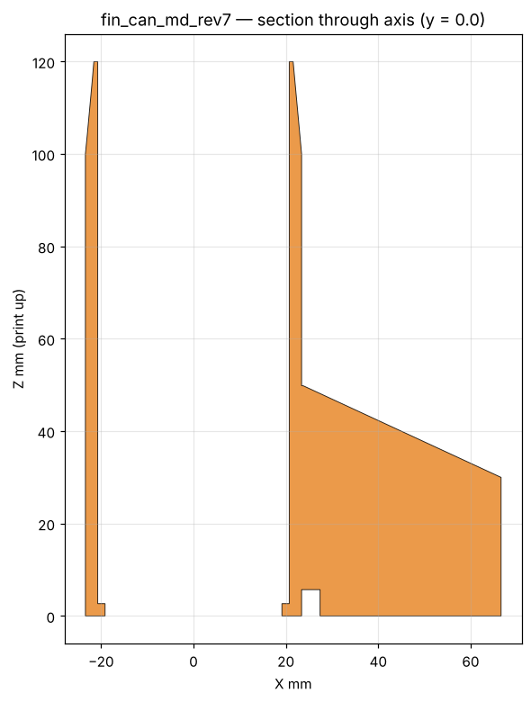

*Figure 29. Fin can rev 7, axial section through a fin (y = 0).*
- *Left: the 2.67 mm sleeve wall with the inward lip at Z = 0.*
- *Right: the 50 mm root, 30 mm tip and 43.18 mm span, with the M3 insert hole entering from the aft face.*
- *The fairing tapers from Z = 100 to 120 mm.*

*Source: `out/fin_can_md/rev7/fin_can_md_rev7_section.png`, 2026-11-21.*

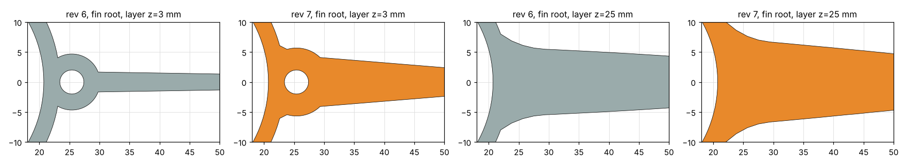

*Figure 30. Rev 6 (grey) vs rev 7 (orange) fin-root cross-sections at print layers z = 3 mm (through the insert boss) and z = 25 mm (mid-root). Rev 6 was orange in figure 3c.*
- *At z = 3 mm, rev 7 is much thicker aft of the boss (8 mm blunt root TE), and the boss ring is larger (+1 mm wall).*
- *At z = 25 mm the two sections differ only slightly.*

*Source: sliced by rocket-docs from `out/fin_can_md/rev6/fin_can_md_rev6.stl` and `out/fin_can_md/rev7/fin_can_md_rev7.stl` (trimesh), 2026-11-21. Geometry only; no values derived.*

**Verify results, rev 7** (`fin_can_md_rev7_verify.json`): **5/5 PASS**.

| # | Check | Result |
|---|---|---|
| 1 | Mesh integrity | PASS: watertight, 1 body, 89 534.5 mm³ |
| 2 | Mass | PASS: target 90.0 g (±5 %); model 90.6 g (0 %) – 113.7 g (100 %); "infill to hit target" −2.7 % |
| 3 | Mating interference | PASS: 0 mm³ with the tube wall, case and ring (**placeholders**) |
| 4 | Renders | PASS: iso, front and section written; reviewed by the main session; iso and section reviewed for this report |
| 5 | Build volume | PASS: 102.6 / 118.4 / 120.0 mm vs 256 |

- As for rev 6, the mass pass relies on the ±5 % tolerance: the model's **0 % infill value (90.6 g) is above the slicer's 90 g** (§4.5).
- **Fin criteria** C1–C7 are met (C5 by argument). C8, "lowest mass", is not demonstrated, because the lighter rev 8 was never scored (§4.4.7–4.4.9).

**Loads vs layers (rev 7, printed axis-vertical, lip down).** Sources: rev 7 spec; out/fea/rev7 `result.json` and `criteria.json`; ansys_results.md.

| Load | Direction vs layers | Bond loading (rev 7, ANSYS-scaled FI) |
|---|---|---|
| Motor thrust: ring pushes +Z on the lip underside | across layers | **compression** (good). FEA not yet run (§4.3.8) |
| Fin aero gust, 15 N Y | root bending; peak normal Z at (29.3, −4.2, 3.5) mm | across-layer tension, low: **C4 FI 0.022** (limit 0.1). Rev 5 ANSYS: 1.72 MPa |
| Sideways tip strike (landing, Y) | root bending; peak normal Z at (29.3, −4.2, 3.5) mm, aft end of the root where the boss meets the fin flank (figure 30) | **across-layer tension, the governing case: C1 FI 0.28 at 200 N** (limit 0.5) |
| Tilted tip strike, 200 N at 45° | bending plus axial push; peak at (29.4, −4.1, 3.1) mm | across-layer tension: **C2 FI 0.25** (limit 0.5) |
| Axial tip strike (landing, Z) | pushes the fin along the layer-stacking direction; root-zone peak at (29.4, −4.0, 2.6) mm | across-layer tension: **C3 FI 0.084 at 200 N** (limit 0.5) |
| Sleeve-to-tube epoxy joint | shear on vertical cylindrical faces | in-plane shear |
| Ejection kick (−Z): ring pulls the screws out of the inserts | across layers | **pull-out: shear + tension (weak direction)** |

- All four peaks now sit at the **aft end of the root, z ≈ 2.6–3.5 mm**, on the −Y flank near the insert boss. In rev 6 they were at the boss/fillet corner, the aft-face root corner or the fillet-to-sleeve junction (§4.4.3–4.4.4).
- That the peaks sit where the boss meets the fin flank is the docs agent's reading of the coordinates against figure 30. The sim lab has not stated it.
- Note: the rev 5, 6 and 7 spec sheets all say fin root bending is carried "within the layers". The ANSYS and CalculiX results show the peak stress is normal-Z (across layers) at the fin root. This report follows the FEA (§11).

### 4.1b Fin can rev 6: landing-tough (SUPERSEDED by rev 7 for flight)

`parts/fin_can_md.py` (taper support in `parts/fin_can.py`), built with `make.py fin_can_md --rev 6` on 2026-11-21 (out/fin_can_md/rev6/fin_can_md_rev6_spec.md). Same sleeve, lip, fairing and insert bosses as rev 5; only the fins changed (§4.3.7).
- **Superseded:** rev 6 fails criterion C1 (FI 0.785 vs 0.5, out/fea/rev6/criteria.json, §4.4.8). It is kept as the basis of the rev 6 FEA (§4.4.3–4.4.5).

| Parameter | Value | Status |
|---|---|---|
| Tube OD (sets the sleeve bore) | 41.275 mm | **PLACEHOLDER**: measure |
| Sleeve bore / wall / OD | 41.455 / 2.67 / **46.795 mm** | derived / PROPOSED / derived |
| Sleeve length / fairing | 100 mm / 20 mm | derived / PROPOSED |
| Lip thickness / lip bore | 2.67 mm / 38.28 mm | PROPOSED / derived |
| Motor case OD / length | 38.10 / 155 mm | **PLACEHOLDER** / CITED |
| Thrust ring OD × thickness | 41.0 × 3.0 mm | **PLACEHOLDER** |
| Fins | 50 / 30 / 43.18 / 20.32 mm, **12 mm root → 6 mm tip** | owner OR planform / rev 6 |
| TE | **2.0 mm at the root → 0.84 mm at the tip** | PROPOSED |
| Root fillet | **r 6 mm** (was 4) | PROPOSED |
| Retention | One M3 insert per fin (Ø4.0 × 5.7 mm), insert radius 25.398 mm, washer min. OD 13.795 mm | OWNER / CITED / derived |
| Kevlar anchor | not in the part; the sim carries a 10 g stop/anchor ring ESTIMATE | open (§11) |
| Extents / print | 102.6 × 118.4 × 120.0 mm; lip down, axis vertical, no supports | verify check 5; spec |
| Mass model / target | **87.0–101.9 g** (0–100 % infill) / **84.83 g owner slicer at 25 % gyroid** (88.43 g at the other settings tried) | verify; design.yaml `fin_can_md.target_mass_g` (OWNER) |
| CG | 40.5 mm forward of the aft face (rev 5: 43.3) | design.yaml `stability.fin_can_model_cg_from_aft_mm` |

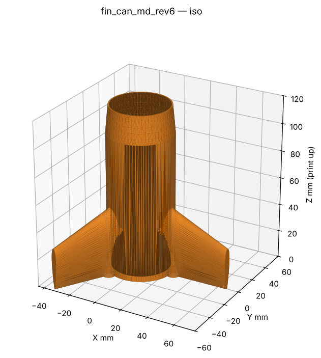

*Figure 3a. Fin can rev 6, iso view in print orientation (aft lip on the bed, Z up). The fins are visibly thicker at the root and blend into the sleeve with the 6 mm fillet. Source: `out/fin_can_md/rev6/fin_can_md_rev6_iso.png`, `make.py fin_can_md --rev 6`, 2026-11-21. Built with the placeholder tube OD, case OD and ring.*

*Figure 3b. Fin can rev 6, axial section through a fin (y = 0).*
- *Left: the 2.67 mm sleeve wall with the inward lip at Z = 0.*
- *Right: the 50 mm root, 30 mm tip and 43.18 mm span, with the M3 insert hole entering from the aft face.*

*Source: `out/fin_can_md/rev6/fin_can_md_rev6_section.png`, 2026-11-21.*

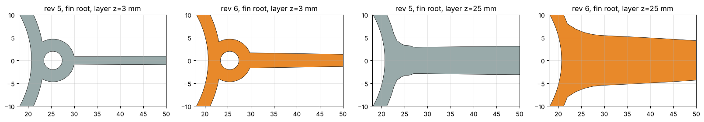

*Figure 3c. Rev 5 (grey) vs rev 6 (orange) fin-root cross-sections at print layers z = 3 mm (through the insert boss) and z = 25 mm (mid-root). Rev 6 has about twice the root thickness and a larger fillet blend into the sleeve. Source: main-session scratchpad `rev5_vs_rev6.png`, copied 2026-11-21.*

**Verify results, rev 6** (`fin_can_md_rev6_verify.json`): **5/5 PASS**.

| # | Check | Result |
|---|---|---|
| 1 | Mesh integrity | PASS: watertight, 1 body, 80 276.6 mm³ |
| 2 | Mass | PASS: target 84.83 g (±5 %); model 87.0 g (0 %) – 101.9 g (100 %); "infill to hit target" −14.6 % |
| 3 | Mating interference | PASS: 0 mm³ with the tube wall, case and ring (**placeholders**) |
| 4 | Renders | PASS: iso, front and section written; iso and section reviewed for this report |
| 5 | Build volume | PASS: 102.6 / 118.4 / 120.0 mm vs 256 |

- The mass pass relies on the ±5 % tolerance: the model's **0 % infill value (87.0 g) is already above the slicer's 84.83 g**. The main session puts the model ~6 % high vs the slicer (§4.5).

**Loads vs layers (rev 6, superseded; printed axis-vertical, lip down).** Sources: rev 6 spec; ansys_results.md; fea_results.md.

| Load | Direction vs layers | Bond loading |
|---|---|---|
| Motor thrust: ring pushes +Z on the lip underside | across layers | **compression** (good). FEA not yet run (§4.3.8) |
| Fin aero gust (side load on a fin) | root bending; ANSYS shows normal-Z stress at the root | across-layer tension/compression, low (rev 5: 1.72 MPa) |
| Sideways tip strike (landing) | root bending; rev 6 peak normal Z at the **insert-boss / fillet corner** | **across-layer tension: the governing failure** (rev 5 ~88 N; rev 6 **~252 N ANSYS-scaled / ~308 N raw**, in-house FEA §4.4) |
| Axial tip strike (landing, Z) | pushes the fin along the layer-stacking direction | **across-layer tension at the aft-face root corner** (rev 5 ~770 N; rev 6 **~913 / ~947 N**, §4.4) |
| Sleeve-to-tube epoxy joint | shear on vertical cylindrical faces | in-plane shear |
| Ejection kick (−Z): ring pulls the screws out of the inserts | across layers | **pull-out: shear + tension (weak direction)** |

Note: the rev 5 and rev 6 spec sheets say fin root bending is carried "within the layers". The ANSYS and CalculiX results both show the peak stress is normal-Z (across layers) at the fin root. This report follows the FEA (§11).

### 4.1c Fin can rev 5: ANSYS basis (superseded by rev 6, then rev 7, for flight)

`make.py fin_can_md --rev 5`, 2026-11-21 (out/fin_can_md/rev5/fin_can_md_rev5_spec.md). Same sleeve as rev 6; fins 50 / 30 / 43.18 / 20.32 / **6 mm constant**, TE 0.84, fillet r 4. Model mass 83.4–85.7 g; owner slicer 80 g.

*Figure 3. Fin can rev 5, iso view in print orientation (aft lip on the bed, Z up). The sleeve carries the owner's 3 fins at the aft end (Z 0–50 mm), with the root bosses at the aft face. The fairing is at Z 100–120 mm. Source: `out/fin_can_md/rev5/fin_can_md_rev5_iso.png`, `make.py fin_can_md --rev 5`, 2026-11-21. Built with the placeholder tube OD, case OD and ring.*

*Figure 4. Fin can rev 5, axial section through a fin (y = 0).*
- *Left: the 2.67 mm sleeve wall, with the lip turning inward at Z = 0.*
- *Right: the 50 mm root, 30 mm tip and 43.18 mm span, with the M3 insert hole entering from the aft face.*
- *The fairing tapers from Z = 100 to 120 mm.*

*Source: `out/fin_can_md/rev5/fin_can_md_rev5_section.png`, 2026-11-21.*

**Verify (rev 5):** the on-disk `fin_can_md_rev5_verify.json` has been re-run at the **80.0 g** target (model 83.4–85.7 g), so the earlier 120 g record conflict is resolved. 5/5 PASS as reported by the main session.

### 4.2 Structural hand checks (rev 3/5/6/7 geometry, H100W)

**Thrust bearing on the lip** (motor.md §D): σ = F / A, with A = π/4 · (ring OD² − lip ID²).
- σ is bearing stress (MPa), F force (N), A bearing area (mm²).
- F = 137.8 N. A is TBD until the ring is measured. The 15 MPa reference is reached at A = 9.2 mm².
- 15 MPa is the interlayer *shear* figure, used as a conservative reference because the shop has no PETG compressive allowable.

**Retention pull-out** (motor.md §E, PROPOSAL)
- Design load (ESTIMATE): 15 psi × 1178.4 mm² = **122 N**; ×3 margin gives **366 N** (design.yaml `motor.retention_design_load_n`).
- Capacity per insert, plug shear: τ·π·D·L = 15 × π × 4.0 × 5.7 = 1074 N. τ is interlayer shear (MPa), D the hole diameter (mm), L the insert length (mm).
- SPIROL's installation knock-down to 25 % gives 269 N per insert. Three inserts give 807 N, so **SF 2.2**.

**Fin root bending (hand calc, aero.md §0.4)**
- σ = M/Z with Z = Cr·t²/6, at α 5° and q 44.0 kPa.
- Symbols: σ root bending stress (MPa); M root bending moment (N·mm); Z section modulus (mm³); Cr root chord (mm); t root thickness (mm).
- design.yaml `aero.fin_root_bending_mpa` = 6.5 MPa is for the **77 mm** proposal. No hand value is recorded for the owner's fins; ANSYS (§4.3) replaces it. The same Z ∝ t² relation is the basis of the rev 6 sizing (§4.3.7).

**Interlayer net-area check for printed anchors** (recovery.md §4): A_net ≥ F·SF / 15.
- **191 mm²** for a 40 m/s deploy on the 40 in chute; **48 mm²** for a deploy at ≤ 20 m/s.
- The 12 s delay deploys at ≤ 17 m/s (§6.5), so the 48 mm² case applies. No anchor part exists yet.

### 4.3 Structural analysis: ANSYS FEA of fin can rev 5 (ansys_results.md)

**Tool:** Ansys Mechanical Enterprise 2023 R1. Owner's runs, 2026-11-20/21.
- Geometry: `out/fin_can_md/rev5/fin_can_md_rev5.step`. Units mm; Z = rocket axis = print direction.
- **Boundary condition (all static cases):** one Fixed Support on the sleeve bore (R 20.727 mm), standing in for the epoxied joint to the tube.
- **All results in §4.3.1–4.3.6 are for rev 5.** Neither rev 6 nor rev 7 has been run in ANSYS. The rev 6 pre-build prediction (§4.3.7) is **superseded** by the in-house CalculiX results in §4.4.

#### 4.3.1 Material: orthotropic `3D_Printed_PETG` (Z = across layers)

| Property | Owner's earlier entry (figure 5) | **Conservative set, used in the runs** | Nominal set |
|---|---|---|---|
| Ex = Ey (in-plane) | 1880 MPa | **1472 MPa** | 1939 MPa |
| Ez (across layers) | 500 MPa | **1087 MPa** | 1711 MPa |
| ν | νxy 0.35, νyz = νxz 0.3 | **0.38 (assumed)** | — |
| Gxy / Gyz = Gxz | 696 / 500 MPa | **533 / 394 MPa** | — |
| Density | 1270 kg/m³ | — | — |
| Source | owner | JuggerBot PETG review | Ultimaker PETG TDS |

- **The owner confirmed on 2026-11-21 that the runs used the conservative set.**
- **Caveat:** both recommended sets were picked off search-result summaries, not read from the documents. Confirm them before relying on them (ansys_results.md).
- **Failure limits** used to judge results:
  - Z tensile (across layers) ~19 MPa (Ultimaker TDS, upright);
  - interlayer shear ~15 MPa (shop constant);
  - in-plane tensile ~38.5 MPa (Ultimaker TDS, flat).

*Figure 5. ANSYS Engineering Data for `3D_Printed_PETG`. This screenshot shows the **owner's earlier values** (Exy 1880, Ez 500 MPa). They were replaced before the runs by the conservative set in the table above. Source: `report/figures/ansys/00_material_table.webp`, owner, 2026-11-21.*

**Mesh:** tetrahedral, 1 mm element size, **422,598 nodes, 244,392 elements**. An earlier default mesh had 42,442 nodes.

*Figure 6. 1 mm tetrahedral mesh of fin can rev 5. Source: `report/figures/ansys/01_mesh_1mm.webp`, owner, 2026-11-21.*

#### 4.3.2 Case 1: flight side gust

Force Y = 15 N on one side of the +X fin (ESTIMATE: 5° AoA at max q ≈ 37 kPa). Linear static.

| Result | Max | Limit | Factor |
|---|---|---|---|
| Total deformation | 0.274 mm | — | — |
| Normal Z (across layers) | +1.72 / −1.58 MPa | 19 MPa | **~11×** |
| Shear XZ | 0.354 MPa | 15 MPa | ~42× |
| Shear YZ | 0.192 MPa | 15 MPa | ~78× |
| Von Mises | 3.42 MPa (fin root) | 38.5 MPa | ~11× |

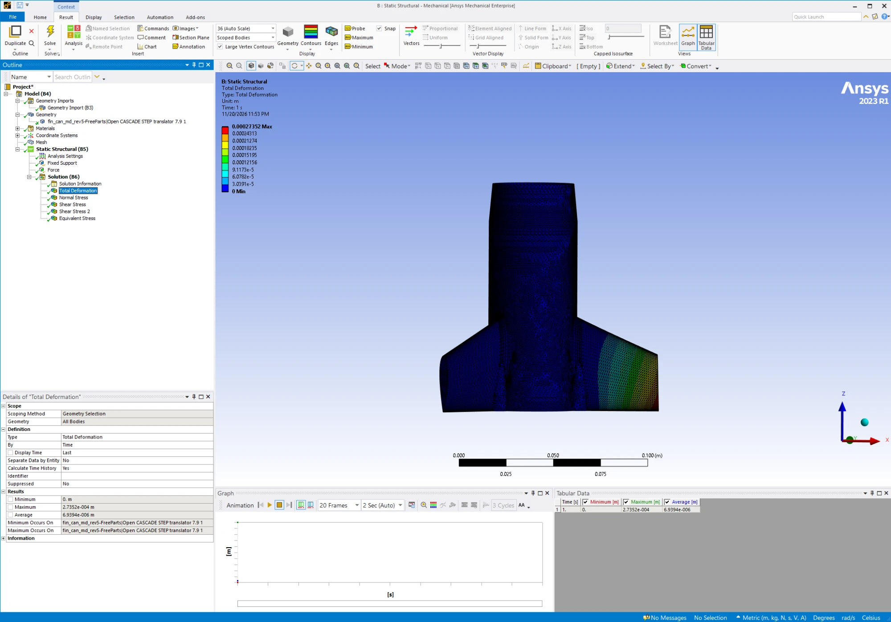

*Figure 7. Gust case, total deformation, max 0.274 mm. Source: `report/figures/ansys/10_gust_deformation.webp`, fin can rev 5, owner, 2026-11-21.*

*Figure 8. Gust case, normal stress Z (across layers), +1.72 / −1.58 MPa. Source: `report/figures/ansys/11_gust_normalZ.webp`, fin can rev 5.*

*Figure 9. Gust case, von Mises stress, max 3.42 MPa at the fin root. Source: `report/figures/ansys/14_gust_vonmises.webp`, fin can rev 5.*

#### 4.3.3 Case 2: modal (free vibration, same support)

| Modes | Frequency | Shape |
|---|---|---|
| 1–3 (one per fin) | **567.9 Hz** | likely 1st bending |
| 4–6 | 1530 Hz | torsion or 2nd bending: **not yet identified** |
| 7–9 | 2677 Hz | — |

The flutter estimate (≈ 5.3× at G = 394 MPa) is in §3.5.

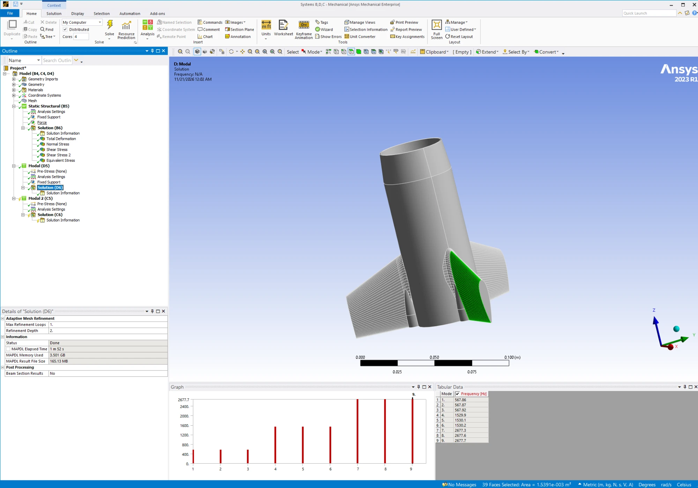

*Figure 10. Modal analysis, first 9 frequencies (three groups of three). Source: `report/figures/ansys/20_modal_frequencies.webp`, fin can rev 5, owner, 2026-11-21.*

#### 4.3.4 Case 3: landing tip strike, sideways (Y)

Force Y = 50 N on the +X fin's tip face.

| Result | Max | Limit | Factor |
|---|---|---|---|
| Total deformation | 2.51 mm | — | — |
| Normal Z (across layers) | 10.8 MPa (root) | 19 MPa | 1.75× → **fails at ~88 N** |
| Shear YZ / XZ | 1.48 / 2.77 MPa | 15 MPa | 5.4–10× |
| Von Mises | 21.4 MPa | 38.5 MPa | 1.8× → ~90 N |

*Figure 11. Sideways tip strike, 50 N in Y: total deformation, max 2.51 mm. Source: `report/figures/ansys/30_tipY50_deformation.webp`, fin can rev 5.*

*Figure 12. Sideways tip strike, 50 N in Y: normal stress Z (across layers), max 10.8 MPa at the root. Scaled to 19 MPa, the fin fails at ~88 N. Source: `report/figures/ansys/31_tipY50_normalZ.webp`, fin can rev 5.*

*Figure 12b. Sideways tip strike, 50 N in Y: failure index σ_Z/19 MPa (legend 0–1), max **0.571** (= 10.85 MPa). This confirms the ~88 N sideways failure load (50 / 0.571 = 87.6 N). Source: `report/figures/ansys/35_tipY50_failure_index.webp`, owner, 2026-11-21.*

#### 4.3.5 Case 4: landing tip strike, axial (Z)

Force in Z on the tip face. The response is linear: **σ_Z,max = k·F**, with k = 0.0247 MPa per N at the fin root, aft end.

Failure index: **FI = σ_Z / 19 MPa** (ANSYS expression `SZ/19e6`). FI ≥ 1 means across-layer tensile failure.
- σ_Z is the normal stress across the layers (MPa).
- F is the applied tip force (N).

| Load | Normal Z max | FI (ratio to 19 MPa) |
|---|---|---|
| 400 N | 9.88 MPa | 0.52 |
| 770 N | 19.0 MPa | 1.0008 |
| 900 N | 22.2 MPa | 1.17 |
| 2000 N | 49.4 MPa | 2.60 (max 2.5994) |

**Axial failure point: 770 N** (FI = 1.0008, figure 15). The 2000 N run shows how the crack spreads: a **thin strip along the fin-root fillet at the aft end** (figure 13).

*Figure 13. **Where it breaks.** Axial tip strike, 2000 N in Z: failure index σ_Z/19 MPa, legend fixed at 0–1 (red = failed), max 2.5994. The failed band is a thin strip along the fin-root fillet at the aft end. Source: `report/figures/ansys/43_tipZ2000_failure_index.webp`, fin can rev 5, owner, 2026-11-21.*

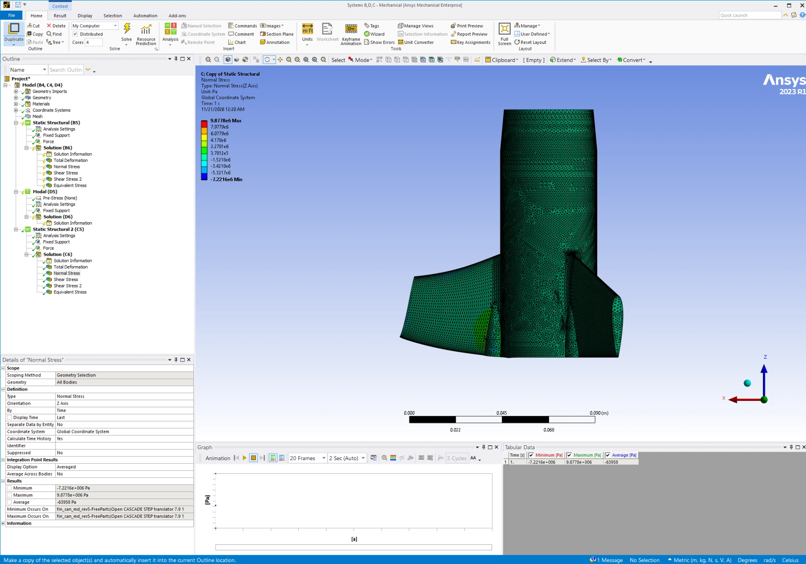

*Figure 14. Axial tip strike, 400 N in Z: normal stress Z, max 9.88 MPa (FI 0.52). Source: `report/figures/ansys/40_tipZ400_normalZ.webp`, fin can rev 5.*

*Figure 15. **FAILURE POINT: 770 N axial tip load.** Failure index σ_Z/19 MPa with the legend fixed at 0–1, max **1.0008**: the first elements reach the across-layer strength. Failure starts at the **fin-root fillet, aft end**; the rest of the fin and the sleeve stay blue (FI < 0.1). Source: `report/figures/ansys/45_tipZ770_failure_point.webp`, fin can rev 5, owner, 2026-11-21.*

*Figure 16. Axial tip strike, 900 N in Z: normal stress Z, max 22.2 MPa (FI 1.17). Source: `report/figures/ansys/42_tipZ900_normalZ.webp`, fin can rev 5.*

#### 4.3.5b Combined landing load: 200 N sideways (Y) + 770 N axial (Z)

Owner run, 2026-11-21: a tip force of Y = +200 N and Z = +770 N applied together (a tilted landing).

| Case | Failure index max (σ_Z/19 MPa) |
|---|---|
| 50 N Y alone | 0.571 |
| 200 N Y alone (scaled ×4) | 2.28 |
| 770 N Z alone | 1.00 |
| **200 N Y + 770 N Z, combined run** | **3.28** (= 2.28 + 1.00, both peak at the root fillet) |

- The combined result equals the sum of the two single loads. The model is linear and both loads peak at the same spot, the **fin-root fillet**, so any landing angle can be checked by adding the scaled single-load results.
- **The sideways part dominates:** 200 N sideways alone is already 2.3× over the limit.
- **Rev 6 is different:** its Y and Z peaks sit at different spots, so adding the single-load results overestimates the combined FI. The combined runs in §4.4.4 are the real numbers (fea_results.md §4).

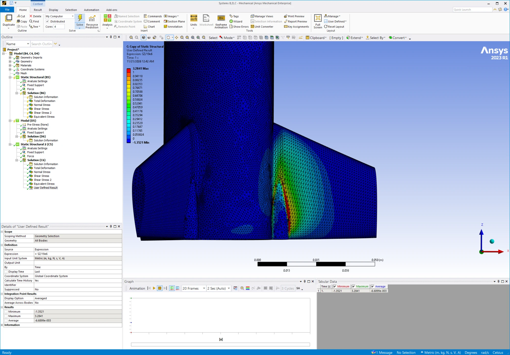

*Figure 17. Combined tip load, 200 N Y + 770 N Z: failure index (legend 0–1), max **3.28**. Red = failed, along the fin-root fillet of the loaded fin. Source: `report/figures/ansys/50_combined_Y200_Z770_failure_index.webp`, owner, 2026-11-21.*

#### 4.3.6 Landing-load context (main-session ESTIMATE, ansys_results.md)

Method:
- Landing energy E = ½·m·v², with m the descent mass (kg) and v the descent rate (m/s).
- Average impact force F ≈ E / s, where s is the ground stopping distance (m), taken as 2–5 cm.
- Masses: 540–600 g, chute Cd 0.75.

| | **40 in chute (kept)** | 28 in chute (considered) |
|---|---|---|
| Landing energy | 3.8–4.7 J | 7.8–9.7 J |
| Average impact force | 90–220 N | 180–450 N |
| Peak impact force | to ~450 N | to ~900 N |
| Drop-test height to reproduce | 0.8 m | 1.5 m |

- **Realistic design value: ~200 N.**
  - Axial: OK, ~3.8× margin against the ~770 N failure load (rev 5).
  - Sideways: rev 5 **fails** (~90 N capacity).
  - **Rev 6 (in-house FEA, §4.4):** sideways capacity ~252 N (ANSYS-scaled) / ~308 N (raw), so the 200 N hit survives at FI 0.65–0.80. Axial capacity ~913 / ~947 N.
  - The ~450 N peak-impact bound for the 40 in chute (table above) is above the rev 6 sideways capacity.
  - **Rev 7 (in-house FEA, §4.4.8):** at 200 N, FI 0.28 sideways, 0.25 tilted at 45° and 0.084 axial (ANSYS-scaled). All are within the owner's 2× criterion (FI ≤ 0.5). Rev 7 capacities (FI = 1) have not been stated by the sim lab (§11.1).
- **Mitigations** (ansys_results.md):
  1. Fly the 40 in chute unreefed (conflicts with recovery.md's reefing advice; §11).
  2. Drop-test the fit-test print: 0.8 m for the 40 in chute, 1.5 m for the 28 in.
  3. A landing-tough **rev 6** (~2.3× root bending strength needed). **Chosen by the owner and built 2026-11-21** (§4.3.7). In-house FEA gives rev 6 **2.87×** the rev 5 sideways strength (§4.4.3).
  4. **Rev 7** (owner fin loop, §4.4.7): blunt 8 mm root TE and a thicker insert boss. It meets C1–C4 and is the current flight candidate (§4.1).

#### 4.3.7 Rev 6 design rationale: sizing from the owner's ANSYS data (PREDICTION, SUPERSEDED)

> **SUPERSEDED 2026-11-21 by the in-house FEA (§4.4, fea_results.md §3).** The prediction below (~350–400 N; FI 0.50–0.57 at 200 N) was **optimistic**. The actual sideways gain is **2.9×**, not the 4× from thickness² scaling, because the peak sits at the boss/fillet corner rather than in plain fin bending. The text is kept as the sizing record.

**All rev 6 strength values below are PREDICTIONS** by the main session (design.yaml `aero.fin_thickness_mm` note; git 2c62fb5). An owner ANSYS run on rev 6 is no longer needed, because rev 7 supersedes it (§4.3.8).

**Sizing steps:**
1. Rev 5 sideways FI per unit load: 0.571 / 50 N = **0.01142 per N** (figure 12b).
2. At 200 N sideways (the realistic landing value, §4.3.6): 0.01142 × 200 = **2.28** on rev 5.
3. Root bending stress scales as σ = M/Z with Z = Cr·t²/6 (§4.2), so at a fixed load and chord **σ ∝ 1/t²**.
4. Doubling the root from 6 to 12 mm: (12/6)² = **4**, so FI at 200 N Y ≈ 2.28 / 4 = **0.57** (~1.75× margin) before fillet credit.
5. The fillet increase (4 → 6 mm) and the 2.0 mm blunt root TE (at the aft-end crack origin, figure 13) are credited to about **FI 0.50 (~2×)**.

Symbols: FI failure index σ_Z / 19 MPa (–); σ_Z across-layer normal stress (MPa); M root bending moment (N·mm); Z section modulus (mm³); Cr root chord (mm); t root thickness (mm).

| Predicted (rev 6) vs ANSYS (rev 5) | Rev 5 (ANSYS) | Rev 6 (PREDICTION, **superseded**) | Rev 6 in-house FEA (§4.4) |
|---|---|---|---|
| 50 N Y, FI | 0.571 | ~0.14 | 0.162 (raw) |
| 200 N Y, FI | 2.28 (scaled) | ~0.5–0.57 | **0.65 (raw) – 0.80 (ANSYS-scaled)** |
| Sideways capacity (FI = 1) | ~88 N | ~350–400 N | **~252 N (scaled) / ~308 N (raw)** |
| 200 N Y + 770 N Z, FI | 3.28 | ~0.75–0.8 | **1.38 (raw) / ~1.69 (scaled)** |

**Changes rev 5 → rev 6** (design.yaml, rev 6 spec):

| Item | Rev 5 | Rev 6 | Why |
|---|---|---|---|
| Planform | 50 / 30 / 43.18 / 20.32 | same | owner OR set, keeps the CP |
| Root thickness | 6 mm | **12 mm** | 4× root section-modulus factor |
| Tip thickness | 6 mm | 6 mm (linear taper) | flutter and mass |
| Root fillet | r 4 mm | **r 6 mm** | at the ANSYS failure site; larger collides with the sleeve bore |
| TE | 0.84 mm | **2.0 mm root → 0.84 tip** | aft-end root is the ANSYS crack origin |
| Mass | 80 g slicer | **84.83 g slicer, 25 % gyroid** | owner |
| Verify | 5/5 at 80 g | **5/5 at 84.83 g** | — |

**Caveats on the prediction:**
- The 1/t² rule assumes the same solid section. The rev 5 fin (6 mm) was almost all wall; the 12 mm rev 6 root is wider than two 2.67 mm wall bands, so it has a **25 % gyroid core**. The verify model's infill region grew from 1.76 cm³ (rev 5) to 11.76 cm³ (rev 6). ANSYS models the part as solid, so it will not capture this. (The same applies to the CalculiX model, §4.4.10.)
- The fillet credit (0.57 → ~0.50) is a judgement, not a calculation.
- The axial part of the combined prediction is not derived in the sources.
- **Outcome:** the 1/t² rule missed because the sideways peak is at the insert-boss / fillet corner, not in plain fin bending (§4.4.5).

#### 4.3.8 Not yet run in ANSYS
- **Rev 7 cross-check, OPTIONAL (owner):** run ANSYS on `out/fin_can_md/rev7/fin_can_md_rev7.step` at the in-house run loads. Raw CalculiX root FI to compare against (out/fea/rev7 `result.json`; mesh 3.0 / 0.8 mm):
  - 50 N Y: 0.054.
  - 400 N Z: 0.138.
  - 200 N at 45° (141.4 N Y + 141.4 N Z): 0.193.
  - 15 N Y (gust): 0.017.
  - The in-house criteria values multiply these by ×1.294 (sideways) or ×1.222 (axial) (§4.4.7).
- **Rev 6 ANSYS re-run:** no longer needed (rev 6 superseded).
- **Motor thrust:** +138 N on the lip underside (not run in-house either).
- **Mode-shape identification** for modes 4–6 (and a rev 7 modal run).

### 4.4 In-house FEA (CalculiX): validation, rev 6 and rev 7 results (fea_results.md; out/fea)

The sim lab is `tools/fea_ccx.py` (gmsh 4.15.2 + CalculiX 2.21), run in the project container by the main session on 2026-11-21. The `rocket-simlab` agent (`.claude/agents/rocket-simlab.md`) now owns these runs.
- Its rule is **validate before predicting**: reproduce an owner reference first and report the % difference.
- **These results supersede the rev 6 PREDICTION in §4.3.7.**
- **Rev 7** was scored against the owner's fin criteria at a fixed mesh (§4.4.7–4.4.9). Its results are only in `out/fea/rev7/` and fin_design_criteria.md; fea_results.md has no rev 7 section yet (§11). The owner's ANSYS cross-check of rev 7 is optional.

#### 4.4.1 Method (fea_results.md; `tools/fea_ccx.py` docstring)

The setup mirrors the owner's ANSYS runs (§4.3).

| Item | In-house (CalculiX) | Owner ANSYS (§4.3) |
|---|---|---|
| Geometry | `out/fin_can_md/rev<N>/fin_can_md_rev<N>.step`, mm, Z = rocket axis = print direction | same (rev 5) |
| Support | fixed sleeve bore | Fixed Support on the sleeve bore (R 20.727 mm) |
| Load | total force spread over the **+X fin's tip face** | force on the +X fin's tip face |
| Material | **conservative** orthotropic PETG: E 1472 / 1472 / 1087 MPa, ν 0.38, G 533 / 394 / 394 MPa | same set (§4.3.1) |
| Elements | **C3D10** (quadratic tetrahedra) | tetrahedral |
| Mesh | **2.5 mm global, 0.7 mm in a box around the +X fin root** (validation and rev 6, §4.4.2–4.4.4). **Fin loop: 3.0 mm global, 0.8 mm root box** for rev 5 calibration, rev 6 and rev 7 (§4.4.7–4.4.8) | 1 mm, 422,598 nodes |
| Nodes (run `result.json`) | 2.5 / 0.7 mesh: rev 5 validation 212,241–218,440; rev 6 runs 254,576–255,113. 3.0 / 0.8 mesh: rev 5 159,789–159,913; rev 6 183,337–183,427; **rev 7 205,231–206,185** | — |
| Solver | **direct** (SPOOLES) | — |
| Read-out | FI in the fin-root zone (8 mm band above the sleeve OD); nodes within 5 mm of the loaded tip face excluded | FI expression `SZ/19e6` |

Run records: `out/fea/rev<N>/<case>/result.json`, with renders `fi_overview.png` and `fi_root_zoom.png`.

**Equations** (linear static):
- Failure index: **FI = σ_Z / σ_allow**, with σ_allow = 19 MPa (across-layer tensile, Ultimaker TDS, upright).
- Capacity: **F₁ = F / FI**, the tip load at which FI reaches 1.
- ANSYS-scaled values: **FI_A = k · FI_C** and **F₁,A = F₁,C / k**. Here **k = σ_Z,ANSYS / σ_Z,CCX** on the matching rev 5 case, at the 2.5 / 0.7 mesh:
  - sideways: k = 10.85 / 8.85 (fea_results.md uses ×1.22);
  - axial: k = 9.88 / 9.52.
- The fin loop re-derives k at its own 3.0 / 0.8 mesh: ×1.294 sideways, ×1.222 axial (§4.4.7).

Symbols: σ_Z normal stress across the layers (MPa); F applied tip force (N); FI_C raw CalculiX failure index (–); FI_A ANSYS-scaled failure index (–); k calibration ratio (–).

**Loads vs layers.** Z is the print direction, so every FI here checks **across-layer (interlayer) tension**:
- **Sideways tip load (Y):** root bending puts across-layer tension at the insert-boss / fillet corner.
- **Axial tip load (Z):** across-layer tension at the aft-face root corner.
- **Combined loads:** the peak is at the fillet-to-sleeve junction (200 N at 45°) or at the boss/fillet (200 N Y + 770 N Z).
- **Rev 7, all four criteria loads:** across-layer tension at the aft end of the root near the insert boss, z ≈ 2.6–3.5 mm (§4.1, §4.4.8).

#### 4.4.2 Validation against the owner's ANSYS (rev 5; fea_results.md §1)

| Case | Owner ANSYS | CalculiX (0.7 mm root mesh) | Difference |
|---|---|---|---|
| 50 N Y: root σ_Z | 10.85 MPa (FI 0.571) | 8.85 MPa (FI 0.466) | −18 % |
| 50 N Y: root σ_Z (uniform 2.0 mm mesh) | 10.85 MPa | 10.25 MPa (FI 0.540) | −5.5 % |
| 50 N Y: tip deflection | 2.51 mm | 2.84 mm | +13 % |
| 400 N Z: root σ_Z | 9.88 MPa | 9.52 MPa (FI 0.501) | **−3.6 %** |

- **Axial: within 3.6 %.**
- **Sideways: 5.5–18 % low, and mesh-dependent.** The peak sits on a sharp concave edge at the top of the insert-boss cap, near (29.8, −1.5, 8.3) mm. There it ranged from 7.5 to 10.3 MPa across the meshes tried. This is expected at a sharp corner, in ANSYS too.
- **Consequence:** rev-to-rev comparisons use **identical settings**, and absolute values are **scaled to the owner's ANSYS calibration** (§4.4.1).

*Figure 23. In-house FEA validation, fin can **rev 5**, 50 N Y on the +X fin tip. Failure index σ_Z/19 MPa, legend 0–1. Root FI max **0.466** (σ_Z 8.85 MPa) vs the owner's ANSYS 0.571 (figure 12b). Mesh 2.5 mm global / 0.7 mm root, C3D10, direct solver. The bright spot at the fin tip is the load-face spike, excluded from the read. Source: `out/fea/rev5/val_tipY50_r0.7_direct/fi_overview.png`, `tools/fea_ccx.py`, 2026-11-21.*

#### 4.4.3 Rev 6 vs rev 5, identical settings (fea_results.md §2–3)

| Case | Rev 5 FI | Rev 6 FI | Ratio | Rev 6 peak location (mm) |
|---|---|---|---|---|
| 50 N Y (sideways) | 0.466 | **0.162** | 0.348: **2.87× stronger** | (29.4, −2.5, 6.8): boss/fillet |
| 400 N Z (axial) | 0.501 | **0.422** | 0.843: **1.19× stronger** | (29.9, 1.1, 0.8): aft face, root corner |
| Max deflection, 50 N Y | 2.84 mm | 0.90 mm | 3.2× stiffer | tip |

**Rev 6 capacities (FI = 1)**

| Load | Raw CalculiX | Scaled to the owner's ANSYS rev 5 calibration | Rev 5 (owner ANSYS) |
|---|---|---|---|
| **Sideways (Y)** | **~308 N** | **~252 N** | ~88 N |
| **Axial (Z)** | ~947 N | ~913 N | ~770 N |

- **Realistic sideways landing hit, ~200 N (ESTIMATE): FI 0.65 (raw) to 0.80 (ANSYS-scaled). Rev 6 survives, with a 1.25–1.5× margin.**
- Rev 5 at the same 200 N: FI 1.86–2.28 (fails).
- ansys_results.md asked for ~2.3× root bending strength; the sideways ratio is 2.87×.
- **The axial capacity barely changed.** The axial peak is at the aft-face root corner, which the thickness taper does not reinforce.

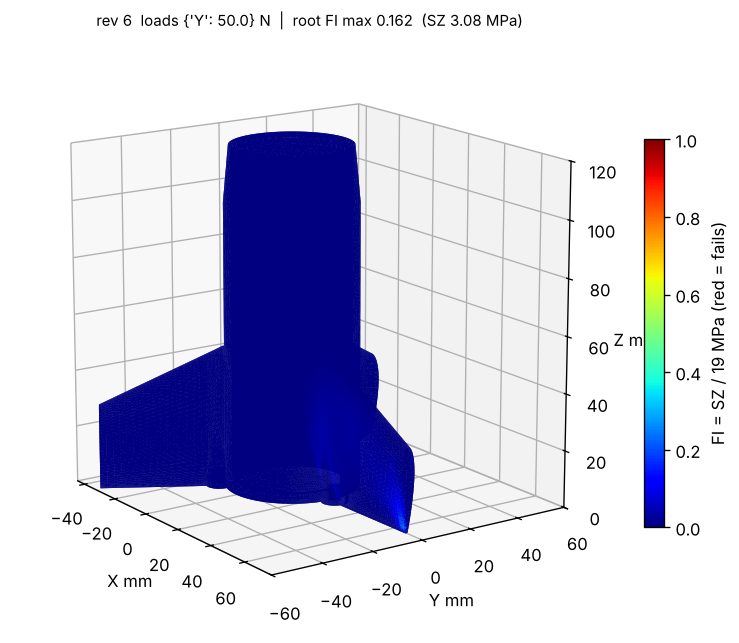

*Figure 24. In-house FEA, fin can **rev 6**, 50 N Y on the +X fin tip. Failure index σ_Z/19 MPa, legend 0–1. Root FI max **0.162** (σ_Z 3.08 MPa), at the boss/fillet (29.4, −2.5, 6.8) mm. That is 2.87× below rev 5 at identical settings (figure 23). The tip spike is the load face, excluded. Source: `out/fea/rev6/tipY50/fi_overview.png`, `tools/fea_ccx.py`, 2026-11-21.*

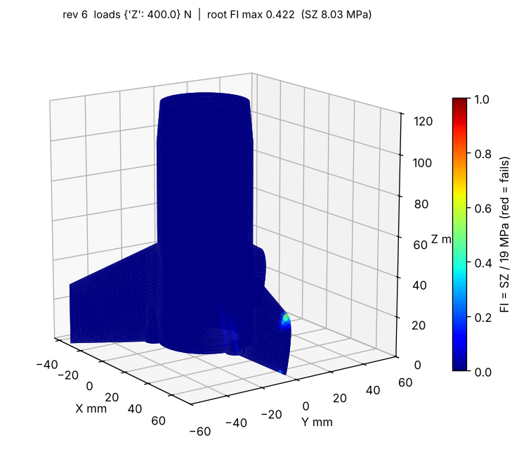

*Figure 25. In-house FEA, fin can **rev 6**, 400 N Z (axial) on the +X fin tip. Failure index σ_Z/19 MPa, legend 0–1. Root FI max **0.422** (σ_Z 8.03 MPa), at the aft-face root corner (29.9, 1.1, 0.8) mm; rev 5 at identical settings: 0.501. The bright spot at the fin tip is the load-face spike, excluded. Source: `out/fea/rev6/tipZ400/fi_overview.png`, `tools/fea_ccx.py`, 2026-11-21.*

#### 4.4.4 Combined landing loads (rev 6, actual runs; fea_results.md §4)

| Case | Rev 6 FI (raw) | Rev 6 FI (ANSYS-scaled ×1.22) | Rev 5 reference | Verdict |
|---|---|---|---|---|
| **200 N at 45°** (141 N Y + 141 N Z): a realistic tilted landing | **0.56** at (23.1, −4.2, 9.9), where the fillet meets the sleeve | ~0.69 | ~1.4 (superposed estimate) | **survives, 1.45–1.8×** |
| 200 N Y + 770 N Z (the owner's severe rev 5 ANSYS case) | **1.38** at (29.4, −2.4, 6.4), boss/fillet | ~1.69 | **3.28** (owner ANSYS) | **fails**, but ~1.9× (scaled) to 2.4× (raw) better than rev 5 |

- **The 200 N Y + 770 N Z case is extreme.** It totals about 800 N: rev 5's axial *failure* load plus a full sideways hit. It is not the realistic landing estimate (~200 N, main-session ESTIMATE).
- **Superposing single loads overestimates rev 6**, because its Y and Z peaks are at different spots. The combined runs are the real numbers.
- fea_results.md now labels the two ratios: **~1.9× on the ANSYS-scaled FI** (like-for-like with the owner's 3.28) and 2.4× on the raw FI. This closes the earlier like-for-like query.
- **Not re-run on rev 7** (§4.4.8).

*Figure 26. In-house FEA, fin can **rev 6**, 200 N at 45° (141.4 N Y + 141.4 N Z) on the +X fin tip. Failure index σ_Z/19 MPa, legend 0–1. Root FI max **0.561** (σ_Z 10.67 MPa), where the fillet meets the sleeve; ~0.69 ANSYS-scaled, so it survives. The bright spot at the fin tip is the load-face spike, excluded. Source: `out/fea/rev6/combined_200N_at45/fi_overview.png`, `tools/fea_ccx.py`, 2026-11-21.*

*Figure 27. In-house FEA, fin can **rev 6**, 200 N Y + 770 N Z (extreme case) on the +X fin tip. Failure index σ_Z/19 MPa, legend 0–1 (red = failed). Root FI max **1.380** (σ_Z 26.22 MPa) at the boss/fillet; ~1.69 ANSYS-scaled, so it **fails**. Rev 5 ANSYS for the same case: 3.28 (figure 17). The bright spot at the fin tip is the load-face spike, excluded. Source: `out/fea/rev6/combined_Y200_Z770/fi_overview.png`, `tools/fea_ccx.py`, 2026-11-21.*

#### 4.4.5 Correction: the rev 6 pre-build prediction was optimistic

| Quantity | Pre-build PREDICTION (§4.3.7, superseded) | In-house FEA (this section) |
|---|---|---|
| Sideways capacity | ~350–400 N | **~252 N (ANSYS-scaled) / ~308 N (raw)** |
| 200 N Y, FI | 0.50–0.57 | **0.65–0.80** |
| 200 N Y + 770 N Z, FI | ~0.75–0.8 | **1.38 (raw) / ~1.69 (scaled)** |
| Sideways gain vs rev 5 | 4× (thickness², 6 → 12 mm) | **2.87×** |

- **Why:** the actual gain is 2.9×, not 4×, because the peak sits at the **boss/fillet corner**, not in plain fin bending (fea_results.md §3).
- The §4.3.7 PREDICTION text is marked **SUPERSEDED**; it stays as the sizing record.
- **Verdict:** rev 6 still survives the realistic 200 N sideways and 200 N at 45° landings.

#### 4.4.6 Suggested geometric fixes (fea_results.md §5; NOT BUILT)
1. **Fillet the top edge of the insert-boss cap.** That sharp concave edge carries the sideways peak.
2. **Fillet or chamfer the fin root where it meets the aft face.** That corner carries the axial peak.

- The sources give no predicted gain for either fix.
- **Rev 7 took a different route:** it buried the boss in an 8 mm blunt root TE and added 1 mm of boss wall (§4.1). Neither fillet was built.

#### 4.4.7 Fin acceptance criteria and the rev 7 loop (fin_design_criteria.md; `tools/fin_iter.py`)

**Owner request (2026-11-21):** iterate rev 7, 8, 9 … "until the fins are right for this rocket".
- Each revision is generated with `make.py fin_can_md`, then analysed with `tools/fea_ccx.py` at the **same settings**: mesh 3.0 mm global / 0.8 mm root box, C3D10, direct solver.
- Failure indices are scaled to the owner's ANSYS calibration, using rev 5 run at those same settings.
- `tools/fin_iter.py --rev N` scores a revision and writes `out/fea/rev<N>/criteria.json`.

| # | Criterion | Requirement | Basis (fin_design_criteria.md) | **Rev 7 status** |
|---|---|---|---|---|
| C1 | Sideways landing hit, 200 N at the tip (Y) | **FI ≤ 0.5** (ANSYS-scaled): a 2× margin | 200 N = main-session realistic landing ESTIMATE (ansys_results.md); 2× covers print variability | **PASS, 0.28** |
| C2 | Tilted landing, 200 N at 45° (Y + Z) | FI ≤ 0.5 (scaled) | same | **PASS, 0.25** |
| C3 | Tail-first landing, 200 N axial (Z) | FI ≤ 0.5 (scaled) | same | **PASS, 0.084** |
| C4 | Flight gust (15 N Y) | FI ≤ 0.1 | ansys_results.md case 1 | **PASS, 0.022** |
| C5 | Flutter | Vf ≥ 1.5 × Vmax (250 m/s) at G = 394 MPa | NACA TN 4197; "thickness only increases Vf" | PASS by argument; not recomputed (§3.5) |
| C6 | Printable and verified | verify checks 1, 3, 4, 5 PASS; no overhang (TE flush, planform shrinks going up); check 2 once the owner gives the slicer mass | shop rules | **PASS:** verify 5/5 at the 90 g slicer mass (§4.1) |
| C7 | Aero and stability unchanged | owner's OR planform kept (50/30/43.18/20.32); ballast re-solved for 1.8 cal | owner decision | **PASS:** planform kept; 73 g → 1.81 cal (§6.1) |
| C8 | **Mass** | the **lowest** fin-can mass that meets C1–C7 | "every gram at the tail costs ~0.4 g of nose ballast" | **NOT DEMONSTRATED:** the lighter rev 8 was never scored (§4.4.9) |

- **Stop rule:** stop when a revision meets C1–C7 and the next, lighter step fails one of them. Hard cap: rev 10. Then hand off to stability, docs and the owner.
- **Outcome (2026-11-21):** the **owner stopped the loop at rev 7**. Rev 8 was not analysed (§4.4.9). The stop was the owner's choice, not the stop rule's C8 test.

**Scaling method** (`tools/fin_iter.py` docstring and code). The model is linear static, so FI scales with load:

**FI_crit = k · FI_C,run · (F_crit / F_run)**

- **k_side = FI_ANSYS,rev5(50 N Y) / FI_C,rev5(50 N Y) = 0.571 / 0.441 = ×1.294.**
- **k_ax = FI_ANSYS,rev5(400 N Z) / FI_C,rev5(400 N Z) = (400 / 770) / 0.425 = ×1.222.** The owner's ANSYS fails at 770 N axial (FI 1.0, §4.3.5).
- C1 uses the 50 N Y run (F_crit / F_run = 200 / 50) with k_side. C3 uses the 400 N Z run (200 / 400) with k_ax.
- C2 runs at 200 N at 45° and C4 at 15 N Y (ratio 1). C2 uses the larger of the two k values (×1.294); C4 uses k_side.

Symbols: FI_crit failure index at the criterion load, ANSYS-scaled (–); FI_C,run raw CalculiX root-zone FI at the run load (–); F_crit criterion load (N); F_run run load (N); k calibration ratio (–); FI_C,rev5 rev 5 raw FI at the same mesh (out/fea/rev5/m30r08_* `result.json`).

- At the 2.5 / 0.7 mesh the sideways k was ×1.22 (§4.4.1). The difference comes from the mesh-dependent corner peak (§4.4.2). Values from the two meshes are not mixed in the tables below.

#### 4.4.8 Rev 7 results (out/fea/rev7/criteria.json and `result.json`; out/fea/rev6/criteria.json)

**Criteria scores, rev 7 vs rev 6 at identical settings** (mesh 3.0 / 0.8, calibration ×1.294 sideways / ×1.222 axial)

| Criterion | Rev 7 FI raw (at criterion load) | **Rev 7 FI scaled** | Limit | Rev 7 | Rev 6 FI scaled | Rev 6 |
|---|---|---|---|---|---|---|
| C1 sideways 200 N | 0.217 | **0.28** | 0.5 | **PASS** | 0.785 | **FAIL** |
| C2 tilted 200 N at 45° | 0.193 | **0.25** | 0.5 | **PASS** | not run at this mesh | MISSING |
| C3 axial 200 N | 0.069 | **0.084** | 0.5 | **PASS** | 0.218 | PASS |
| C4 flight gust 15 N | 0.017 | **0.022** | 0.1 | **PASS** | not run at this mesh | MISSING |

- **Rev 7: C1–C4 ALL PASS** (`all_pass_C1_C4: true`). Rev 6 fails C1.
- Rev 6's earlier 200 N at 45° result was ~0.69 ANSYS-scaled (§4.4.4). That is above the C2 limit, but it used the 2.5 / 0.7 mesh and ×1.22, so it is not directly comparable.

**Raw runs at identical settings** (root-zone FI = σ_Z / 19 MPa; load face excluded)

| Run | Rev 5 FI | Rev 6 FI (peak, mm) | **Rev 7 FI** (σ_Z) | Rev 7 peak (mm) | Rev 7 max deflection |
|---|---|---|---|---|---|
| 50 N Y (sideways) | 0.441 | 0.152 (23.1, −4.2, 9.9) | **0.054** (1.03 MPa) | (29.3, −4.2, 3.5) | 0.50 mm (rev 6: 0.91) |
| 400 N Z (axial) | 0.425 | 0.356 (29.6, −2.1, 4.8) | **0.138** (2.63 MPa) | (29.4, −4.0, 2.6) | 0.56 mm (rev 6: 0.69) |
| 200 N at 45° | — | — | **0.193** (3.66 MPa) | (29.4, −4.1, 3.1) | 1.44 mm |
| 15 N Y (gust) | — | — | **0.017** (0.33 MPa) | (29.3, −4.2, 3.5) | 0.15 mm |

- **Rev 7 is ~2.6–2.8× better than rev 6** on identical meshes: 0.152 → 0.054 sideways and 0.356 → 0.138 axial (main session).
- **Peak location moved.** The rev 6 sideways peak on this mesh was where the fillet meets the sleeve (the same spot as the rev 6 45° case, §4.4.4). The rev 7 peaks all sit at the aft end of the root near the insert boss (§4.1).
- **Axial run, global peak:** outside the root read-out zone, the 400 N Z run's global FI (load face excluded) is **0.191** (σ_Z 3.62 MPa) at (20.6, 2.6, 3.0) mm. That is above its root-zone 0.138.
  - Those coordinates appear to lie on the sleeve bore (R 20.727 mm), which is the fixed support.
  - C3 uses the root-zone value. This run is at twice the C3 load.
  - The sim lab should confirm whether this is a support artifact (§11.1).
- **Not run on rev 7:** the extreme 200 N Y + 770 N Z case, capacities (FI = 1), motor thrust and modal.

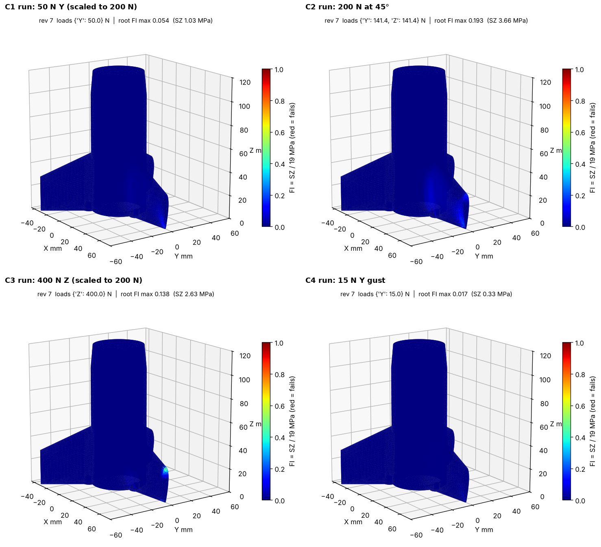

*Figure 31. In-house FEA, fin can **rev 7**, the four criteria runs on the +X fin tip. Mesh 3.0 mm global / 0.8 mm root, C3D10, direct solver. Failure index σ_Z/19 MPa, legend 0–1, **raw** (not ANSYS-scaled).*
- *Top left: 50 N Y, root FI 0.054. C1 = 0.054 × (200/50) × 1.294 = 0.28.*
- *Top right: 200 N at 45°, root FI 0.193 (C2 0.25).*
- *Bottom left: 400 N Z, root FI 0.138 (C3 0.084). The bright spot at the fin tip is the load face, which is excluded.*
- *Bottom right: 15 N Y gust, root FI 0.017 (C4 0.022).*

*Source: `out/fea/rev7/m30r08_{tipY50,200N_at45,tipZ400,gust15}/fi_overview.png`, `tools/fea_ccx.py`, 2026-11-21. Assembled 2 × 2 by rocket-docs, with panel labels added and pixels unchanged.*

#### 4.4.9 Rev 8: generated, not analysed, dropped (fin_design_criteria.md Outcome; main session)
- **Rev 8** was the next, lighter step: **root 10 mm** (rev 7: 12 mm).
- It was generated, but its FEA mesh failed in gmsh: "Failed to reach critical value ... ScaledJac".
- **The owner chose rev 7.** Rev 8 is dropped and design.yaml is back at rev 7.
- No rev 8 output is kept in `out/fin_can_md/` or `out/fea/`. Its mass and verify results are not recorded.
- **Consequence:** C8 (lowest mass) is not demonstrated. Whether a 10 mm root would also pass C1–C4 is unknown.

#### 4.4.10 Caveats
- **Sharp-corner peaks are mesh-dependent** (7.5–10.3 MPa across meshes on rev 5). Ratios at identical settings are more reliable than absolute values. The sideways k differs between meshes: ×1.22 at 2.5 / 0.7 and ×1.294 at 3.0 / 0.8.
- **Solid model.** The STEP solid is meshed with one orthotropic material, as in ANSYS. It does not capture the 25 % gyroid core in the 12 mm root (§4.3.7).
  - Rev 7's infill region is larger: 18.17 cm³ (rev 6: 11.76).
  - Whether the extra boss wall and the thick blunt-TE region print as solid walls or as infill depends on the slicer. The FE model treats them as solid. Check the slicer preview (owner).
  - The drop test (§9.4) is the check.
- **Material inputs** are the conservative set from search-result summaries (§4.3.1). The limits come from ansys_results.md; changing them is the owner's call (rocket-simlab.md).
- **The landing load (~200 N) is an ESTIMATE.** The 40 in chute's peak-impact bound (to ~450 N, §4.3.6) is above the rev 6 sideways capacity. No rev 7 capacity has been stated.
- **Not run in-house:** motor thrust on the lip; modal (rev 6 or rev 7); rev 7 200 N Y + 770 N Z.

### 4.5 Mass model (walls + infill): skills/SKILL.md, verify check 2

m = ρ · (V_shell + f · V_interior)

Symbols:
- ρ = 1.27 g/cm³ (PETG).
- V_shell: walls (2.67 mm band) plus top/bottom skins (cm³).
- V_interior: infill region (cm³).
- f: infill fraction (0–1).

| Rev | V_shell (cm³) | V_interior (cm³) | m at f = 0 / f = 1 | Owner slicer |
|---|---|---|---|---|
| rev 2 | 134.67 | 2.39 | 171.0 / 174.1 g | — |
| rev 3 | 76.84 | 0.54 | 97.6 / 98.3 g | — |
| rev 5 | 65.70 | 1.76 | 83.4 / 85.7 g | 80 g |
| rev 6 | 68.51 | 11.76 | 87.0 / 101.9 g | 84.83 g at 25 % gyroid (88.43 g at other settings) |
| **rev 7** | **71.36** | **18.17** | **90.6 / 113.7 g** | **90 g at 25 % gyroid** |

- The model reads **~6 % high** vs the slicer (main session, rev 6). For rev 6 even its 0 % value (87.0 g) is above the slicer figure, so the verify's "infill to hit target" is −14.6 %.
- **Rev 7:** the 0 % value (90.6 g) is again above the slicer's 90 g; "infill to hit target" is −2.7 % (rev 7 verify).
- Rev 7 adds mass at the aft end: 8 mm blunt root TE and +1 mm boss wall. The CG moves aft, from 40.5 to 38.0 mm forward of the aft face (design.yaml `stability.fin_can_model_cg_from_aft_mm`).
- The stability re-solve uses the slicer's **90.0 g** (design.yaml `stability.fin_can_model_mass_g`).

### 4.6 Fin can revision history

| Rev | Part / layout | Change | Mass (0–100 % infill) | Verify | Status |
|---|---|---|---|---|---|
| rev 1 | `fin_can.py`, 29 mm + liner | First geometry | 170.5–173.0 g | 5/5 (171.1 g) | superseded |
| rev 2 | `fin_can.py`, 29 mm | Option A insert bosses | 171.0–174.1 g | 5/5 | **SUPERSEDED** (29 mm dropped) |
| rev 3 | `fin_can_md.py`, sleeve | Sleeve, aft lip, fairing; old 100/40/40/5 fins | 97.6–98.3 g | 4/5 (no target) | superseded (unstable fins, aero.md §0.3) |
| rev 4 | `fin_can_md.py` | Aero-optimised fins 50/30/77/6 | 105.2–108.7 g | 5/5 (target 108.7 g) | PROPOSED, not adopted |
| rev 5 | `fin_can_md.py` | Owner's OR fins 50/30/43.18/20.32/6 | 83.4–85.7 g (slicer 80 g) | 5/5 at 80 g (re-run) | superseded for flight; ANSYS basis (§4.3); CalculiX validation basis (§4.4.2) |
| rev 6 | `fin_can_md.py` + taper in `fin_can.py` | Landing-tough: root 12 → tip 6 mm, fillet 6, TE 2.0 → 0.84; same planform | 87.0–101.9 g (slicer 84.83 g, 25 % gyroid) | 5/5 at 84.83 g | **SUPERSEDED by rev 7**; in-house FEA: sideways ~252–308 N (§4.4.3); fails C1 at 0.785 (§4.4.8) |
| **rev 7** | **`fin_can_md.py` + `boss_extra_wall_mm` in `fin_can.py`** | **Blunt root TE 8.0 → 0.84 mm; insert-boss wall +1.0 mm (2.67 → 3.67); rev 6 planform, taper and fillet** | **90.6–113.7 g (slicer 90 g, 25 % gyroid)** | **5/5 at 90 g** | **current flight candidate, DRAFT; FEA C1–C4 PASS (§4.4.8); owner stopped the fin loop here; ANSYS cross-check optional** |
| rev 8 | `fin_can_md.py` | Root 10 mm (next lighter step of the fin loop) | not recorded | not recorded | **DROPPED:** gmsh mesh failed (ScaledJac), never analysed; owner chose rev 7 (§4.4.9) |

*Figure 18a. SUPERSEDED. Fin can rev 3 (old 100/40/40/5 fins), iso view in print orientation. Source: `out/fin_can_md/rev3/fin_can_md_rev3_iso.png`, 2026-11-21.*

*Figure 18. SUPERSEDED. Fin can rev 3, axial section through a fin. Source: `out/fin_can_md/rev3/fin_can_md_rev3_section.png`, 2026-11-21.*

*Figure 19. SUPERSEDED. Fin can rev 2 (29 mm mount), iso view. Source: `out/fin_can/rev2/fin_can_rev2_iso.png`, 2026-11-20.*

*Figure 20. SUPERSEDED. Fin can rev 2, axial section through a fin. Source: `out/fin_can/rev2/fin_can_rev2_section.png`, 2026-11-20.*

### 4.7 Nose cone: PROPOSED, part module not written (nosecone.md)

| Item | Value | Status |
|---|---|---|
| Shape / length | Tangent ogive, 165 mm, fineness 4.0 | PROPOSED |
| Base OD | 41.275 mm | nominal; reset to the measured tube OD |
| Shoulder | OD 38.555 mm, 40 mm long | PROPOSED |
| Wall | 2.2 mm (fully solid) | PROPOSED |
| Aft bulkhead | 5 mm, integral; Kevlar strap holes and a ballast fill port (sizes TBD) | PROPOSED |
| Shell mass / CG | **52.7 g ESTIMATE**, CG 119.9 mm from the tip | ESTIMATE |
| Ballast | **73 g** at 74.6 mm; filling tip → 100 mm (27.2 cm³) needs ≥ 2.57 g/cm³ packed (stated for 70 g); material TBD | design.yaml `stability.ballast_*` |
| Owner's nose target | **80 g** whole nose (OR); the plan is 52.7 g shell + 73 g ballast | design.yaml `nosecone.mass_g`, `stability.target_mass_g` (§11) |
| Print | Tip up, bulkhead on the bed, 41.3 × 41.3 × 205 mm, no supports | |

**Loads vs layers (nose, printed tip-up)**, nosecone.md §4. The snatch load pulls the strap aft (−Z).
- The bulkhead web bends in-plane.
- The shoulder wall carries the load in **Z tension across the layers**, the weak link. Its 251 mm² annulus reaches 15 MPa at 3.77 kN.
- The ballast adds inertia load at deploy. That is not checked yet.

`parts/nose_cone.py` does not exist, so the nose has no verify run.

---

### 4.8 Nose cone mass sweep (RocketPy, rev 7 fin can 90 g, 2026-11-21)

Ballast varied with everything else from design.yaml (nose shell 52.7 g ESTIMATE, ballast CG 74.6 mm from the tip).
Run: `sims/l1_cheap_sweep.py` `case()` with `stability.ballast_g` overrides.

| Nose total (shell + ballast) | Ballast | Margin liftoff / burnout (cal) | Apogee | Mach max | Rail exit 1.83 m | Deploy speed, 12 s delay |
|---|---|---|---|---|---|---|
| 108 g | 55.0 g | 1.37 / 2.50 (below band) | 1231 m | 0.743 | 24.1 m/s | 8.4 m/s |
| 117 g | 64.4 g | 1.60 / 2.76 (band low edge) | 1233 m | 0.737 | 24.0 m/s | 7.9 m/s |
| **126 g** | **73.0 g** | **1.81 / 3.00 (target)** | **1234 m** | **0.732** | **23.8 m/s** | **7.4 m/s** |
| 134 g | 81.3 g | 2.00 / 3.22 (band high edge) | 1235 m | 0.727 | 23.7 m/s | 6.9 m/s |
| 143 g | 90.0 g | 2.20 / 3.44 (above band) | 1236 m | 0.723 | 23.5 m/s | 6.5 m/s |

**Recommendation: 126 g nose total (window 117–134 g).** Apogee is insensitive (5 m across the range), so mass is set by
the 1.8 cal target alone. Weigh the printed shell and add ballast to 126 g; confirm with the balance check (CG 730 mm from the tip).

## 5. Recovery

> recovery.md has not been re-run for the H100W. design.yaml `recovery.deployment` still names the H182R-14A charge.

### 5.1 Scheme (recovery.md §1, design.yaml `recovery`)
- **Single deploy on the H100W-14A's own ejection charge, drilled to 12 s** (§2.4). PROPOSED; no electronics are flown.
- The charge size is unpublished, and a DMS charge can't be ground-tested on its own.
- **Pack position:** the sim puts the pack on the stop ring ahead of the motor (stability.md §0.2). OR's model holds it at 18 in with a bulkhead (§3.3). This is worth +0.99 cal, or about 37 g of ballast.
- **Aft anchor:** not designed. The sim carries a 10 g ring ESTIMATE (§11).
- **Heat:** the paper tube touches the motor case directly (motor.md §D).

### 5.2 Parachute: owned 40 in, kept (28 in considered)

Descent rate, flat canopy: **v = √( 2·m·g / (ρ·Cd·A) )**

Symbols:
- v: descent rate (m/s).
- m: descent mass (kg).
- g = 9.80665 m/s².
- ρ = 1.225 kg/m³.
- Cd: canopy drag coefficient (0.75 design, 1.5 optimistic).
- A = πD²/4: canopy area (m²).

| 40 in chute (recovery.md §7) | 450 g | 575 g | 700 g |
|---|---|---|---|
| Cd 0.75 | 3.44 m/s | 3.89 m/s | 4.29 m/s |
| Cd 1.5 | 2.43 m/s | 2.75 m/s | 3.04 m/s |
| Reefed to ~30 in, Cd 0.75 | 4.59 m/s | 5.19 m/s | 5.72 m/s |

- The burnout mass is **548 g** (design.yaml `stability.burnout_mass_g`, rev 7 basis; rev 5 run: 539 g), between the 450 g and 575 g columns. recovery.md has not tabulated it.
- **Chute decision:** the 40 in chute is kept. A 28 in chute was considered; it roughly doubles the landing energy (§4.3.6).
- **Reefing:** recovery.md recommends reefing in wind. The ANSYS mitigation is to fly unreefed for gentler landings (§11).

### 5.3 Opening load (recovery.md §3, §7)

**F = ½ · ρ · v² · Cd · A · Cx**, where Cx = 1.6 is the opening-shock factor (Knacke 1992), F is in N and v is the deploy speed (m/s).

| v at deploy (40 in, Cd 0.75) | 10 m/s | 20 | 30 | 40 |
|---|---|---|---|---|
| F | 60 N | 238 N | 536 N | 953 N |

- With the 12 s delay, deploy is 7.4 m/s nominal (rev 7) and ≤ 17 m/s over the Cd spread (rev 5 run, §6.5). That is inside the ≤ 20 m/s column.
- An undrilled 14 s delay would deploy at 10–28 m/s.

### 5.4 Shock cord
- **9KM DWLIFE Kevlar, 750 lb (3336 N), 2.3 mm, 2.91 g/m; 16 m owned.**
- Cut length rule: 3 × rocket length + 300 mm, with rocket length 1030.7 mm. The sim carries **9.9 g** of Kevlar (stability.md §0.1).
- Knotted at 40 % efficiency, the cord holds 1334 N, which is enough up to a ~27 m/s deploy. **Splice or sew the loops.**

### 5.5 Ejection protection
Estes recovery wadding is PROPOSED ($5.43–5.99). A Nomex 6×6 (~$5) is the reusable alternative (recovery.md §5).

---

## 6. Stability & Flight Simulation

**Tool:** RocketPy 1.13.0, `sims/l1_cheap.py --allow-tbd --margin-plot out/sims/l1_cheap_margin_vs_time.png` (stability.md §0).
- The sim models the sleeve step and fairing as RocketPy tails, with the fins on the sleeve radius.
- Each value is taken in this order:
  1. the owner value, if it is a number;
  2. otherwise the `stability.assumptions` value;
  3. otherwise the item is left out and the run is stamped PROVISIONAL.
- Conditions: standard atmosphere, vertical rail, no wind unless stated.
- The run is **PROVISIONAL**: the tube, chute, stop ring, epoxy, buttons, retention and nose shell masses are ESTIMATES.
- **Basis:** the design.yaml `stability` result block is now **rev 7: fin can 90 g, CG 38.0 mm forward of the aft face, 73 g ballast** (main session re-solve, 2026-11-21; git 370cebe).
  - stability.md §0, the delay table (§6.5) and the margin plot (figure 21) are still the **rev 5 / 70 g** run. Rev 5 and rev 6 rows are kept for reference.

### 6.1 Static margin
**SM = (CP − CG) / d**

Symbols: SM static margin (calibers); CP and CG measured from the nose tip (mm); d reference diameter, 41.275 mm (tube) for the gate. 46.795 mm (sleeve) is shown for comparison.

**Rev 7, 73 g:** (804.7 − 730.2) / 41.275 = **1.81 cal, PASS** (1.8 ± 0.2) (design.yaml `stability.margin_liftoff_cal`).

| Case (liftoff) | Ballast g | CG mm | ref 41.275 | ref 46.795 |
|---|---|---|---|---|
| **Rev 7, design value (pack on motor)** | **73** | **730.2** | **1.81 PASS** | 1.59 FAIL (low on that ref; `margin_liftoff_cal` note) |
| Rev 7, solved 1.6 / 1.80 / 2.0 | 64.4 / 72.8 / 81.3 | — | 1.60 / 1.80 / 2.00 | — |
| Rev 6 (superseded), design value | 71 | 729.8 | 1.82 PASS | — |
| Rev 6, solved 1.80 / 2.0 | 70.4 / 78.8 | — | 1.80 / 2.00 | — |
| Rev 5: zero ballast, pack on motor | 0 | 807.8 | **−0.08 UNSTABLE** | −0.07 |
| Rev 5: owner 80 g nose (27.3 g ballast), pack on motor | 27.3 | 775.4 | 0.71 FAIL | 0.63 FAIL |
| Rev 5: owner 80 g nose, pack at OR 457 mm | 27.3 | 736.4 | 1.66 PASS | 1.46 FAIL |
| Rev 5: solved 1.8, pack on motor | 69.7 → 70 | 730.1 | 1.81 PASS | 1.59 |
| Rev 5: solved 2.0, pack on motor | 78.1 | 722.2 | 2.00 PASS | 1.76 PASS |
| Rev 5: solved 1.8 / 2.0, pack at OR 457 mm | 32.9 / 40.9 | 730 / 722 | 1.80 / 2.00 | 1.59 / 1.76 |

- **On OR's CP (836.0 mm)** the rev 5 / 70 g build read about **2.57 cal** (§3.3). Not re-stated for rev 6 or rev 7.
- **Fin can at 120 g** (the old owner target) instead of 84 g: the CG moves 10.4 mm aft (−0.25 cal), and 83.8 g of ballast would be needed (stability.md §0.2, rev 5).
- design.yaml `stability.ballast_g` note: "solved 72.8 g for 1.80 cal (ref 41.275); 1.6 cal 64.4 g, 2.0 cal 81.3 g". **73 g** is the design value; the final value comes from the balance check.
- **Tail mass costs ballast:** "every gram at the tail costs ~0.4 g of nose ballast" (fin_design_criteria.md C8). Rev 6 → rev 7: fin can 84.83 → 90 g, ballast 71 → 73 g.

### 6.2 Mass budget: liftoff, pack on the motor (stability.md §0.1; design.yaml `stability` for rev 7; x from the nose tip)

| Item | g | x (mm) | Basis |
|---|---|---|---|
| Nose shell | 52.7 | 119.9 | nosecone.md ESTIMATE |
| **Ballast** | **73** (rev 5 run: 70) | 74.6 | solved for 1.8 cal; final value from the balance check |
| Tube 863 mm | 93.6 | 596.5 | ESTIMATE 0.1085 g/mm (OR "LOC avg" gives 150.6 g; OR model 123 g; weigh it) |
| **Fin can rev 7** | **90.0** | CG 38.0 mm forward of the aft face | owner slicer, 25 % gyroid (rev 6: 84.83 g, CG 40.5; rev 5 run: 84.0 g at 987.4 mm, CG 43.3 mm fwd of aft face) |
| Stop/anchor ring | 10 | 870.7 | ESTIMATE, not designed |
| Chute 57 + Kevlar 9.9 | 66.9 | 805.7 | ESTIMATES; pack rests on the ring |
| Wadding / epoxy / buttons / retention | 2 / 10 / 5 / 5 | 855.7 / 980.7 / 730.7 / 1028.7 | ESTIMATES |
| Motor H100W | 261 → 140 | 953.2 | CG at mid-length ASSUMED |
| **Liftoff / burnout** | **669 / 548** (rev 7; rev 5 run 660 / 539) | **CG 730.2 / 680.9** (rev 7); rev 5 run 730.1 / 680.0 | design.yaml: "structure 408 (incl. 73 g ballast, rev 7 fin can 90 g) + motor 261" |

**Balance check (ready to fly):** the CG must be at **730 mm (window 722–739)**, unchanged for rev 7. If it is aft of 739, add ballast at about 1.1 g per mm (design.yaml `stability.balance_check_cg_from_nose_mm`).

### 6.3 Margin vs time

*Figure 21. Static margin CP(Mach) − CG(t) for the H100W, **fin can rev 5 and 70 g ballast** (not regenerated for rev 6 or rev 7), on a 1.83 m rail. It is plotted from liftoff to apogee with 0 / 5 / 10 g of delay and ejection mass loss; the dotted line is Mach. The shaded band is the owner's 1.8 ± 0.2 liftoff gate. Source: `out/sims/l1_cheap_margin_vs_time.png`, `sims/l1_cheap.py`, 2026-11-21.*

Method (stability.md §3a):
- CP(M) comes from RocketPy's Mach-dependent Barrowman.
- Propellant m(t) is impulse-proportional.
- The propellant CG is at the motor midpoint.

| Event | t (s) | Mach | **SM rev 7 / 73 g (cal)** | Rev 5 run / 70 g | Source (design.yaml stability) |
|---|---|---|---|---|---|
| Liftoff | 0 | 0 | **1.81 (min)** | 1.81 | `margin_liftoff_cal`, `margin_min_in_flight_cal` |
| Rail exit (1.83 m) | — | 0.07 | **1.87** | 1.88 | `margin_rail_exit_cal` |
| Max margin | ~2.2 | ~0.7 | **3.31** | 3.34 | `margin_max_in_flight_cal` |
| Vmax | 1.93 | **0.732** (rev 5: 0.737) | — | — | `max_velocity_m_s`, `max_mach` |
| Burnout | 2.398 | — | **3.00** (static M0) | 3.02 | `margin_burnout_cal` |
| Apogee | **13.64** (rev 5: 13.59) | 0 | not re-stated | 3.02–3.11 (0–10 g loss) | `time_to_apogee_s`; `margin_burnout_cal` note (rev 5 text) |

### 6.4 Flight summary (design.yaml `stability`, rev 7 / 73 g; rev 5 run from stability.md §0.4)

| Quantity | **Rev 7 / 73 g** | Rev 5 run / 70 g | Owner's OR |
|---|---|---|---|
| Apogee | **1234 m** at 13.64 s, no deployment before apogee | 1233 m (4044 ft) at 13.59 s | 3327 ft (1014 m), flown with the −6 delay |
| Burnout / coast to apogee | 2.398 s / **11.24 s** | 2.398 s / 11.19 s | "optimum delay" 11.6 s |
| Vmax / Mach / max q | **248.3 m/s / 0.732 / 36.7 kPa** | 250.0 m/s / 0.737 / 37.3 kPa | 245.9 m/s / 0.726 |
| Rail exit 1.5 m / 1.83 m | **21.4 / 23.8 m/s** (no rail-button geometry modelled) | 21.6 / 24.0 m/s | — |
| Liftoff / burnout mass | **669 / 548 g** | 660 / 539 g | 637 g |
| Deploy, 12 s delay | **7.4 m/s at 1231 m**, falling | 7.9 m/s at 1230 m | — |

- **Apogee gap:** if OR still uses the −6 delay, its apogee is cut short. Ours is not; at 6 s we are at 1095 m, still climbing at 56 m/s (rev 5 run). The rest of the gap is coast drag: our Cd is an ESTIMATE, and OR's Cd is unknown.
- The owner's Monte Carlo (1199–1213 m, balsa 3 mm fins, −6 delay) is not comparable to the printed fins.

### 6.5 Delay table (stability.md §0.4, rev 5 run / 70 g)

| Delay (s) | Deploy t (s) | Alt (m) | Speed, nominal (m/s) | Direction | Speed over Cd ×0.7–1.3 (m/s) |
|---|---|---|---|---|---|
| 14 (undrilled) | 16.40 | 1199 | 21.2 | falling | 10–28 |
| 13 | 15.40 | 1218 | 15.2 | falling | 0–22 |
| **12 (DRILL)** | **14.40** | **1230** | **7.9** | falling | **≤ 17** |
| 11 | 13.40 | 1233 | 1.9 | at apogee | ≤ 19 |
| 10 | 12.40 | 1226 | 11.7 | climbing | ≤ 30 |
| 9 | 11.40 | 1209 | 21.8 | climbing | 10–40 |
| 8 | 10.40 | 1182 | 32.3 | climbing | 20–51 |
| 7 | 9.40 | 1144 | 43.5 | climbing | 31–63 |
| 6 (OR's "−6") | 8.40 | 1095 | 55.8 | climbing | 42–77 |
| 5 | 7.40 | 1032 | 69.5 | climbing | — |
| 4 | 6.40 | 955 | 85.4 | climbing | — |

- **Rev 7 re-solve, 12 s row:** deploy at **7.4 m/s, 1231 m, falling** (design.yaml `deploy_velocity_m_s`, `deploy_altitude_m`). The other rows were not re-stated for rev 7.
- The pack-position, 80 g-nose, 120 g-can and wind cases all deploy at 5–11 m/s with 12 s (stability.md §0.4, rev 5 run).
- **12 s stays the recommendation for rev 7** (design.yaml `stability.recommended_delay_s`).

### 6.6 Sensitivity
- **Cd ×0.7 / 0.85 / 1.3:** apogee 1509 / 1352 / 1061 m; coast 12.96 / 11.97 / 10.01 s. A 4.5 m/s wind gives 1224 m (design.yaml `stability.apogee_m` note; rev 5 run values, not re-stated for rev 7).
- **Pack position:** moving the pack from 805.7 to 457 mm gives +0.99 cal, about 37 g of ballast (stability.md §0.2).
- **Ballast vs CG:** about 1.1 g per mm of CG shift (design.yaml `stability.balance_check_cg_from_nose_mm`).
- **Mass estimates** (aero.md §0.6): +10 g nose → +0.27 cal; +10 g tube → +0.09 cal; tube at 151 g → +0.46 cal.
- **Delay/ejection mass loss** of 0–10 g moves the apogee margin from 3.02 to 3.11 cal (rev 5 run).
- **Fin can mass:** about 0.4 g of nose ballast per gram at the tail (fin_design_criteria.md C8).
- **Rev 6/7 drag:** the thick root and blunt TE (**8 mm at the root in rev 7**) are not in the Cd table (§3.4). A higher Cd lowers apogee and shortens the coast (Cd ×1.3 row).

---

## 7. Bill of Materials & Budget

### 7.1 BOM (bom.csv, Phase 3; **not yet updated for the H100W**)

| Tag | Item | Qty | Mass (g) | Unit price (USD) | Current-design change |
|---|---|---|---|---|---|
| buy | Motor: bom.csv lists the H182R-14A | 1 | 207 | 42.29–56.40 | **H100W-14A DMS, 261 g, $54.99, HAZMAT** (motor.md §A) |
| buy | LOC BT-1.52 tube, 34 in | 1 | 93.6 ESTIMATE | 9.30 | OR model: 123 g |
| buy | Estes recovery wadding | 1 pack | 2 ESTIMATE | 5.43–5.99 | — |
| buy | M3 brass heat-set inserts | 2 (pack of 100) | ~1 ESTIMATE | 10.99 / 100 | rev 7 uses 3 |
| TBD | M3 screws + washers | 2 + 2 | ~3 ESTIMATE | TBD | 3 + 3; washer min. OD 13.795 mm (placeholder ring) |
| print | Nose cone | 1 | 52.7 | 0.69 | owner target 80 g whole nose |
| print | Fin can | 1 | 197.3 (stale) | 2.56 | **rev 7: slicer 90 g at 25 % gyroid** (model 90.6–113.7 g) |
| have | Ballast, 40 in chute, Kevlar, epoxy, PETG, glue stick, calipers, scale | — | — | 0 | **ballast 73 g** |
| borrow | AeroTech delay tool; pad, rail, controller | — | — | 0 | **UDDT**; source TBD |
| owner-handled | Rail buttons, igniter, soldering iron | — | — | excluded | — |
| — | MMT-1.14 liner | — | — | — | **dropped** (min-diameter) |
| PROPOSED | Forward stop / aft anchor ring | — | 10 ESTIMATE (sim) | — | owner decision (motor.md §C) |

### 7.2 Budget: Phase 4 not started
- Cap $100 incl. motor; 5 % contingency leaves **$95 spendable** (feasibility.md §4).
- The motor is $54.99 (motor.md §A).
- Excluded: the altimeter (git 392a135) and the owner-handled items (bom.csv).
- No total yet: screws, washers, UDDT access and shipping or vendor terms are unpriced.

---

## 8. Schedule

Phase 5 has not started, and there is no `schedule.md`.
- Deadline: launch on 2026-12-14 (goal.md).
- **Ordering constraints:**
  - fin loop done: rev 7 chosen, FEA C1–C4 PASS (§4.4.7–4.4.8). The owner ANSYS cross-check is optional and not blocking;
  - measure the tube OD and the motor → regenerate rev 7 with measured values → print;
  - test-print rev 7 → fit test and drop test → final fin can;
  - weigh the parts → re-sim → set the final ballast → balance check;
  - drill the delay to 12 s once the motor is in hand.
- The 3D CFD run is not on the critical path, but it decides the ballast if OR's CP turns out right (§3.3).
- The motor is HAZMAT. If it is bought at the field, its dimensions may not be known before printing (fin_can_design.md, Risks).
- Project difficulty is 3 / 5 (feasibility.md §5).

---

## 9. Verification & Test Plan

### 9.1 verify.py (skills/SKILL.md)

| # | Check | Pass condition | **Fin can rev 7** | Fin can rev 6 | Fin can rev 5 | Nose cone |
|---|---|---|---|---|---|---|
| 1 | Mesh integrity | watertight, manifold, one body | **PASS** | PASS | PASS | not generated |
| 2 | Mass | within ±5 % of target | **PASS** (90 g; model 90.6–113.7 g) | PASS (84.83 g; model 87.0–101.9 g) | PASS (80 g; model 83.4–85.7 g) | — |
| 3 | Mating interference | 0 mm³ with each mating solid | **PASS** (vs placeholders) | PASS (vs placeholders) | PASS (vs placeholders) | — |
| 4 | Renders | written and looked at | **PASS** (main session; iso and section reviewed here) | PASS | PASS | — |
| 5 | Build volume | ≤ 256 mm on each axis | **PASS** | PASS | PASS | — |

A part is not "good" until every check passes and its renders have been reviewed (CLAUDE.md).

### 9.2 FEA (owner ANSYS §4.3; in-house CalculiX §4.4)
- **Owner ANSYS, done on rev 5:** flight gust, modal, sideways tip strike (50 N), axial tip strike (400 / 770 / 900 / 2000 N), combined 200 N Y + 770 N Z.
- **In-house sim lab (CalculiX, validated against the rev 5 ANSYS):** axial −3.6 %; sideways −5.5 to −18 %, mesh-dependent corner (§4.4.2).
  - Done on rev 6: 50 N Y, 400 N Z, 200 N at 45°, 200 N Y + 770 N Z (2.5 / 0.7 mesh). Result: survives 200 N sideways and 200 N at 45°; the extreme combined case fails (§4.4.3–4.4.4).
  - **Fin loop (3.0 / 0.8 mesh, `tools/fin_iter.py`):** rev 5 calibration; rev 6 50 N Y and 400 N Z; **rev 7 50 N Y, 400 N Z, 200 N at 45°, 15 N Y**.
  - **Result:** **rev 7 meets C1–C4** (0.28 / 0.25 / 0.084 / 0.022 vs 0.5 / 0.5 / 0.5 / 0.1); rev 6 fails C1 at 0.785 (§4.4.8).
- **To do:**
  - Optional: owner ANSYS cross-check of rev 7 (§4.3.8).
  - Sim lab: rev 7 capacities (FI = 1) and the extreme 200 N Y + 770 N Z case. Confirm whether the 400 N Z global peak at the sleeve bore is a support artifact (§4.4.8).
  - The thrust case (+138 N on the lip underside); a rev 7 modal run; identify the mode shapes for modes 4–6.
  - Confirm the material source data.

### 9.3 Measurements and fit tests before printing
- **Tube OD** (calipers): sets the sleeve bore and the nose base OD.
- **Motor, in hand** (motor.md §C):
  1. Case OD at the label, in 3 places.
  2. Ring OD.
  3. Ring axial thickness.
  4. Ring-to-nozzle-exit offset.
  5. Overall length.
- **Thrust ring glue:** inspect per the AT 2014 advisory.
- **Fit test:** slide the motor into the BT-1.52, and the sleeve onto the tube.

### 9.4 Test print and drop test (PROPOSED, ansys_results.md)
- **Test-print rev 7** at the owner's settings (25 % gyroid, target 90 g). Weigh it against the 90 g slicer figure and check the fit on the tube and motor (§9.3).
- Drop the rev 7 print from **0.8 m** (40 in chute equivalent) or **1.5 m** (28 in equivalent).
- Land it on a fin tip sideways. Inspect the aft end of the fin root around the insert boss: the rev 7 FEA peak (figure 31) and the rev 5 crack origin (figure 13).
- In-house FEA says a 200 N sideways hit gives FI 0.28 ANSYS-scaled (C1, §4.4.8).
- This is the only test that includes the real 25 % gyroid core in the 12 mm root (§4.3.7 caveats, §4.4.10).

### 9.5 Weigh-and-balance
- Weigh the nose, tube, fin can, chute and Kevlar, then re-run the sim with the as-built masses.
- Set the ballast from the weighed parts. **Ready-to-fly CG 730 mm, window 722–739** (design.yaml `stability.balance_check_cg_from_nose_mm`).
- A swing test checks CP qualitatively.

### 9.6 Recovery and pre-flight
- Pack-test the chute, cord and wadding (recovery.md §6). Splice or sew the Kevlar loops.
- **Drill the H100W delay to 12 s with the UDDT** (§2.4).
- Arrange witnesses and give the cert form to the prefect (feasibility.md §1).

### 9.7 Analysis tools
- `sims/l1_cheap.py`: RocketPy flight and stability (§6).
- `tools/fluent_domain.py`: 2D fin-section CFD domains, rev 6 tapered sections (§3.6.1). Not regenerated for rev 7. No results yet.
- `tools/rocket_oml.py`: whole-rocket OML STEP for the planned 3D Fluent run (§3.6.2). Rev 6 geometry; regenerate for rev 7. No results yet.
- `tools/fin_iter.py`: scores a fin-can revision against criteria C1–C4 at fixed FEA settings and writes `out/fea/rev<N>/criteria.json` (§4.4.7).
- Ansys Mechanical 2023 R1 (owner): FEA (§4.3).
- **In-house sim lab** (`rocket-simlab` agent, `.claude/agents/rocket-simlab.md`; owner request, 2026-11-21):
  - **FEA:** `tools/fea_ccx.py` (gmsh 4.15.2 + CalculiX 2.21, C3D10, direct solver). **Validated** against the owner's rev 5 ANSYS: axial within 3.6 % (§4.4).
  - **OpenRocket headless** (OpenRocket jar via `orhelper`/JPype on the owner's .ork): **pending the .ork upload** to `projects/l1-cheap/openrocket/`.
  - **CFD:** OpenFOAM is available to the sim lab. 2D fin sections are quick; 3D runs only on a coarse mesh. No runs yet.

---

## 10. Decision Log

| Date | Decision | By | Rationale / source |
|---|---|---|---|
| 2026-11-20 | Goal: Tripoli L1, $100 incl. motor, 29 mm H, 38 mm tube, printed PETG fin can and nose, 1.8 cal | owner | goal.md |
| 2026-11-20 | Owner is 18+; launch at Palm Bay, FL, on 2026-12-14 | owner | feasibility.md §7 |
| 2026-11-20 | Airframe: buy a LOC BT-1.52 34 in ($9.30) | owner | feasibility.md §7 |
| 2026-11-20 | Motor: AeroTech H182R-14A. **Superseded 2026-11-21** | owner | git f1494d0 |
| 2026-11-20 | Recovery: owned 40 in chute and 750 lb Kevlar | owner | recovery.md §7 |
| 2026-11-20 | No payload; altimeter cost outside the budget | owner | payload.md; git b0bd19e, 392a135 |
| 2026-11-20 | Rail buttons, igniter and soldering iron owner-handled; owner has ballast, calipers and scale | owner | bom.csv |
| 2026-11-20 | Stability band gates **liftoff only** | owner | design.yaml `owner.stability_band_applies` |
| 2026-11-20 | Liftoff aim 1.8 cal, accept 1.6–2.0 | stability (PROPOSED) | stability.md §3b |
| 2026-11-20 | Motor liner LOC MMT-1.14. **Dropped 2026-11-21** | owner | design.yaml `fin_can.liner` |
| 2026-11-20 | Retention: **Option A**, one M3 insert per fin in a root boss | owner | design.yaml `fin_can.retention` |
| 2026-11-20 | Ballast 90.5 g and delay 12 s (H182R). **Superseded** | stability (PROPOSED) | stability.md §3 |
| 2026-11-20 | Single deploy on motor ejection | recovery (PROPOSED) | design.yaml `recovery.deployment` |
| 2026-11-21 | **Motor: AeroTech H100W-14A DMS (38 mm)**; owner drills the delay with the UDDT | owner | design.yaml `motor.designation`; git c717e50. Reason not recorded |
| 2026-11-21 | **Minimum-diameter**: motor directly in the BT-1.52, liner dropped | owner | motor.md; design.yaml `fin_can_md`. Reason not recorded |
| 2026-11-21 | Fin can becomes a sleeve with an aft-lip thrust stop (`fin_can_md.py`) | main session / owner | git cfd68fc |
| 2026-11-21 | Forward backup motor stop inside the tube | motor (PROPOSED) | motor.md §C; owner decision pending |
| 2026-11-21 | H100W thrust curve from the owner's ThrustCurve CSV → `motor/H100W.eng` | owner | design.yaml `motor.thrust_curve_source`; git c94c472 |
| 2026-11-21 | Aero optimisation proposes fins 50/30/77/6 (rev 4, 2.0 cal at zero ballast). **Not adopted** | aero (PROPOSED) | aero.md §0.5 |
| 2026-11-21 | **Fins: the owner's OpenRocket set, 50.0 / 30.0 / 43.18 / 20.32 / 6.0 mm** → fin can rev 5 | owner | design.yaml `aero`; git 94b621b |
| 2026-11-21 | Fin can target mass 80 g from the owner's Bambu Studio slicer (was 120 g OR override, then 78.87 g). **Superseded by rev 6** | owner | git aa0c1ba, 937c29b |
| 2026-11-21 | Fly 70 g ballast (rev 5): 1.81 cal on our CP, ~2.57 on OR's CP. **Superseded by 71 g (rev 6), then 73 g (rev 7)** | owner plan / stability (PROPOSED) | stability.md §0.3 |
| 2026-11-21 | **Drill the delay to 12 s** (not ~7 s); unchanged for rev 6 | stability (PROPOSED) | stability.md §0.4; main session |
| 2026-11-21 | **Keep the 40 in chute**; a 28 in chute was considered and roughly doubles the landing energy | owner | ansys_results.md landing context |
| 2026-11-21 | ANSYS runs use the **conservative PETG set** (Exy 1472, Ez 1087, Gyz = Gxz 394 MPa) | owner (confirmed) | ansys_results.md; git b467173 |
| 2026-11-21 | **Build a landing-tough fin can rev 6**, sized from the owner's ANSYS data: root 12 → tip 6 mm, fillet 6, TE 2.0 mm at the root; same planform. **Superseded by rev 7 for flight** | owner request; main session sizing | design.yaml `aero.fin_thickness_mm`; git 2c62fb5 |
| 2026-11-21 | **Print the fin can at 25 % gyroid**; rev 6 target 84.83 g (owner slicer; 88.43 g at the other settings tried, briefly used as the target in git f3004e0). 25 % gyroid kept; **target superseded by 90 g (rev 7)** | owner | design.yaml `fin_can_md.target_mass_g`, `print_infill`; git 201e22e |
| 2026-11-21 | Ballast 71 g → 1.82 cal on rev 6 (70.4 g = 1.80; 2.0 cal = 78.8 g). **Superseded by 73 g (rev 7)** | main session (stability re-solve) | design.yaml `stability.ballast_g`; git 201e22e |
| 2026-11-21 | Plan a 3D Fluent run on the whole-rocket OML (M 0.3, α 0/2/4°) to resolve the OR CP gap | main session (PROPOSED) | git 87fc346 |
| 2026-11-21 | **Build an in-house sim lab:** gmsh + CalculiX FEA mirroring the owner's ANSYS setup (`tools/fea_ccx.py`), OpenRocket headless and OpenFOAM, run by a new `rocket-simlab` agent. Each tool is validated against an owner reference before it predicts | owner request; main session built it | `.claude/agents/rocket-simlab.md`; fea_results.md; git d0382ec |
| 2026-11-21 | **Fin loop:** iterate rev 7, 8, 9 … against criteria C1–C8 (200 N landings FI ≤ 0.5 scaled, gust FI ≤ 0.1, flutter, printable, planform kept, lowest mass). Same FEA settings for every rev; stop rule; hard cap rev 10 | owner request; main session wrote the criteria and `tools/fin_iter.py` | fin_design_criteria.md; git 8bfee80 |
| 2026-11-21 | **Rev 7 geometry:** blunt root TE 8.0 mm (was 2.0) and insert-boss wall +1.0 mm, because both rev 6 FEA peaks sat in the boss outer wall near the TE (PROPOSED values) | main session (fin loop) | design.yaml `fin_can_md.te_root_thickness_mm`, `boss_extra_wall_mm`; git 2438d93 |
| 2026-11-21 | **Stop the fin loop at rev 7** (C1–C4 all pass). Rev 8 (root 10 mm) dropped after its FEA mesh failed in gmsh, unanalysed; design.yaml back at rev 7. C8 (lowest mass) not demonstrated | **owner** | fin_design_criteria.md Outcome; out/fea/rev7/criteria.json; git 34bab91 |
| 2026-11-21 | **Rev 7 fin can target 90 g** (owner Bambu Studio slicer, 25 % gyroid); verify 5/5 | owner | design.yaml `fin_can_md.target_mass_g`; git 370cebe |
| 2026-11-21 | **Ballast 73 g → 1.81 cal** on rev 7 (72.8 g = 1.80; 1.6 cal 64.4 g; 2.0 cal 81.3 g); final value from the balance check | main session (stability re-solve) | design.yaml `stability.ballast_g`; git 370cebe |

---

## 11. Open Items & Placeholders

### 11.1 Structures and FEA
- **Owner ANSYS cross-check of rev 7: OPTIONAL.** The cases and the raw in-house FIs to compare against are in §4.3.8. The rev 6 ANSYS run is no longer needed.
- **Test print and drop test of rev 7** (0.8 m / 1.5 m, §9.4). They check the FEA result with the real gyroid core.
- **C8 "lowest mass" not demonstrated.** The lighter rev 8 (root 10 mm) was never scored, because of the gmsh ScaledJac mesh failure. The owner accepted rev 7 (§4.4.9).
- **Rev 7 runs not yet done (sim lab):** capacities (FI = 1); the extreme 200 N Y + 770 N Z case; motor thrust; modal.
- **400 N Z global peak:** FI 0.191 raw at (20.6, 2.6, 3.0) mm, on what appears to be the fixed sleeve bore. That is above the root-zone 0.138 that C3 uses. Confirm whether it is a support artifact (§4.4.8).
- **Infill core and boss wall (owner, slicer preview):** the rev 7 infill region is 18.17 cm³ (rev 6: 11.76).
  - Check whether the +1 mm boss wall and the 8 mm blunt-TE region print as walls or as 25 % gyroid. The FE model assumes solid.
  - Decide whether to raise walls or infill in the fin-root region.
- **Thrust FEA case:** +138 N on the lip underside, not yet run.
- **Mode shapes:** identify modes 4–6 (1530 Hz) as torsion or 2nd bending; no rev 6 or rev 7 modal run.
- **Flutter** not recomputed for the rev 6/7 taper. C5 holds by argument only (§3.5).
- **PETG properties:** ANSYS used the conservative set, but both recommended sets came from search-result summaries. Read the JuggerBot and Ultimaker sources and confirm them.
- **Closed this update:** the boss-cap and aft-root fillet decision (§4.4.6). Rev 7 used a blunt TE and a thicker boss instead; the fillets were not built.

### 11.2 Placeholders that block printing
- `tube_od_mm` 41.275: measure the tube.
- `motor_case_od_mm` 38.10, `thrust_ring_od_mm` 41.0, `thrust_ring_thk_mm` 3.0, motor length 155: measure the motor.
- Then regenerate the rev 7 fin can with the measured values and re-run verify.
- No aft Kevlar anchor or forward stop part yet (the sim carries a 10 g ESTIMATE).
- Nose cone: `parts/nose_cone.py` not written; ballast material for ≥ 2.57 g/cm³ packed is TBD.

### 11.3 Weigh the parts
Tube (93.6 g ESTIMATE vs OR's 123 g), nose shell (52.7 g ESTIMATE), fin can (rev 7: 90 g slicer vs 90.6–113.7 g model), chute (≤ 57 g ESTIMATE) and Kevlar. Then re-sim and do the balance check at 730 mm (window 722–739).

### 11.4 OR CP discrepancy and CFD
- Our CP is 804.7 mm; OR's is 836.0 mm. OR's fin CNα is 9.364, against 6.97 / 7.08 for 3 fins and 9.43 for 4 fins. **Check the fin count in the .ork.**
- **.ork upload** to `projects/l1-cheap/openrocket/` for headless OpenRocket in the sim lab. It would read the fin count, delay setting and CP directly (§3.3).
- **3D CFD:** the owner's Fluent run on `out/cfd/rocket_oml.step` (M 0.3, α 0/2/4°, ref area 1.338e-3 m², ref length 0.041275 m), or an in-house OpenFOAM run (coarse 3D mesh only). Not yet run. The OML is rev 6 geometry; regenerate it for rev 7 first.
- OR has a 2 g bulkhead at 19.461 in that holds the pack forward. Is that a planned part? Without it the pack sits on the motor (−0.99 cal).
- OR has a 6 g inner tube, which does not exist in the min-diameter layout.
- Needed from OR: its delay setting and the "optimum delay" for the current config.

### 11.5 Stale or conflicting source entries
1. **Stability basis:** the design.yaml `stability` results are now rev 7 / 73 g (CG 730.2, 1.81 cal, 669 / 548 g). stability.md §0 and the margin plot (figure 21) are still rev 5 / 70 g; stability.md has not been updated for rev 6 or rev 7.
2. **Fin can mass: resolved in design.yaml.** `stability.target_mass_g.fin_can_md`, `fin_can_model_mass_g` and `fin_can_md.target_mass_g` all read 90.0 (rev 7). The verify model's 0 % value (90.6 g) is still above the slicer's 90 g.
3. **Our total CNα:** the main session gives ≈ 9.0 for the CFD comparison; the Barrowman components in §3.2 sum to 2.000 + 0.184 + 0.386 + 7.117 (stability.md §0.2). Clarify which value and Mach the ≈ 9.0 refers to.
4. **Rocket length:** OML 1029 mm (main session) vs design.yaml `stability.total_length_mm` 1030.7.
5. **Loads vs layers:** rev 5/6/7 spec sheets (`parts/fin_can_md.py` INFO) say fin root bending is "within the layers"; ANSYS and CalculiX show across-layer normal-Z failure at the fin root.
6. **Nose mass:** the owner's `nosecone.mass_g` is 80 g; the plan is 52.7 g shell + 73 g ballast. `stability.target_mass_g.nose_cone_with_ballast` is still 122.7 (70 g basis).
7. **design.yaml `aero`:** `cp_from_nose_tip_mm` 899.0, `cg_liftoff` 816.5, `margin_liftoff_cal` 2.00, `cd_estimate`, `fin_root_bending_mpa` 6.5 and `max_velocity_m_s` 268 are for the 77 mm proposal or the owner's OR, not the current sim.
8. **Drag inputs:** the sim uses `cd_vs_mach` for the old 100/40/40/5 fins (0.70–0.83); aero's estimate for the 77 mm fins is 0.73–1.13. Neither covers the 12 mm root or the rev 7 8 mm blunt root TE.
9. **H100W data disagree:** impulse 226.8 / 228.4 (curve) / 234 / 223.9 N·s; max thrust 137.8 / 130.2 (curve) / 131 N; burn 2.32 / 2.40 (curve) / 2.3 s; length 155 / 153 / 157.5 mm; the unlabelled TC 116.1 N.
10. **Reefing:** recovery.md recommends reefing in wind; ansys_results.md recommends flying the 40 in unreefed.
11. **design.yaml `owner.motor_class` "29mm H"**, goal.md and feasibility.md ("not min-diameter") conflict with the 2026-11-21 change.
12. **design.yaml `recovery.deployment`** names the H182R-14A; `recovery.descent_mass_range_g` is still the 450–700 g PLACEHOLDER (burnout is 548 g, rev 7).
13. **out/cfd/fluent_setup.md** still says "compressible up to Mach 0.83" and points to `fin_can_rev2_fin_only.step` for 3D (rev 7 has `fin_can_md_rev7_fin_only.step`). The `out/cfd/` domains and OML are rev 6 geometry.
14. **design.yaml `motor.retention`** says "sleeve geometry TBD", but rev 5/6/7 define it (insert radius 25.398 mm).
15. **bom.csv:** the motor row is the H182R; inserts and screws are qty 2; fin can 197.3 g; the delay tool row is for the AeroTech tool, not the UDDT.
16. **fin_can_design.md** describes the 29 mm design. **payload.md** has two contradictory banners. design.yaml `fin_can.fin_thickness_mode` (old 29 mm part) still says "constant".
17. **Ballast packing density:** ≥ 2.57 g/cm³ (design.yaml, stated for 70 g) vs the H182R-era ≥ 3.27 (stability.md) and ≥ 3.54 g/cm³ (bom.csv).
18. **Fin thickness note:** design.yaml `aero.fin_thickness_mm` now cites the rev 6 in-house FEA (FI 0.65–0.80; the 0.57 prediction marked optimistic). It does not mention rev 7 (C1 0.28).
19. **Combined-case ratio basis: resolved.** fea_results.md now reads "~1.9× (scaled) to 2.4× (raw) better than rev 5".
20. **Delay note vs result:** design.yaml `stability.recommended_delay_s` note still says "deploy 7.9 m/s descending, 1230 m (nominal)". The rev 7 fields read `deploy_velocity_m_s` 7.4 and `deploy_altitude_m` 1231.
21. **Rev 5 notes inside the rev 7 result block** (design.yaml `stability`): `apogee_m` "4044 ft" and the Cd / wind sensitivity (1509 / 1352 / 1061 m, 1224 m); the `coast_to_apogee_s` Cd range (12.96..10.01 s); `margin_burnout_cal` "3.02–3.11 at apogee"; the `balance_check_cg_from_nose_mm` solve examples (69.7 g → 730.1, 78.1 g → 722.2). It is not stated whether these were re-run for rev 7. The report labels them rev 5.
22. **fea_results.md has no rev 7 section.** Rev 7 results are only in `out/fea/rev7/` and the fin_design_criteria.md Outcome. The rev 8 mesh failure is recorded only in that Outcome paragraph.
23. **fin_design_criteria.md Outcome** says "C6 mass check still needs the slicer mass". That is now done: 90 g, verify 5/5 (git 370cebe).
24. **Two rev 6 sideways values:** FI 0.80 at 200 N (2.5 / 0.7 mesh, ×1.22, fea_results.md) and 0.785 (3.0 / 0.8 mesh, ×1.294, out/fea/rev6/criteria.json). They come from different meshes and calibrations; both are reported, neither is averaged.

### 11.6 Owner inputs still TBD
- Approve or reject the forward backup stop; choose the aft Kevlar anchor.
- **UDDT:** do you own one, or who has one? What are its step sizes?
- Minimum thrust-to-weight and rail-exit-speed thresholds (rail exit is 21.4 / 23.8 m/s, rev 7).
- Rev 7: confirm that stopping the loop waives C8 (lowest mass); slicer-preview check of the boss and blunt-TE region (walls vs infill).
- Reasons for the H100W switch and for min-diameter; motor vendor (HAZMAT).
- Heat protection for the paper tube around the case.
- Carried over:
  - club rail size, club name, waiver altitude (apogee 1234 m, rev 7);
  - descent-rate target; chute brand and mass; cord SF; fillet radius (6 mm proposed);
  - confirm the ±0.2 cal reading and single deploy on motor ejection;
  - epoxy type; whether M3 screws and washers are owned;
  - check the Tripoli L1 rules on tripoli.org.

---

## 12. References

Accessed 2026-11-20 unless noted (as recorded in the project files).

**Motor: H100W (searched 2026-11-21)**
- ThrustCurve H100W_DMS — https://www.thrustcurve.org/motors/AeroTech/H100W_DMS
- ThrustCurve sim file (M. Haberer), source of `motor/H100W.eng` — https://www.thrustcurve.org/simfiles/5f9242581bca58000417172e/
- Wildman H100W — https://wildmanrocketry.com/products/h100w
- Quest Aerospace H100W — https://questaerospace.com/products/product_f89c2d4d-4c3c-9a99-bfd8-b2d0b1dcef8a
- AeroTech catalog 03.26.25 — https://cdn.shopify.com/s/files/1/0615/7592/1878/files/Model_and_HP_03.26.25.pdf
- eRockets H100W — https://www.erockets.biz/aerotech-38mm-composite-model-rocket-motor-dms-h100w-14a-1pk-aer-081014-required-to-pay-for-ups-ground-shipping-requires-level-1-certification/
- RocketReviews H100W — https://www.pirate.rocketreviews.com/h100w.html
- AeroTech generic DMS data sheet — https://cdn.shopify.com/s/files/1/0615/7592/1878/files/genericdms_1648304178571.pdf
- AeroTech I500T DMS page (1.500 in nominal; URL not recorded in motor.md)
- NAR notices (AT DMS thrust-ring advisory) — https://nar.org/?p=16459
- MESS failure reports — motorcato.org (not seen)
- Rocketry Forum: 38 mm DMS OD — https://www.rocketryforum.com/threads/can-someone-measure-the-od-of-a-38mm-dms-motor-for-me.145958/ ; ring — https://www.rocketryforum.com/threads/38mm-aerotech-dms-thrust-ring-dimensions.146365/ ; drawings — https://www.rocketryforum.com/threads/aerotech-dms-dimensional-drawings.181755/

**Motor: H182R and options (superseded) & certification**
- AeroTech DMS H182R-14A spec sheet (owner-supplied); ThrustCurve RSE `motor/AeroTech_HP-H182R.rse` (owner)
- ThrustCurve HP-H182R — https://www.thrustcurve.org/motors/AeroTech/HP-H182R
- AeroTech H182R — https://aerotech-rocketry.com/products/product_907feaa5-d1fd-0d12-e28f-37e0cfa3bb8f
- AeroTech H128W — https://aerotech-rocketry.com/products/product_2df7f4ec-4f83-4bb0-01ce-b9a1932c0541
- AeroTech H13ST — https://aerotech-rocketry.com/products/product_b7697119-7d82-3db0-694e-7de6ea74dd90
- AeroTech RMS-29 hardware — https://aerotech-rocketry.com/collections/a-rms-29-hardware
- RouseTech RMS-29 — https://rousetech.net/collections/hardware/rms-29-mm/
- Sirius Rocketry H182R — https://www.siriusrocketry.biz/ishop/aerotech-high-power-h182r-14a-29mm-dms-hazmat-1509.html
- Apogee H182R — https://www.apogeerockets.com/Rocket_Motors/AeroTech_Motors/29mm_Motors_Single_Use/Aerotech_29mm_Motor_H182R-14A_SU
- rocket.supplies H182R — https://rocket.supplies/proddetail.php?prod=A081814
- Wildman H128W — https://wildmanrocketry.com/products/h128w
- TRA Certification Rules 2009 — https://laulima.hawaii.edu/access/content/group/7f13b953-c1b5-4532-00fe-072e1311e8a4/uslipub/USLI%20KFC%20Editor/DOCUMENTS/ROCKETRY%20RELATED/TRA_Certification_Rules_2009.pdf
- BYU Rocketry L1 — https://rocketry.byu.edu/join-us/level-1-cert
- Rocketry Forum (L1 avg thrust) — https://www.rocketryforum.com/goto/post?id=1926841
- NAR motor shipping — https://thisistheoldsite.nar.org/wp-content/uploads/2014/05/Shipping-Rocket-Motors.pdf

**Retention & inserts**
- Ejection charge calc — https://tonuonu.github.io/MyLevel1Peregrine/calculations/ejection-charges
- NAU capstone ejection/parachute — https://ceias.nau.edu/capstone/projects/ME/2026/F25toSp26_Rocket/files/AislinnJoyGacayan-ME476C-001-EjectionChargeandParachuteAnalysis.pdf
- 3D People inserts white paper — https://felix-manley-n4jm.squarespace.com/s/Threaded-Inserts-White-Paper-V1.pdf
- Sculpteo insert pull-out — https://www.sculpteo.com/en/3d-learning-hub/design-guidelines/pull-out-resistance-of-threaded-inserts-testing-and-results/
- SPIROL inserts in plastic — https://www.spirol.com/resources/white-papers/performance-expectations-for-threaded-inserts-in-plastic-assemblies/
- McMaster inserts — https://www.mcmaster.com/products/threaded-inserts/performance~any-orientation/ ; https://www.mcmaster.com/product/94459A769/
- accu-components hole chart — https://accu-components.com/p/488-threaded-insert-hole-size-charts-for-3d-printing-pla-petg-resin
- Prusa / CNC Kitchen M3 inserts — https://www.prusa3d.com/en/product/heat-set-inserts-m3-standard-100-pcs/
- Zoro 94459A130 — https://zoro.com/bsc-preferred-heat-set-inserts-for-plastic-brass-m3-x-05-mm-43-mm-installed-length-50pk-94459a130/i/G111638281
- MMT-1.14 ID, OpenRocket catalogue (third-party) — github.com/nrdptel/fusionspace-eridanus/issues/280

**Structures & materials (2026-11-21)**
- Ansys Mechanical Enterprise 2023 R1 (owner's runs) — ansys_results.md
- JuggerBot PETG filament review (conservative PETG moduli) — https://juggerbot3d.com/petg-filament-review/
- Ultimaker PETG TDS v1.00 (nominal moduli; Z tensile ~19 MPa, in-plane ~38.5 MPa) — https://um-support-files.ultimaker.com/materials/2.85mm/tds/PETG/Ultimaker-PETG-TDS-v1.00.pdf

**In-house simulation tools (2026-11-21; fea_results.md, `.claude/agents/rocket-simlab.md`; no URLs recorded)**
- gmsh 4.15.2 (meshing) and meshio — `tools/fea_ccx.py`
- CalculiX 2.21 (`calculix-ccx`), C3D10 elements, SPOOLES direct solver — `tools/fea_ccx.py`
- Fin-loop scorer (internal) — `tools/fin_iter.py`, fin_design_criteria.md
- trimesh (STL slicing for figure 30, docs agent)
- OpenRocket (headless jar, via `orhelper` / JPype) — rocket-simlab.md
- OpenFOAM — rocket-simlab.md

**Aerodynamics, CFD & stability**
- Barrowman CP method; OpenRocket technical documentation (drag buildup) — aero.md
- NACA TN 4197 flutter, via Apogee *Peak of Flight* #291 — aero.md, ansys_results.md
- RocketPy 1.13.0 — sims/l1_cheap.py
- OpenRocket (owner's model, component analysis) — or_component_analysis.md
- Fluent domain sizing (20 chords) and flat-plate Cf = 0.026 Re^-1/7 — tools/fluent_domain.py, out/cfd/fluent_setup.md
- RocketReviews, over-stability — https://rocketreviews.com/over-stability-230702231653.html
- NASA GRC, Rocket stability (searched 2026-11-21) — https://www1.grc.nasa.gov/beginners-guide-to-aeronautics/rocket-stability/
- Rocketry Forum, caliber reference — https://www.rocketryforum.com/threads/caliber.185262/
- MIT Rocket Team wiki (stability) — https://wikis.mit.edu/confluence/x/JGf_Bg
- NASA SL "Rocketry by the Numbers" (2023) — https://www.nasa.gov/wp-content/uploads/2023/09/nasa-sl-2024-arw-rocketry-by-the-numbers-508.pdf
- OpenRocket cardboard density — https://www.rocketryforum.com/goto/post?id=2317962 ; https://hub.wsu.edu/aerospace/wp-content/uploads/sites/204/2015/02/OpenRocket-Model.pdf

**Airframe**
- LOC BT-1.52 — https://wildmanrocketry.com/products/bt-1-52 ; https://www.csrocketry.com/building-supplies/loc-precision/cardboard-airframes/1.52-loc-airframe-38mm.html ; https://locprecision.com/products/cardboard-airframes

**Recovery**
- Instructables parachute calc — https://www.instructables.com/Calculating-the-Performance-of-a-Parachute
- NASA GRC recovery — https://www.grc.nasa.gov/WWW/k-12/VirtualAero/BottleRocket/airplane/rktvrecv.html
- Nakka App. K — https://nakka-rocketry.net/Appendix-K.htm
- Knacke 1992 opening factor, cited in — https://www.redalyc.org/journal/3094/309456744012/html
- Estes 24 in rip-stop — https://edu.estesrockets.com/products/rip-stop-parachute-24-inch
- Estes Pro Series II 24 / 30 in — https://estesrockets.com/products/pro-series-ii-24-inch-nylon-parachute ; https://estesrockets.com/products/pro-series-ii%e2%84%a2-30-inch-nylon-parachute
- Arizona Hobbies 24 / 30 in — https://arizonahobbies.com/products/pro-series-ii%E2%84%A2-24-inch-nylon-parachute ; https://arizonahobbies.com/products/pro-series-ii%e2%84%a2-30-inch-nylon-parachute
- 42 in chute mass — https://the-rocketman.com/?p=3121
- Shock-cord length — https://www.extension.purdue.edu/county/boone/4-H-Youth-Development/rocketry2011.pdf ; https://www.rocketryforum.com/threads/why-4x-the-length-of-rocket-for-shock-cord.129201/ ; https://ssi-wiki.stanford.edu/Special:MobileDiff/1557
- Knot strength — https://wikis.mit.edu/confluence/x/ckP_Bg ; https://link.springer.com/article/10.1007%2Fs40870-015-0015-5 ; https://www.cmcpro.com/?p=121806
- Wadding — https://www.schoolspecialty.com/estes-model-rocket-recovery-wadding-1006149 ; https://stemfinity.com/collections/estes-rockets/products/estes-recovery-wadding ; https://rainbowresource.com/product/000597/Recovery-Wadding-for-rockets.html ; https://store.hobbyetc.com/parts/view/123056
- Nomex protector — https://www.rocketryforum.com/threads/a-cornucopia-of-nomex-parachute-and-shock-cord-protectors.169577/
- Kevlar chute protector — https://giantleaprocketry.com/products/kevlar-chute-protector-up-to-2-6-airframe

**Payload (scoping only; not flown)**
- Eggtimer Quasar FAQ — https://eggtimerrocketry.com/quasar/
- Quasar User's Guide 1.02S — https://eggtimerrocketry.com/wp-content/uploads/2024/02/Eggtimer-Quasar-1_02s.pdf
- Quasar forum thread — https://www.rocketryforum.com/threads/the-eggtimer-quasar-a-wifi-enabled-gps-altimeter.175766/
- Eggtimer Apogee — https://www.rocketryforum.com/goto/post?id=2051607 ; https://contrailrockets.com/product/eggtimer-apogee-altimeter
- Estes Altimeter 2246 — https://estesrockets.com/product/002246-estes-altimeter/ ; https://edu.estesrockets.com/products/altimeter
- Jolly Logic AltimeterOne — https://locprecision.com/products/jolly-logic-altimeterone ; https://aeroconsystems.com/product/altimeter-one-by-jolly-logic
- Lucid RB02 beeper — https://lucidtechnologies.info/rb02_11.htm

---

## Changelog

- **2026-11-21 (370cebe)**: fin can **rev 7** outcome of the owner's fin loop; rev 7 stability re-solve (rocket-docs).
  - Header and Briefing: rev 7 is the current flight candidate. At-a-glance nose 73 g, fins rev 7 (8 mm blunt root TE, +1 mm boss), fin can 90 g, verify 5/5. Key performance 1.81 cal / 1234 m / 248.3 m/s M 0.732 / 21.4–23.8 m/s / 7.4 m/s. New C1–C4 criteria table; risks, next steps and phase status rewritten.
  - §2.4: coast 11.24 s, deploy 7.4 m/s at 1231 m. §3.1: rev 7 column (rev 6 superseded), boss-wall row. §3.2–3.5: CP unchanged, Vmax and Mach updated, blunt-TE drag flag, C5 by argument. §3.6: CFD inputs flagged as rev 6 geometry.
  - §4.1: **new rev 7 section** (change table, parameters, figures 28–30, verify 5/5, loads vs layers). Rev 6 moved to §4.1b (SUPERSEDED), rev 5 to §4.1c.
  - §4.3: intro, §4.3.6, §4.3.7 and §4.3.8 updated (rev 7 ANSYS cross-check optional, raw FIs listed).
  - §4.4: method mesh and nodes rows; **new §4.4.7 criteria and loop** (C1–C8 table, stop rule, scaling equations); **§4.4.8 rev 7 results** (criteria vs rev 6, raw-run table, 400 N Z global-peak note, figure 31); **§4.4.9 rev 8 dropped**; caveats moved to §4.4.10 and updated. §4.4.4 ratio wording follows fea_results.md; §4.4.6 marked not built.
  - §4.5: rev 7 mass row. §4.6: rev 6 superseded, rev 7 current, rev 8 dropped. §4.7: ballast 73 g.
  - §5: burnout 548 g, deploy 7.4 m/s. §6: rev 7 basis, margin table, mass budget, margin-vs-time table, flight summary (rev 7 vs rev 5 columns); delay table and sensitivities labelled rev 5 run.
  - §7–§9: BOM fin can 90 g, ballast 73 g; schedule order; verify table rev 7 column; FEA done and to-do; test print and drop test on rev 7; `tools/fin_iter.py`.
  - §10: fin loop, rev 7 geometry, owner stop at rev 7 (rev 8 dropped), 90 g target, 73 g ballast; rev 6 entries marked superseded.
  - §11: §11.1 rebuilt (ANSYS optional, test print, C8, rev 7 runs not done, bore peak, slicer check). Items 1, 2, 18 and 19 updated or closed; new conflicts 20–24.
  - Figures added: `fin_can_md_rev7_iso.png`, `fin_can_md_rev7_section.png`, `rev6_vs_rev7_root.png` (generated from the rev 6/7 STLs), `fea/rev7_criteria_cases.png` (2 × 2 of the rev 7 `fi_overview.png` renders).
- **2026-11-21 (5633ce4)**: in-house sim lab and CalculiX FEA of rev 5 (validation) and rev 6 (rocket-docs).
  - Briefing: sideways-landing line now reads rev 6 ~250–310 N (in-house FEA), 200 N FI 0.65–0.80, survives, owner ANSYS pending. New tilted-landing and sim-lab validation lines. Risk 1, next steps and phase status updated.
  - §3.3, §3.6.2: headless OpenRocket (pending the .ork) and OpenFOAM noted.
  - §4: **new §4.4 In-house FEA (CalculiX)**: method and equations, validation table, rev 6 vs rev 5, capacities, combined runs, correction table, suggested fillets, caveats; figures 23–27.
  - §4 (cont.): §4.3.7 PREDICTION marked **SUPERSEDED**, with an in-house column added. §4.3 intro, §4.3.5b, §4.3.6, §4.3.8, the §4.1 loads-vs-layers table and §4.6 rev 6 row updated. Old §4.4–4.6 renumbered to §4.5–4.7.
  - §8, §9.2, §9.4, §9.7: sim lab added; owner ANSYS on rev 6 becomes a cross-check.
  - §10: in-house sim lab (owner request). §11: ANSYS cross-check, rev 7 fillets, .ork upload, 3D CFD, drop test; conflicts 18–19. §12: simulation tools.
  - Figures linked: `fea/rev5_val_tipY50_r0.7_direct.png`, `fea/rev6_tipY50.png`, `fea/rev6_tipZ400.png`, `fea/rev6_combined_200N_at45.png`, `fea/rev6_combined_Y200_Z770.png`.
- **2026-11-21 (201e22e)**: fin can rev 6 (landing-tough), rev 6 stability re-solve, CFD prep (rocket-docs).
  - Briefing: fin can row rev 6, 84.83 g at 25 % gyroid; ballast 71 g → 1.82 cal; sideways-landing line (rev 5 FAIL ~88 N, rev 6 predicted ~350–400 N, ANSYS pending); new risks and next steps.
  - §3: fin table gains rev 6 (12 → 6 mm taper, TE 2.0 → 0.84, fillet 6); flutter not recomputed; §3.6 split into 2D domains (rev 6 sections) and the new whole-rocket OML with the planned 3D Fluent run (figure 22).
  - §4: new §4.1 rev 6 (figures 3a–3c, verify 5/5, loads vs layers); rev 5 moved to §4.1b, its verify-record conflict closed. New §4.3.7 rev 6 design rationale (sizing math, prediction table, change table, infill-core caveat). §4.4 rev 6 mass row; §4.5 rev 6 row. Rev 3 iso renumbered to figure 18a (duplicate 17).
  - §6: rev 6 margin rows (71 g → 1.82 cal, CG 729.8; 70.4 g → 1.80; 78.8 g → 2.0); mass budget fin can and ballast rows; rev 5 basis labelled.
  - §7–§9: BOM fin can and ballast; schedule order; verify table rev 6 column; FEA to-do on rev 6; drop test on rev 6; `tools/rocket_oml.py`.
  - §10: rev 6 build, 25 % gyroid 84.83 g, 71 g ballast, CFD plan. §11: rev 6 decision removed; ANSYS re-run, CFD, infill core and new conflicts added.
  - Figures added: `fin_can_md_rev6_iso.png`, `fin_can_md_rev6_section.png`, `rev5_vs_rev6_root.png`, `rocket_oml_side.png`.
- **2026-11-21 (65aa51e)**: owner's fins, fin can rev 5, H100W re-sim, OR comparison, ANSYS (rocket-docs).
  - Briefing: rev 5 and owner fins; new key-performance table; three ANSYS result lines; new top risks and next steps.
  - §2: H100W thrust curve (figure 1, replotted from `motor/H100W.eng`); curve values; delay drilled to 12 s, with the OR "−6" explanation.
  - §3: owner's fins vs aero's rev 4 proposal; Barrowman CP 804.7 with sleeve; new §3.3 OR comparison; drag sources flagged; flutter from the ANSYS note.
  - §4: fin can rev 5 (figures 3–4), verify-record discrepancy, loads vs layers. **New §4.3 Structural analysis (ANSYS)** with figures 5–16, including the 2000 N "where it breaks" figure (13) and linearity table. Old §4.3–4.5 renumbered to §4.4–4.6.
  - §5: 12 s delay, 539 g burnout, 40 in kept vs 28 in, reefing conflict.
  - §6: replaced all "H182R basis — superseded" placeholders with the H100W re-sim: margin table, mass budget, margin-vs-time (figure 21), flight summary, delay table, sensitivity.
  - §7–§9: BOM change column, schedule ordering, FEA and drop test in the test plan, balance check 730 mm.
  - §10: owner fins, 80 g slicer target, 70 g ballast plan, 40 in chute, 12 s delay, conservative PETG set, thrust-curve source.
  - §11 rebuilt; §12 gains the materials sources, the ThrustCurve sim file and NASA GRC stability.
  - Figures added or refreshed: `h100w_thrust.png`, `fin_can_md_rev5_iso.png`, `fin_can_md_rev5_section.png`, `l1_cheap_margin_vs_time.png`; `ansys/*.webp` linked.
- **2026-11-21 (b0dd66b)**: motor change to the H100W, minimum-diameter (rocket-docs). Briefing rewritten; fin can rev 3; H182R material moved to history; §11 rebuilt.
- **2026-11-20 (5741954)**: first full build of this report (rocket-docs). Figures: H182R thrust curve, fin can rev 2 iso and section, margin vs time.

Project history (git log):
- 2026-11-20:
  - 6d16bdd → 095784c: repo skeleton, shop rules, Phase 0 goal, Phase 1 feasibility.
  - 44c87a1 → 8437b9b: subagents, design.yaml, RocketPy; Phase 2 motor (H182R), nosecone, aero.
  - f1494d0, 9c72e0a: owner confirms the H182R, Kevlar and 40 in chute.
  - 7f29410 → b0bd19e: payload scoped, then no payload.
  - 415a24e, c7feb6c: retention sizing; stability sim.
  - b789686 → aa449c0: Phase 3 BOM.
  - 5465fab → 7e1d2cd: fin can design, verify.py and make.py, rev 1, rev 2 (Option A); 90.5 g ballast.
  - 5741954, a8eaef5, eee4948, 51644a5: rocket-docs agent; report PDF tooling; first report build.
- 2026-11-21:
  - a5b9da7: `tools/fluent_domain.py`.
  - c717e50, cfd68fc, 7544078, b0dd66b: H100W motor change; fin can rev 3 sleeve; motor data.
  - 50fc4a6: living report, H100W / min-diameter update.
  - c94c472: fin can rev 4 (aero fins 50/30/77/6); H100W thrust curve from the owner's CSV.
  - 94b621b: fin can rev 5, owner's OR fins; owner mass targets (fins 120 g, nose 80 g).
  - d824073: stability re-sim, 70 g ballast → 1.81 cal, drill delay 12 s.
  - 3911aa5: OR component analysis and fin CNα comparison.
  - aa0c1ba, 937c29b: fin can target 78.87 g, then 80 g (owner slicer).
  - ec9cbab: ChatGPT handoff prompt.
  - 51d28f4, b467173, 65aa51e, 90c24c2, c74f1a1, 22651b2, de24f7b, 0294b1a: owner's ANSYS results (gust, modal, landing, axial 900/2000/770 N, sideways FI, combined run); conservative PETG set confirmed; living report rev 5 build.
  - 2c62fb5: fin can rev 6, landing-tough fins sized from the owner's ANSYS.
  - 87fc346: CFD tools, rev 6 2D domains and whole-rocket OML STEP.
  - f3004e0, 201e22e: rev 6 target 88.43 g, then 84.83 g at 25 % gyroid (owner slicer); verify 5/5; ballast 72 g, then 71 g.
  - 2b00f5c: report figures (rev 6).
  - d0382ec: sim lab, CalculiX FEA pipeline validated against the owner's ANSYS; `rocket-simlab` agent; report updated for rev 6.
  - 1ffc217, 5633ce4: FEA write-up (rev 5 validation, rev 6 vs rev 5); rev 6 combined-load runs; FEA figures for the report.
  - 90ca052, 0499874: gmsh and meshio requirements; living report §4.4 in-house FEA, PDF.
  - 2438d93: fin can rev 7 (blunt 8 mm root TE, thicker insert boss).
  - 8bfee80, 764d691, e65473f, e31e466: fin acceptance criteria and `tools/fin_iter.py`; rev 5 calibration, rev 6 and rev 7 runs at the same mesh.
  - 34bab91: fin loop stopped at rev 7 by the owner; rev 7 criteria results.
  - 370cebe: rev 7 owner slicer 90 g, verify 5/5; ballast re-solved to 73 g.
