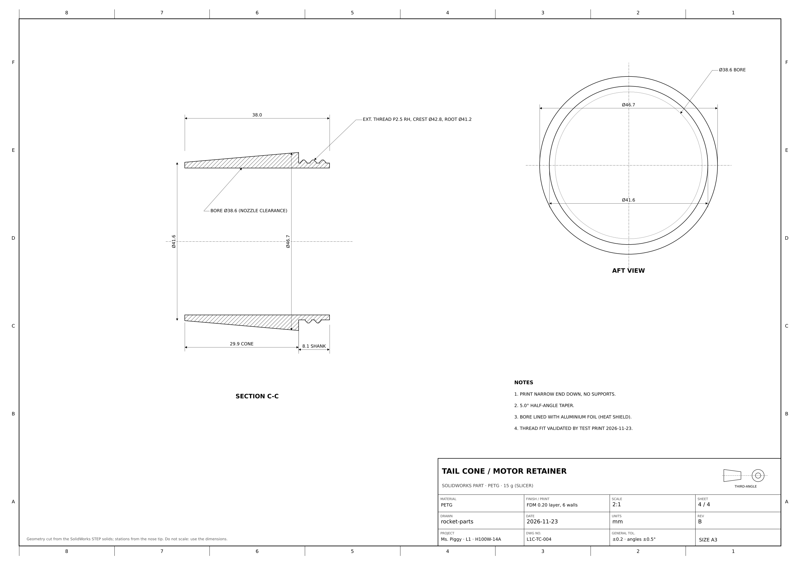
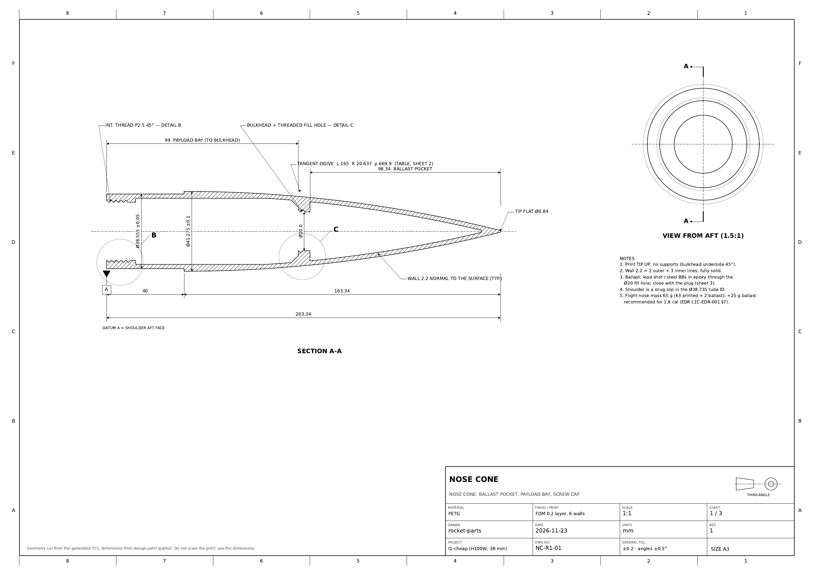
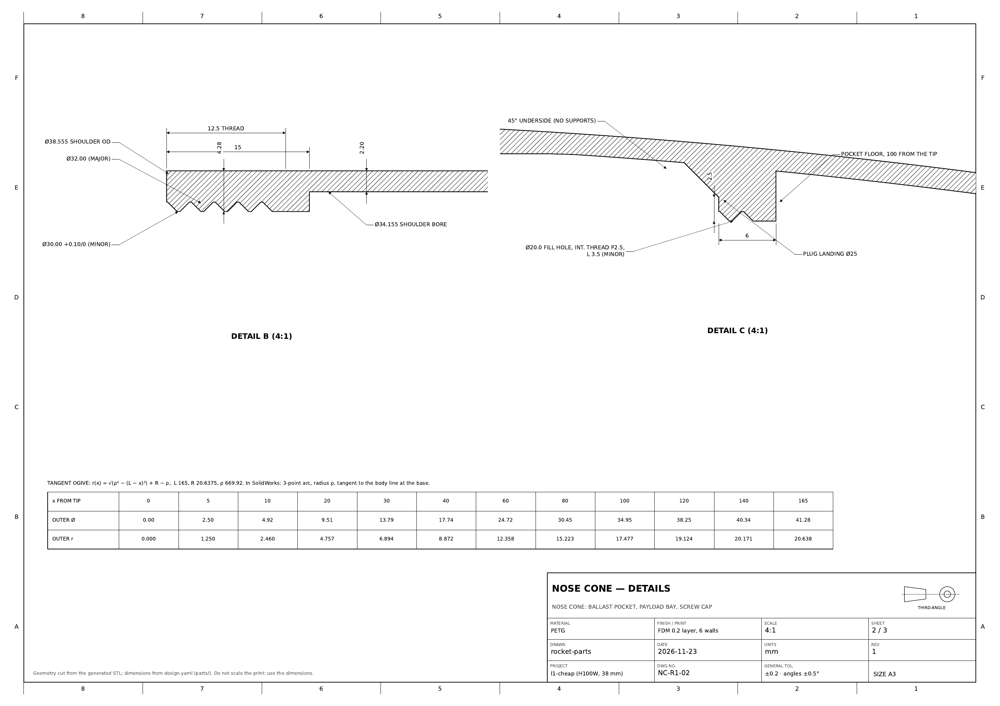
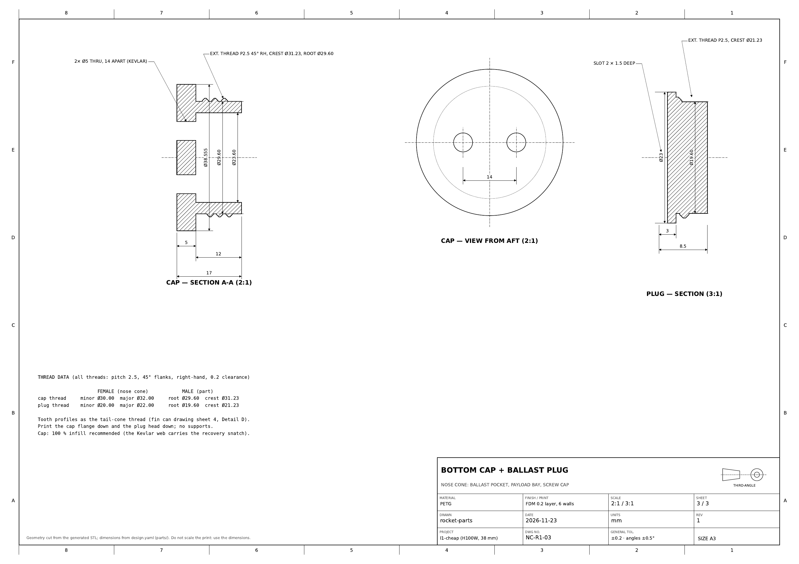

# Executive Summary {.unnumbered}

**Purpose.** This report sets out the design basis, analyses and verification status of *Ms. Piggy*, the rocket to be flown for a Tripoli Level 1 certification at Palm Bay, FL, on 2026-12-14 [D1]. The budget is \$100 including the motor [D1]. The report is the design basis for the build release and states the engineering recommendations for flight.

**Configuration.** Ms. Piggy is a single-stage, minimum-diameter rocket. An AeroTech H100W-14A DMS 38 mm motor sits directly in a LOC BT-1.52 paper tube [D3]. A 165 mm PETG tangent-ogive nose carries 2 g of ballast, for a 65 g nose total [D3]. A PETG fin can modelled in SolidWorks carries three trapezoidal fins of 46.1 mm span [D15]. A screw-on PETG tail cone with a foil-lined bore traps the motor thrust ring and forms a 30 mm boattail [D3][D15]. Recovery is a single deployment on the motor's ejection charge, with the delay drilled to 13 s, a LOC Precision 28 in parachute with an 84 mm spill hole, and 3.5 m of 750 lb Kevlar with knotted ends; a printed bulkhead in the tube anchors the cord and holds the chute pack forward [D3]. The aerodynamic basis is the refined-mesh CFD of the complete SolidWorks assembly, documented in the supporting analysis report L1C-CFD-002 [D28]. Fin can rev 9, generated from the design data, is geometrically almost identical to the flight part and remains the structural reference [D14].

| Quantity | Value | Basis | Status |
|---|---|---|---|
| Liftoff mass / CG | **610 g** (1.344 lb) / **763.3 mm** from the tip | OR model v4 with slicer-estimate masses, 65 g nose | [ESTIMATE]{.tag} |
| Centre of pressure | **826.3 mm** from the tip; *C*~Nα~ 12.74 /rad | Refined-mesh CFD of the full assembly, M 0.29, offset removed [D28] | Design basis |
| Static margin, no ballast | **1.53 cal** | CP 826.3 mm, estimated CG | below the 1.7 cal minimum: ballast required |
| Ballast, 1.7 / 1.8 cal | **6.4 / 10.2 g** at 74.6 mm | CP 826.3 mm, estimated CG 763.3 mm | sized at assembly [CONFIRMED]{.tag} |
| Margin at burnout | 2.5–2.8 cal | CFD CP(Mach) against simulated CG(*t*) | liftoff is critical |
| Apogee | **1664 m (5460 ft)**; 1525–1840 m for drag ±15 % | RocketPy on the CFD drag, +10.2 g ballast [D28] | [PROVISIONAL]{.tag} |
| Max speed / rail exit | 302 m/s, **M 0.89** / 24.7 m/s on 1.83 m | same | [PROVISIONAL]{.tag} |
| Fin strength, rev 9 | FI 0.34 / 0.27 / 0.15 / 0.026 | CalculiX, ANSYS-calibrated | pass (limits 0.5 / 0.5 / 0.5 / 0.1) |
| Delay | drill 14 s → **13 s** | ideal 13.1 s at nominal drag; worst-case ejection 14.7 m/s over drag ×0.85–1.40 | [CONFIRMED]{.tag} |
| Descent rate | **5.22 – 5.27 m/s** (17.1–17.3 ft/s) | LOC 28 in chute, 84 mm spill hole, *C*~d~ 0.75, 489–499 g | [ESTIMATE]{.tag} |
| Opening / snatch load | 5 N at 13 s; ≤ 79 N in the ±1.5 s band / 686 N at 20 m/s | against 1334 N knotted Kevlar | [ESTIMATE]{.tag} |
| Printed thread | pitch 2.5 / depth 1.0 / clearance 0.2 mm | test print | [VALIDATED]{.tag .ok} |

Table: Key results. Sources: §2.5, §3.4, §4.4–4.7, §5.4, §6.2–6.6, §7.2–7.4, §8.2.

**Findings**

1. **The centre of pressure is 826.3 mm from the nose tip.** This is the refined-mesh CFD of the complete assembly with the numerical zero-incidence offset removed [D28]. The coarse mesh under-predicts *C*~Nα~ by 9.8 % and puts the CP 22.3 mm forward. The refined full-assembly analysis supersedes the earlier coarse-mesh CP band of 809.9–827.4 mm as the design basis (Appendix A.8).
2. **Ballast is required to meet the 1.7 cal minimum.** On the liftoff CG of 763.3 mm [ESTIMATE]{.tag} the margin is 1.53 cal. Nose ballast of **6.4 g** gives 1.7 cal and **10.2 g** gives 1.8 cal. The margin rises to 2.5–2.8 cal by burnout, so liftoff is the critical condition (§6.3–6.4).
3. **The CP moves forward with incidence and Mach number.** It lies at 843.3 mm at α = 2° and 787.9 mm at α = 8°, and at 819.1 mm at M 0.8 [D28].
4. **Skin friction dominates drag.** It provides 64 % of the axial-force coefficient of 0.591 at M 0.29 [D28].
5. **Apogee is 1664 m (5460 ft) at nominal CFD drag**, at M 0.89, with a band of 1525–1840 m for ±15 % drag. A drag factor of 1.40 gives 1347 m and reproduces the OpenRocket apogee, so the two models differ mainly in drag [D28].
6. **A 13 s delay gives the lowest worst-case ejection speed**: 14.7 m/s across drag ×0.85–1.40, against 21.1 m/s for 12 s. The ideal delay at nominal drag is 13.1 s [D28].
7. **The rev 9 fin can passes all four structural criteria.** The SolidWorks fin can (flight part) is covered by similarity. It differs from rev 9 at the fin root (root-fillet thickness 11.1 mm against 13.4 mm) and at the trailing edge (1.0 mm against 2.5 mm) [D25].
8. **The 28 in parachute is adequate.** Descent is 5.22–5.27 m/s (17.1–17.3 ft/s) at *C*~d~ 0.75, and body-section landing energy is 5.8–5.9 J (4.3 ft-lbf) [D27]. Opening and snatch loads stay far below the 1334 N knotted-cord strength.
9. **Chute-pack position is critical.** If the pack slid aft onto the motor, the RocketPy basis would drop to 0.15 cal [D25]. The printed aft bulkhead holds the pack about 300 mm from the tip [D3].

**Recommendations**

1. **Size the nose ballast at assembly against the CP of 826.3 mm** from the measured ready-to-fly CG, using the ballast chart (§6.3). On the estimated CG this is 6.4 g for 1.7 cal and 10.2 g for 1.8 cal.
2. **Drill the H100W-14A delay to 13 s** (§3.4).
3. **Restrain the parachute pack at the forward station** with the printed aft bulkhead, vented or baffled so that it passes the ejection gas (§7.6).
4. **Fit-check the sleeve, motor, thrust ring and tail cone on the actual parts** before any epoxy is applied.
5. **Drop-test a printed flight fin can from 1.5 m** onto a fin tip as its structural acceptance test.
6. **Set the launch-wind limit from the size of the recovery area** (§7.8).

# Introduction {#sec-intro}

::: summary
**Section summary**
This section defines the scope, mission and requirements of the design, and the conventions used throughout. Each requirement carries its compliance status as of revision N.
:::

## Scope

The report covers the flight vehicle as it will be built: the SolidWorks fin can and tail cone, the nose cone rev 1, the LOC BT-1.52 airframe, the H100W motor and the recovery system. Fin can rev 9 is reported as the analysed reference, because the two fin cans are almost identical [D25].

The main body carries the current design and its conclusions. Superseded designs and analyses are condensed in Appendix A. The CFD figure gallery is in Appendix B, FEA detail in Appendix C, and the OpenRocket review in Appendix D. Decisions are logged in Appendix E. References and data sources are listed in Appendices F and G.

## Mission

| Item | Value | Source |
|---|---|---|
| Objective | Tripoli Level 1 certification flight | [D1] |
| Flyer | Tripoli member, uncertified; age 18+ confirmed | [D2] |
| Launch site | Palm Bay, FL (approx. 28.03° N, 80.59° W, sea level) | [D1][D3] |
| Launch date | 2026-12-14 | [D1] |
| Launch rail | 6 ft (1.83 m) rail; printed rail guides for both 1010 and 1515 rails [CONFIRMED]{.tag} | [D3] |
| Waiver | None required per the design data; predicted apogee 5460 ft (1664 m), 6038 ft (1840 m) at drag −15 % | [D3][D28][D29] |
| Payload | None; altimeter cost excluded from the budget | [D3][D10] |

Table: Mission definition.

## Requirements

| ID | Requirement | Source | Compliance |
|---|---|---|---|
| RQ-1 | Single certified H or I motor, 160.01–640 N·s | [R17] | **Complies**: H100W 223.9–234 N·s |
| RQ-2 | Average thrust above 80 N (forum guidance only) | [R19] | **Complies**: 93.4–100 N; margin only 13–20 N |
| RQ-3 | Rocket built by the flyer | [R17] | By the assembly sequence (§8.4) |
| RQ-4 | Safe recovery; rocket flyable again | [R17] | **Complies** by analysis: 5.22–5.27 m/s, body landing energy ≤ 5.9 J (§7) |
| RQ-5 | \$100 total including motor; 5 % held as contingency | [D1][D3] | Cost basis: motor \$54.99, tube \$9.30; full budget not in the project sources [PLACEHOLDER]{.tag} |
| RQ-6 | Static margin target 1.8 cal at liftoff | Design decision 2026-11-23 [D3] | **Complies** with ballast sized at assembly against CP 826.3 mm (§6.3): 10.2 g on the estimated CG; 1.53 cal without ballast |
| RQ-7 | Static margin at least 1.7 cal at liftoff | Design decision 2026-11-23 [D3] | **Complies** with ballast sized at assembly (§6.3): 6.4 g on the estimated CG |
| RQ-8 | Printed parts within 256 × 256 × 256 mm (Bambu P1S) | [D23] | **Complies** (§8.1) |
| RQ-9 | Fin landing and gust criteria C1–C4 | [D11] | Rev 9 **complies**; flight part by similarity and drop test (§5.7) |
| RQ-10 | Flutter speed at least 1.5 × V~max~ | [D11] | Complies by argument (§4.9), including the 302 m/s CFD-basis maximum speed |
| RQ-11 | Witnesses and certification form | [R17] | At the launch (pre-flight checklist, §9.3) |

Table: Requirements and compliance.

- The band gates the margin **at liftoff only**. In-flight margins are reported, not gated [D3].
- The 1.8 cal target and the 1.7 cal minimum, on the 41.275 mm reference, are design decisions of 2026-11-23 [D3].
- The apogee rose from 4388 ft on the earlier flight-video basis to 5460 ft on the CFD basis; the waiver entry of the design data was recorded on the earlier basis [D3][D21][D28].

## Conventions

- **Units.** SI: mm, g, N, s, m/s. US customary values appear in parentheses where the source is in those units, such as OpenRocket.
- **Axial coordinate.** *x* is measured from the nose tip, positive aft. Part coordinates use *Z* as the rocket axis, which is also the print direction.
- **Reference diameter.** *d* = 41.275 mm, the BT-1.52 tube OD (1.625 in). This is the OpenRocket model reference and the reference of the 1.8 cal target [D3]. OpenRocket models v3 and v4 report on the 1.842 in sleeve diameter; those values are converted to the tube reference here (Appendix D).
- **Abbreviations.** OR: OpenRocket (models v2, v3 and v4 are the OpenRocket files of 2026-11-23). OML: outer mould line. FI: failure index. TE: trailing edge. CP, CG: centre of pressure, centre of gravity. UDDT: AeroTech universal delay drilling tool.
- **Status tags.** Every number carries its basis. The tags used are:

| Tag | Meaning |
|---|---|
| [ESTIMATE]{.tag} | Calculated or assumed; not measured |
| [PROVISIONAL]{.tag} | Analysis result on a stated interim mass or geometry basis |
| [UNCONFIRMED]{.tag} | Result whose difference from a reference is within its own uncertainty |
| [NOMINAL]{.tag} | Published or catalogue value accepted without measurement |
| [CONFIRMED]{.tag} | Design decision confirmed 2026-11-23 or 2026-11-24 and recorded in the design data file |
| [PLACEHOLDER]{.tag} | Value not defined in the project sources; the stated basis applies |
| [VALIDATED]{.tag .ok} | Confirmed by test or by an independent reference |

Table: Status tags.

# Vehicle Configuration {#sec-config}

::: summary
**Section summary**
Ms. Piggy is a 1077 mm, 610 g minimum-diameter rocket. The SolidWorks fin can and tail cone are the flight hardware, and the near-identical rev 9 provides the structural reference. The aerodynamic basis is the refined CFD of the complete assembly (L1C-CFD-002). All mass properties are estimates: the printed-part masses are slicer estimates and no part has been weighed.
:::

![General arrangement of Ms. Piggy, drawing L1C-GA-001, sheet 1 of 4, rev C: side elevation with stations from the nose tip, isometric reference view, parts list (motor delay drilled 13 s) and notes. CG 763.3 mm [ESTIMATE]{.tag}; CP 826.3 mm (refined CFD, L1C-CFD-002).](figures/drawings/ga_vehicle.png){.drawing}

## Design basis {#sec-basis}

::: decision
**Design decisions, 2026-11-23 and 2026-11-24**
The SolidWorks fin can and tail cone fly exactly as drawn; the optional 6 mm root fillets are not added. Published nominal dimensions are accepted for the tube, motor case and thrust ring, without caliper measurement [D3]. The motor delay is drilled to 13 s (design decision 2026-11-24) [D3]. The aerodynamic basis is the refined-mesh CFD of the complete assembly, L1C-CFD-002, which supersedes the coarse-mesh CP band of 2026-11-23 (§4) [D28].
:::

| Confirmed design decision, 2026-11-23 | Section |
|---|---|
| Stability: 1.8 cal target, 1.7 cal minimum; ballast chosen at assembly from the measured CG | §6.3 |
| Single deployment on the motor ejection charge, delay drilled to 13 s (2026-11-24) | §3.4, §7.1 |
| LOC Precision 28 in parachute, 84 mm spill hole, 8 shroud lines | §7.2 |
| Printed aft bulkhead epoxied in the tube: Kevlar anchor, chute-pack stop, chute protection | §7.1, §7.6 |
| LOC Precision reusable wadding (chute protector) | §7.5 |
| Shock cord: 750 lb Kevlar, 3.5 m, knotted ends; nose attachment through the nose-cap floor | §7.4 |
| No forward backup motor stop; no heat protection around the motor case | §3.3 |
| Tail cone: PETG with a foil-lined bore | §8.1 |
| Fin can printed aft end (fins) down, axis vertical; 0.20 mm layers, 6 walls, 25 % gyroid | §5.6, §8.1 |
| 6 ft (1.83 m) rail; printed rail guides for 1010 and 1515 rails | §1.2 |
| Motor purchased on site; delay drilled with a delay drill tool | §3.1 |

Table: Confirmed design decisions [CONFIRMED]{.tag}. Source: [D3].

- **Flight hardware:** the SolidWorks fin can and tail cone [D15], nose cone rev 1 [D19], LOC BT-1.52 tube and the H100W motor.
- **Reference design:** fin can rev 9 and tail cone rev 9 [D17][D18]. A true-scale overlay shows the two fin cans are geometrically almost identical [D14][D25]. Rev 9 carries the FEA (§5).
- **Aerodynamic basis:** CFD of the complete SolidWorks assembly (fin can, tail cone, nose, tube and motor in flight position), refined mesh, L1C-CFD-002 [D28] (§4).
- **Mass basis:** slicer-estimate masses for the printed parts [ESTIMATE]{.tag}, with the rest of the vehicle from OpenRocket model v4 (§2.5).

## Layout {#sec-layout}

| Component | Key dimensions | Material | Mass | Status |
|---|---|---|---|---|
| Nose cone rev 1 (cone, cap, plug) | Tangent ogive, 165 mm, fineness 4.0; base OD 41.275; shoulder 38.555 × 40 mm; wall 2.2 mm | PETG | 63 g printed + 2 g ballast | Slicer [ESTIMATE]{.tag} |
| Body tube LOC BT-1.52 | ID 38.735 mm; OD 41.275 mm (1.625 in) | Kraft paper | OR model v4 0.229 lb | OD [NOMINAL]{.tag} |
| Fin can (SolidWorks) | Sleeve 118 mm; fairing 46.8 → 43.3 mm over 40.5 mm; 3 fins, root ≈ 52, tip 30, sweep 18.8, span 46.1 mm | PETG | **97 g** | Slicer [ESTIMATE]{.tag} |
| Tail cone (SolidWorks) | 46.8 → 41.6 mm over 29.9 mm; right-hand thread | PETG, foil-lined bore [CONFIRMED]{.tag} (§8.1) | **15 g** | Slicer [ESTIMATE]{.tag} |
| Motor H100W-14A DMS | Case 38.10 × 155 mm; ring 41.0 × 9.525 mm | — | 261 g loaded | [NOMINAL]{.tag} |
| Recovery | LOC Precision 28 in chute, 84 mm spill hole; 3.5 m 750 lb Kevlar; LOC reusable wadding; printed aft bulkhead | Nylon, aramid, PETG | chute 38 g [ESTIMATE]{.tag} | [CONFIRMED]{.tag} |

Table: Vehicle layout. Sources: [D3][D15][D16][D19][D25].

- **Overall length:** 1078.3 mm for the full-assembly CFD outer mould line [D28]; 1077.4 mm for the earlier SolidWorks CFD model and 1077.5 mm for rev 9 [D20]. OpenRocket model v2 gives 1077 mm [D16]. The outer mould line of the assembly is shown in §4.4.
- **Tube length:** the stock 863 mm tube is used uncut in the design data [D3]. OpenRocket model v4 has 28.57 in exposed [D16]; the general arrangement drawing shows 724.0 mm exposed.

## Component descriptions

**Nose cone.** The nose is a 165 mm tangent ogive printed tip-up in PETG [D3][D19]. A tip pocket, from the tip to 100 mm aft, holds ballast behind a screw-in plug; its uniform-fill CG is 74.6 mm from the tip [D3]. A screw-on bottom cap carries the Kevlar through two 5 mm holes. An empty payload bay is reserved between them [D3].

**Airframe.** The LOC BT-1.52 tube has a measured ID of 38.735 mm, equal to the nominal value [D23]. The motor case slides directly into it. The paper therefore touches the motor case, which is hot when the ejection charge fires [D4].

**Fin can and tail cone (flight hardware).** The SolidWorks fin can is a PETG sleeve that slides over the aft end of the tube and is epoxied to it [D15]. Its inward aft lip is the thrust stop. Three trapezoidal fins sit on the 46.795 mm sleeve. The span of 46.1 mm is intentional [D25]. The tail cone screws into a threaded collar behind the fins. Its shank face bears on the motor thrust ring, which traps the motor and forms the boattail.

**Motor retention.** The thrust ring is clamped between the fin-can lip (forward) and the tail-cone shank (aft). Thrust passes from the ring into the lip in compression. The ejection kick pulls the motor aft onto the shank, and the collar thread carries it [D18]. No screws or inserts are used. The aft-end assembly section (drawing L1C-AS-002) shows the flight parts at nominal dimensions. It records a 0.9 mm gap between the thrust ring and the cone shank, so the motor is retained but not clamped axially at nominal dimensions [D26].

{.drawing}

## Flight fin can versus the rev 9 reference {#sec-flight-vs-rev9}

| Item | SolidWorks (flight) | Rev 9 reference |
|---|---|---|
| Fin count; planform | 3; root ≈ 52, tip 30, sweep 18.8 mm | 3; root 50, tip 30, sweep 20.32 mm |
| Span | **46.1 mm** (tip r 69.5 mm), intentional | 43.18 mm |
| Thickness (max) | 11.4 / 9.4 / 7.5 mm at *r* 30 / 45 / 60 mm | 12 mm root → 6 mm tip, NACA 4-digit |
| Root-fillet region thickness | 11.1 mm (no fillet) | 13.4 mm (R6 fillet) |
| Trailing edge at the root | 1.0 mm | 2.5 mm, concave R6 skirt into the collar |
| Sleeve; bore; fairing | 118 mm; Ø41.6 mm slip fit; 46.8 → 43.3 mm over 40.5 mm | 100 mm; 40 mm fairing |
| Tail cone | 46.8 → 41.6 mm over 29.9 mm | 30 mm boattail to 41.6 mm (5.0°) |
| Masses | fin can 97 g, cone 15 g (slicer) [ESTIMATE]{.tag} | fin can 97.9 g [ESTIMATE]{.tag}, cone 16.0 g (model) |

Table: Flight fin can versus rev 9. Sources: [D3][D11][D15][D17][D25]; fin thickness and bore from drawing L1C-FC-003 [D26].

- The drawing of the SolidWorks fin can lists bore Ø41.6 mm and lip Ø38.42 × 2.67 mm [D26]; rev 9 uses a 41.455 mm sleeve bore and a 38.28 mm lip bore [D17].
- The overlay gives root-fillet thicknesses of 11.1 and 13.4 mm [D25]. The analysis note gives 11.2 and 13.6 mm [D14]. Both are reported (Appendix G).
- The fairing, sleeve, full-diameter section behind the fins and the 30 mm tail cone coincide at true scale [D14].

## Mass properties {#sec-mass}

::: summary
**Mass basis**
OpenRocket model v4 overstates the printed-part masses. Replacing them with the slicer-estimate masses at their STEP-solid CGs, and setting the nose to 65 g, gives a liftoff mass of 610 g and a CG of 763.3 mm from the tip [ESTIMATE]{.tag}.
:::

**Method.** The starting point is OpenRocket model v4 (649 g, CG 30.502 in) [D16]. The four OpenRocket printed-part entries were removed: fairing 77.1 g (modelled solid), sleeve 53.1 g, fins 15.9 g and tail transition 10.0 g, a total of 156.0 g [D25]. The slicer masses were added at the CGs of the SolidWorks STEP solids: fin can 97 g with its CG 59.5 mm forward of the fin-can aft face (*x* = 989.7 mm), and tail cone 15 g at *x* = 1059.6 mm [D3][D25]. The nose was set to the 65 g design value. All other OpenRocket items are unchanged.

$$ x_{CG} = \frac{\sum_i m_i\, x_i}{\sum_i m_i} $$

where *m*~i~ is the mass of item *i* (g) and *x*~i~ its CG from the nose tip (mm).

| Item | OR model v4 | Report basis | Basis |
|---|---|---|---|
| Nose cone | 0.132 lb (59.9 g) | 65 g | Design decision 2026-11-22 [D3] |
| Fairing + sleeve + fins | 77.1 + 53.1 + 15.9 g | — | Replaced by the fin can |
| Fin can | — | 97 g at *x* 989.7 mm | Slicer [D3]; mass and CG [ESTIMATE]{.tag} |
| Tail cone | 10.0 g | 15 g at *x* 1059.6 mm | Slicer [D3]; mass and CG [ESTIMATE]{.tag} |
| Tube, chute, cords, bulkhead, inner tube, motor | as OR model v4 | unchanged | [D16], Appendix D |
| **Liftoff mass** | 1.43 lb (649 g) | **610 g (1.344 lb)** | [ESTIMATE]{.tag} |
| **Liftoff CG from tip** | 30.502 in (774.8 mm) | **763.3 mm (30.05 in)** | [ESTIMATE]{.tag} |

Table: Liftoff mass properties, 65 g nose, no added ballast.

- The fin can CG is the uniform-density CG of the STEP solid. The tail-cone CG is given as 10.3 mm aft of the fin-can aft face, seated [D3].
- OpenRocket model v4 still models elastic shock cord and shroud lines, a bulkhead (0.005 lb) and an inner tube (0.043 lb) [D16]. These are carried unchanged.
- **Every mass is an estimate.** The materials are not purchased and no part has been weighed; the printed-part masses are slicer estimates at 0.20 mm layers, 6 walls and 25 % gyroid [D3]. The ready-to-fly balance check is the verification method for the CG (§9.3).

# Propulsion {#sec-prop}

::: summary
**Section summary**
The AeroTech H100W-14A DMS (38 mm, single-use) delivers 228.4 N·s over 2.40 s on the thrust-curve file used by the simulations. The motor is retained by the screw-on tail cone, which traps the factory-glued thrust ring. The 14 s delay is drilled to 13 s (design decision 2026-11-24): the ideal delay at nominal CFD drag is 13.1 s, and 13 s gives the lowest worst-case ejection speed across the drag uncertainty.
:::

## Motor data {#sec-motor}

Published values were gathered on 2026-11-21. No manufacturer certification document could be read [D4]. Sources disagree in places; all are listed.

| Parameter | Design value | Thrust-curve file | Other sources |
|---|---|---|---|
| Total impulse | 226.8 N·s | **228.4 N·s** | 234 [R4]; 223.9 [R7]; OR 228 |
| Average thrust | 97.7 N | — | 100 [R4]; 93.4 [R7]; OR 99.6 |
| Maximum thrust | **137.8 N** (structural) | 130.2 N at 0.696 s | 131 [R4]; OR 130 |
| Burn time | 2.32 s | **2.40 s** | 2.3 [R1][R4]; OR 2.29 |
| Loaded / propellant mass | 261 / 121 g | 261 / 121 g | OR 0.267 lb |
| Length | 155 mm | 155 mm | 153 [R1]; 157.5 [R7]; OR 158 |

Table: H100W-14A DMS data (AT part 081014). Sources: [D3][D4][D16].

- The design values are those in the project data file [D3]. Simulations fly the thrust-curve file; structural checks use the 137.8 N maximum.
- ThrustCurve also lists an unlabelled "116.1 N", which no source identifies [D4].
- The burnout mass of 140 g is derived (261 − 121 g) and ignores delay-grain and ejection mass [D3].
- Case OD: 38.10 mm (1.500 in) [NOMINAL]{.tag}, taken from the AeroTech I500T DMS page [R9]. This gives 0.64 mm diametral clearance in the 38.735 mm tube [D4].
- The motor is purchased on site and its delay drilled with a delay drill tool [CONFIRMED]{.tag} [D3]. Mail-order motors require HAZMAT shipping. Price \$54.99 [R3][R4][R5]. Three failures are reported in MESS; their details are not in the project sources [R11].

![AeroTech H100W-14A DMS thrust versus time. The curve integrates to 228.4 N·s, peaks at 130.2 N at 0.696 s and ends at 2.40 s. Plotted from the thrust-curve file converted from the ThrustCurve CSV (contributor M. Haberer), 2026-11-21 [D4][R2].](figures/h100w_thrust.png){width=80%}

## Selection rationale

- **2026-11-20:** the AeroTech H182R-14A (29 mm DMS) was selected. It was chosen over 29 mm reloads, which need a \$108.79–\$152.99 case [D2].
- **2026-11-21:** design decision to change to the **H100W-14A (38 mm DMS)** and to a **minimum-diameter** layout [D3][D24]. The rationale: the H100W-14A is the most cost-effective motor for the goal, its long delay can be drilled shorter, and it is single-use, whereas the H182R needed a reusable case [D3]. The H100W costs \$12.70 more than the H182R's lowest price [D4].
- The H182R history is in Appendix A.1.

## Retention and thrust path {#sec-retention}

- **Thrust.** The factory-glued thrust ring bears on the fin-can lip. The glue joint therefore carries the full thrust, 137.8 N design value [D4]. AeroTech's 2014 DMS thrust-ring advisory asks users to inspect the ring [R10].
- **Bearing on the lip.** Bearing stress is

$$ \sigma_b = \frac{F}{A}, \qquad A = \frac{\pi}{4}\left(D_{ring}^2 - D_{lip}^2\right) $$

  where *F* is the thrust (N), *D*~ring~ the ring OD and *D*~lip~ the lip bore (mm). The 15 MPa interlayer reference is reached at *A* = 9.2 mm² [D4]. The nominal annulus, 41.0 mm ring OD on the 38.28 mm lip bore, is far larger [D3][D17].
- **Ejection.** The ejection kick pulls the motor aft onto the tail-cone shank. The collar thread carries it in shear, with about 6 kN capacity (§5.5) [D18].
- **No backup stop.** No forward backup motor stop is fitted (design decision, 2026-11-23) [D3]. The simulation mass basis carried a 10 g stop ring [ESTIMATE]{.tag} [D3][D8].
- **Heat.** The paper tube touches the case directly [D4]; no heat protection is fitted around the case (design decision, 2026-11-23) [D3]. The tail cone surrounds the nozzle exit during the 2.4 s burn (§8.1).

::: warning
**Nominal motor dimensions**
The case OD (38.10 mm), ring OD (41.0 mm) and ring length (9.525 mm, 3/8 in) are not measured [NOMINAL]{.tag} [D3]. No AeroTech drawing was found; the ring length is a Rocketry Forum estimate [R13], and a photograph of the motor is consistent with it. These values set the collar length (18.5 mm), collar bore (41.6 mm) and tail-cone bore (38.6 mm) on rev 9 [D17][D18]. A fit check of the actual motor, tube, fin can and tail cone at assembly, before epoxy, is recommended (§8.3).
:::

## Delay selection {#sec-delay}

The delay timer starts at burnout, so the ideal delay equals the coast time [D7]:

$$ t_{delay} = t_{apogee} - t_{burnout} $$

where *t*~apogee~ is the time of apogee and *t*~burnout~ the time of burnout after liftoff (s).

The coast time depends mainly on drag. The CFD flight simulation (§6.5) was therefore run across a drag band from ×0.85 to ×1.40 of the CFD axial force; ×1.40 reproduces the OpenRocket apogee [D28].

| Drag | Apogee | Ideal delay | Ejection speed at 11 / 12 / **13** / 14 s |
|---|---|---|---|
| CFD −15 % | 1840 m | 14.1 s | 31.3 / 21.1 / **11.1** / 1.3 m/s |
| CFD nominal | 1664 m | 13.1 s | 21.2 / 11.2 / **1.4** / 8.4 m/s |
| CFD +15 % | 1525 m | 12.3 s | 13.1 / 3.2 / **6.6** / 14.1 m/s |
| ×1.40 (matches OpenRocket apogee) | 1347 m | 11.3 s | 2.5 / 7.3 / **14.7** / 20.9 m/s |
| **Worst case** | | | 31.3 / 21.1 / **14.7** / 20.9 m/s |

Table: Ideal delay and ejection speed against drag factor and drilled delay, +10.2 g ballast case [PROVISIONAL]{.tag}. Source: L1C-CFD-002 [D28][D29].

::: decision
**Design decision 2026-11-24: delay drilled from 14 s to 13 s** [CONFIRMED]{.tag}
The ideal delay at nominal CFD drag is 13.1 s. Across drag ×0.85–1.40, a 13 s delay gives the lowest worst-case ejection speed: 14.7 m/s, against 21.1 m/s for 12 s [D3][D28]. On the nominal trajectory the parachute deploys at 1.4 m/s; across a ±1.5 s delay tolerance the deploy speed stays at or below 16.2 m/s (§7.3) [D27]. The delay is drilled with a delay drill tool (AeroTech UDDT) [D3]. This decision replaces the 12 s delay of 2026-11-23 (Appendix E).
:::

- **Earlier bases.** The coarse-mesh, flight-video and OpenRocket simulations put the coast between 11.2 and 12.09 s; they are recorded in Appendix A.8. They carry higher drag than the CFD basis, as the ×1.40 row shows.
- **Not ~7 s.** A 7 s delay deploys while still climbing, at 31–63 m/s over the drag spread (rev 5 basis) [D8]. The knotted Kevlar is good to about 27 m/s (§7.4).
- **OpenRocket model v4 is set to the 14 s delay**, so its deploy speeds do not represent the 13 s configuration (Appendix D).
- The delay chart is in §6.6.

# Aerodynamics {#sec-aero}

::: summary
**Section summary**
The aerodynamic design basis is the CFD of the complete SolidWorks assembly in the supporting report L1C-CFD-002: nine cases on two mesh levels, an angle-of-attack sweep and Mach 0.5 and 0.8 runs [D28]. The refined, offset-free result is CP **826.3 mm** from the tip and *C*~Nα~ **12.74 /rad** at M 0.29. The CP moves forward with incidence and Mach number. The axial-force coefficient is 0.591 at M 0.29, of which skin friction is 64 %. This analysis supersedes the earlier coarse-mesh CP band of 809.9–827.4 mm as the design basis (Appendix A.8).
:::

## Method overview

| Method | Tool | Captures | Limitation |
|---|---|---|---|
| Barrowman | Hand calculation; RocketPy 1.13.0 | Nose, body steps, fins with interference factor | Omits most body lift near the fins |
| OpenRocket | OpenRocket models v2–v4 | Component build-up | Model errors (Appendix D) |
| 3D CFD, full assembly | OpenFOAM `simpleFoam` and `rhoPimpleFoam`, k-ω SST | Whole-vehicle pressure field; α 0–8°; M 0.29–0.8 | Two mesh levels; grid independence not demonstrated |

Table: CP methods. Sources: [D5][D16][D28].

## Fin geometry

The fin planform comes from the OpenRocket fin set: root 50, tip 30, span 43.18 and sweep 20.32 mm, trailing edge flush with the aft face [D3]. Rev 9 builds it with a NACA 4-digit symmetric section, 12 mm thick at the root and 6 mm at the tip [D3]. The SolidWorks fins differ slightly (§2.4): span 46.1 mm (tip radius 69.5 mm), maximum thickness 11.4 mm at *r* = 30 mm, 9.4 mm at 45 mm and 7.5 mm at 60 mm, with a 1.0 mm trailing edge (drawing L1C-FC-003) [D26]. The CFD of §4.4 uses the SolidWorks fins as assembled [D28].

## Barrowman centre of pressure {#sec-barrowman}

The Barrowman method sums component normal-force slopes and their centres [D5][D8]. With the nose tip as origin and *d* = 41.275 mm:

$$ x_{CP} = \frac{\sum_i C_{N\alpha,i}\, x_i}{\sum_i C_{N\alpha,i}} $$

- Nose: *C*~Nα,n~ = 2, at *x*~n~ = 0.466 *L*~n~ for a tangent ogive.
- Body step from diameter *d* to *d*~1~: *C*~Nα~ = 2[(*d*~1~/*d*)² − 1].
- Fins:

$$ C_{N\alpha,f} = K_{fb}\,\frac{4N\,(s/d)^2}{1 + \sqrt{1 + \left(\dfrac{2\,l_m}{C_r + C_t}\right)^2}}, \qquad K_{fb} = 1 + \frac{r}{s + r} $$

where *N* is the fin count, *s* the span, *C*~r~ and *C*~t~ the root and tip chords, *l*~m~ the mid-chord line length and *r* = 23.40 mm the sleeve radius (all mm); *K*~fb~ is the fin–body interference factor.

| Component | *C*~Nα~ (/rad) | *x* (mm) |
|---|---|---|
| Nose | 2.000 | 76.9 |
| Body step 41.275 → 43.135 mm | 0.184 | 910.7 |
| Fairing 43.135 → 46.795 mm | 0.386 | 920.8 |
| Fins (with *K*~fb~) | 7.117 | 1000.2 |
| **Total** | **9.69** | **804.7** |

Table: Barrowman build-up, OpenRocket planform on the rev 5–7 body (no boattail). Sources: [D3][D5][D8][D14].

- RocketPy gives 804.6 mm at M 0, 810.9 mm at M 0.5 and 822.0 mm at M 0.8 [D3].
- The build-up was not repeated for the boattail fin cans or the SolidWorks fins.
- On rev 7, CFD placed the CP 31 mm aft of Barrowman [D14]; the full-assembly refined CFD places it at 826.3 mm (§4.5). The CFD nose term matches the theory [D14]. The difference is body lift around the fin can and at the tube-to-fairing step, which Barrowman largely omits. **Barrowman is therefore conservative for this rocket.**

## Full-assembly CFD method {#sec-cfd-method}

The CFD body is the outer mould line of the SolidWorks assembly (Ms.Piggy_Assembly.STEP, 2026-11-24): nose cone with cap and plug, LOC BT-1.52 body tube, fin can, tail cone and motor in flight position [D28]. Internal features (bores, threads, motor, nose cavity) are filled, because they carry no external flow. The result is watertight and 1078.3 mm long, with an exposed nose length of 163.4 mm and a flat base of Ø41.6 mm.

![Outer mould line of the SolidWorks assembly used for the CFD, section through fin 0: full vehicle (top) and aft end (bottom), mm; fin-can aft face at z = 0. Source: L1C-CFD-002 Rev A, 2026-11-24 [D28].](figures/msp/oml_side.png){width=100%}

| Item | Setting |
|---|---|
| Solver | `simpleFoam` (incompressible, M 0.29); `rhoPimpleFoam` with local time stepping (compressible) |
| Turbulence | k-ω SST, wall functions |
| Domain | Box 1 m ahead, 3 m behind, ±1 m vertical, 1 m lateral; half model, symmetry plane through fin 0 |
| Mesh | `snappyHexMesh`: surface level 4–5 (coarse, 0.60 M cells) and 5–6 (refined, 2.50 M cells); maximum skewness 3.27 / 3.16 |
| Convergence | 800 (coarse), 1200 (refined), 2500 (compressible) iterations; CP change over the last quarter ≤ 0.3 mm (incompressible), 2.8 mm (compressible) |
| Reference | *d* = 41.275 mm, *A* = 1.338 × 10⁻³ m²; moments about the nose tip |

Table: CFD set-up. Source: L1C-CFD-002 §2 [D28].

| Case | Mesh | α | Mach | Purpose |
|---|---|---|---|---|
| msp_a0 / msp_a0_f | coarse / refined | 0° | 0.29 | Zero-incidence offset; drag |
| msp_a2, a4, a6, a8 | coarse | 2, 4, 6, 8° | 0.29 | Angle-of-attack sweep |
| msp_a4_f | refined | 4° | 0.29 | Mesh study; design CP |
| msp_m05 / msp_m08 | coarse | 4° | 0.50 / 0.80 | Compressibility increments |

Table: CFD case matrix, nine cases. Source: L1C-CFD-002 §2.2 [D28].

Forces come from integrating surface pressure:

$$ \mathbf{F} = \sum_f p_f\, \mathbf{n}_f A_f, \qquad C_N = \frac{F_z}{qA}, \qquad C_{A,p} = \frac{F_x}{qA}, \qquad q = \tfrac{1}{2}\rho U^2, \qquad x_{CP} = -\frac{M_y}{F_z} $$

where *p*~f~ is the face pressure (Pa), **n**~f~ the face unit normal and *A*~f~ the face area (m²); *F*~z~ and *F*~x~ the normal and axial forces (N); *q* the dynamic pressure (Pa), ρ the air density (kg/m³) and *U* the flow speed (m/s); *A* the reference area (m²); and *M*~y~ the pitching moment about the tip (N·m).

**Corrections applied** [D28]:

- **Zero-incidence offset.** A three-fin rocket produces no normal force at α = 0 by symmetry, yet the half-model mesh returns *C*~N0~ = 0.054. The offset is numerical and identical on both meshes. It is removed from every case:

$$ C_N' = C_N - C_{N0}, \qquad x_{CP}' = \frac{C_N\, x_{CP} - C_{N0}\, x_{CP0}}{C_N'} $$

  where *C*~N0~ and *x*~CP0~ are the normal-force coefficient and its centre at α = 0 (mm).
- **Mesh correction.** The refined mesh raises *C*~N~ by 9.8 % and moves the CP 22.3 mm aft at α = 4°. Both corrections are applied to all coarse-mesh cases.
- **Compressible cases.** First-order upwinding over-predicts pressure drag in absolute terms. Normal force and CP therefore enter as increments over the coarse M 0.29 case; axial force enters only as the ratio M 0.8 / M 0.5 of the same scheme.
- **Skin friction.** A turbulent flat plate with compressibility correction on the wetted areas: the paper tube (0.094 m²) smooth, the printed parts (0.054 m²) fully rough with *k*~s~ = 40 µm for 0.2 mm layers.
- **Rail guides.** Two printed guides add Δ*C*~A~ = 0.06 [ESTIMATE]{.tag}.

## Mesh study and centre of pressure {#sec-cfd-results}

| Quantity (α = 4°, offset removed) | Coarse 0.60 M | Refined 2.50 M | Change |
|---|---|---|---|
| *C*~Nα~ (/rad) | 11.60 | **12.74** | +9.8 % |
| CP from tip (mm) | 804.0 | **826.3** | +22.3 mm |
| *C*~A~ pressure | 0.242 | **0.169** | −30 % |

Table: Mesh study at 100 m/s, α = 4°. Source: L1C-CFD-002 §4.1 [D28].

![Mesh study: *C*~Nα~, CP and pressure axial force against cell count at α = 4°. The coarse mesh resolves the 6–12 mm thick fins with too few cells, which lowers fin lift and raises pressure drag. Source: L1C-CFD-002 Rev A, 2026-11-24 [D28].](figures/msp/mesh_study.png){width=100%}

- **The coarse mesh under-predicts *C*~Nα~ by 9.8 % and puts the CP 22.3 mm forward** of the refined result [D28].
- Two mesh levels bound the result but do not prove grid independence. If the error falls with the square of the cell size, the converged CP lies about 7 mm aft of the refined value, about 833 mm. The refined value of 826.3 mm is therefore the conservative basis [D28].

| α | *C*~N~ | *C*~N~/α (/rad) | CP from tip (mm) |
|---|---|---|---|
| 2° | 0.467 | 13.38 | 843.3 |
| 4° | 0.889 | 12.74 | **826.3** |
| 6° | 1.311 | 12.52 | 815.5 |
| 8° | 1.584 | 11.34 | 787.9 |

Table: Normal force and centre of pressure against incidence, mesh- and offset-corrected, M 0.29. Source: L1C-CFD-002 §4.2 [D28][D29].

![Normal-force coefficient and CP against angle of attack. *C*~N~ is linear to 6° and falls below the linear slope at 8°, as the fins approach their lift limit. The CP moves forward as body lift grows with incidence. Source: L1C-CFD-002 Rev A, 2026-11-24 [D28].](figures/msp/cn_cp_vs_alpha.png){width=100%}

::: result
**Design CP: 826.3 mm from the nose tip**
Refined-mesh CFD of the full assembly, M 0.29, zero-incidence offset removed; *C*~Nα~ 12.74 /rad [D28]. This value replaces the CP band of 809.9–827.4 mm used in revisions L and M. The refined full-assembly analysis supersedes the earlier coarse-mesh results as the design basis; they are recorded in Appendix A.8.
:::

## CP by method {#sec-cp-table}

| Basis | Geometry | CP (mm) | *C*~Nα~ (/rad) | Status |
|---|---|---|---|---|
| **CFD msp_a4_f, refined, offset removed** | **Full SolidWorks assembly** | **826.3** | **12.74** | **Design basis** [D28] |
| CFD msp_a4, coarse, offset removed | Full SolidWorks assembly | 804.0 | 11.60 | mesh study |
| CFD own_a4, coarse | SolidWorks fin can and tail cone | 809.9 | 11.89 | earlier basis (Appendix A.8) |
| CFD r9a4, coarse | Rev 9 | 827.4 | 13.12 | earlier basis (Appendix A.8) |
| CFD a4, coarse | Rev 7, flat base | 836.3 | 14.06 | history |
| Barrowman M 0 | Rev 5–7 body | 804.7 | 9.69 | conservative |
| OR model v2 | OpenRocket | 835.6 (32.896 in) | — | model errors |
| OR model v3 / v4 | OpenRocket | 861.5 (33.918 in) | — | not trusted: fins 15 mm aft |

Table: CP from the nose tip by method, reference 41.275 mm. CFD at 100 m/s, α = 4°. Sources: [D3][D14][D16][D20][D28].

- The earlier coarse-mesh cases (own_a4, r9a4, a4) used a single mesh of 590–633 k cells with a design tube and nose [D14][D20]. The full-assembly case adds the as-modelled nose, tube and motor, a second mesh level and the zero-incidence correction [D28].
- OpenRocket's CP sits aft of every CFD value; models v3 and v4 carry the fin offset error of Appendix D.4.

## Drag and Mach number {#sec-drag}

| Mach | *C*~Nα~ (/rad) | CP (mm) | *C*~A~ pressure: forebody + fins / base | *C*~A~ friction | *C*~A~ total |
|---|---|---|---|---|---|
| 0.29 | 12.74 | 826.3 | 0.099 / 0.051 | 0.381 | **0.591** |
| 0.50 | 14.77 | 820.7 | 0.109 / 0.060 | 0.353 | **0.582** |
| 0.80 | 14.65 | 819.1 | 0.151 / 0.080 | 0.325 | **0.615** |

Table: Aerodynamic coefficients against Mach number, axial at α = 0 and normal at α = 4°; totals include rail guides Δ*C*~A~ = 0.060 [ESTIMATE]{.tag}. Source: L1C-CFD-002 §4.3 [D28][D29].

- **Breakdown at M 0.29:** skin friction 0.381 (64 %), forebody and fin pressure 0.099, base pressure 0.051 and rail guides 0.060 [ESTIMATE]{.tag}; total 0.591 [D28]. The 0.2 mm FDM layer lines are modelled as roughness on the printed parts.
- **Mach effect.** The CP moves forward from 826.3 mm at M 0.29 to 820.7 mm at M 0.5 and 819.1 mm at M 0.8. Forebody and fin pressure drag rises 39 % from M 0.5 to M 0.8 [D28].
- **Above M 0.8.** The flight peaks at M 0.89 (§6.5). The aerodynamic database carries *C*~A~ 0.638 at M 0.9 as a non-CFD entry beyond the M 0.8 case [D29].
- The drag used in the flight simulation is the CFD axial-force curve; the power-on curve removes the base drag (§6.5) [D28].

![Axial-force coefficient (total, pressure and friction), *C*~Nα~ and CP against Mach number. Source: L1C-CFD-002 Rev A, 2026-11-24 [D28].](figures/msp/ca_cn_cp_vs_mach.png){width=100%}

![Breakdown of the axial-force coefficient at M 0.29, α = 0: skin friction 0.381 (64 %), forebody and fin pressure 0.099, base pressure 0.051 and rail guides 0.060 (estimate); total 0.591. Source: L1C-CFD-002 Rev A, 2026-11-24 [D28].](figures/msp/drag_breakdown.png){width=80%}

## Flow field {#sec-flowfield}

![Surface pressure coefficient, refined mesh, 100 m/s, α = 4°: windward and leeward views of the whole vehicle and the fin can. High pressure along the windward fin leading edges and suction over the leeward fins produce the restoring force. Source: L1C-CFD-002 Rev A, case msp_a4_f, 2026-11-24 [D28].](figures/msp/fine_cfd_surface_cp.png){.color width=88%}

![Fin can surface pressure, isometric view from the windward side (ParaView, refined mesh, α = 4°). Stagnation lines run along the fin leading edges with suction behind them. Source: L1C-CFD-002 Rev A, case msp_a4_f, 2026-11-24 [D28].](figures/msp/gallery/06_fincan_Cp_iso_windward.png){.color width=75%}

Further flow-field views of the refined case are in Appendix B.6 and in L1C-CFD-002 [D28].

## Flutter {#sec-flutter}

Flutter speed is estimated with NACA TN 4197, as presented in Apogee *Peak of Flight* #291 [R33]:

$$ V_f = a\,\sqrt{\frac{G}{\dfrac{1.337\,AR^3\,P\,(\lambda + 1)}{2\,(AR + 2)\,(t/C_r)^3}}}, \qquad AR = \frac{s^2}{A_{fin}} $$

where *V*~f~ is the flutter speed and *a* the speed of sound (m/s); *G* the shear modulus and *P* the air pressure (Pa); λ = *C*~t~/*C*~r~ the taper ratio; *t* the thickness and *C*~r~ the root chord (mm); *A*~fin~ the fin area.

| Fins 50/30/43.18 mm, 6 mm constant (rev 5), sea level | *G* | *V*~f~ | *V*~f~ / 250 m/s |
|---|---|---|---|
| Conservative PETG set (used in FEA) | 394 MPa | ≈ 1330 m/s | ≈ 5.3 |
| Higher shear modulus | 620 MPa | ≈ 1670 m/s | ≈ 6.7 |

Table: Flutter estimate. Source: [D12].

- Criterion C5 requires *V*~f~ ≥ 1.5 × 250 m/s at *G* = 394 MPa [D11]. Thicker fins only raise *V*~f~, so C5 holds **by argument** for the 12 → 6 mm taper. No calculation exists for rev 9 or the SolidWorks fins.
- The CFD flight simulation peaks at 302 m/s [D28], above the 250 m/s basis of C5. The ≈ 1330 m/s estimate also exceeds 1.5 × 302 m/s.
- The ANSYS modal run on rev 5 gives a first fin mode at 567.9 Hz (Appendix C).

# Structures {#sec-struct}

::: summary
**Section summary**
The governing structural loads are landing strikes on a fin tip, which put the printed layers at the fin root in across-layer tension. The rev 9 reference fin can meets all four fin criteria with in-house FEA calibrated against reference ANSYS runs. The SolidWorks flight fin can is covered by similarity to rev 9, and a 1.5 m drop test is recommended as its structural acceptance test.
:::

## Load cases {#sec-loadcases}

| ID | Load case | Load | Criterion | Basis |
|---|---|---|---|---|
| C1 | Sideways landing hit on a fin tip | 200 N, Y | FI ≤ 0.5 | [D11] |
| C2 | Tilted landing | 200 N at 45° (Y + Z) | FI ≤ 0.5 | [D11] |
| C3 | Tail-first landing | 200 N axial, Z | FI ≤ 0.5 | [D11] |
| C4 | Flight gust (5° at max *q*) | 15 N, Y | FI ≤ 0.1 | [D11][D12] |
| C5 | Flutter | *V*~f~ ≥ 1.5 × 250 m/s | by argument | §4.9 |
| — | Motor thrust on the lip | 137.8 N | hand check | [D4] |
| — | Ejection kick on the collar thread | not quantified | hand capacity | [D18] |

Table: Structural load cases. FI = across-layer failure index (§5.3).

- The 200 N landing load is an [ESTIMATE]{.tag} set when the 40 in chute was the plan [D12]. The FI ≤ 0.5 limit is a 2× margin covering print variability [D11].
- A 28 in chute was then chosen. For 540–600 g this roughly doubles the landing energy: 7.8–9.7 J, 180–450 N average and up to about 900 N peak impact force [ESTIMATE]{.tag} [D12]. The fin criteria keep the 200 N basis; the landing comparison is in §7.7.
- The 15 N gust load of C4 is an [ESTIMATE]{.tag} for 5° incidence at a maximum dynamic pressure of about 37 kPa [D12]. The CFD flight simulation gives a maximum dynamic pressure of 53.8 kPa [D28]; C4 is not re-derived on it (Appendix G.2).

## Material and allowables {#sec-material}

The fin can is printed with *Z* (the rocket axis) as the build direction, so *Z* is across the layers. The analyses use a conservative orthotropic PETG set, confirmed for the reference ANSYS runs [D12].

| Property | Value | Source |
|---|---|---|
| *E*~x~ = *E*~y~ (in plane) | 1472 MPa | JuggerBot PETG review [R42] |
| *E*~z~ (across layers) | 1087 MPa | same |
| *G*~xy~ / *G*~yz~ = *G*~xz~ | 533 / 394 MPa | same |
| Poisson's ratio | 0.38 (assumed) | [D12] |
| Tensile strength across layers | ≈ 19 MPa | Ultimaker PETG TDS, upright [R43] |
| Interlayer shear strength | ≈ 15 MPa | shop constant [D23] |
| In-plane tensile strength | ≈ 38.5 MPa | Ultimaker PETG TDS, flat [R43] |

Table: PETG properties and limits.

- Both property sets were taken from search-result summaries of the cited documents, not from the documents themselves [D12].

## FEA method and calibration {#sec-fea-method}

The in-house FEA uses gmsh and CalculiX with quadratic tetrahedra (C3D10) and a direct solver [D13]. It mirrors the reference ANSYS setup: fixed sleeve bore, load spread over the tip face of the +X fin, the conservative PETG set. Fin-criteria runs use a 3.0 mm global mesh refined to 0.8 mm around the fin root. The failure index is read in the root zone, excluding nodes within 5 mm of the loaded face.

$$ FI = \frac{\sigma_Z}{\sigma_{allow}}, \qquad \sigma_{allow} = 19\ \text{MPa} $$

$$ FI_{crit} = k\; FI_{C,run}\,\frac{F_{crit}}{F_{run}}, \qquad k_{side} = \frac{0.571}{0.441} = 1.294, \qquad k_{ax} = \frac{400/770}{0.425} = 1.222 $$

where σ~Z~ is the normal stress across the layers (MPa); *FI*~C,run~ the raw CalculiX root-zone index at the run load *F*~run~ (N); *F*~crit~ the criterion load (N); and *k* the calibration ratio of the reference ANSYS result to CalculiX on rev 5 at the same mesh [D11][D13]. The model is linear static, so FI scales with load.

| Validation case, rev 5 | ANSYS (reference) | CalculiX | Difference |
|---|---|---|---|
| 400 N axial: root σ~Z~ | 9.88 MPa | 9.52 MPa | **−3.6 %** |
| 50 N sideways: root σ~Z~ (0.7 mm root mesh) | 10.85 MPa | 8.85 MPa | −18 % |
| 50 N sideways: root σ~Z~ (uniform 2.0 mm mesh) | 10.85 MPa | 10.25 MPa | −5.5 % |
| 50 N sideways: tip deflection | 2.51 mm | 2.84 mm | +13 % |

Table: CalculiX validation against the reference ANSYS runs on rev 5. Source: [D13]. Axial agreement with ANSYS within 3.6 %.

- The sideways peak sits on a sharp concave corner, so it is mesh-dependent. Revisions are therefore compared at identical settings, and absolute values are scaled to the ANSYS calibration. Detail is in Appendix C.

## Results {#sec-fea-results}

| Criterion (ANSYS-scaled FI) | Rev 7 | Rev 8 | **Rev 9** | Limit |
|---|---|---|---|---|
| C1 sideways 200 N | 0.28 | 0.30 | **0.34** | 0.5 |
| C2 tilted 200 N at 45° | 0.25 | 0.33 | **0.27** | 0.5 |
| C3 axial 200 N | 0.084 | 0.11 | **0.15** | 0.5 |
| C4 gust 15 N | 0.022 | 0.023 | **0.026** | 0.1 |

Table: Fin criteria C1–C4. Mesh 3.0 / 0.8 mm, calibration 1.294 / 1.222. Sources: [D11][D13]. Rev 8 values are for the gusseted version.

- **Rev 9 passes all four criteria.** It is slightly weaker than rev 7, which had an 8 mm blunt root trailing edge, but stays inside the 2× limit.
- Rev 9 C4 is 0.0257 in the results file and is quoted as 0.026 here [D13].

| Rev 9 raw run | Root FI (σ~Z~) | Root peak (mm) | Max deflection |
|---|---|---|---|
| 50 N Y | 0.065 (1.24 MPa) | (23.0, −4.3, 9.1) | 0.88 mm |
| 400 N Z | 0.240 (4.56 MPa) | (23.3, 1.6, 0.0) | 0.67 mm |
| 200 N at 45° | 0.207 (3.93 MPa) | (23.2, −4.1, 8.7) | 2.50 mm |
| 15 N Y | 0.020 (0.38 MPa) | (23.0, −4.5, 9.9) | 0.26 mm |

Table: Rev 9 raw CalculiX runs, root zone, load face excluded. Source: [D13].

- **Peak location.** The bending peaks lie where the root fillet meets the sleeve (*r* ≈ 23 mm, *z* ≈ 9–10 mm). The axial peak lies at the aft face.
- **Peaks outside the root zone.** Three runs peak at *x* ≈ 60.7 mm on the fin near the loaded tip, slightly above the root value (0.073, 0.212, 0.022). The 400 N Z run peaks at 0.264 on what appears to be the fixed sleeve bore. Whether these are load-introduction or support effects is not stated [D13].

![Rev 9 fin can, 50 N sideways on the +X fin tip: failure index σ~Z~/19 MPa, legend 0–1, raw. Root FI 0.065 (σ~Z~ 1.24 MPa). The whole part is at low FI except for a faint patch at the loaded fin root. Scaled to 200 N and ×1.294 this gives C1 = 0.34. Source: CalculiX, rev 9, 2026-11-22 [D13].](figures/fea/rev9_tipY50_overview.png){width=80%}

![Rev 9, 50 N sideways, close-up of the loaded fin root. The lighter band follows the line where the root fillet meets the sleeve, the C1, C2 and C4 peak location (*z* ≈ 9 mm). Source: CalculiX, rev 9, 2026-11-22 [D13].](figures/fea/rev9_tipY50_root.png){width=70%}

![Rev 9, 200 N at 45° (141.4 N Y + 141.4 N Z), root close-up. Root FI 0.207 (σ~Z~ 3.93 MPa), giving C2 = 0.27. A light streak runs along the fillet-to-sleeve line, and the fin's aft lower corner is lighter where the axial component adds. Source: CalculiX, rev 9, 2026-11-22 [D13].](figures/fea/rev9_200N_at45_root.png){width=70%}

## Hand checks and margins {#sec-hand}

| Check | Equation and inputs | Result | Source |
|---|---|---|---|
| Thrust bearing on the lip | σ = *F*/*A*; *F* = 137.8 N | 15 MPa at *A* = 9.2 mm²; nominal annulus far larger | [D4] |
| Collar thread, ejection kick | π × 41.6 × 6.5 × 0.5 = 425 mm² × 15 MPa | ≈ 6 kN shear capacity | [D18] |
| Nose cap Kevlar web | 9 × 5 mm web, 2 shear planes | ≈ 2.1 kN, 6× the 343 N opening [ESTIMATE]{.tag} | [D3] |
| Nose shoulder, across layers | 251 mm² annulus at 15 MPa | 3.77 kN | [D19] |
| Printed anchor net area | *A*~net~ ≥ *F*·SF/15 MPa | 48 mm² for deploy ≤ 20 m/s | [D7] |

Table: Hand checks.

- No hand check quantifies the ejection kick itself; the ≈ 6 kN thread capacity is reported against it.
- The rev 9 criteria results give the fin margins directly: FI ≤ 0.5 is a 2× margin on across-layer failure by construction.

## Loads versus layers {#sec-layers}

Every printed structural part is printed with its axis vertical, so *Z* is across the layers.

| Part and load | Path | Across or within layers |
|---|---|---|
| **Fin can (flight part and rev 9)** | | |
| Motor thrust | Ring pushes +*Z* on the lip underside | Across: **compression** |
| Fin side loads (C1, C2, C4) | Root bending; peak at the fillet-to-sleeve line | Across: **tension** (governing) |
| Fin axial tip strike (C3) | Push along *Z*; peak at the aft face | Across: **tension** |
| Ejection kick | Ring pulls aft on the cone; collar thread flanks loaded along *Z* | Across: **thread shear** |
| Tail-first landing | Cone → ring → motor → lip | Across: **compression** |
| Sleeve-to-tube epoxy joint | Shear on the vertical bore | Within: in-plane shear |
| **Tail cone** (printed aft end down) | | |
| Tail-first landing | Cone → shank → ring → motor → lip | Across: **compression** |
| Ejection kick | Shank face bears; thread shears | Across: **shear**, ≈ 6 kN |
| **Nose cone rev 1** (printed tip up; cap flange down) | | |
| Recovery snatch on the cap | Cap floor web bends; cap thread shears the thread ring | Floor within; thread across |
| Same load, onward | Shoulder wall in *Z* tension, 251 mm² | Across: **the weak link** (3.77 kN) |
| Ballast inertia | Onto plug and bulkhead; 45° cone to the wall | Within: compression and bending |

Table: Load direction relative to the print layers. Sources: [D13][D17][D18][D19].

- **Flight part.** The SolidWorks fin can is printed aft end (fins) down with the axis vertical [CONFIRMED]{.tag} [D3], as rev 9. The table applies to it directly.
- The rev 9 fin-can specification states that fin-root bending is carried "within the layers". The ANSYS and CalculiX results show across-layer tension at the root, and this report follows the FEA (Appendix G).

## Flight fin can: structural basis {#sec-flight-struct}

::: warning
**Flight fin can covered by similarity and drop test**
The structural basis of the SolidWorks fin can is the rev 9 FEA. Its fin root is thinner than rev 9's (root-fillet region 11.1 mm against 13.4 mm) and its trailing edge is 1.0 mm instead of 2.5 mm [D25]. The rev 9 peaks sit exactly in this region, so the rev 9 failure indices do not transfer directly. A drop test of a printed flight fin can from 1.5 m onto a fin tip (§9.3) is recommended as the structural acceptance test; it reproduces the 28 in landing energy.
:::

- **Analysed scope on rev 9:** criteria C1–C4. Capacities at FI = 1, the extreme 200 N Y + 770 N Z case, thrust on the lip, ejection on the collar thread and a modal analysis are outside the analysed scope [D13].
- **Gyroid core.** The FE model treats the part as solid. The real fin root has a 25 % gyroid core [D3]. Only a drop test includes it.

# Stability and Flight Performance {#sec-stab}

::: summary
**Section summary**
On the liftoff CG of 763.3 mm [ESTIMATE]{.tag} and the CFD CP of 826.3 mm, the static margin is 1.53 cal without ballast, below the 1.7 cal minimum. Nose ballast of 6.4 g gives 1.7 cal and 10.2 g gives 1.8 cal; the final amount is read from the ballast chart at assembly. The margin rises to 2.5–2.8 cal by burnout, so liftoff is critical. On the CFD drag the vehicle reaches 1664 m (5460 ft) at M 0.89; a 13 s delay deploys the parachute at 1.4 m/s on the nominal trajectory.
:::

## Static margin method {#sec-sm-method}

$$ SM = \frac{x_{CP} - x_{CG}}{d} $$

where *SM* is the static margin (calibers), *x*~CP~ and *x*~CG~ are measured from the nose tip (mm) and *d* = 41.275 mm. OpenRocket v3 and v4 report on the 1.842 in sleeve; on the tube reference, *SM* = (CP − CG) / 1.625 in [D14].

## Static margin on all bases {#sec-margin}

| Basis | CP (mm) | CG (mm) | Margin at liftoff | Status |
|---|---|---|---|---|
| **CFD, full assembly, refined mesh** | **826.3** | **763.3** | **1.53 cal** | Design basis [D28]; below the 1.7 cal minimum |
| RocketPy internal Barrowman | — | 763.3 | 1.04 cal | Comparison only [D29] |
| OR model v4 | 861.5 | 763.3 | 2.38 cal | Not trusted: fins 15 mm aft |
| CFD own_a4, SolidWorks fin can, coarse mesh | 809.9 | 763.3 | 1.13 cal | Earlier basis (Appendix A.8) |
| CFD r9a4, rev 9, coarse mesh | 827.4 | 763.3 | 1.55 cal | Earlier basis (Appendix A.8) |

Table: Static margin at liftoff without added ballast, reference 41.275 mm, 65 g nose. Sources: [D3][D14][D16][D25][D28][D29].

- **Target and minimum.** The stability requirement is a **1.8 cal target and a 1.7 cal minimum** at liftoff, on the 41.275 mm reference [CONFIRMED]{.tag} [D3].
- **Ballast is required.** Without added ballast the rocket is statically stable at 1.53 cal, but below the 1.7 cal minimum.
- **RocketPy's Barrowman model** reads lower margins than the CFD; it is reported for comparison only, because Barrowman omits the body lift near the fin can (§4.3) [D28].
- OpenRocket model v4 is identical to v3 in geometry and masses [D16]. It does not include the model fixes of Appendix D.4.
- Earlier stability bases (rev 5–7, 73 g ballast, Barrowman CP; earlier CG bases) are in Appendices A.5 and A.8.

## Ballast sizing {#sec-ballast}

Ballast goes in the nose tip pocket, whose uniform-fill CG is 74.6 mm from the tip [D3]. The pocket volume to 100 mm is 27.2 cm³ [D3]. The ballast that moves the CG to the target follows from a moment balance:

$$ x_t = x_{CP} - SM_t\, d, \qquad m_b = M\,\frac{x_{CG} - x_t}{x_t - x_b} $$

where *x*~t~ is the target CG (mm), *SM*~t~ the target margin (cal), *m*~b~ the ballast mass (g), *M* = 610 g the liftoff mass without added ballast [ESTIMATE]{.tag}, *x*~CG~ the CG without added ballast and *x*~b~ = 74.6 mm the ballast station (mm). Source: ballast chart tool (Appendix H).

::: decision
**Design decision 2026-11-23: ballast chosen at assembly**
The ballast is chosen after assembly from the measured ready-to-fly CG without added ballast, using the ballast chart below [CONFIRMED]{.tag} [D3]. The chart is drawn on the single CP basis of 826.3 mm [D28]. On the estimated CG of 763.3 mm it gives **6.4 g** for the 1.7 cal minimum and **10.2 g** for the 1.8 cal target.
:::

| Margin at liftoff | Nose ballast at 74.6 mm | Ready-to-fly CG target | Liftoff mass |
|---|---|---|---|
| 1.53 cal (no added ballast) | 0 g | 763.3 mm | 610 g |
| 1.7 cal (minimum) | 6.4 g | 756.1 mm | 616 g |
| **1.8 cal (target)** | **10.2 g** | **752.0 mm** | **620 g** |

Table: Nose ballast on the estimated liftoff CG of 763.3 mm [ESTIMATE]{.tag}, CP 826.3 mm. Sources: [D28][D29].

![Nose ballast required against the measured ready-to-fly CG without added ballast, for 1.7 cal (dashed line) and 1.8 cal (solid line) on the CFD CP of 826.3 mm (refined mesh, full assembly, L1C-CFD-002). Ballast at 74.6 mm from the tip, 610 g basis; the vertical line marks the estimated CG of 763.3 mm, where the chart reads 6.4 g and 10.2 g. No ballast is needed for a measured CG at or forward of 756.1 mm (1.7 cal) or 752.0 mm (1.8 cal). The ballast is read from this chart at assembly. Source: ballast chart, regenerated 2026-11-24 [D28].](figures/ballast_vs_cg.png){width=85%}

- **CG targets.** The ready-to-fly CG with ballast is at or forward of **756.1 mm** (1.7 cal) and **752.0 mm** (1.8 cal) from the tip [D28].
- **Tail mass costs ballast.** Every gram at the tail costs about 0.4 g of nose ballast [D11].
- **Effect on performance.** Across 0–10.2 g of ballast, apogee changes from 1665 to 1664 m, maximum Mach from 0.90 to 0.89 and rail-exit speed from 24.9 to 24.7 m/s [D29].

## Margin in flight {#sec-margin-flight}

The margin over the flight uses the CFD CP(Mach) and the simulated CG(*t*) [D28].

| Case | Margin at liftoff | Margin at burnout | RocketPy Barrowman, liftoff |
|---|---|---|---|
| No added ballast | 1.53 cal | 2.51 cal | 1.04 cal |
| +6.4 g ballast | 1.70 cal | 2.72 cal | 1.22 cal |
| **+10.2 g ballast** | **1.80 cal** | **2.83 cal** | 1.32 cal |

Table: Static margin at liftoff and burnout, CFD CP against simulated CG [PROVISIONAL]{.tag}; Barrowman for comparison only. Source: [D29].

![Static margin during flight, CFD CP(Mach) against simulated CG(*t*), for no added ballast (dotted line), 6.4 g (dashed line) and 10.2 g (solid line). The margin rises through the burn as propellant mass leaves the aft end, and continues to rise in the coast as Mach falls and the CP moves aft. The horizontal lines mark the 1.8 cal target and 1.7 cal minimum; the vertical line marks burnout. Source: L1C-CFD-002 Rev A, regenerated 2026-11-24 [D28].](figures/msp/margin_vs_time.png){width=88%}

- **Liftoff is critical.** The margin is lowest at liftoff and rises to 2.5–2.8 cal at burnout [D28].
- **Incidence and Mach.** Gust incidence of 8° or high Mach moves the CP forward by up to 38 mm, which the 1.8 cal target covers [D28].
- **Wind.** The simulated maximum angle of attack reaches 7.2° at 10 mph and 14.2° at 20 mph (§6.7) [D29]; above 8° it lies outside the CFD sweep.

## Flight simulation {#sec-flightsim}

The flight simulation of L1C-CFD-002 flies the CFD aerodynamic database [D28].

- **Model.** RocketPy 6-DOF with the H100W-14A thrust curve (228.4 N·s, 2.40 s burn); loaded motor 261 g, propellant 121 g.
- **Mass.** Liftoff 610 g with CG 763.3 mm from the tip without added ballast [ESTIMATE]{.tag} (§2.5); ballast at 74.6 mm.
- **Drag.** Power-off: the CFD axial-force curve of §4.7. Power-on: the same with the base drag removed, because the exhaust fills the base wake.
- **Stability.** CFD CP(Mach) against simulated CG(*t*) (§6.4).
- **Conditions.** 1.83 m (6 ft) rail, vertical launch, sea level, standard atmosphere; delay 13 s.

| Case | Liftoff mass | CG | Apogee | Max speed | Rail exit |
|---|---|---|---|---|---|
| No added ballast | 610 g | 763.3 mm | 1665 m | 305 m/s (M 0.90) | 24.9 m/s |
| +6.4 g ballast | 616 g | 756.1 mm | 1665 m | 303 m/s (M 0.89) | 24.8 m/s |
| **+10.2 g ballast** | **620 g** | **752.0 mm** | **1664 m** | **302 m/s (M 0.89)** | **24.7 m/s** |

Table: Flight simulation by ballast case, nominal CFD drag, no wind [PROVISIONAL]{.tag}. All masses are estimates. Source: L1C-CFD-002 §5.2 [D28][D29].

| Event (+10.2 g, nominal drag) | Time | Value |
|---|---|---|
| Rail exit, 1.83 m | — | **24.7 m/s** |
| Burnout | 2.398 s | maximum speed **302 m/s, M 0.89** |
| Peak acceleration | — | 20.7 g |
| Maximum dynamic pressure | — | 53.8 kPa |
| Apogee | **15.5 s** | **1664 m (5460 ft)** |
| Ejection, 13 s delay | 15.4 s | 1.4 m/s |

Table: Key flight events [PROVISIONAL]{.tag}. Sources: [D28][D29].

![Altitude, speed and Mach number, and acceleration magnitude to ejection, 10.2 g ballast, no wind. Source: L1C-CFD-002 Rev A, regenerated 2026-11-24 [D28].](figures/msp/flight_profile.png){width=88%}

| Case | Apogee | Speed | Source |
|---|---|---|---|
| **CFD drag, nominal (design basis)** | **1664 m (5460 ft)** | **302 m/s, M 0.89** | [D28] |
| CFD drag ×1.40 | 1347 m | M 0.83 | [D28] |
| Earlier flight-video simulation, design *C*~d~ × 0.857 | 1337 m (4388 ft) | 269 m/s, M 0.79 | [D21], Appendix A.8 |
| Rev 9 simulation, OR weights | 1383 m | — | [D11] |
| Rev 8 simulation, OR weights | 1341 m | M 0.781 | [D11] |
| OR model v2 | 4404 ft | 614 mph, M 0.80 | [D16] |
| OR model v4 (14 s delay) | 4122 ft at 13.6 s | 573 mph | [D16] |

Table: Apogee across simulations. The cases use different masses and drag; the CFD drag case at ×1.40 reproduces the OpenRocket apogee [D28].

## Drag uncertainty and ejection delay {#sec-delaytable}

| Drag | Apogee | Max Mach | Ideal delay | Ejection speed at 13 s |
|---|---|---|---|---|
| CFD −15 % | 1840 m | 0.92 | 14.1 s | 11.1 m/s |
| CFD nominal | 1664 m | 0.89 | 13.1 s | **1.4 m/s** |
| CFD +15 % | 1525 m | 0.86 | 12.3 s | 6.6 m/s |
| ×1.40 (matches OpenRocket apogee) | 1347 m | 0.83 | 11.3 s | **14.7 m/s** (worst case) |

Table: Apogee, Mach and ideal delay against drag factor, +10.2 g ballast [PROVISIONAL]{.tag}. The ejection speeds at 11, 12 and 14 s are in §3.4. Source: [D28][D29].

![Speed at ejection against drilled delay for each drag case: −15 % (dotted line), nominal (solid line), +15 % (dashed line) and ×1.40 (dash-dot line). The broad shaded line is the worst case over the band; its minimum, 14.7 m/s, lies at 13 s. Source: L1C-CFD-002 Rev A, 2026-11-24 [D28].](figures/msp/delay_choice.png){width=88%}

- The 13 s delay (§3.4) gives the lowest worst-case ejection speed over the band [D28]. The opening load at the band-edge speeds is in §7.3.

## Wind {#sec-wind}

| Wind | Apogee | Apogee position | Landing position | Max α |
|---|---|---|---|---|
| 0 mph | 1664 m | 0 m | 0 m | 0° |
| 5 mph | 1661 m | 82 m upwind | 613 m downwind | 3.6° |
| 10 mph | 1653 m | 161 m upwind | 1220 m downwind | 7.2° |
| 15 mph | 1638 m | 240 m upwind | 1813 m downwind | 10.8° |
| 20 mph | 1617 m | 317 m upwind | 2386 m downwind | 14.2° |

Table: Weathercocking and drift, vertical launch, 10.2 g ballast; descent in the flight simulation at 5.35 m/s [PROVISIONAL]{.tag}. Sources: [D28][D29].

![Apogee against wind speed (weathercocking, left) and the apogee and landing positions downwind (right). Source: L1C-CFD-002 Rev A, 2026-11-24 [D28].](figures/msp/wind_cases.png){width=95%}

- Weathercocking costs 47 m of apogee at 20 mph [D28].
- The flight simulation drifts at 5.35 m/s; the recovery analysis (§7.8) uses 5.27 m/s and no weathercocking offset, so its drift distances differ (Appendix G.2).

## Sensitivity {#sec-sensitivity}

| Parameter | Effect | Basis |
|---|---|---|
| Drag ×0.85 / ×1.15 / ×1.40 | Apogee 1840 / 1525 / 1347 m; ideal delay 14.1 / 12.3 / 11.3 s | CFD flight simulation [D28] |
| Wind 20 mph | Apogee 1617 m; landing 2386 m downwind | CFD flight simulation [D28] |
| Nose ballast 0 → 10.2 g | Margin 1.53 → 1.80 cal; apogee 1665 → 1664 m | CFD flight simulation [D29] |
| Chute pack 805.7 → 457 mm from the tip | +0.99 cal, about 37 g of ballast | rev 5 [D8] |
| Pack on the motor | **0.15 cal; simulation stalls** | [D25] |
| +10 g nose / +10 g tube / tube at 151 g | +0.27 / +0.09 / +0.46 cal | [D5] |
| Delay and ejection mass loss 0–10 g | apogee margin 3.02 → 3.11 cal | rev 5 [D8] |
| Fin can mass | about 0.4 g of nose ballast per gram at the tail | [D11] |

Table: Sensitivities.

::: warning
**Chute-pack position**
With the pack free to slide aft onto the motor, the default mass model simulates at **0.15 cal** and stalls the RocketPy integrator [D25]. The flight simulation runs only with the pack held about 300 mm from the tip, as in the OpenRocket model. The printed aft bulkhead holds the pack at this position (§7.6); the ready-to-fly CG is measured with the chute packed (§9.3).
:::

# Recovery {#sec-recovery}

::: summary
**Section summary**
Recovery is a single deployment on the motor's ejection charge, with the delay drilled to 13 s so the LOC Precision 28 in parachute opens near apogee. The analysis is re-run on the CFD trajectory of L1C-CFD-002 (apogee 1664 m). The parachute gives 5.22–5.27 m/s (17.1–17.3 ft/s) at *C*~d~ 0.75, inside the common 15–20 ft/s target. The opening load is 5 N at the nominal delay and at most 79 N across the ±1.5 s band; opening and snatch loads stay far below the knotted-cord strength. A printed bulkhead in the tube anchors the Kevlar and holds the chute pack forward.
:::

## Scheme

- **Single deployment on the H100W-14A ejection charge, delay drilled to 13 s** (§3.4) [CONFIRMED]{.tag}. No electronics are flown [D3].
- The charge size is unpublished, and a DMS charge cannot be ground-tested on its own [D7].
- The nose separates from the tube. The Kevlar runs from the nose-cap floor to the aft bulkhead in the tube.
- **Aft bulkhead:** a 3D-printed bulkhead epoxied inside the body tube [CONFIRMED]{.tag}. It anchors the Kevlar, holds the chute pack forward at about 300 mm from the tip, and protects the chute. It must pass the ejection gas, so it is vented or built as a baffle [D3].
- **Ejection protection:** LOC Precision reusable wadding (chute protector) [CONFIRMED]{.tag} [D3].
- **Heat:** the paper tube touches the motor case directly, and the case is hot when the charge fires [D4]. No heat protection is fitted around the case (design decision, 2026-11-23) [D3].

| Input | Value | Basis |
|---|---|---|
| Canopy | LOC Precision 28 in flat ripstop, 84 mm spill hole, 8 shroud lines; net area *A* = 0.3917 m² | [D3][D27] [CONFIRMED]{.tag} |
| Air density ρ | 1.20 kg/m³ | Palm Bay in December, near sea level [D27] |
| Drag coefficient *C*~d~ | 0.75 nominal on the net area; band 0.60–0.90 | Flat canopy [D3][D27] |
| Descent mass | 489 g (liftoff 610 g − propellant 121 g); 495 g with +6.4 g; 499 g with +10.2 g ballast | [D3][D27] [ESTIMATE]{.tag} |
| Nose mass (separate section) | 65 / 71.4 / 75.2 g | [D27] [ESTIMATE]{.tag} |
| Apogee; trajectory | 1664 m; CFD flight simulation, +10.2 g, 13 s delay | L1C-CFD-002 [D27][D28] |
| Opening-force coefficient *C*~x~ | 1.6, infinite-mass upper bound | Knacke [R44] |
| Shock cord | 750 lb Kevlar, knotted ends: 3336 N rated, 1334 N knotted (40 %) | [D3] [CONFIRMED]{.tag} |
| Cord length | 3.5 m (design); analysis 3 × rocket length + 0.3 m = 3.53 m | [D3][D27] |

Table: Recovery analysis inputs, 28 in parachute. Method: [D27].

## Parachute and descent rate {#sec-descent}

For a canopy at its steady descent rate,

$$ v = \sqrt{\frac{2\,m\,g}{\rho\, C_d\, A}}, \qquad A = \frac{\pi \left(D^2 - D_s^2\right)}{4}, \qquad t_{desc} = \frac{h_{apogee}}{v} $$

where *v* is the descent rate (m/s), *m* the descent mass (kg), *g* = 9.80665 m/s², ρ = 1.20 kg/m³ the air density, *C*~d~ the canopy drag coefficient on the net area, *D* the canopy diameter (28 in), *D*~s~ = 0.084 m the spill-hole diameter, *A* the net canopy area (m²), *t*~desc~ the descent time from apogee (s) and *h*~apogee~ = 1664 m the apogee [D27].

| Case | Descent mass | *v* at *C*~d~ 0.60 / **0.75** / 0.90 (m/s) | *v* at 0.75 (ft/s) | *t*~desc~ at 0.75 |
|---|---|---|---|---|
| No added ballast | 489 g | 5.83 / **5.22** / 4.76 | 17.1 | 319 s |
| +6.4 g ballast | 495 g | 5.87 / **5.25** / 4.79 | 17.2 | 317 s |
| +10.2 g ballast | 499 g | 5.89 / **5.27** / 4.81 | 17.3 | 316 s |

Table: Descent rate and descent time from 1664 m on the 28 in parachute [ESTIMATE]{.tag}. Common target 15–20 ft/s. Source: [D27].

- At *C*~d~ 0.75 every case descends at 5.22–5.27 m/s (17.1–17.3 ft/s). The band across *C*~d~ 0.60–0.90 is 4.81–5.89 m/s at +10.2 g. All values lie within the common 15–20 ft/s target [D27].
- Descent from apogee takes 316–319 s at *C*~d~ 0.75.

![LOC Precision 28 in parachute (84 mm spill hole): steady descent rate against descent mass for *C*~d~ 0.60 (dotted line), 0.75 (solid line) and 0.90 (dashed line). The shaded band is the common 15–20 ft/s target; the vertical lines mark the no-ballast, +6.4 g and +10.2 g cases (489, 495 and 499 g). Every case lies inside the band. Source: recovery analysis on the CFD trajectory, regenerated 2026-11-24 [D27].](figures/recovery/descent_rate.png){width=85%}

**Landing energy.** The nose and the body section land separately on the shared cord, at the same descent rate:

$$ E = \tfrac{1}{2}\, m_s\, v^2 $$

where *E* is the landing kinetic energy (J) and *m*~s~ the mass of the section (kg): the nose, or the descent mass minus the nose.

| Case, *C*~d~ 0.75 | Body section | Nose |
|---|---|---|
| No added ballast | 5.77 J (4.25 ft-lbf) | 0.88 J |
| +6.4 g ballast | 5.84 J (4.31 ft-lbf) | 0.98 J |
| +10.2 g ballast | 5.89 J (4.34 ft-lbf) | 1.04 J |

Table: Landing kinetic energy [ESTIMATE]{.tag}. Guideline 75 ft-lbf. Source: [D27].

- The body section lands with 5.8–5.9 J (4.3 ft-lbf) and the nose with 0.9–1.0 J, well under the 75 ft-lbf guideline [D27].
- At *C*~d~ 0.60 the body section reaches 7.36 J (5.43 ft-lbf) with +10.2 g of ballast [D27].

| Basis | Descent rate | Source |
|---|---|---|
| 28 in recovery analysis, spill hole, *C*~d~ 0.75, ρ 1.20 kg/m³, 489–499 g | **5.22–5.27 m/s** | [D27] |
| CFD flight simulation, wind cases | 5.35 m/s | [D29] |
| Design data file, *C*~d~ 0.75, 469 g descent mass | 5.0 m/s | [D3] |
| Earlier flight-video simulation (analytic) | 5.5 m/s | [D21] |
| OR model v2 / v3 / v4 landing speed | 11.9 / 12.3 / 12.2 mph | [D16] |
| OR export, 2026-11-22 | 11.8 mph (5.3 m/s) | [D14] |

Table: Descent rate by basis. The bases use different masses, areas and densities, which the sources do not reconcile.

- **Parachute:** LOC Precision 28 in, flat ripstop, 84 mm spill hole, 8 shroud lines [CONFIRMED]{.tag} [D3][R81]. Mass 38 g [ESTIMATE]{.tag}, from the OpenRocket file [D3].
- The earlier 40 in basis is in Appendix A.7.
- Reefing in wind is recommended in the earlier recovery analysis [D7], while the landing-load note recommends flying unreefed [D12]. Both statements are listed in Appendix G.2.

## Deployment speed and opening load {#sec-opening}

The deployment speed is read from the CFD flight-simulation trajectory (+10.2 g, nominal drag) at burnout plus the actual ejection delay [D27][D28]. The nominal delay is 13 s. A ±1.5 s motor-delay tolerance band (11.5–14.5 s) is assessed, and the analysis extends from 10 to 16 s.

The opening load is bounded by

$$ F_o = \tfrac{1}{2}\,\rho\, v_d^2\, C_d\, A\, C_x + m\,g $$

where *F*~o~ is the opening load (N), *v*~d~ the deployment speed (m/s), *C*~x~ = 1.6 the opening-force coefficient for a flat canopy (infinite-mass upper bound, Knacke [R44]) and *m* = 0.499 kg the +10.2 g descent mass; *C*~d~ = 0.75 and the other symbols are as in §7.2 [D27].

| Actual delay after burnout | Deploy time | Deploy speed | Opening load, upper bound |
|---|---|---|---|
| 10.0 s | 12.40 s | 31.6 m/s | 286 N |
| 11.5 s (−1.5 s) | 13.90 s | 16.2 m/s | 79 N |
| 12.0 s | 14.40 s | 11.2 m/s | 40 N |
| **13.0 s (nominal)** | **15.40 s** | **1.4 m/s** | **5 N** |
| 14.0 s | 16.40 s | 8.4 m/s | 25 N |
| 14.5 s (+1.5 s) | 16.90 s | 12.3 m/s | 48 N |
| 16.0 s | 18.40 s | 21.6 m/s | 136 N |

Table: Deployment speed and opening load against the actual delay [ESTIMATE]{.tag}. Knotted cord strength 1334 N. Source: [D27]; 0.5 s steps in the figure.

![Deployment speed (solid line with markers, left axis) and opening-load upper bound (dashed line, right axis) against the actual ejection delay after burnout, on the CFD trajectory. The vertical line marks the 13 s nominal delay and the shaded region the ±1.5 s band. The speed minimum, 1.4 m/s at 13 s, lies at apogee. Source: recovery analysis on the CFD trajectory, regenerated 2026-11-24 [D27][D28].](figures/recovery/deploy_vs_delay.png){width=85%}

- **Nominal 13 s:** 1.4 m/s and 5 N. **Across ±1.5 s:** at most 16.2 m/s and 79 N. **At 10 s:** 31.6 m/s and 286 N. Every case is far below the 1334 N knotted cord [D27].
- Across the drag band the worst-case ejection speed at 13 s is 14.7 m/s (§6.6) [D28], below the 16.2 m/s band-edge speed of this table.
- The nose cap web is sized against a 343 N opening [ESTIMATE]{.tag} [D3], above the 286 N upper bound at 10 s.
- The shock-cord and anchor requirements in the design data file (2860 N, 191 mm²) are 40 in values; the 40 in opening-load table is in Appendix A.7 [D3].

## Shock cord and anchors {#sec-cord}

- **Cord:** 9KM DWLIFE hollow-braid Kevlar, 750 lb (3336 N), 2.3 mm, 2.91 g/m; 16 m on hand [D3].
- **Length:** 3.5 m [CONFIRMED]{.tag}; the analysis uses 3 × rocket length plus a 0.3 m loop allowance, 3.53 m [D3][D27].
- **Ends:** knotted [CONFIRMED]{.tag}. At 40 % knot efficiency the cord holds 1334 N, enough up to about a 27 m/s deploy [D3].

**Snatch load.** When the nose and body separate at relative speed Δ*v*, the cord absorbs their relative kinetic energy elastically (energy method):

$$ \tfrac{1}{2}\,\mu\,\Delta v^2 = \tfrac{1}{2}\,k\,x^2 \;\;\Rightarrow\;\; F_s = \Delta v\,\sqrt{\mu\,k}, \qquad \mu = \frac{m_n\, m_b}{m_n + m_b}, \qquad k = \frac{EA}{L} $$

where *F*~s~ is the snatch load (N), Δ*v* the separation speed (m/s), *x* the cord stretch (m), μ the reduced mass (kg), *m*~n~ = 0.0752 kg the nose with +10.2 g ballast and *m*~b~ the rest of the 0.499 kg descent mass; *k* is the cord stiffness (N/m), *EA* ≈ 65 kN the axial stiffness of the 2.3 mm braid [ESTIMATE]{.tag} and *L* = 3.53 m the cord length [D27]. This gives μ = 0.064 kg and *k* = 18.4 kN/m.

| Separation speed Δ*v* | 5 m/s | 10 m/s | 15 m/s | 20 m/s |
|---|---|---|---|---|
| Snatch load | 171 N | 343 N | 514 N | 686 N |

Table: Shock-cord snatch load, +10.2 g case [ESTIMATE]{.tag}. Knotted cord strength 1334 N. Source: [D27].

- The snatch load stays below the 1334 N knotted-cord strength even at 20 m/s separation [D27].
- **Technical note:** sewn or spliced ends would raise the capacity to the 3336 N cord rating.
- **Forward anchor:** the Kevlar passes through the two 5 mm holes in the nose-cap floor, 14 mm apart [CONFIRMED]{.tag}; web capacity about 2.1 kN [D3].
- **Aft anchor:** the printed bulkhead epoxied inside the tube (§7.1). A printed anchor needs at least 48 mm² of net area for a deploy at or below 20 m/s [D7]. The liftoff mass basis carries the OpenRocket bulkhead entry (0.005 lb) [D16] [ESTIMATE]{.tag}.

## Ejection protection

LOC Precision reusable wadding (chute protector) [CONFIRMED]{.tag} protects the chute from the ejection gas, together with the aft bulkhead [D3].

## Pack position {#sec-pack}

::: warning
**Chute pack held forward by the aft bulkhead**
The pack sits about 300 mm from the nose tip, as in the OpenRocket model. If it slid aft onto the motor, the RocketPy basis would read 0.15 cal and the simulation stalls [D25]. The printed bulkhead epoxied inside the tube holds the pack at this position [CONFIRMED]{.tag} [D3], as the light ABS bulkhead does in the OpenRocket model [D14][D16]. The ready-to-fly CG is measured with the chute packed (§9.3).
:::

## Landing loads {#sec-landing}

| Landing estimate (540–600 g, *C*~d~ 0.75) | 40 in chute | 28 in chute |
|---|---|---|
| Landing energy | 3.8–4.7 J | **7.8–9.7 J** |
| Average impact force | 90–220 N | **180–450 N** |
| Peak impact force | up to ≈ 450 N | **up to ≈ 900 N** |
| Equivalent drop height | 0.8 m | **1.5 m** |

Table: Landing-load estimate [ESTIMATE]{.tag}. Method: *E* = ½*mv*², *F* ≈ *E*/*s* with stopping distance *s* = 2–5 cm. Source: [D12].

- This whole-rocket estimate (540–600 g) bounds the 28 in recovery analysis, which gives 5.8–5.9 J for the body section and 0.9–1.0 J for the nose (§7.2) [D27].
- The fin criteria use 200 N, which sits inside the 28 in average range; the peak bound is higher. The drop test from 1.5 m reproduces the 28 in landing energy of this estimate (§9.3).

## Drift and launch-wind limit {#sec-drift}

Drift from apogee is estimated for vertical flight, deployment at apogee and a constant wind over the whole descent:

$$ x_{drift} = w\,\frac{h_{apogee}}{v} $$

where *x*~drift~ is the drift distance (m), *w* the wind speed (m/s), *h*~apogee~ = 1664 m and *v* = 5.27 m/s the descent rate (+10.2 g, *C*~d~ 0.75) [D27].

| Constant wind | 0 mph | 5 mph | 10 mph | 15 mph | 20 mph |
|---|---|---|---|---|---|
| Drift (m) | 0 | 706 | 1412 | 2118 | 2824 |
| Drift (ft) | 0 | 2316 | 4632 | 6948 | 9264 |

Table: Drift under the 28 in parachute from 1664 m [ESTIMATE]{.tag}. Source: [D27].

![Drift under the 28 in parachute from the 1664 m apogee at 5.27 m/s descent, against constant wind speed. Drift grows linearly with wind, from 706 m at 5 mph to 2824 m at 20 mph. Source: recovery analysis on the CFD trajectory, regenerated 2026-11-24 [D27].](figures/recovery/drift.png){width=85%}

- **Weathercocking.** The flight simulation, which includes weathercocking and an upwind apogee, gives landing positions of 613 / 1220 / 1813 / 2386 m downwind at 5 / 10 / 15 / 20 mph (§6.7) [D29]. The drift above is measured from apogee without that offset.
- **Launch-wind limit.** The drift must stay inside the downwind length *L*~rec~ of the recovery area, so the wind limit is *w*~max~ = *L*~rec~ *v* / *h*~apogee~. A launch-wind limit set from the recovery-area size at the launch site is recommended. The site dimensions are not in the project sources [PLACEHOLDER]{.tag}.

## Recovery assessment {#sec-recovery-assess}

::: result
**The 28 in parachute is adequate**
Descent is 5.22–5.27 m/s (17.1–17.3 ft/s) at *C*~d~ 0.75 and 4.81–5.89 m/s across the *C*~d~ band at +10.2 g, all within the common 15–20 ft/s target. Landing energy is 5.8–5.9 J for the body section and 0.9–1.0 J for the nose, well under the 75 ft-lbf guideline. The opening-load upper bound is 5 N at the nominal 13 s delay, at most 79 N across the ±1.5 s band and 286 N at 10 s. The snatch load is 686 N at 20 m/s. All loads are far below the 1334 N knotted cord [D27].
:::

**Recommendation.** The launch-wind limit is set from the size of the recovery area (§7.8).

# Manufacturing and Assembly {#sec-mfg}

::: summary
**Section summary**
All printed parts fit the Bambu P1S. The 2.5 mm pitch printed thread is validated by test print. The tube, motor-case and thrust-ring dimensions are published nominal values, so a fit check on the real parts is recommended before epoxy.
:::

## Print settings {#sec-print}

| Setting | Value | Source |
|---|---|---|
| Printer | Bambu P1S, 256 × 256 × 256 mm (hard limit) | [D23] |
| Shop profile | 0.2 mm layers; 6 wall loops; 5 top / 3 bottom layers; elephant-foot compensation 0.15 mm | [D23] |
| Fin can infill | 25 % gyroid (design decision) | [D3] |
| Nose rev 1 | 3 wall loops, 20 % gyroid (slicer, 63 g) | [D3] |
| PETG | 1.27 g/cm³; \$13/kg | [D1][D23] |
| SolidWorks parts | 0.20 mm layers, 6 walls, 25 % gyroid [CONFIRMED]{.tag}: basis of the 97 g / 15 g slicer estimates [ESTIMATE]{.tag} | [D3] |

Table: Print settings.

| Part | Material | Orientation | Mass | Status |
|---|---|---|---|---|
| Fin can (SolidWorks) | PETG | aft end (fins) down, axis vertical [CONFIRMED]{.tag} | 97 g slicer [ESTIMATE]{.tag} | Flight part |
| Tail cone (SolidWorks) | **PETG, foil-lined bore** [CONFIRMED]{.tag} | narrow end down (rev 9) | 15 g slicer [ESTIMATE]{.tag} | Flight part |
| Nose cone + cap + plug | PETG | cone tip up; cap flange down; plug head down | 63 g slicer [ESTIMATE]{.tag} | Flight part |
| Fin can rev 9 | PETG | collar down; light tree supports under the trailing edges | 97.9 g [ESTIMATE]{.tag} | Reference |
| Tail cone rev 9 | as above | narrow end down, no supports | 16.0 g model | Reference |

Table: Printed parts. Sources: [D3][D17][D18][D19].

- **Tail-cone heat.** The cone bore surrounds the nozzle exit during the 2.4 s burn. PETG softens near 80 °C, and the rev 9 specification advises ABS/ASA or an aluminium-tape liner [D18]. The design decision is PETG with the bore lined with aluminium foil (gum-wrapper foil in the design data file) [CONFIRMED]{.tag} [D3]. The thread test pieces were PETG.
- **Build volume.** Rev 9 fin can 102.6 × 118.4 × 158.5 mm; tail cone 46.8 × 46.8 × 39.0 mm; nose cone 41.3 × 41.3 × 203.3 mm [D17][D18][D19].

![Fin can rev 9 (reference), isometric view in print orientation, collar on the bed. No insert bosses; thin trailing edges; the 40 mm fairing tapers at the top. Built with the nominal tube OD, case OD and ring. Source: rev 9 build, 2026-11-22 [D17].](figures/fin_can_md_rev9_iso.png){width=60%}

![Fin can rev 9, axial section through a fin. The sleeve wall runs from the lip at *Z* = 0 to the fairing top at *Z* ≈ 140 mm; the collar below *Z* = 0 carries the internal thread to *Z* = −18.5 mm. Right: the fin and the concave R6 skirt into the collar. Source: rev 9 build, 2026-11-22 [D17].](figures/fin_can_md_rev9_section.png){width=75%}

![Tail cone rev 9, axial section. The taper runs from *Z* = 0 (narrow end, 1.5 mm wall over the 38.6 mm bore) to the shoulder at *Z* = 30 mm; the external thread is on the shank from *Z* 30 to 39 mm. Source: tail cone rev 9 build, 2026-11-22 [D18].](figures/tail_cone_rev9_section.png){width=60%}

## Validated printed thread {#sec-thread}

| Parameter | Value |
|---|---|
| Profile | 45° trapezoid, right-hand |
| Pitch / depth | 2.5 mm / 1.0 mm |
| Radial and flank clearance | 0.2 mm |
| Test pieces | Collar ring and tail-cone stub cut from the SolidWorks STEP |
| Test print | 0.20 mm "Strength" profile, 6 walls, PETG |
| Result | "The screw works great" (test print, 2026-11-23) — keep 0.2 mm |

Table: Printed thread [VALIDATED]{.tag .ok}. Sources: [D3][D22].

- The validation covers the collar and tail-cone pieces. The nose cap uses the same thread profile.

## Nominal dimensions and fit {#sec-fit}

| Dimension | Value | Status | Sets |
|---|---|---|---|
| Tube OD | 41.275 mm (1.625 in) | [NOMINAL]{.tag}, OpenRocket LOC database [R15] | Sleeve bore 41.455 mm; nose base OD |
| Tube ID | 38.735 mm | measured = nominal [D23] | Nose shoulder 38.555 mm |
| Motor case OD | 38.10 mm (1.500 in) | [NOMINAL]{.tag} [R9] | Lip bore 38.28 mm; cone bore 38.6 mm |
| Thrust ring OD × length | 41.0 × 9.525 mm | [NOMINAL]{.tag}, best estimate [R13] | Collar bore 41.6 mm; collar 18.5 mm |
| Motor length | 155 mm | cited; sources 153–158 mm | Motor position |

Table: Fit-critical dimensions. Sources: [D3][D17][D18].

::: warning
**Residual fit risk**
Published nominal values were accepted by design decision on 2026-11-23 instead of caliper measurements [D3]. If the real ring is longer or wider than 41.0 × 9.525 mm, the tail cone may not seat or may not clamp the ring. If the tube OD differs, the sleeve may be loose or may not slide on. A sleeve and collar fit check on the actual parts is recommended at assembly, before any epoxy.
:::

## Assembly sequence {#sec-assembly}

Recommended order:

1. Print the fin can (aft end down), tail cone, nose cone, cap, plug and aft bulkhead at 0.20 mm layers, 6 walls and 25 % gyroid. Weigh each part.
2. Dry-fit the motor in the tube, the sleeve on the tube, and the tail cone over the real thrust ring. Confirm that the shank seats on the ring and the motor cannot move.
3. Inspect the thrust-ring glue joint (AeroTech advisory [R10]).
4. Epoxy the fin-can sleeve to the tube. Line the tail-cone bore with foil.
5. Epoxy the vented aft bulkhead inside the tube with the Kevlar anchored to it, so that the chute pack sits about 300 mm from the tip.
6. Knot the Kevlar through the two 5 mm holes in the nose-cap floor.
7. Drill the motor delay to 13 s with the delay drill tool.
8. Pack the chute and cord in the LOC reusable wadding, forward of the bulkhead.
9. Install the motor and screw the tail cone fully home over the thrust ring.
10. Measure the ready-to-fly CG without added ballast, read the ballast from the chart (§6.3), load it into the nose tip pocket and close the plug.
11. Weigh and balance ready to fly (§9.3).

## Drawing set {#sec-drawings}

The flight hardware is defined by a four-sheet A3 drawing set cut from the SolidWorks STEP solids, issued as a vector PDF of sheets 1–4 (ms_piggy_drawings.pdf) [D26]. The nose cone has its own three-sheet set. The rev 9 reference parts have a separate drawing set and blueprint (§8.6).

| Drawing no. | Title | Sheet | Rev | Scale |
|---|---|---|---|---|
| L1C-GA-001 | Ms. Piggy — general arrangement | 1 / 4 | C | 1:3 |
| L1C-AS-002 | Aft-end assembly, section A-A and aft view | 2 / 4 | C | 1:1 |
| L1C-FC-003 | Fin can (SolidWorks part, PETG, 97 g slicer) | 3 / 4 | C | 1:1 |
| L1C-TC-004 | Tail cone / motor retainer (SolidWorks part, 15 g slicer) | 4 / 4 | C | 2:1 |
| NC-R1-01 | Nose cone: section A-A and view from aft | 1 / 3 | 1 | 1:1 |
| NC-R1-02 | Nose cone details: base thread ring, ballast bulkhead, ogive table | 2 / 3 | 1 | 4:1 |
| NC-R1-03 | Bottom cap and ballast plug | 3 / 3 | 1 | 2:1 / 3:1 |
| FC-MD-R9-01 … 04 | Rev 9 reference: fin can, details, fin definition, tail cone | 1–4 / 4 | 9 | various |

Table: Drawing register. Sheets L1C-GA-001 to L1C-TC-004 are issued together as ms_piggy_drawings.pdf, Rev C dated 2026-11-24: the general arrangement carries the 13 s delay and the CFD CP of 826.3 mm. Sources: [D22][D26].

- The general arrangement (L1C-GA-001) and aft-end section (L1C-AS-002) appear in §2.
- Drawing L1C-TC-004 notes "ABS/ASA optional" for the tail cone, and the rev 9 specification advises ABS/ASA or a foil liner [D18][D26]. The design decision is PETG with a foil-lined bore [D3] (Appendix G.2).

{.drawing}

{.drawing}

{.drawing}

{.drawing}

{.drawing}

## Deliverables {#sec-deliverables}

| Item | Content |
|---|---|
| Flight drawing set | Sheets L1C-GA-001 to L1C-TC-004 (vector PDF and images) |
| Rev 9 fin can and tail cone | STEP and STL; fin-only STEP; airfoil coordinates |
| Rev 9 blueprint | 8 sheets, every wall and thickness dimensioned |
| Rev 9 drawing set | ISO A3, true scale, hatched sections, title block, datums and GD&T |
| Nose cone drawing set | A3: section, details, ogive table, cap and plug |
| SolidWorks fin guide | Sketched airfoil and loft |
| SolidWorks thread guide | Helix and sweep, tail cone and collar |
| Thread test pieces | Collar ring and tail-cone stub from the SolidWorks STEP |

Table: Engineering deliverables. Source: [D22].

# Verification & Risk {#sec-verify}

::: summary
**Section summary**
Analysis covers aerodynamics, structure, flight performance and recovery. The validated thread test print is the physical verification of the flight parts so far. The remaining verification methods are physical: fit check, drop test, weigh-and-balance and pack test.
:::

## Verification matrix {#sec-vmatrix}

| Requirement | Method | Result / basis |
|---|---|---|
| RQ-1, RQ-2 motor rules | Review | Complies: H100W 223.9–234 N·s, 93.4–100 N (§3.1) |
| RQ-4 recovery | Analysis; pack test | Descent 5.22–5.27 m/s; body landing energy 5.8–5.9 J; loads below the 1334 N knotted cord (§7.9) |
| RQ-6 margin 1.8 cal target | Analysis; CG measurement; ballast chart | 1.53 cal without ballast; 10.2 g against CP 826.3 mm at the estimated CG (§6.3) |
| RQ-7 margin ≥ 1.7 cal | Analysis; CG measurement; ballast chart | Ballast required; 6.4 g against CP 826.3 mm at the estimated CG (§6.3) |
| RQ-8 build volume | Verification script | Complies: all parts within 256 mm |
| RQ-9 fin loads | FEA (rev 9); drop test (flight part) | Rev 9 passes C1–C4; flight part by similarity (§5.7) |
| RQ-10 flutter | Analysis | C5 by argument (§4.9) |
| Thread fit | Test print | [VALIDATED]{.tag .ok}, 2026-11-23 |
| Part fit | Fit test on the actual parts | Method: §9.3 |
| CP | CFD, full assembly, two mesh levels | 826.3 mm, refined mesh; grid independence not demonstrated (§4.5) |
| Delay | Simulation; drill with the delay drill tool | 13 s; 1.4 m/s nominal, ≤ 16.2 m/s across ±1.5 s (§7.3); worst case 14.7 m/s across drag ×0.85–1.40 (§6.6) |
| CG | Weigh and balance ready to fly | Method: §9.3; with ballast ≤ 756.1 mm (1.7 cal) and ≤ 752.0 mm (1.8 cal) on CP 826.3 mm |

Table: Verification matrix.

## Part verification {#sec-verifypy}

Each generated part is checked by the verification script: mesh integrity, mass against target (±5 %), zero interference with mating solids, renders reviewed, and build volume [D23]. A part is accepted when every check passes and its renders have been reviewed.

| Check | Fin can rev 9 | Tail cone rev 9 | Nose cone / cap / plug |
|---|---|---|---|
| 1 Mesh integrity | Pass | Pass | Pass / pass / pass |
| 2 Mass | **Fail**: stale 90 g rev 7 target; model 101.0–116.3 g | **Fail**: no target; model 16.0 g | **Fail** (52.7 g split target; model 61.2–62.4 g) / pass / pass |
| 3 Interference | Pass (nominal mating parts) | Pass | Pass |
| 4 Renders | Iso and section reviewed | Iso and section reviewed | Renders written (iso, front, section) |
| 5 Build volume | Pass, 158.5 mm | Pass, 39.0 mm | Pass, 203.3 mm |

Table: Verification-script results. Sources: [D17][D18][D19].

- The mass failures come from stale or missing targets, not from the geometry. The slicer total for the nose is 63 g [ESTIMATE]{.tag}.
- The verification script applies to the generated parts (rev 9 and the nose). The SolidWorks parts are covered by the drawing set, the thread test print and the fit check; their slicer masses (97 g, 15 g) [ESTIMATE]{.tag} are the mass targets.

## Test plan {#sec-tests}

| Test | Procedure | Pass criterion |
|---|---|---|
| Fit check | Motor in tube; sleeve on tube; tail cone over the real ring | Slides without force; shank seats on the ring; no motor play |
| Ring inspection | Inspect the glue joint per the AeroTech advisory [R10] | No gaps or cracks |
| Drop test | Printed SolidWorks fin can dropped from 1.5 m onto a fin tip, sideways | No crack at the fin root (fillet-to-sleeve line, aft face) |
| Weigh | Nose, tube, fin can, tail cone, chute, Kevlar, motor | Measured masses replace the slicer estimates in the mass budget |
| Balance | Ready to fly: motor in, chute packed; CG measured without ballast, then with the charted ballast | CG ≤ **752.0 mm** (1.8 cal), never aft of 756.1 mm (1.7 cal), CP 826.3 mm |
| Swing test | Swing on a string at the CG | Flies nose first (qualitative CP check) |
| Pack test | Chute, cord and LOC wadding in the tube, forward of the aft bulkhead | Pack held about 300 mm from the tip; deploys freely; bulkhead vents pass |
| Delay | Drill to 13 s with the delay drill tool | Per AeroTech instructions |

Table: Test plan.

- The drop test is the only test that includes the real 25 % gyroid core in the fin root [D13].

**Pre-flight checklist**

1. Tail cone screwed fully home over the thrust ring; foil liner in the bore checked.
2. Delay drilled to 13 s.
3. Chute pack forward of the aft bulkhead; Kevlar knots checked at both ends.
4. Ballast sized from the measured CG (§6.3); plug tight; CG at or forward of the target.
5. Wind within the launch-wind limit for the recovery area (§7.8).
6. Witnesses arranged and the certification form given to the prefect [D2].

## Risk register {#sec-risks}

Likelihood (L) and severity (S) are rated Low, Medium or High (engineering judgement).

| ID | Risk | L | S | Mitigation |
|---|---|---|---|---|
| K1 | Margin below the 1.7 cal minimum (1.53 cal without ballast); gust or Mach moves the CP forward up to 38 mm | M | H | Ballast sized at assembly against CP 826.3 mm from the measured CG; 1.8 cal target |
| K2 | Chute pack slides onto the motor (0.15 cal) | L | H | Printed aft bulkhead holds the pack; CG measured ready to fly |
| K3 | Flight fin can fails on landing (covered by similarity to rev 9) | M | M | 1.5 m drop test; descent 5.22–5.27 m/s |
| K4 | Nominal dimensions do not fit (ring, collar, sleeve) | M | M | Fit check before epoxy; reprint |
| K5 | Tail cone softens from nozzle heat | M | M | Foil-lined bore |
| K6 | Thrust-ring glue joint fails | L | H | Ring inspection per the AeroTech advisory; no backup stop (design decision) |
| K7 | Delay drilled wrongly; deploy at speed | L | H | Delay drill tool, 13 s; ±1.5 s band gives ≤ 79 N opening load; 14.7 m/s worst case across the drag band |
| K8 | Ballast changes apogee, Mach or rail exit | M | L | CFD flight simulation: apogee 1665 → 1664 m, rail exit 24.9 → 24.7 m/s across 0–10.2 g |
| K9 | Paper tube heat-damaged at ejection | L | M | No heat protection (design decision); post-flight inspection |
| K10 | Schedule: motor availability on site and the 2026-12-14 deadline | M | M | Motor purchased on site; build to nominal dimensions |
| K11 | Budget above \$100 | M | L | Cost tracked against the \$100 limit with 5 % contingency |
| K12 | Drift beyond the recovery area in wind (706 m from apogee at 5 mph) | M | M | Launch-wind limit from the recovery-area size (§7.8) |
| K13 | Aft bulkhead blocks the ejection gas | L | H | Vented or baffle bulkhead; pack test |
| K14 | Actual drag differs from the CFD prediction; apogee 1347–1840 m across drag ×0.85–1.40 | M | M | 13 s delay: lowest worst-case ejection speed, 14.7 m/s (§6.6) |

Table: Risk register (engineering judgement).

# Conclusions and Recommendations {#sec-concl}

::: summary
**Section summary**
The design is released for build. The refined full-assembly CFD places the CP at 826.3 mm; ballast chosen at assembly from the measured CG, about 10 g on the estimated CG, brings the rocket to the 1.8 cal target. A 13 s delay best fits the predicted coast across the drag uncertainty, and the 28 in parachute is adequate.
:::

**Conclusions**

1. The configuration meets the Level 1 motor rules and fits the shop's printer. The printed thread is validated.
2. The refined-mesh CFD of the complete assembly places the CP at 826.3 mm from the tip, with *C*~Nα~ 12.74 /rad [D28]. It supersedes the earlier coarse-mesh CP band of 809.9–827.4 mm as the design basis.
3. The rocket is statically stable at 1.53 cal without ballast, below the 1.7 cal minimum. On the estimated CG, 6.4 g of nose ballast meets the minimum and 10.2 g meets the 1.8 cal target. The final amount follows from the measured CG at assembly.
4. The margin is lowest at liftoff and rises to 2.5–2.8 cal at burnout. Gust incidence of 8° or high Mach moves the CP forward by up to 38 mm, which the 1.8 cal target covers [D28].
5. On the CFD drag the predicted apogee is 1664 m (5460 ft) at M 0.89, higher than the OpenRocket models; a drag factor of 1.40 reproduces the OpenRocket apogee.
6. A 13 s delay gives the lowest worst-case ejection speed across drag ×0.85–1.40, 14.7 m/s, and deploys at 1.4 m/s on the nominal trajectory.
7. The OpenRocket model is not used as a stability basis: its fins sit 15 mm too far aft and its fairing is modelled solid.
8. The rev 9 fin can meets all landing and gust criteria with a 2× margin. The SolidWorks flight part is covered by similarity, with a 1.5 m drop test as its acceptance test.
9. The LOC Precision 28 in parachute is adequate: 5.22–5.27 m/s descent, 5.8–5.9 J body landing energy, and opening and snatch loads far below the 1334 N knotted-cord strength.
10. Holding the chute pack forward is essential to stability; the printed aft bulkhead does this.

**Recommendations**

1. Size the nose ballast at assembly against the CP of 826.3 mm from the measured ready-to-fly CG, using the ballast chart (§6.3): 6.4 g for 1.7 cal and 10.2 g for 1.8 cal on the estimated CG.
2. Drill the H100W-14A delay to 13 s.
3. Restrain the parachute pack at the forward station with the printed aft bulkhead, vented so that it passes the ejection gas.
4. Fit-check all mating parts on the real hardware before epoxy.
5. Drop-test a printed SolidWorks fin can from 1.5 m onto a fin tip.
6. Set the launch-wind limit from the size of the recovery area.

# Appendix A — Design History {#app-history .unnumbered .appendix}

This appendix condenses the superseded designs and analyses. Each item keeps its original basis and label. None of it is the current flight basis.

## A.1 Motor history: H182R-14A (superseded 2026-11-21) {.unnumbered}

The first design used the AeroTech H182R-14A, a 29 mm DMS motor, in a 38 mm tube with a 29 mm motor mount and liner [D4][D10].

| Item | Spec sheet | Thrust-curve file |
|---|---|---|
| Total impulse | 218 N·s | 216.1 N·s |
| Average / peak thrust | 182 N (derived) / 192 N stated, about 205 N plotted | 175.0 N / 200.8 N |
| Burn time | 1.2 s | 1.235 s |
| Loaded / burnout mass; length | 207 g / 92 g; 203 mm | — |

Table: H182R-14A data (superseded). Source: [D4]; supplied spec sheet and RSE file [R31].

- The H182R design used 90.5 g of ballast and a 12 s delay [D8]. The 29 mm layout, its liner (LOC MMT-1.14) and fin can revs 1–2 were dropped with the motor change.

![Superseded motor: H182R-14A thrust against time, 216.1 N·s, 175.0 N average, 200.8 N peak at 1.144 s. Plotted from the ThrustCurve RSE file, 2026-11-20 [D4].](figures/h182r_thrust.png){width=70%}

## A.2 Fin can revision summary {.unnumbered}

| Rev | Change | Model mass (0–100 % infill) | Verify | Outcome |
|---|---|---|---|---|
| 1 | First geometry, 29 mm + liner | 170.5–173.0 g | 5/5 | Superseded |
| 2 | Insert bosses (Option A), 29 mm | 171.0–174.1 g | 5/5 | Superseded (29 mm dropped) |
| 3 | Sleeve, aft lip, fairing; old 100/40/40/5 fins | 97.6–98.3 g | 4/5 | Superseded: −0.70 cal, unstable |
| 4 | Aero-optimised fins 50/30/77/6 | 105.2–108.7 g | 5/5 | Proposed, not adopted |
| 5 | OpenRocket fins 50/30/43.18/20.32, 6 mm | 83.4–85.7 g (slicer 80 g) | 5/5 | ANSYS and CalculiX basis |
| 6 | Root 12 → tip 6 mm; fillet r 6; TE 2.0 → 0.84 | 87.0–101.9 g (slicer 84.83 g) | 5/5 | Fails C1 (0.785) |
| 7 | Blunt root TE 8.0 mm; boss wall +1.0 mm | 90.6–113.7 g (slicer 90 g) | 5/5 | C1–C4 pass; CFD CP 836.3 |
| 8 (orig.) | Root 10 mm | not recorded | — | Dropped: mesh failed |
| 8 | Threaded collar + screw-on tail cone; gussets | 98.4–122.3 g; cone 12.6 g | 4/5 | C1–C4 pass; CP 834.4; −14 % drag |
| **9** | No bosses; TE 2.5; R6 skirt; 30 mm boattail; 40 mm fairing | 101.0–116.3 g; cone 16.0 g | 4/5 | **Reference**; C1–C4 pass; CP 827.4; −18 % drag |
| SolidWorks | Fin can + tail cone, span 46.1 mm | slicer 97 g + 15 g [ESTIMATE]{.tag} | — | **Flight hardware**; coarse-mesh CP 809.9 (earlier basis); full-assembly CP 826.3 mm (§4) |

Table: Fin can revisions. Sources: [D3][D11][D13][D17][D24].

![Superseded: fin can rev 2 (29 mm mount), isometric view, 2026-11-20 [D24].](figures/fin_can_rev2_iso.png){width=45%}

![Superseded: fin can rev 2, axial section through a fin, 2026-11-20 [D24].](figures/fin_can_rev2_section.png){width=45%}

![Superseded: fin can rev 3 (old 100/40/40/5 fins), isometric view in print orientation, 2026-11-21 [D24].](figures/fin_can_md_rev3_iso.png){width=45%}

![Superseded: fin can rev 3, axial section through a fin, 2026-11-21 [D24].](figures/fin_can_md_rev3_section.png){width=45%}

## A.3 Fin geometry history {.unnumbered}

| Item | Old (rev 1–3) | Aero rev 4 | Rev 5 | Rev 6 | Rev 7 |
|---|---|---|---|---|---|
| Root / tip chord | 100 / 40 | 50 / 30 | 50 / 30 | 50 / 30 | 50 / 30 |
| Span / sweep | 40 / 60 | 77 / 20 | 43.18 / 20.32 | same | same |
| Thickness | 5 | 6 | 6.0 constant | 12 → 6 | 12 → 6 |
| Root TE | 0.84 | — | 0.84 | 2.0 → 0.84 | 8.0 → 0.84 |
| Root fillet | — | — | r 4 | r 6 | r 6 |
| Claimed margin | −0.70 cal | 2.00 cal, 0 ballast | OR 2.08 cal | 1.82 cal, 71 g | 1.81 cal, 73 g (Barrowman) |

Table: Fin geometry by revision (mm). Sources: [D3][D5][D24].

- **Aero proposal (rev 4).** Aerodynamic optimisation targeted 2.0 cal with zero ballast and proposed a 77 mm span [D5]. Its CG of 816.5 mm assumed the chute pack on the motor and a 52.7 g nose. The OpenRocket fins were chosen instead [D3].
- **Rev 5** builds the OpenRocket fins at 6 mm constant thickness. The reference ANSYS runs on rev 5 showed sideways failure at about 88 N (Appendix C.2).
- **Rev 6** doubled the root to 12 mm, tapering to 6 mm at the tip, for landing loads. It raised sideways strength 2.87× but failed C1 at 0.785 [D13].
- **Rev 7** blunted the root trailing edge to 8 mm and added 1 mm of wall around the insert boss, where the rev 6 FEA peaks sat [D3]. It met C1–C4 at 0.28 / 0.25 / 0.084 / 0.022. The fin loop was stopped at rev 7 by design decision.
- **Rev 8 (original, root 10 mm)** was the next lighter step. Its FEA mesh failed in gmsh and it was never analysed, so criterion C8 (lowest mass) was not demonstrated [D11].
- **Rev 8 (2026-11-22)** reused the number for the screw-on tail-cone design: rev 7 fins, a threaded collar (12 mm, then 18.5 mm for the 9.525 mm ring estimate), a 20 mm boattail to 43.0 mm and 45° trailing-edge gussets [D11]. Whether the rev 8 FEA and CFD were re-run after the collar change is not recorded.
- **Rev 9** removed the bosses, thinned the root trailing edge to 2.5 mm, replaced the gussets by a concave R6 skirt, lengthened the boattail to 30 mm (to 41.6 mm) and the fairing to 40 mm [D11].

| Rev 7 parameter | Value | Status |
|---|---|---|
| Sleeve bore / wall / OD | 41.455 / 2.67 / 46.795 mm | derived / proposed / derived |
| Sleeve length / fairing | 100 / 20 mm | — |
| Lip thickness / bore | 2.67 / 38.28 mm | — |
| Retention | One M3 insert per fin (Ø4.0 × 5.7 mm) at r 25.398 mm | design decision |
| Extents | 102.6 × 118.4 × 120.0 mm; lip down; no supports | verify |
| CG | 38.0 mm forward of the aft face (rev 6 40.5; rev 5 43.3) | [D3] |

Table: Rev 7 fin can parameters (superseded). Source: [D24].

![Superseded: fin can rev 5 (OpenRocket fins, 6 mm), isometric view in print orientation, 2026-11-21. Basis of the reference ANSYS runs [D24].](figures/fin_can_md_rev5_iso.png){width=45%}

![Superseded: fin can rev 5, axial section through a fin: 2.67 mm sleeve wall, inward lip at *Z* = 0, M3 insert hole from the aft face, fairing *Z* 100–120 mm, 2026-11-21 [D24].](figures/fin_can_md_rev5_section.png){width=55%}

![Superseded: fin can rev 6 (landing-tough, 12 → 6 mm taper), isometric view, 2026-11-21 [D24].](figures/fin_can_md_rev6_iso.png){width=45%}

![Superseded: fin can rev 6, axial section through a fin, 2026-11-21 [D24].](figures/fin_can_md_rev6_section.png){width=55%}

![Rev 5 (grey) against rev 6 (orange) fin-root cross-sections at print layers *z* = 3 mm (through the insert boss) and 25 mm (mid-root). Rev 6 has about twice the root thickness and a larger fillet, 2026-11-21 [D24].](figures/rev5_vs_rev6_root.png){width=70%}

![Superseded: fin can rev 7, isometric view in print orientation, aft lip on the bed. The aft ends of the fin roots are blunt (8 mm), 2026-11-21 [D24].](figures/fin_can_md_rev7_iso.png){width=45%}

![Superseded: fin can rev 7, axial section through a fin, with the M3 insert hole entering from the aft face, 2026-11-21 [D24].](figures/fin_can_md_rev7_section.png){width=55%}

![Rev 6 (grey) against rev 7 (orange) fin-root cross-sections at *z* = 3 mm and 25 mm. At 3 mm rev 7 is much thicker aft of the boss (8 mm blunt trailing edge) and the boss ring is larger. Sliced from the rev 6 and rev 7 STL files, 2026-11-21 [D24].](figures/rev6_vs_rev7_root.png){width=70%}

![Superseded: fin can rev 8, isometric view in print orientation. The blunt rev 7 trailing edges and the 45° gussets sit above the threaded collar, 2026-11-22 [D24].](figures/fin_can_md_rev8_iso.png){width=45%}

![Assembly half-section of the rev 9 reference: fin can (PETG), tail cone and motor retainer, BT-1.52 tube, H100W case and thrust ring at nominal dimensions (38.1 mm; 41.0 × 9.5 mm). The ring pushes up on the lip; the cone shank holds it from below. The label "boattail 46.8 → 43 mm" is a rev 8 value; rev 9 tapers to 41.6 mm. Source: rev 9 assembly section, 2026-11-22 [D17].](figures/fin_can_md_rev9_assembly_section.png){width=80%}

![Fin can rev 9 reference, tail cone, isometric view in print orientation (narrow aft end on the bed, threaded shank up), 2026-11-22 [D18].](figures/tail_cone_rev9_iso.png){width=40%}

## A.4 Mass model and mass history {.unnumbered}

The verification script estimates printed mass from walls and infill [D23]:

$$ m = \rho\,\left(V_{shell} + f\,V_{interior}\right) $$

where ρ = 1.27 g/cm³ (PETG), *V*~shell~ the wall and skin volume, *V*~interior~ the infill region (cm³) and *f* the infill fraction (0–1).

| Rev | *V*~shell~ (cm³) | *V*~interior~ (cm³) | Mass at *f* = 0 / 1 | Slicer |
|---|---|---|---|---|
| 2 | 134.67 | 2.39 | 171.0 / 174.1 g | — |
| 3 | 76.84 | 0.54 | 97.6 / 98.3 g | — |
| 5 | 65.70 | 1.76 | 83.4 / 85.7 g | 80 g |
| 6 | 68.51 | 11.76 | 87.0 / 101.9 g | 84.83 g, 25 % gyroid |
| 7 | 71.36 | 18.17 | 90.6 / 113.7 g | 90 g, 25 % gyroid |
| 8 | 77.50 | 18.78 | 98.4 / 122.3 g | — (94.6 g [ESTIMATE]{.tag}) |
| 9 | 79.52 | 12.05 | 101.0 / 116.3 g | — (97.9 g [ESTIMATE]{.tag}) |
| Tail cone 8 / 9 | 9.91 / 12.59 | 0 | 12.6 / 16.0 g (solid) | — |
| SolidWorks fin can / tail cone | — | — | — | **97 g / 15 g** |

Table: Mass model by revision. Sources: [D3][D17][D24].

- The model reads about 6 % high against the slicer (rev 6). For revs 6 and 7 even the 0 % infill value is above the slicer mass [D24].
- The rev 6 slicer gave 88.43 g at other settings tried; 84.83 g at 25 % gyroid was adopted [D3].
- An earlier OpenRocket fin-set mass override was 120 g; with it the CG moved 10.4 mm aft and 83.8 g of ballast would have been needed (rev 5) [D8].

## A.5 Superseded stability bases {.unnumbered}

**Rev 5 – rev 7 in-house basis (Barrowman CP 804.7 mm, pack on the motor).** These results came from RocketPy with the then-current masses [D3][D8].

| Case (liftoff) | Ballast | CG | Margin, *d* 41.275 | Margin, *d* 46.795 |
|---|---|---|---|---|
| Rev 7 design value | 73 g | 730.2 mm | 1.81 (pass) | 1.59 |
| Rev 7 solved 1.6 / 1.8 / 2.0 cal | 64.4 / 72.8 / 81.3 g | — | 1.60 / 1.80 / 2.00 | — |
| Rev 6 design value | 71 g | 729.8 mm | 1.82 | — |
| Rev 5, zero ballast | 0 | 807.8 mm | −0.08 (unstable) | −0.07 |
| Rev 5, 80 g nose target, pack on motor | 27.3 g | 775.4 mm | 0.71 | 0.63 |
| Rev 5, 80 g nose target, pack at 457 mm | 27.3 g | 736.4 mm | 1.66 | 1.46 |
| Rev 5, solved 1.8 / 2.0, pack on motor | 70 / 78.1 g | 730.1 / 722.2 mm | 1.81 / 2.00 | 1.59 / 1.76 |
| Rev 5, solved 1.8 / 2.0, pack at 457 mm | 32.9 / 40.9 g | 730 / 722 mm | 1.80 / 2.00 | 1.59 / 1.76 |

Table: Superseded margins, Barrowman CP. Sources: [D3][D8].

- On OR's CP the rev 5 / 70 g build read about 2.57 cal. The CFD later confirmed OR's rev 7 CP, so the nose was changed to 65 g total (2 g ballast) on 2026-11-22 [D3][D14].

| Item (rev 7 / 73 g basis) | Mass | *x* from tip | Basis |
|---|---|---|---|
| Nose shell | 52.7 g | 119.9 mm | [ESTIMATE]{.tag} |
| Ballast | 73 g | 74.6 mm | solved for 1.8 cal |
| Tube, 863 mm | 93.6 g | 596.5 mm | [ESTIMATE]{.tag} 0.1085 g/mm (OR model 123 g) |
| Fin can rev 7 | 90.0 g | CG 38.0 mm fwd of aft face | slicer |
| Stop/anchor ring | 10 g | 870.7 mm | [ESTIMATE]{.tag} |
| Chute 57 g + Kevlar 9.9 g | 66.9 g | 805.7 mm | [ESTIMATE]{.tag}, pack on the ring |
| Wadding / epoxy / buttons / retention | 2 / 10 / 5 / 5 g | 855.7 / 980.7 / 730.7 / 1028.7 mm | [ESTIMATE]{.tag} |
| Motor H100W | 261 → 140 g | 953.2 mm | CG at mid-length assumed |
| **Liftoff / burnout** | **669 / 548 g** | **730.2 / 680.9 mm** | — |

Table: Rev 7 mass budget (superseded). Source: [D3].

| Event (rev 7 / 73 g) | Time | Mach | Margin |
|---|---|---|---|
| Liftoff | 0 | 0 | 1.81 cal (minimum) |
| Rail exit, 1.83 m | — | 0.07 | 1.87 cal |
| Maximum | ≈ 2.2 s | ≈ 0.7 | 3.31 cal |
| Burnout | 2.398 s | — | 3.00 cal (static M 0) |
| Apogee | 13.64 s | 0 | 3.02–3.11 cal (rev 5, 0–10 g loss) |

Table: Margin against time, rev 7 / 73 g (superseded). Source: [D3].

![Superseded basis: static margin CP(Mach) − CG(*t*) for the H100W with fin can rev 5 and 70 g ballast on a 1.83 m rail, liftoff to apogee, with 0 / 5 / 10 g of delay and ejection mass loss; dotted line is Mach; the band is the 1.8 ± 0.2 cal gate. CP from RocketPy's Barrowman. Source: RocketPy, 2026-11-21 [D8].](figures/l1_cheap_margin_vs_time.png){width=85%}

| Quantity | Rev 7 / 73 g | Rev 5 / 70 g |
|---|---|---|
| Apogee | 1234 m at 13.64 s | 1233 m (4044 ft) at 13.59 s |
| Burnout / coast | 2.398 s / 11.24 s | 2.398 s / 11.19 s |
| Max speed / Mach / *q* | 248.3 m/s / 0.732 / 36.7 kPa | 250.0 m/s / 0.737 / 37.3 kPa |
| Rail exit, 1.5 / 1.83 m | 21.4 / 23.8 m/s | 21.6 / 24.0 m/s |
| Liftoff mass / CG | 669 g / 730.2 mm | 660 g / 730.1 mm |
| Deploy, 12 s | 7.4 m/s at 1231 m | 7.9 m/s at 1230 m |

Table: Superseded flight summaries. Sources: [D3][D8].

**Delay table, rows not shown in the rev 5 table of Appendix A.8** (rev 5 / 70 g): 9 s deploys at 11.40 s, 1209 m, 21.8 m/s climbing (10–40 m/s); 7 s at 9.40 s, 1144 m, 43.5 m/s climbing (31–63 m/s); 5 s at 7.40 s, 1032 m, 69.5 m/s climbing; 4 s at 6.40 s, 955 m, 85.4 m/s climbing [D8].

**Nose mass sweep (rev 7 fin can 90 g, 2026-11-21).** Ballast was swept with everything else fixed [D8].

| Nose total | Ballast | Margin liftoff / burnout | Apogee | Deploy at 12 s |
|---|---|---|---|---|
| 108 g | 55.0 g | 1.37 / 2.50 cal | 1231 m | 8.4 m/s |
| 117 g | 64.4 g | 1.60 / 2.76 cal | 1233 m | 7.9 m/s |
| **126 g** | **73.0 g** | **1.81 / 3.00 cal** | **1234 m** | **7.4 m/s** |
| 134 g | 81.3 g | 2.00 / 3.22 cal | 1235 m | 6.9 m/s |
| 143 g | 90.0 g | 2.20 / 3.44 cal | 1236 m | 6.5 m/s |

Table: Nose mass sweep (superseded). Mach fell from 0.743 to 0.723 and rail exit from 24.1 to 23.5 m/s across the sweep. Source: [D8].

- The sweep showed apogee almost insensitive to ballast (5 m across the range). It sat on the Barrowman CP with the pack on the motor, which the CFD later showed to be conservative.

**65 g nose on the OpenRocket basis (2026-11-22).** The nose was set by design decision to 65 g total (63 g printed plus 2 g ballast) per OpenRocket, with a balance check of CG ≤ 750 mm (29.5 in) [D3].

| Case, 65 g nose | CG | On rev 7 CFD CP 836.3 | On Barrowman CP 804.7 |
|---|---|---|---|
| OpenRocket model (594 g) | 750.4 mm | 2.08 cal | 1.32 cal |
| With the real extras | 753 mm | 2.01 cal | — |
| Chute pack on the motor | 788 mm | 1.17 cal | — |
| In-house, pack on the motor | — | — | 0.16 cal (62.7 g for 1.8) |
| In-house, pack held at 300 mm | — | — | 1.20 cal (24.1 g for 1.8) |

Table: Rev 7 / 65 g basis (superseded). Source: [D14].

- **Case A** (in-house simulation with OR weights): CG 749.2 mm, apogee 1212 m against OR's 1202 m, M 0.785, rail exit 25.5 m/s on a 1.83 m rail [D14].
- Earlier OpenRocket runs flew the H100W **−6** delay configuration; an OpenRocket Monte Carlo (1199–1213 m) used 3 mm balsa fins and is not comparable [D8].

## A.6 Superseded analyses {.unnumbered}

- **OR versus Barrowman CP gap (2026-11-21).** OR's fin CNα was about 34 % above two independent 3-fin methods and within 1 % of a 4-fin value, which suggested a fin-count error [D14]. The 3D CFD on the 3-fin rev 7 shape then reproduced OR's CP (836.3 against 836.0 mm), so the gap was settled in favour of OpenRocket. Details are in Appendix D.1.
- **Planned Fluent run.** A 3D Fluent run (M 0.3, α 0/2/4°) was planned on 2026-11-21. It was replaced by the in-house OpenFOAM run at one angle [D24].
- **2D fin-section domains.** Fluent-ready 2D domains around the rev 6 root and tip sections were generated (20-chord domains, k-ω SST, α 0/2/4/6°) [D20]. They were not regenerated for rev 7 and no results exist.
- **Retention by inserts (revs 2–7).** One M3 heat-set insert per fin root boss; design load 15 psi × 1178.4 mm² = 122 N, ×3 = 366 N [ESTIMATE]{.tag}; capacity per insert 1074 N plug shear, 269 N after a 25 % installation knock-down, three inserts 807 N, safety factor 2.2 [D4]. Dropped at rev 8 in favour of the tail cone.

## A.7 Earlier recovery basis: 40 in chute {.unnumbered}

The 40 in chute on hand was the plan until 2026-11-22 [D7].

| Descent rate, 40 in | 450 g | 575 g | 700 g |
|---|---|---|---|
| *C*~d~ 0.75 | 3.44 m/s | 3.89 m/s | 4.29 m/s |
| *C*~d~ 1.5 | 2.43 m/s | 2.75 m/s | 3.04 m/s |
| Reefed to about 30 in, *C*~d~ 0.75 | 4.59 m/s | 5.19 m/s | 5.72 m/s |

Table: Descent rate, 40 in chute (superseded). Source: [D7].

| Deploy speed (40 in chute, *C*~d~ 0.75) | 10 m/s | 20 m/s | 30 m/s | 40 m/s |
|---|---|---|---|---|
| Opening load | 60 N | 238 N | 536 N | 953 N |

Table: Opening load, 40 in chute basis (superseded). Method: *F*~o~ = ½ρ*v*²*C*~d~*A C*~x~, *C*~x~ = 1.6 [R44]. Source: [D7].

- The shock-cord requirement for the 40 in chute is 2860 N (953 N at 40 m/s × safety factor 3), and the printed-anchor net area 191 mm² [D3]. At a deploy of 20 m/s or less these fall to 714 N and 48 mm².

## A.8 Earlier aerodynamic and flight-performance basis (coarse-mesh CFD, 2026-11-22/23) {#app-earlier-aero .unnumbered}

Revisions K to M of this report used single-mesh CFD of the SolidWorks fin can and of rev 9, reported as a CP band, and a RocketPy flight simulation rendered as a flight video. The refined full-assembly analysis of L1C-CFD-002 supersedes them as the design basis (§4, §6) [D28]. They are recorded here as the earlier analysis basis.

**CFD set-up (cases a4, r8a4, r9a4, own_a4).**

| Item | Setting |
|---|---|
| Solver | OpenFOAM `simpleFoam`: steady, incompressible RANS (v1912; reproduced with v2406) |
| Turbulence | k-ω SST with wall functions, no prism layers (y+ ≈ 100–300) |
| Domain | Half model, symmetry plane through fin 0; forces doubled |
| Mesh | `snappyHexMesh`; 590 k cells (rev 7), 633 k (SolidWorks); ≈ 1.6 mm cells on the fins |
| Flow | 100 m/s (M 0.29), α = 4°; ρ = 1.225 kg/m³, ν = 1.5 × 10⁻⁵ m²/s; Re~L~ = 6.86 × 10⁶ |
| Geometry | Fin can and tail cone from STEP (or rev 9 / rev 7 builds), with the design tube and tangent-ogive nose |
| Friction | Flat plate, *C*~f~ = 0.074 *Re*~L~^−0.2^, *C*~A,f~ = *C*~f~ *S*~wet~/*A* [ESTIMATE]{.tag}, axial force only |

Table: Earlier CFD set-up. Sources: [D14][D20].

- *C*~Nα~ was a one-angle estimate, *C*~N~/α at 4°, assuming *C*~N~ = 0 at α = 0. All runs converged: the CP moved less than 0.001 mm over the last 200 iterations on rev 7, 0.013 mm on rev 8, −0.017 mm on rev 9 and −0.11 mm on the SolidWorks model [D20].
- **Nose check:** CFD *C*~Nα~ 2.01 at 78.0 mm, against 2.00 at 76.9 mm from theory [D14]. **Reproduction:** the rev 7 case re-run on a second workstation gave 836.2966 against 836.3131 mm [D14].
- **Scope:** one mesh, one angle of attack and one speed per case. The single-mesh uncertainty was stated as ±5–8 % [D14].

| Result (100 m/s, α = 4°) | Rev 9 (r9a4) | SolidWorks (own_a4) |
|---|---|---|
| CP from the tip | 827.4 mm | 809.9 mm |
| *C*~Nα~ total | 13.12 /rad | 11.89 /rad |
| Fin 1 lift slope, pitch plane | 3.46 /rad | 3.19 /rad |
| Fins 1 + 2 | 6.92 /rad | 6.38 /rad |
| *C*~A~ pressure / total | 0.232 / 0.578 | 0.252 / 0.600 |
| Mesh | — | 633 k cells, 1 skewed face (4.37) |

Table: Earlier CFD of the two fin cans. Total *C*~A~ includes the flat-plate friction [ESTIMATE]{.tag}. Sources: [D14][D20].

**CP band (revisions L and M).** The SolidWorks fin can and rev 9 are geometrically almost identical: span +2.9 mm, root chord 52 against 50 mm, root-fillet thickness 11.1 against 13.4 mm and trailing edge 1.0 against 2.5 mm [D14][D25]. The 9 % *C*~Nα~ difference lay within the stated single-mesh uncertainty, so the CP was reported as the band 809.9–827.4 mm and ballast was sized on the lower bound [D14]. The full-assembly mesh study (§4.5) shows that the coarse mesh under-predicts *C*~Nα~ by 9.8 % and places the CP 22.3 mm forward [D28].

| Region | SolidWorks − rev 9 (/rad) |
|---|---|
| Fin roots (fillets, edge caps, skirt) | −0.53 |
| Aft body and tail cone | −0.25 |
| Fin panels (side faces), despite +10 % panel area | −0.19 |
| Body between the fins | −0.17 |
| Nose and tube | −0.08 |
| **Total** | **−1.23** |

Table: Where the earlier *C*~Nα~ difference sat. Source: CFD lift breakdown [D14].

| Outer mould line | *C*~A~ pressure | *C*~A~ total [ESTIMATE]{.tag} | Change vs rev 7 |
|---|---|---|---|
| Rev 7, flat base | 0.375 | 0.709 | — |
| Rev 8, 20 mm boattail to 43.0 mm | 0.266 | 0.608 | −14 % |
| Rev 9, 30 mm boattail to 41.6 mm, 40 mm fairing | 0.232 | 0.578 | −18 % |
| SolidWorks model | 0.252 | 0.600 | — |

Table: Earlier CFD axial force at 100 m/s, α = 4°, with flat-plate friction. Sources: [D11][D20].

- The earlier simulation drag tables (0.70–0.83 sim input; 0.73–1.13 aero build-up, M 0.1–0.7) were estimates for older fin sets, held flat above M 0.7. The rev 8, rev 9 and flight-video simulations scaled *C*~d~ by ×0.857, whose derivation is not documented [D3][D11][D21].

| Basis | CP (mm) | CG (mm) | Margin | Ballast for 1.8 cal |
|---|---|---|---|---|
| SolidWorks CFD, liftoff CG 763.3 mm | 809.9 | 763.3 | 1.13 cal | +25.6 g (1.7 cal: +21.6 g) |
| Rev 9 CFD, liftoff CG 763.3 mm | 827.4 | 763.3 | 1.55 cal | +9.2 g (1.7 cal: +5.4 g) |
| Rev 9 sim, rev 9 masses | 827.4 | 761.0 | 1.61 cal | +7.4 g |
| SolidWorks CFD, CG estimate | 809.9 | 759 | ≈ 1.23 cal | ≈ +23 g |
| SolidWorks CFD, OR model v2 CG | 809.9 | 750.6 | 1.44 cal | ≈ +15 g |
| SolidWorks CFD, OR model v3 CG after mass fix | 809.9 | ≈ 752 | ≈ 1.40 cal | ≈ +15 g |

Table: Earlier static-margin and ballast bases, reference 41.275 mm. CG targets on the 809.9 mm basis were 739.7 mm (1.7 cal) and 735.6 mm (1.8 cal). Sources: [D3][D11][D14][D25].

**Earlier flight simulation (flight video, 2026-11-23).** Inputs: liftoff 613.4 g; fin can + tail cone 113.9 g with CG 31.5 mm forward of the fin-can aft face (rev 9 values); chute pack 300 mm from the tip; design *C*~d~ table × 0.857; vertical launch from a 1.83 m rail [D21]. Results: rail exit 24.9 m/s; burnout 2.398 s; 269 m/s, M 0.79; apogee 1337 m (4388 ft) at 14.0 s; 12 s delay deploying at 14.4 s near apogee; descent 5.5 m/s (analytic) [PROVISIONAL]{.tag} [D21]. The RocketPy Barrowman margin of that case read 0.93 cal [D21].

| Basis | Coast to apogee | 12 s delay deploys at | Source |
|---|---|---|---|
| Rev 7 re-solve, 73 g ballast | 11.24 s | 7.4 m/s, 1231 m, falling | [D3] |
| Rev 8 sim, OR weights | 11.75 s | 2.4 m/s | [D11] |
| Rev 9 sim, OR weights | 12.09 s | 0.9 m/s | [D11] |
| Flight-video sim | apogee 14.0 s, burnout 2.4 s | 14.4 s, 3.6 m/s, near apogee | [D21][D27] |
| OR model v2 / v3 / v4 | "optimum delay" 11.5 / 11.3 / 11.2 s | — | [D16] |

Table: Earlier coast-to-apogee bases, on which the 12 s delay of 2026-11-23 was chosen. Sources as listed.

**Earlier recovery analysis (2026-11-23).** On the flight-video trajectory (apogee 1337 m) with a 12 s nominal delay, descent masses of 489 / 498 / 514 g (0 / +9 / +25 g ballast) gave 5.22–5.35 m/s at *C*~d~ 0.75 and 250–256 s descent; the opening-load upper bound was 9 N at 12 s, 40–71 N across ±1.5 s and 201 N at 9 s; the snatch load was 739 N at 20 m/s; drift was 559–2236 m at 5–20 mph (recovery analysis as issued in report revision M) [D27].

![Earlier basis: flight-simulation still at T+1.00 s (boost): 90 m altitude, 187.4 m/s, M 0.55. Right: trajectory, altitude against time with the peak near 1340 m, and speed against time with the 269 m/s peak at burnout. Source: flight video, 2026-11-23 [D21].](figures/flight_video_boost.png){width=95%}

![Earlier basis: flight-simulation still at T+209.44 s, descending on the 28 in chute: 266 m, 5.5 m/s (12 mph), fast-forward ×20. Source: flight video, 2026-11-23 [D21].](figures/flight_video_descent.png){width=95%}

![Earlier basis: flight configuration outer mould line built from the SolidWorks STEP files of the fin can and tail cone with the design tube and nose: XZ section through fin 0. Source: SolidWorks STEP model, 2026-11-23 [D15][D20].](figures/cfd/owner/rocket_oml_owner_side.png){width=95%}

![Earlier basis: convergence of the SolidWorks-geometry case own_a4. Residuals fall to about 10⁻⁷ (p, Uz) and 10⁻⁸ (Ux, k, ω) by iteration 800; the CP moved −0.11 mm from iteration 600 to 800. Source: CFD own_a4, 2026-11-23 [D20].](figures/cfd/owner/cfd_convergence.png){width=75%}

![Earlier basis: rev 9 normal-force distribution d*C*~N~/d*x* with the coarse-mesh CP at 827 mm: a small hump on the nose, a spike at the 40 mm fairing and the large peak over the fins. Source: CFD r9a4, 2026-11-22 [D20].](figures/cfd/rev9/cfd_force_distribution.png){width=85%}

![Earlier basis: SolidWorks geometry, surface pressure coefficient from below (windward) and above (leeward). Source: CFD own_a4, 2026-11-23 [D20].](figures/cfd/owner/cfd_surface_cp.png){width=85%}

![Earlier basis: share of *C*~Nα~ by region, rev 9 (total 13.12) against the SolidWorks model (11.89), and the difference (−1.23). Source: CFD lift breakdown, 2026-11-23 [D14].](figures/cfd/owner/cfd_lift_breakdown.png){width=85%}

![Earlier basis: fin 1 pressure along the chord at r = 30, 45 and 60 mm, both faces, rev 9 against the SolidWorks model (legend). The panels make the same lift per unit area. Source: CFD fin-chord comparison, 2026-11-23 [D14].](figures/cfd/owner/cfd_fin_chord_pressure.png){width=80%}

![Earlier basis: rev 9 speed in the symmetry plane through fin 0. The 30 mm boattail ends at 41.6 mm and the wake is narrower than for the flat-based rev 7. Source: CFD r9a4, 2026-11-22 [D20].](figures/cfd/rev9/cfd_velocity_plane.png){width=85%}

![Earlier basis: SolidWorks fin can, surface Cp, isometric view from the windward side. Source: ParaView gallery, CFD own_a4, 2026-11-23 [D20].](figures/cfd/owner/gallery/06_fincan_Cp_iso_windward.png){width=65%}

**Rev 5 delay table** (70 g ballast, the only full table of that basis) [D8]:

| Delay (s) | Deploy time (s) | Altitude (m) | Speed, nominal (m/s) | Direction | Speed over *C*~d~ ×0.7–1.3 (m/s) |
|---|---|---|---|---|---|
| 14 (undrilled) | 16.40 | 1199 | 21.2 | falling | 10–28 |
| 13 | 15.40 | 1218 | 15.2 | falling | 0–22 |
| 12 | 14.40 | 1230 | 7.9 | falling | ≤ 17 |
| 11 | 13.40 | 1233 | 1.9 | at apogee | ≤ 19 |
| 10 | 12.40 | 1226 | 11.7 | climbing | ≤ 30 |
| 8 | 10.40 | 1182 | 32.3 | climbing | 20–51 |
| 6 | 8.40 | 1095 | 55.8 | climbing | 42–77 |

Table: Delay table, rev 5 basis, 70 g ballast. Source: [D8]. Rows 4, 5, 7 and 9 s are in Appendix A.5.

**Earlier sensitivities (rev 5 run).** *C*~d~ ×0.7 / ×0.85 / ×1.3 gave apogee 1509 / 1352 / 1061 m and coast 12.96 / 11.97 / 10.01 s; a 4.5 m/s wind gave 1224 m [D3].

# Appendix B — CFD Figure Gallery {#app-cfd .unnumbered .appendix}

All cases: OpenFOAM `simpleFoam`, k-ω SST with wall functions, half model, 100 m/s (M 0.29), α = 4°, reference *d* = 41.275 mm, unless stated. The set-up of B.1–B.5 is in Appendix A.8; B.6 follows §4.4. Colour maps follow the source renders: high pressure warm, suction cool. Figures are grouped by case.

## B.1 Rev 7, flat base (case a4, 2026-11-22; superseded geometry) {#app-cfd-a4 .unnumbered}

Rev 7 was the first whole-rocket CFD run. The OML was 1029.02 mm long, with a 0.3 mm tip flat and all bores filled [D20]. The run used 590,365 cells (maximum skewness 3.17) and converged to residuals of 10⁻⁷ (p) and 10⁻⁸ (U, k, ω).

| Item | CFD | Barrowman / RocketPy | OpenRocket |
|---|---|---|---|
| CP from the tip | **836.3 mm** | 804.7 mm | 836.0 mm |
| *C*~Nα~ total | **14.06 /rad** | 9.69 | 11.364 |
| Nose *C*~Nα~ (check) | 2.01 at 78.0 mm | 2.00 at 76.9 mm | 2 at 3.018 in |
| Fins only | 7.70 | 7.12 (with interference) | 9.364 (fin set) |
| Body around the fins | 3.01 | (inside the 7.12) | — |
| Tube + fairing step | 1.34 | 0.57 (step + fairing) | — |
| *C*~A~ | 0.375 pressure + 0.33 friction = 0.71 | *C*~d~ 0.73 at M 0.1 [ESTIMATE]{.tag} | — |

Table: Rev 7 CFD results. Raw values: *C*~N~ 0.98148, *F*~z~ 8.044 N, *M*~y~ −6.727 N·m, *F*~x~ 3.075 N. Sources: [D14][D20].

- **Per-fin loads.** Fin 0 lies in the pitch plane, edge-on to the crossflow, and makes no lift by symmetry. Fin 1 gives 4.42 /rad normal to the fin, 3.82 /rad in the pitch plane. Fins 1 + 2 give 7.65 /rad, against 7.70 /rad for "fins only" in the component table; the 0.05 difference is not explained [D14].
- On the OpenRocket CG of 750.4 mm this CP gave 2.08 cal (Appendix A.5).

![Rev 7: initial residuals of Ux, Uz, p, k and ω against iteration, flattening after 500–600 iterations; the CP moved less than 0.001 mm from iteration 600 to 800. Source: case a4 [D20].](figures/cfd/cfd_convergence.png){width=75%}

![Rev 7: CG and CP markers on the rocket outline, with margins on the OpenRocket CG (750 mm, 65 g nose): Barrowman 805 mm (1.32 cal), OpenRocket 836 mm (2.07 cal), CFD 836 mm (2.08 cal). The CFD CP sits on the OpenRocket CP; Barrowman is about 31 mm forward. Source: case a4 [D20].](figures/cfd/cfd_cp_comparison.png){width=95%}

![Rev 7: normal-force distribution d*C*~N~/d*x* (top) with a small nose hump, little lift along the tube, a spike at the fairing step and the main peak over the fins; windward and leeward body Cp (bottom). Source: case a4 [D20].](figures/cfd/cfd_force_distribution.png){width=90%}

![Rev 7: surface Cp on each fin, plotted as *x* against radius. Fin 0 is symmetric and makes no lift; the two faces of fin 1 differ, and that difference is the fin lift (4.42 /rad normal to the fin). Source: case a4 [D20].](figures/cfd/cfd_fin_pressure.png){width=85%}

![Rev 7: surface Cp from below (windward) and above (leeward). High pressure along the fin leading edges and at the fairing step; suction over the leeward fins. Source: case a4 [D20].](figures/cfd/cfd_surface_cp.png){width=90%}

![Rev 7: pressure coefficient in the symmetry plane through fin 0, whole rocket, nose and fin can, with the mesh drawn. Stagnation at the tip; suction behind the flat base. Source: case a4 [D20].](figures/cfd/cfd_pressure_plane.png){width=90%}

![Rev 7: speed |U| in the symmetry plane. The slow wake starts at the full base diameter: base drag. Source: case a4 [D20].](figures/cfd/cfd_velocity_plane.png){width=90%}

![Rev 7: cross-sections looking forward at *x* = 1004, 1039, 1109 and 1279 mm; shading is axial speed *u*/*U*∞, arrows the cross-flow. A dead-air core forms behind the base, then a counter-rotating vortex pair, the trailing-vortex signature of lift. Source: case a4 [D20].](figures/cfd/cfd_cross_sections.png){width=90%}

![Rev 7: streamlines around the fin can, side and top views. Lines tilt at 4° and pass the fins almost undisturbed; lines entering the base region slow down and curl into a recirculation bubble. Source: case a4 [D20].](figures/cfd/cfd_streamlines.png){width=90%}

![Rev 7, ParaView: fin can surface pressure, seen from aft and below. A high-pressure ring marks the tube-to-fairing step: body lift that Barrowman largely omits. Source: case a4 [D20].](figures/cfd/paraview_fins_pressure.png){width=70%}

![Rev 7, ParaView: side slice coloured by speed (0–110 m/s), whole rocket. Thin boundary layer along the body; wake behind the blunt base. Source: case a4 [D20].](figures/cfd/paraview_side_speed.png){width=90%}

![Rev 7, ParaView: close-up of the side slice at the fin can. A near-zero-speed recirculation zone sits behind the aft face. Source: case a4 [D20].](figures/cfd/paraview_side_speed_fins.png){width=80%}

![Rev 7, ParaView: cross-section 10 mm behind the base, coloured by axial velocity (−36 to 110 m/s; the legend reads "U Magnitude" but the script colours by *U*~x~). The core is reverse flow, about one base diameter wide; the three arms are fin wakes. Source: case a4 [D20].](figures/cfd/paraview_cross_section_wake.png){width=65%}

![Rev 7, ParaView: streamlines seeded upstream, passing the fin can at 4°. Source: case a4 [D20].](figures/cfd/paraview_streamlines.png){width=80%}

![Rev 7, ParaView: surface pressure seen from below. Source: case a4 [D20].](figures/cfd/paraview_surface_pressure_below.png){width=80%}

![Rev 7 gallery 06: fin can surface Cp, isometric from the windward side; stagnation lines along the leading edges and the pressure ring at the step. Source: case a4 [D20].](figures/cfd/gallery/06_fincan_Cp_iso_windward.png){width=65%}

![Rev 7 gallery 08: fins and base from directly behind, surface Cp. The 8 mm blunt root trailing edges and the insert-boss fairings add small base areas. Source: case a4 [D20].](figures/cfd/gallery/08_fins_from_behind.png){width=60%}

![Rev 7 gallery 12: side slice, speed, fin can. Source: case a4 [D20].](figures/cfd/gallery/12_side_speed_fins.png){width=70%}

![Rev 7 gallery 16: side slice through fin 0, pressure Cp (−0.6 to +0.6). High pressure along the swept leading edge; suction behind the base corner. Source: case a4 [D20].](figures/cfd/gallery/16_side_Cp_fins.png){width=70%}

![Rev 7 gallery 19: side slice, vertical velocity *U*~z~ (−5 to 19 m/s; freestream 6.98 m/s). Upwash at the leading edge; downwash behind the tail, the reaction to the lift. Source: case a4 [D20].](figures/cfd/gallery/19_side_upwash_Uz_fins.png){width=70%}

![Rev 7 gallery 22: side slice, turbulence kinetic energy *k* (0–150 m²/s²): low along the body, very high in the base wake. The step in the wake is most likely a mesh-refinement boundary. Source: case a4 [D20].](figures/cfd/gallery/22_side_turbulence_k_fins.png){width=70%}

![Rev 7 gallery 28: cross-section at mid fin chord, speed/*U*∞. The stepped fin surfaces show the ≈ 1.6 mm cell size without prism layers, the reason friction comes from a flat-plate estimate. Source: case a4 [D20].](figures/cfd/gallery/28_xsec_speed_mid_fin.png){width=60%}

![Rev 7 gallery 30: cross-section 10 mm behind the base, speed magnitude: a slow ring around a faster core, with three fin-wake arms. Source: case a4 [D20].](figures/cfd/gallery/30_xsec_speed_base_plus10mm.png){width=60%}

![Rev 7 gallery 37: streamlines seeded at the base, spiralling in the recirculation bubble whose low pressure is the base drag. Source: case a4 [D20].](figures/cfd/gallery/37_streamlines_base_recirculation.png){width=70%}

![Rev 7 gallery 38: streamline tubes, isometric. Source: case a4 [D20].](figures/cfd/gallery/38_streamline_tubes_iso.png){width=70%}

![Rev 7 gallery 40: isosurface where the air is slower than 60 % of flight speed; it closes into a short cone behind the base. Source: case a4 [D20].](figures/cfd/gallery/40_wake_isosurface_iso.png){width=70%}

![Rev 7 gallery 41: isosurface Cp = −0.3 (suction) over the forward part of the fins. Source: case a4 [D20].](figures/cfd/gallery/41_suction_isosurface_fins.png){width=70%}

![Rev 7 gallery 42: isosurface Cp = +0.3 (high pressure), confined to thin bands along the fin leading edges. Source: case a4 [D20].](figures/cfd/gallery/42_pressure_isosurface_fin_leading_edges.png){width=70%}

## B.2 Mach 0.8 run (rev 7, first order; not trusted) {#app-m08 .unnumbered}

The compressible run used `rhoPimpleFoam` with local time stepping, first-order upwind and a temperature limiter, at M 0.8 (272.23 m/s), α = 4°, ISA sea level, on the rev 7 mesh [D14]. The steady `rhoSimpleFoam` start diverged twice with negative temperatures.

| Iteration | CP from tip | *C*~Nα~ | *C*~A~ pressure | Surface *T* |
|---|---|---|---|---|
| 500 | 822.0 mm | 15.21 | 1.138 | 260–352 K |
| 1000 | 821.1 mm | 15.17 | 0.957 | 260–350 K |
| 2000 | 817.7 mm | 14.88 | 0.952 | 262–350 K |
| **2500** | **818.3 mm** | **14.89** | **0.958** | 261–350 K |

Table: Mach 0.8 CFD, first-order. Total *C*~A~ ≈ 1.23 with flat-plate friction 0.273. Source: [D14].

- The CP moved 0.6 mm over the last 500 iterations, so the run converged for this scheme.
- **Not trusted:** the CP sits about 15 mm forward of the 100 m/s result, against the expected aft trend with Mach; the 350 K surface peak exceeds the ≈ 321 K adiabatic wall temperature. First-order upwind is the suspected cause.
- On the OpenRocket CG of 750.4 mm it would give 1.64 cal. These values are not used for stability.

## B.3 Rev 8 (case r8a4, 2026-11-22; superseded geometry) {.unnumbered}

![Rev 8: speed in the symmetry plane. The 20 mm boattail narrows the base and the wake starts from a smaller diameter than for rev 7 (*C*~A~ total 0.608 against 0.709). Source: case r8a4 [D20].](figures/cfd/rev8/cfd_velocity_plane.png){width=90%}

![Rev 8: normal-force distribution. Source: case r8a4 [D20].](figures/cfd/rev8/cfd_force_distribution.png){width=85%}

![Rev 8: surface Cp on each fin; fin 1 lift 4.26 /rad. Source: case r8a4 [D20].](figures/cfd/rev8/cfd_fin_pressure.png){width=80%}

![Rev 8: surface Cp from below and above. Source: case r8a4 [D20].](figures/cfd/rev8/cfd_surface_cp.png){width=85%}

![Rev 8: pressure coefficient in the symmetry plane. Source: case r8a4 [D20].](figures/cfd/rev8/cfd_pressure_plane.png){width=85%}

![Rev 8: wake cross-sections. Source: case r8a4 [D20].](figures/cfd/rev8/cfd_cross_sections.png){width=85%}

![Rev 8: streamlines around the fin can. Source: case r8a4 [D20].](figures/cfd/rev8/cfd_streamlines.png){width=85%}

## B.4 Rev 9 (case r9a4, 2026-11-22; reference design) {.unnumbered}

![Rev 9: surface Cp from below (windward) and above (leeward). High pressure at the fairing start (*x* ≈ 890 mm) and along the fin leading edges; suction over the leeward fins. Source: case r9a4 [D20].](figures/cfd/rev9/cfd_surface_cp.png){width=90%}

![Rev 9: surface Cp on each fin. Fin 1 lift 4.00 /rad normal to the fin, 3.46 /rad in the pitch plane; fins 1 + 2: 6.92 /rad. Source: case r9a4 [D20].](figures/cfd/rev9/cfd_fin_pressure.png){width=85%}

![Rev 9: pressure coefficient in the symmetry plane. Source: case r9a4 [D20].](figures/cfd/rev9/cfd_pressure_plane.png){width=85%}

![Rev 9: wake cross-sections behind the 30 mm boattail. Source: case r9a4 [D20].](figures/cfd/rev9/cfd_cross_sections.png){width=85%}

![Rev 9: streamlines around the fin can and tail cone. Source: case r9a4 [D20].](figures/cfd/rev9/cfd_streamlines.png){width=85%}

## B.5 SolidWorks flight geometry (case own_a4, 2026-11-23) {#app-cfd-own .unnumbered}

The OML was built from the SolidWorks STEP files of the fin can and tail cone, seated as in the thread review (d*z* = −29.89 mm), with the design tube and tangent-ogive nose; bores, threads and the motor cavity were filled [D15][D20]. Mesh 633 k cells, one skewed face (4.37).

![Fin can comparison chart, CFD at 100 m/s, α = 4°: SolidWorks fin can (46.1 mm span) against rev 9 (43.2 mm). CP 827 against 810 mm; *C*~Nα~ 13.12 against 11.89; *C*~A~ 0.578 against 0.600. The margin panel uses the liftoff CG of 763.3 mm [ESTIMATE]{.tag} (1.55 / 1.13 cal, §6.2). Source: CFD comparison, 2026-11-23 [D14].](figures/cfd/owner/cfd_owner_vs_rev9.png){width=95%}

![SolidWorks geometry: CG and CP markers on the OpenRocket model v2 CG (750 mm): Barrowman 805 mm (1.32 cal), OpenRocket 836 mm (2.07 cal), CFD 810 mm (1.44 cal). Superseded CG basis. Source: case own_a4 [D20].](figures/cfd/owner/cfd_cp_comparison.png){width=95%}

![SolidWorks geometry: normal-force distribution. Source: case own_a4 [D20].](figures/cfd/owner/cfd_force_distribution.png){width=85%}

![SolidWorks geometry: surface Cp on each fin. Fin 1 lift 3.68 /rad normal to the fin, 3.19 /rad in the pitch plane; fins 1 + 2: 6.38 /rad (rev 9: 4.00 / 3.46 / 6.92). The radius axis reaches *r* ≈ 70 mm: the fin is taller, yet the lift is lower. Source: case own_a4 [D20].](figures/cfd/owner/cfd_fin_pressure.png){width=85%}

![SolidWorks geometry: pressure coefficient in the symmetry plane. Source: case own_a4 [D20].](figures/cfd/owner/cfd_pressure_plane.png){width=85%}

![SolidWorks geometry: speed in the symmetry plane. Source: case own_a4 [D20].](figures/cfd/owner/cfd_velocity_plane.png){width=85%}

![SolidWorks geometry: wake cross-sections. Source: case own_a4 [D20].](figures/cfd/owner/cfd_cross_sections.png){width=85%}

![SolidWorks geometry: streamlines around the fin can. Source: case own_a4 [D20].](figures/cfd/owner/cfd_streamlines.png){width=85%}

![SolidWorks geometry, ParaView: fin can surface pressure from aft and below. Source: case own_a4 [D20].](figures/cfd/owner/paraview_fins_pressure.png){width=65%}

![SolidWorks geometry, ParaView: surface pressure from below. Source: case own_a4 [D20].](figures/cfd/owner/paraview_surface_pressure_below.png){width=80%}

![SolidWorks geometry, ParaView: side slice, speed, whole rocket. Source: case own_a4 [D20].](figures/cfd/owner/paraview_side_speed.png){width=90%}

![SolidWorks geometry, ParaView: side slice, speed, fin can close-up. Source: case own_a4 [D20].](figures/cfd/owner/paraview_side_speed_fins.png){width=80%}

![SolidWorks geometry, ParaView: wake cross-section 10 mm behind the base. Source: case own_a4 [D20].](figures/cfd/owner/paraview_cross_section_wake.png){width=60%}

![SolidWorks geometry, ParaView: streamlines. Source: case own_a4 [D20].](figures/cfd/owner/paraview_streamlines.png){width=80%}

The ParaView gallery for this case has 42 views [D20]; 24 are reproduced below.

![Gallery 01: surface Cp, side view. Source: case own_a4 [D20].](figures/cfd/owner/gallery/01_surface_Cp_side.png){width=85%}

![Gallery 02: surface Cp from below. Source: case own_a4 [D20].](figures/cfd/owner/gallery/02_surface_Cp_below.png){width=85%}

![Gallery 03: surface Cp from above. Source: case own_a4 [D20].](figures/cfd/owner/gallery/03_surface_Cp_above.png){width=85%}

![Gallery 04: surface Cp, isometric. Source: case own_a4 [D20].](figures/cfd/owner/gallery/04_surface_Cp_iso.png){width=85%}

![Gallery 05: nose surface Cp, close-up. Source: case own_a4 [D20].](figures/cfd/owner/gallery/05_nose_Cp_closeup.png){width=65%}

![Gallery 07: fin can surface Cp, isometric from the leeward side. Source: case own_a4 [D20].](figures/cfd/owner/gallery/07_fincan_Cp_iso_leeward.png){width=65%}

![Gallery 08: fins and base from behind, surface Cp. Source: case own_a4 [D20].](figures/cfd/owner/gallery/08_fins_from_behind.png){width=60%}

![Gallery 09: fins from the front, surface Cp. Source: case own_a4 [D20].](figures/cfd/owner/gallery/09_fins_from_front.png){width=60%}

![Gallery 10: side slice, speed, whole rocket. Source: case own_a4 [D20].](figures/cfd/owner/gallery/10_side_speed_whole.png){width=90%}

![Gallery 12: side slice through fin 0, speed/*U*∞ (0–1.1), fin can close-up. The wake starts from the narrowed tail-cone base, not the full sleeve diameter. Source: case own_a4 [D20].](figures/cfd/owner/gallery/12_side_speed_fins.png){width=70%}

![Gallery 13: side slice, speed, wake. Source: case own_a4 [D20].](figures/cfd/owner/gallery/13_side_speed_wake.png){width=80%}

![Gallery 14: side slice, pressure Cp, whole rocket. Source: case own_a4 [D20].](figures/cfd/owner/gallery/14_side_Cp_whole.png){width=90%}

![Gallery 16: side slice, pressure Cp, fin can. Source: case own_a4 [D20].](figures/cfd/owner/gallery/16_side_Cp_fins.png){width=70%}

![Gallery 19: side slice, upwash *U*~z~, fin can. Source: case own_a4 [D20].](figures/cfd/owner/gallery/19_side_upwash_Uz_fins.png){width=70%}

![Gallery 22: side slice, turbulence kinetic energy, fin can. Source: case own_a4 [D20].](figures/cfd/owner/gallery/22_side_turbulence_k_fins.png){width=70%}

![Gallery 24: top slice, speed, fins and wake. Source: case own_a4 [D20].](figures/cfd/owner/gallery/24_top_speed_fins_wake.png){width=80%}

![Gallery 27: cross-section at the fairing, speed. Source: case own_a4 [D20].](figures/cfd/owner/gallery/27_xsec_speed_fairing.png){width=55%}

![Gallery 29: cross-section at mid fin chord, pressure Cp. Source: case own_a4 [D20].](figures/cfd/owner/gallery/29_xsec_Cp_mid_fin.png){width=55%}

![Gallery 33: cross-section 250 mm behind the base, speed. Source: case own_a4 [D20].](figures/cfd/owner/gallery/33_xsec_speed_wake_250mm.png){width=55%}

![Gallery 36: streamlines, isometric. Source: case own_a4 [D20].](figures/cfd/owner/gallery/36_streamlines_iso.png){width=80%}

![Gallery 37: streamlines seeded at the base, spiralling in a recirculation bubble just aft of the tail cone. Compare the flat-based rev 7 (gallery 37 in B.1). Source: case own_a4 [D20].](figures/cfd/owner/gallery/37_streamlines_base_recirculation.png){width=70%}

![Gallery 39: velocity arrows around the fins. Source: case own_a4 [D20].](figures/cfd/owner/gallery/39_velocity_arrows_fins.png){width=70%}

![Gallery 41: suction isosurface Cp = −0.3 over the fins. Source: case own_a4 [D20].](figures/cfd/owner/gallery/41_suction_isosurface_fins.png){width=70%}

![Gallery 42: pressure isosurface Cp = +0.3 at the fin leading edges. Source: case own_a4 [D20].](figures/cfd/owner/gallery/42_pressure_isosurface_fin_leading_edges.png){width=70%}

## B.6 Full SolidWorks assembly, refined mesh (case msp_a4_f, 2026-11-24; design basis) {#app-cfd-msp .unnumbered}

Refined mesh of 2.50 M cells, 100 m/s (M 0.29), α = 4°, set-up as in §4.4. The full 42-view ParaView gallery of this case is in L1C-CFD-002 [D28].

![Refined case msp_a4_f: initial residuals of Ux, Uz, p, k and ω against iteration (legend). The CP moved +0.00 mm from iteration 900 to 1200, as stated in the figure title. Source: L1C-CFD-002, 2026-11-24 [D28].](figures/msp/fine_cfd_convergence.png){.color width=80%}

![Distribution of normal force along the body, refined mesh. The fin can carries most of the restoring force; the nose carries the destabilising part. The vertical line marks the raw CP of 837 mm, before removal of the zero-incidence offset; the corrected CP is 826.3 mm. Source: L1C-CFD-002, 2026-11-24 [D28].](figures/msp/fine_cfd_force_distribution.png){.color width=88%}

![Pressure coefficient in the symmetry plane, refined mesh. Source: L1C-CFD-002, case msp_a4_f, 2026-11-24 [D28].](figures/msp/fine_cfd_pressure_plane.png){.color width=88%}

![Speed in the symmetry plane, refined mesh. Source: L1C-CFD-002, case msp_a4_f, 2026-11-24 [D28].](figures/msp/fine_cfd_velocity_plane.png){.color width=88%}

![Streamlines near the base, showing the recirculation behind the flat base that produces base drag (ParaView, refined mesh). Source: L1C-CFD-002, case msp_a4_f, 2026-11-24 [D28].](figures/msp/gallery/37_streamlines_base_recirculation.png){.color width=70%}

![Suction regions on the fins, iso-surface of Cp (ParaView, refined mesh). Source: L1C-CFD-002, case msp_a4_f, 2026-11-24 [D28].](figures/msp/gallery/41_suction_isosurface_fins.png){.color width=70%}

# Appendix C — FEA Detail and ANSYS Calibration {#app-fea .unnumbered .appendix}

## C.1 Reference ANSYS runs on rev 5 {.unnumbered}

The reference runs used Ansys Mechanical Enterprise 2023 R1 on fin can rev 5, 2026-11-20/21 [D12][R41]. Units mm; *Z* = rocket axis = print direction. One fixed support on the sleeve bore (R 20.727 mm) stands in for the epoxy joint to the tube. Mesh: tetrahedral, 1 mm, 422,598 nodes, 244,392 elements.

| Property | Earlier entry (figure) | **Conservative set, used** | Nominal set |
|---|---|---|---|
| *E*~x~ = *E*~y~ | 1880 MPa | **1472 MPa** | 1939 MPa |
| *E*~z~ | 500 MPa | **1087 MPa** | 1711 MPa |
| ν | 0.35 / 0.3 | **0.38 (assumed)** | — |
| *G*~xy~ / *G*~yz~ = *G*~xz~ | 696 / 500 MPa | **533 / 394 MPa** | — |
| Source | — | JuggerBot [R42] | Ultimaker TDS [R43] |

Table: PETG material sets. Density 1270 kg/m³. Source: [D12].

![ANSYS engineering data for 3D_Printed_PETG, showing the earlier values (*E*~xy~ 1880, *E*~z~ 500 MPa), replaced by the conservative set before the runs [D12].](figures/ansys/00_material_table.webp){width=80%}

![ANSYS 1 mm tetrahedral mesh of fin can rev 5 [D12].](figures/ansys/01_mesh_1mm.webp){width=70%}

## C.2 ANSYS load cases {.unnumbered}

| Case | Result | Max | Limit | Factor |
|---|---|---|---|---|
| 1 Gust, 15 N Y | Deformation | 0.274 mm | — | — |
| | Normal *Z* | +1.72 / −1.58 MPa | 19 MPa | ≈ 11× |
| | Shear XZ / YZ | 0.354 / 0.192 MPa | 15 MPa | ≈ 42× / 78× |
| | Von Mises | 3.42 MPa | 38.5 MPa | ≈ 11× |
| 3 Tip strike, 50 N Y | Deformation | 2.51 mm | — | — |
| | Normal *Z* | 10.8 MPa (FI 0.571) | 19 MPa | fails at ≈ 88 N |
| | Shear YZ / XZ | 1.48 / 2.77 MPa | 15 MPa | 5.4–10× |
| | Von Mises | 21.4 MPa | 38.5 MPa | ≈ 90 N |

Table: ANSYS gust and sideways cases, rev 5. Source: [D12].

| Modes | Frequency | Shape |
|---|---|---|
| 1–3 | 567.9 Hz | likely first bending |
| 4–6 | 1530 Hz | not identified in the source |
| 7–9 | 2677 Hz | — |

Table: ANSYS modal analysis, rev 5 (case 2). Source: [D12].

**Axial tip strike (case 4).** The response is linear: σ~Z,max~ = *k F*, with *k* = 0.0247 MPa/N at the fin root, aft end. *FI* = σ~Z~ / 19 MPa.

| Axial load | Normal *Z* max | FI |
|---|---|---|
| 400 N | 9.88 MPa | 0.52 |
| **770 N** | 19.0 MPa | **1.0008 (failure point)** |
| 900 N | 22.2 MPa | 1.17 |
| 2000 N | 49.4 MPa | 2.60 |

Table: ANSYS axial tip strike, rev 5. Source: [D12].

| Combined landing case | FI max |
|---|---|
| 50 N Y alone | 0.571 |
| 200 N Y alone (scaled ×4) | 2.28 |
| 770 N Z alone | 1.00 |
| **200 N Y + 770 N Z, combined run** | **3.28** (= 2.28 + 1.00, same peak at the root fillet) |

Table: ANSYS combined load, rev 5. Source: [D12].

![ANSYS gust case: total deformation, maximum 0.274 mm [D12].](figures/ansys/10_gust_deformation.webp){width=65%}

![ANSYS gust case: normal stress *Z* (across layers), +1.72 / −1.58 MPa [D12].](figures/ansys/11_gust_normalZ.webp){width=65%}

![ANSYS gust case: shear stress XZ, maximum 0.354 MPa [D12].](figures/ansys/12_gust_shearXZ.webp){width=65%}

![ANSYS gust case: shear stress YZ, maximum 0.192 MPa [D12].](figures/ansys/13_gust_shearYZ.webp){width=65%}

![ANSYS gust case: von Mises stress, maximum 3.42 MPa at the fin root [D12].](figures/ansys/14_gust_vonmises.webp){width=65%}

![ANSYS modal analysis: first nine frequencies in three groups of three [D12].](figures/ansys/20_modal_frequencies.webp){width=65%}

![ANSYS sideways tip strike, 50 N Y: total deformation, maximum 2.51 mm [D12].](figures/ansys/30_tipY50_deformation.webp){width=65%}

![ANSYS sideways tip strike, 50 N Y: normal stress *Z*, maximum 10.8 MPa at the root; scaled to 19 MPa the fin fails at about 88 N [D12].](figures/ansys/31_tipY50_normalZ.webp){width=65%}

![ANSYS sideways tip strike, 50 N Y: shear stress YZ, maximum 1.48 MPa [D12].](figures/ansys/32_tipY50_shearYZ.webp){width=65%}

![ANSYS sideways tip strike, 50 N Y: shear stress XZ, maximum 2.77 MPa [D12].](figures/ansys/33_tipY50_shearXZ.webp){width=65%}

![ANSYS sideways tip strike, 50 N Y: von Mises stress, maximum 21.4 MPa [D12].](figures/ansys/34_tipY50_vonmises.webp){width=65%}

![ANSYS sideways tip strike, 50 N Y: failure index σ~Z~/19 MPa, maximum 0.571 (10.85 MPa), confirming the ≈ 88 N sideways failure load (50 / 0.571 = 87.6 N) [D12].](figures/ansys/35_tipY50_failure_index.webp){width=65%}

![ANSYS axial tip strike, 400 N Z: normal stress *Z*, maximum 9.88 MPa (FI 0.52) [D12].](figures/ansys/40_tipZ400_normalZ.webp){width=65%}

![ANSYS axial tip strike, 770 N Z: failure index, maximum 1.0008 [D12].](figures/ansys/41_tipZ770_failure_index.webp){width=65%}

![ANSYS axial tip strike, 900 N Z: normal stress *Z*, maximum 22.2 MPa (FI 1.17) [D12].](figures/ansys/42_tipZ900_normalZ.webp){width=65%}

![Where it breaks. ANSYS axial tip strike, 2000 N Z: failure index with the legend fixed at 0–1, maximum 2.5994. The failed band is a thin strip along the fin-root fillet at the aft end [D12].](figures/ansys/43_tipZ2000_failure_index.webp){width=65%}

![ANSYS axial tip strike, 900 N Z: failure index [D12].](figures/ansys/44_tipZ900_failure_index.webp){width=65%}

![Failure point: ANSYS axial tip strike at 770 N. Failure index with the legend fixed at 0–1, maximum 1.0008: the first elements reach the across-layer strength at the fin-root fillet, aft end; the rest of the part stays below 0.1 [D12].](figures/ansys/45_tipZ770_failure_point.webp){width=65%}

![ANSYS combined tip load, 200 N Y + 770 N Z: failure index (legend 0–1), maximum 3.28, along the root fillet of the loaded fin [D12].](figures/ansys/50_combined_Y200_Z770_failure_index.webp){width=65%}

## C.3 CalculiX method {.unnumbered}

| Item | CalculiX (in-house) | ANSYS reference |
|---|---|---|
| Geometry | Fin can STEP per revision; mm; *Z* = print axis | Rev 5 STEP |
| Support / load | Fixed sleeve bore; force on the +X fin tip face | Same |
| Material | Conservative orthotropic PETG (C.1) | Same |
| Elements / solver | C3D10 quadratic tetrahedra; direct (SPOOLES) | Tetrahedral |
| Mesh, validation and rev 6 | 2.5 mm global, 0.7 mm root box; 212–255 k nodes | 1 mm, 422,598 nodes |
| Mesh, fin criteria | 3.0 mm global, 0.8 mm root box; rev 5 160 k, rev 6 183 k, rev 7 205–206 k, rev 9 200–201 k nodes | — |
| Read-out | FI in an 8 mm band above the sleeve OD; nodes within 5 mm of the load face excluded | `SZ/19e6` |

Table: CalculiX setup. Sources: [D13][R39][R40].

- At the 2.5 / 0.7 mm mesh, the calibration ratios were 10.85 / 8.85 sideways (rounded ×1.22) and 9.88 / 9.52 axially. The criteria mesh uses ×1.294 and ×1.222 (§5.3). Values from the two meshes are not mixed.

![CalculiX validation, rev 5, 50 N Y: failure index (legend 0–1), root FI 0.466 (σ~Z~ 8.85 MPa) against ANSYS 0.571. Mesh 2.5 / 0.7 mm. The tip hot spot is the excluded load face. 2026-11-21 [D13].](figures/fea/rev5_val_tipY50_r0.7_direct.png){width=70%}

## C.4 Rev 6 results (2.5 / 0.7 mm mesh) {.unnumbered}

| Case | Rev 5 FI | Rev 6 FI | Ratio | Rev 6 peak (mm) |
|---|---|---|---|---|
| 50 N Y | 0.466 | **0.162** | 2.87× stronger | (29.4, −2.5, 6.8): boss/fillet |
| 400 N Z | 0.501 | **0.422** | 1.19× stronger | (29.9, 1.1, 0.8): aft-face root corner |
| Deflection, 50 N Y | 2.84 mm | 0.90 mm | 3.2× stiffer | tip |

Table: Rev 6 against rev 5 at identical settings. Source: [D13].

| Rev 6 capacity (FI = 1) | Raw | ANSYS-scaled | Rev 5 (ANSYS) |
|---|---|---|---|
| Sideways | ≈ 308 N | ≈ 252 N | ≈ 88 N |
| Axial | ≈ 947 N | ≈ 913 N | ≈ 770 N |

Table: Rev 6 capacities. Source: [D13].

| Combined case, rev 6 | FI raw | FI scaled ×1.22 | Rev 5 reference | Verdict |
|---|---|---|---|---|
| 200 N at 45° | 0.56 at (23.1, −4.2, 9.9) | ≈ 0.69 | ≈ 1.4 (superposed) | survives |
| 200 N Y + 770 N Z | 1.38 at (29.4, −2.4, 6.4) | ≈ 1.69 | 3.28 (ANSYS) | fails; ≈ 1.9× (scaled) to 2.4× (raw) better than rev 5 |

Table: Rev 6 combined landing loads. Source: [D13].

- Rev 6 at 200 N sideways: FI 0.65 raw to 0.80 scaled; it survives. Rev 5 at 200 N: FI 1.86–2.28 (fails).
- The 200 N Y + 770 N Z case totals about 800 N and is extreme, not the realistic landing estimate.
- **Sizing prediction (superseded).** Rev 6 was sized by σ ∝ 1/*t*² from the rev 5 ANSYS data: 0.01142 FI per N sideways, 2.28 at 200 N, divided by (12/6)² = 4 gives 0.57, credited to about 0.50 for the larger fillet and blunt trailing edge. Predicted capacity was 350–400 N. The FEA gave ≈ 252–308 N and a 2.87× gain instead of 4×, because the peak sits at the boss/fillet corner rather than in plain fin bending [D13].
- **Suggested fixes (not built):** fillet the top edge of the insert-boss cap; fillet or chamfer the fin root at the aft face [D13]. Rev 7 instead buried the boss in an 8 mm blunt trailing edge.

![CalculiX rev 6, 50 N Y: root FI 0.162 at the boss/fillet, 2.87× below rev 5 at identical settings [D13].](figures/fea/rev6_tipY50.png){width=65%}

![CalculiX rev 6, 400 N Z: root FI 0.422 at the aft-face root corner (rev 5: 0.501) [D13].](figures/fea/rev6_tipZ400.png){width=65%}

![CalculiX rev 6, 200 N at 45°: root FI 0.561 where the fillet meets the sleeve; about 0.69 scaled, so it survives [D13].](figures/fea/rev6_combined_200N_at45.png){width=65%}

![CalculiX rev 6, 200 N Y + 770 N Z (extreme): root FI 1.380 at the boss/fillet; about 1.69 scaled, so it fails (rev 5 ANSYS: 3.28) [D13].](figures/fea/rev6_combined_Y200_Z770.png){width=65%}

## C.5 Fin criteria loop and rev 7 {.unnumbered}

The fin loop iterated revisions against criteria C1–C8 at fixed FEA settings, with a stop rule (stop when a revision meets C1–C7 and the next lighter step fails) and a hard cap at rev 10 [D11].

| # | Criterion | Requirement | Rev 7 |
|---|---|---|---|
| C1 | Sideways 200 N | FI ≤ 0.5 | Pass, 0.28 |
| C2 | Tilted 200 N at 45° | FI ≤ 0.5 | Pass, 0.25 |
| C3 | Axial 200 N | FI ≤ 0.5 | Pass, 0.084 |
| C4 | Gust 15 N | FI ≤ 0.1 | Pass, 0.022 |
| C5 | Flutter, *V*~f~ ≥ 1.5 × 250 m/s | *G* = 394 MPa | Pass by argument |
| C6 | Printable and verified | Verify 1, 3, 4, 5; mass with slicer | Pass, 5/5 at 90 g |
| C7 | Planform kept; ballast re-solved | OR planform | Pass |
| C8 | Lowest mass meeting C1–C7 | — | Not demonstrated |

Table: Fin acceptance criteria. Source: [D11].

| Run (3.0 / 0.8 mm) | Rev 5 FI | Rev 6 FI | Rev 7 FI (σ~Z~) | Rev 7 peak (mm) |
|---|---|---|---|---|
| 50 N Y | 0.441 | 0.152 | 0.054 (1.03 MPa) | (29.3, −4.2, 3.5) |
| 400 N Z | 0.425 | 0.356 | 0.138 (2.63 MPa) | (29.4, −4.0, 2.6) |
| 200 N at 45° | — | — | 0.193 (3.66 MPa) | (29.4, −4.1, 3.1) |
| 15 N Y | — | — | 0.017 (0.33 MPa) | (29.3, −4.2, 3.5) |

Table: Raw runs at identical settings. Rev 6 scaled: C1 0.785 (fail), C3 0.218. Source: [D13].

- Rev 7 is about 2.6–2.8× better than rev 6 on identical meshes. Its peaks sit at the aft end of the root near the insert boss.
- The 400 N Z run's global FI is 0.191 at (20.6, 2.6, 3.0) mm, apparently on the fixed sleeve bore. C3 uses the root-zone value.
- Rev 7 deflections: 0.50 mm (50 N Y), 0.56 mm (400 N Z), 1.44 mm (45°), 0.15 mm (gust).

![CalculiX rev 7, the four criteria runs (raw FI): 50 N Y, root FI 0.054 (C1 0.28); 200 N at 45°, 0.193 (C2 0.25); 400 N Z, 0.138 (C3 0.084); 15 N Y, 0.017 (C4 0.022). Mesh 3.0 / 0.8 mm, 2026-11-21 [D13].](figures/fea/rev7_criteria_cases.png){width=90%}

## C.6 Rev 8 raw runs and caveats {.unnumbered}

- **Rev 8 raw (gusseted):** 50 N Y 0.058, 400 N Z 0.186, 200 N at 45° 0.257, 15 N Y 0.018. All root peaks sit at the aft face, *r* ≈ 22.8–22.9 mm, where the gusset meets the collar [D13]. Without the gussets the first rev 8 run gave C1 0.46 / C2 0.39 / C3 0.20 / C4 0.031 [D11].
- **Caveats.** Sharp-corner peaks are mesh-dependent (7.5–10.3 MPa across meshes on rev 5). The solid model ignores the gyroid core. Material inputs come from search-result summaries. The landing load is an estimate.
- **Outside the analysed scope:** capacities for revs 7–9; the extreme combined case on revs 7–9; thrust on the lip; collar-thread ejection load; modal analysis after rev 5; the SolidWorks fin can (covered by similarity, §5.7).

# Appendix D — OpenRocket Model Review {#app-or .unnumbered .appendix}

## D.1 Early component analysis (2026-11-21) {.unnumbered}

The first OpenRocket model (configuration H100W_DMS-6, M 0.300, α 0, reference 1.625 in) gave 637 g, CG 29.442 in, CP 32.914 in (836.0 mm) and *C*~Nα~ 11.364 [D14].

| Fin *C*~Nα~, same fins, 3 fins, no sleeve | Value |
|---|---|
| Barrowman (RocketPy) | 6.97 |
| Lifting-surface slope × N/2 × interference, N = 3 | 7.08 |
| Same, N = 4 | 9.43 |
| OpenRocket | 9.364 |

Table: Fin normal-force slope comparison. Source: [D14].

- The nose agreed exactly (*C*~Nα~ 2, CP 3.018 in) and the CG reconciled to 750.2 against 750.3 mm.
- The model also contained a 2 g bulkhead at 19.461 in between the chute (13.992 in) and the motor (37.55 in), a 6 g inner tube at 37.45 in, a 123 g body tube, and overrides of 80 g (nose) and 120 g (fin set).
- The 3D CFD later reproduced OpenRocket's CP with three fins, so a fin-count error is not needed to explain the gap. The OpenRocket model v4 parts list shows a three-fin set [D16].

## D.2 OpenRocket export, 2026-11-22 {.unnumbered}

Inputs: nose 65 g total; tube 34 in / 123 g; three 0.35 in fins with a 90 g mass override; 28 in ripstop chute, 38 g; elastic shock cord 122 in; ABS bulkhead; inner tube 6.1 in [D14].

| Mass | CG | CP | Margin | Apogee | Max speed | Optimum delay | Landing |
|---|---|---|---|---|---|---|---|
| 594 g | 750.4 mm | 836.0 mm | 2.07 cal | 3945 ft (1202 m) | 615 mph | 11.6 s | 11.8 mph |

Table: OpenRocket export 2026-11-22 (H100W_DMS-6). Off the pad 41.5 mph. Source: [D14].

## D.3 OpenRocket models v2, v3 and v4 (2026-11-23) {.unnumbered}

All three files use the vehicle name of the time and fly H100W_DMS-14 [D16].

| Result | Model v2 | Model v3 | Model v4 |
|---|---|---|---|
| Mass with motor | 1.31 lb (594 g) | 1.43 lb (649 g) | 1.43 lb (649 g) |
| CG / CP | 29.552 / 32.896 in | 30.502 / 33.918 in | 30.502 / 33.918 in |
| Stability as reported | 1.82 cal (tube) | 1.85 cal (sleeve) | 1.85 cal (sleeve) |
| Apogee / time to apogee | 4404 ft / 13.9 s | 4122 ft / 13.6 s | 4122 ft / 13.6 s |
| Optimum delay | 11.5 s | 11.3 s | 11.2 s |
| Off pad / max / at deployment | 41.4 / 614 / 35.8 mph | 40.9 / 573 / 37.9 mph | 40.9 / 573 / 37.9 mph |
| Landing / flight time | 11.9 mph / 278 s | 12.3 mph / 248 s | 12.2 mph / 248 s |

Table: OpenRocket model results. Motor data in all three: 99.6 N average, 2.29 s, 130 N maximum, 228 N·s, 0.267 lb, 38/158 mm. Source: [D16].

- **Model v4 equals v3** in every input and in mass, CG, CP and apogee. Only the optimum delay (11.3 → 11.2 s) and landing speed (12.3 → 12.2 mph) differ, by re-simulation.
- **Model v2 components:** nose 6.5 in, 0.132 lb (59.9 g); tube 29.25 in exposed; transition 1.625 → 1.842 in over 0.75 in (34.9 g); sleeve 1.842 in × 4 in (45.8 g); three fins 0.315 in thick (15.9 g); tail transition 1.842 → 1.638 in over 1.909 in (15.9 g); 28 in chute; length 1077 mm [D14].

| Model v4 component | Entry | Mass |
|---|---|---|
| Nose cone | PETG ogive, 6.5 in | 0.132 lb |
| Body tube | BT-1.52, 1.52 / 1.625 in, 28.57 in | 0.229 lb |
| Parachute | 28 in ripstop; 6 elastic shroud lines, 42 in | 0.084 lb |
| Bulkhead | ABS, 1.52 in × 0.079 in | 0.005 lb |
| Shock cord | elastic, 127 in | 0.013 lb |
| Transition (fairing) | PETG, 1.704 → 1.842 in over 1.594 in, **solid** | 0.17 lb |
| Sleeve | PETG, 1.637 / 1.842 in × 4.646 in | 0.117 lb |
| Fin set (3) | PETG, 0.35 in thick | 0.035 lb |
| Inner tube | cardboard, 1.496 / 1.535 in × 5.4 in | 0.043 lb |
| Tail transition | PETG, 1.842 → 1.638 in over 1.177 in | 0.022 lb |

Table: OpenRocket model v4 parts list. Source: [D16].

## D.4 Model issues and recommended fixes {.unnumbered}

1. **Caliber reference.** Models v3 and v4 use the 1.842 in sleeve as the reference: (33.918 − 30.502) / 1.85 = 1.846 in. On the 1.625 in tube the same rocket is 2.10 cal [D14]. Convert with *SM* = (CP − CG) / 1.625 in.
2. **Fin offset missing.** The −0.59 in offset is not applied, so the fins sit 15 mm too far aft, trailing edge flush with the sleeve bottom [D14].
3. **Solid fairing.** The fairing transition is filled solid (0.17 lb, 77 g). The modelled fin-can total is 146 g against the 97 g slicer estimate [ESTIMATE]{.tag}, so the CG is too far aft.
4. **Settings:** 14 s delay (the review recommended 12 s; the design decision of 2026-11-24 sets 13 s), nose 0.132 lb (0.143 lb recommended), elastic cords (Kevlar recommended).
5. On the liftoff CG of 763.3 mm [ESTIMATE]{.tag}, the model v4 CP gives 2.38 cal. With the fins 15 mm aft this is not trusted (§6.2).

| OpenRocket component | Recommended entry |
|---|---|
| Body tube | 28.57 in exposed |
| Fairing transition | 1.704 → 1.842 in over 1.594 in, hollow |
| Sleeve | 4.646 in |
| Fins | root 2.05, tip 1.18, height 1.815, sweep 0.74, thickness 0.35 in; offset −0.59 in |
| Inner tube | 5.4 in at −0.83 in, 0.043 lb |
| Tail transition | 1.841 → 1.638 in over 1.177 in |

Table: Recommended OpenRocket component mapping. Source: design-review record [D25].

- Model v4 does not include these fixes [D25].

# Appendix E — Decision Log {#app-decisions .unnumbered .appendix}

Type: **Design decision** (project direction, binding), **Recommendation** (analysis-based engineering recommendation) or **Result** (test or analysis outcome adopted).

| Date | Decision | Type | Basis |
|---|---|---|---|
| 2026-11-20 | Tripoli L1, \$100 including motor, 38 mm tube, printed PETG fin can and nose, 1.8 cal | Design decision | [D1] |
| 2026-11-20 | Launch at Palm Bay, FL, 2026-12-14; flyer 18+ | Design decision | [D2] |
| 2026-11-20 | Airframe: LOC BT-1.52, 34 in (\$9.30) | Design decision | [D2] |
| 2026-11-20 | Motor H182R-14A (**superseded** 2026-11-21) | Design decision | [D24] |
| 2026-11-20 | No payload; altimeter outside the budget | Design decision | [D3][D10] |
| 2026-11-20 | Rail buttons, igniter and soldering iron handled outside the budget; ballast, calipers, scale on hand | Design decision | [D9] |
| 2026-11-20 | Stability band gates liftoff only; aim 1.8, accept 1.6–2.0 cal (**superseded** 2026-11-23: 1.7 cal minimum) | Design decision | [D3][D8] |
| 2026-11-20 | Single deploy on motor ejection | Recommendation | [D3] |
| 2026-11-20 | Retention Option A: one M3 insert per fin root (**superseded** by the tail cone) | Design decision | [D3] |
| 2026-11-21 | **Motor H100W-14A DMS 38 mm**, delay drilled with the UDDT. Rationale: most cost-effective motor for the goal; long delay that can be drilled shorter; single-use, whereas the H182R needed a reusable case | Design decision | [D3][D24] |
| 2026-11-21 | **Minimum-diameter**: motor directly in the BT-1.52; liner dropped | Design decision | [D3][D4] |
| 2026-11-21 | Fin can becomes a sleeve with an aft-lip thrust stop | Design decision | [D24] |
| 2026-11-21 | Forward backup motor stop inside the tube (**not adopted** 2026-11-23) | Recommendation | [D4] |
| 2026-11-21 | Thrust curve from the ThrustCurve CSV | Result | [D4] |
| 2026-11-21 | Aero proposal 50/30/77/6 fins (**not adopted**) | Recommendation | [D5] |
| 2026-11-21 | **Fins: OpenRocket set 50 / 30 / 43.18 / 20.32 mm** | Design decision | [D3] |
| 2026-11-21 | Drill the delay to 12 s, not about 7 s (**superseded** 2026-11-24: 13 s) | Recommendation | [D3][D8] |
| 2026-11-21 | Conservative PETG property set for all FEA | Design decision | [D12] |
| 2026-11-21 | Landing-tough rev 6: 12 → 6 mm taper, fillet 6, TE 2.0 mm (**superseded**) | Design decision | [D3] |
| 2026-11-21 | Fin can infill 25 % gyroid | Design decision | [D3] |
| 2026-11-21 | In-house FEA validated against ANSYS before use | Design decision | [D13] |
| 2026-11-21 | Fin loop against criteria C1–C8 at fixed FEA settings | Design decision | [D11] |
| 2026-11-21 | Rev 7: blunt root TE 8.0 mm, boss wall +1.0 mm | Recommendation, adopted | [D3] |
| 2026-11-21 | Stop the fin loop at rev 7; original rev 8 dropped; C8 not demonstrated | Design decision | [D11] |
| 2026-11-21 | Rev 7 target 90 g (slicer); ballast 73 g → 1.81 cal (**superseded**) | Result | [D3] |
| 2026-11-22 | Nose rev 1 layout: tip ballast pocket and plug, screw-on Kevlar cap, empty payload bay | Design decision | [D3] |
| 2026-11-22 | Nose rev 1 printed mass 63 g (slicer, 3 walls, 20 % gyroid) | Result | [D3] |
| 2026-11-22 | **Chute: 28 in ripstop, 38 g**, replacing the 40 in | Design decision | [D3] |
| 2026-11-22 | **Nose 65 g total** (63 g + 2 g ballast) per OpenRocket; balance CG ≤ 750 mm (**superseded basis**) | Design decision | [D3] |
| 2026-11-22 | 3D CFD (OpenFOAM) confirms the OpenRocket CP on rev 7; Barrowman conservative | Result | [D14] |
| 2026-11-22 | Rev 8: threaded collar and screw-on tail cone that traps the thrust ring (**superseded** by rev 9) | Design decision | [D3] |
| 2026-11-22 | Rev 8: 45° trailing-edge gussets (C1 0.46 → 0.30) | Recommendation, adopted | [D11] |
| 2026-11-22 | Thrust ring modelled 9.525 mm; collar 18.5 mm | Recommendation, adopted | [D3] |
| 2026-11-22 | **Rev 9**: no bosses, TE 2.5 mm, R6 skirt, 30 mm boattail to 41.6 mm, 40 mm fairing | Design decision | [D3][D11] |
| 2026-11-22 | Rev 9 drawings, blueprint and SolidWorks guides issued | Result | [D22] |
| 2026-11-23 | **Thread 2.5 / 1.0 / 0.2 mm validated by test print** | Result | [D3] |
| 2026-11-23 | Fin span 46.1 mm on the SolidWorks fin can is intentional | Design decision | [D25] |
| 2026-11-23 | **Flight hardware: SolidWorks fin can and tail cone**; rev 9 is the reference | Design decision | [D3] |
| 2026-11-23 | SolidWorks fin can and rev 9 geometrically almost identical (true-scale overlay) | Result | [D14][D25] |
| 2026-11-23 | **CP reported as the band 809.9–827.4 mm** (coarse-mesh uncertainty ±5–8 %) (**superseded** 2026-11-24 by CP 826.3 mm) | Result | [D14] |
| 2026-11-23 | **No 6 mm root fillets**; fin can kept as drawn | Design decision | [D3] |
| 2026-11-23 | CP basis: single coarse-mesh CFD; no fine-mesh refinement (**superseded** 2026-11-24 by the refined full-assembly CFD) | Design decision | [D3] |
| 2026-11-23 | **Published nominal dimensions accepted** (tube, case, ring); no caliper check | Design decision | [D3] |
| 2026-11-23 | Slicer-estimate masses: fin can 97 g, tail cone 15 g [ESTIMATE]{.tag} | Result | [D3] |
| 2026-11-23 | Liftoff basis: 610 g, CG 763.3 mm [ESTIMATE]{.tag} | Result | [D3][D25] |
| 2026-11-23 | **Stability: target 1.8 cal, minimum 1.7 cal** (41.275 mm reference) | Design decision | [D3] |
| 2026-11-23 | **Ballast chosen after assembly** from the measured ready-to-fly CG with the ballast chart; conservative sizing on CP 809.9 mm (sizing basis **superseded** 2026-11-24: CP 826.3 mm) | Design decision | [D3] |
| 2026-11-23 | **Single deployment on the motor ejection charge**, delay drilled to 12 s (delay **superseded** 2026-11-24: 13 s) | Design decision | [D3] |
| 2026-11-23 | **Ejection protection: LOC Precision reusable wadding** (chute protector) | Design decision | [D3] |
| 2026-11-23 | **Aft bulkhead**: printed, epoxied in the tube; anchors the Kevlar, holds the chute pack forward, protects the chute; vented or baffle | Design decision | [D3] |
| 2026-11-23 | **No forward backup motor stop** | Design decision | [D3] |
| 2026-11-23 | **Tail cone: PETG with a foil-lined bore** | Design decision | [D3] |
| 2026-11-23 | **Fin can printed aft end (fins) down**, axis vertical | Design decision | [D3] |
| 2026-11-23 | **Print settings: 0.20 mm layers, 6 walls, 25 % gyroid** (basis of the slicer estimates) | Design decision | [D3] |
| 2026-11-23 | **Shock cord: 750 lb Kevlar, 3.5 m, knotted ends** (1334 N knotted) | Design decision | [D3] |
| 2026-11-23 | **Nose attachment: Kevlar through the two 5 mm holes in the nose-cap floor** | Design decision | [D3] |
| 2026-11-23 | **No heat protection** for the paper tube around the motor case | Design decision | [D3] |
| 2026-11-23 | **Rail: 6 ft (1.83 m)**; printed rail guides for 1010 and 1515 rails; no waiver required (apogee 4388 ft) | Design decision | [D3] |
| 2026-11-23 | **Parachute: LOC Precision 28 in**, 84 mm spill hole, 8 shroud lines | Design decision | [D3] |
| 2026-11-23 | **Motor purchased on site**; delay drilled with a delay drill tool | Design decision | [D3] |
| 2026-11-23 | All masses are estimates: materials not purchased | Design decision | [D3] |
| 2026-11-23 | **28 in parachute adequate**: 5.22–5.35 m/s; loads below the 1334 N knotted cord | Result | [D27] |
| 2026-11-23 | Launch-wind limit from the recovery-area size | Recommendation | §7.8 |
| 2026-11-24 | **Full-assembly CFD adopted as the aerodynamic basis**: refined mesh, CP 826.3 mm, *C*~Nα~ 12.74 /rad (L1C-CFD-002); supersedes the coarse-mesh CP band | Result | [D28] |
| 2026-11-24 | Ballast on the estimated CG against CP 826.3 mm: 6.4 g (1.7 cal), 10.2 g (1.8 cal); ballast chart regenerated on the single CP basis | Result | [D28] |
| 2026-11-24 | **Delay drilled to 13 s**, replacing 12 s. Rationale: ideal delay 13.1 s at nominal CFD drag; across drag ×0.85–1.40, 13 s gives the lowest worst-case ejection speed, 14.7 m/s against 21.1 m/s for 12 s | Design decision | [D3][D28] |
| 2026-11-24 | Recovery analysis re-run on the CFD trajectory with the 13 s delay: 5.22–5.27 m/s; opening ≤ 79 N in the ±1.5 s band | Result | [D27] |
| 2026-11-24 | Drawing set L1C-GA-001 to L1C-TC-004 issued at Rev C (13 s delay, CP 826.3 mm) | Result | [D26] |

Table: Decision log.

# Appendix F — References {#app-refs .unnumbered .appendix}

Accessed 2026-11-20 unless noted, as recorded in the project files. Entries without a URL were not recorded with one.

**Motor: H100W (searched 2026-11-21)**

- [R1] ThrustCurve, AeroTech H100W_DMS. https://www.thrustcurve.org/motors/AeroTech/H100W_DMS
- [R2] ThrustCurve simulation file (contributor M. Haberer), source of the thrust curve. https://www.thrustcurve.org/simfiles/5f9242581bca58000417172e/
- [R3] Wildman Rocketry, H100W. https://wildmanrocketry.com/products/h100w
- [R4] Quest Aerospace, H100W. https://questaerospace.com/products/product_f89c2d4d-4c3c-9a99-bfd8-b2d0b1dcef8a
- [R5] AeroTech catalog 03.26.25. https://cdn.shopify.com/s/files/1/0615/7592/1878/files/Model_and_HP_03.26.25.pdf
- [R6] eRockets, H100W. https://www.erockets.biz/aerotech-38mm-composite-model-rocket-motor-dms-h100w-14a-1pk-aer-081014-required-to-pay-for-ups-ground-shipping-requires-level-1-certification/
- [R7] RocketReviews, H100W. https://www.pirate.rocketreviews.com/h100w.html
- [R8] AeroTech generic DMS data sheet. https://cdn.shopify.com/s/files/1/0615/7592/1878/files/genericdms_1648304178571.pdf
- [R9] AeroTech I500T DMS product page (1.500 in nominal OD).
- [R10] NAR notices, AeroTech DMS thrust-ring advisory (04/2014). https://nar.org/?p=16459
- [R11] MESS motor failure reports, motorcato.org (not seen).
- [R12] Rocketry Forum, 38 mm DMS OD. https://www.rocketryforum.com/threads/can-someone-measure-the-od-of-a-38mm-dms-motor-for-me.145958/
- [R13] Rocketry Forum, 38 mm AeroTech DMS thrust-ring dimensions (3/8 in estimate). https://www.rocketryforum.com/threads/38mm-aerotech-dms-thrust-ring-dimensions.146365/
- [R14] Rocketry Forum, AeroTech DMS dimensional drawings. https://www.rocketryforum.com/threads/aerotech-dms-dimensional-drawings.181755/

**Airframe**

- [R15] OpenRocket LOC component database, BT-1.52 OD 1.625 in (accepted 2026-11-23).
- [R16] LOC BT-1.52. https://wildmanrocketry.com/products/bt-1-52 ; https://www.csrocketry.com/building-supplies/loc-precision/cardboard-airframes/1.52-loc-airframe-38mm.html ; https://locprecision.com/products/cardboard-airframes

**Certification**

- [R17] Tripoli Rocketry Association, Certification Rules (2009). https://laulima.hawaii.edu/access/content/group/7f13b953-c1b5-4532-00fe-072e1311e8a4/uslipub/USLI%20KFC%20Editor/DOCUMENTS/ROCKETRY%20RELATED/TRA_Certification_Rules_2009.pdf
- [R18] BYU Rocketry, Level 1 certification. https://rocketry.byu.edu/join-us/level-1-cert
- [R19] Rocketry Forum, L1 average-thrust guidance. https://www.rocketryforum.com/goto/post?id=1926841
- [R20] NAR, Shipping rocket motors. https://thisistheoldsite.nar.org/wp-content/uploads/2014/05/Shipping-Rocket-Motors.pdf

**Motor: H182R and 29 mm options (superseded)**

- [R21] ThrustCurve, AeroTech HP-H182R. https://www.thrustcurve.org/motors/AeroTech/HP-H182R
- [R22] AeroTech, H182R. https://aerotech-rocketry.com/products/product_907feaa5-d1fd-0d12-e28f-37e0cfa3bb8f
- [R23] AeroTech, H128W. https://aerotech-rocketry.com/products/product_2df7f4ec-4f83-4bb0-01ce-b9a1932c0541
- [R24] AeroTech, H13ST. https://aerotech-rocketry.com/products/product_b7697119-7d82-3db0-694e-7de6ea74dd90
- [R25] AeroTech, RMS-29 hardware. https://aerotech-rocketry.com/collections/a-rms-29-hardware
- [R26] RouseTech, RMS-29. https://rousetech.net/collections/hardware/rms-29-mm/
- [R27] Sirius Rocketry, H182R. https://www.siriusrocketry.biz/ishop/aerotech-high-power-h182r-14a-29mm-dms-hazmat-1509.html
- [R28] Apogee Components, H182R. https://www.apogeerockets.com/Rocket_Motors/AeroTech_Motors/29mm_Motors_Single_Use/Aerotech_29mm_Motor_H182R-14A_SU
- [R29] rocket.supplies, H182R. https://rocket.supplies/proddetail.php?prod=A081814
- [R30] Wildman Rocketry, H128W. https://wildmanrocketry.com/products/h128w
- [R31] AeroTech DMS H182R-14A specification sheet and ThrustCurve RSE file (supplied with the project).

**Aerodynamics, CFD and stability**

- [R32] Barrowman CP method; OpenRocket technical documentation (drag build-up).
- [R33] NACA TN 4197 fin flutter, via Apogee Components *Peak of Flight* newsletter #291.
- [R34] RocketPy 1.13.0.
- [R35] OpenFOAM v1912 (`simpleFoam`, `snappyHexMesh`, `rhoPimpleFoam`) and OpenFOAM.com v2406.
- [R36] k-ω SST turbulence model with wall functions.
- [R37] Turbulent flat-plate skin friction, *C*~f~ = 0.074 *Re*^−0.2^.
- [R38] ParaView 5.11 (`pvbatch`); VTK 9.6.
- [R65] RocketReviews, Over-stability. https://rocketreviews.com/over-stability-230702231653.html
- [R66] NASA Glenn Research Center, Rocket stability (searched 2026-11-21). https://www1.grc.nasa.gov/beginners-guide-to-aeronautics/rocket-stability/
- [R67] Rocketry Forum, Caliber reference. https://www.rocketryforum.com/threads/caliber.185262/
- [R68] MIT Rocket Team wiki, Stability. https://wikis.mit.edu/confluence/x/JGf_Bg
- [R69] NASA Student Launch, "Rocketry by the Numbers" (2023). https://www.nasa.gov/wp-content/uploads/2023/09/nasa-sl-2024-arw-rocketry-by-the-numbers-508.pdf
- [R70] OpenRocket cardboard density. https://www.rocketryforum.com/goto/post?id=2317962 ; https://hub.wsu.edu/aerospace/wp-content/uploads/sites/204/2015/02/OpenRocket-Model.pdf
- [R71] Fluent domain sizing (20 chords) and flat-plate *C*~f~ = 0.026 *Re*^−1/7^, as used by the 2D domain tool.

**Structures and materials**

- [R39] gmsh 4.15.2 and meshio.
- [R40] CalculiX 2.21, C3D10 elements, SPOOLES direct solver.
- [R41] Ansys Mechanical Enterprise 2023 R1.
- [R42] JuggerBot 3D, PETG filament review (conservative moduli). https://juggerbot3d.com/petg-filament-review/
- [R43] Ultimaker PETG technical data sheet v1.00 (moduli; *Z* tensile ≈ 19 MPa; in-plane ≈ 38.5 MPa). https://um-support-files.ultimaker.com/materials/2.85mm/tds/PETG/Ultimaker-PETG-TDS-v1.00.pdf

**Recovery**

- [R44] Knacke (1992), opening-shock factor, cited in https://www.redalyc.org/journal/3094/309456744012/html
- [R45] NASA GRC, Recovery systems. https://www.grc.nasa.gov/WWW/k-12/VirtualAero/BottleRocket/airplane/rktvrecv.html
- [R46] R. Nakka, Appendix K. https://nakka-rocketry.net/Appendix-K.htm
- [R47] Instructables, Calculating the performance of a parachute. https://www.instructables.com/Calculating-the-Performance-of-a-Parachute
- [R48] Shock-cord length. https://www.extension.purdue.edu/county/boone/4-H-Youth-Development/rocketry2011.pdf ; https://www.rocketryforum.com/threads/why-4x-the-length-of-rocket-for-shock-cord.129201/ ; https://ssi-wiki.stanford.edu/Special:MobileDiff/1557
- [R49] Knot strength. https://wikis.mit.edu/confluence/x/ckP_Bg ; https://link.springer.com/article/10.1007%2Fs40870-015-0015-5 ; https://www.cmcpro.com/?p=121806
- [R50] 42 in chute mass. https://the-rocketman.com/?p=3121
- [R51] Parachutes: Estes 24 in rip-stop https://edu.estesrockets.com/products/rip-stop-parachute-24-inch ; Estes Pro Series II 24 / 30 in https://estesrockets.com/products/pro-series-ii-24-inch-nylon-parachute , https://estesrockets.com/products/pro-series-ii%e2%84%a2-30-inch-nylon-parachute ; Arizona Hobbies 24 / 30 in https://arizonahobbies.com/products/pro-series-ii%E2%84%A2-24-inch-nylon-parachute , https://arizonahobbies.com/products/pro-series-ii%e2%84%a2-30-inch-nylon-parachute
- [R52] Recovery wadding. https://www.schoolspecialty.com/estes-model-rocket-recovery-wadding-1006149 ; https://stemfinity.com/collections/estes-rockets/products/estes-recovery-wadding ; https://rainbowresource.com/product/000597/Recovery-Wadding-for-rockets.html ; https://store.hobbyetc.com/parts/view/123056
- [R53] Nomex protectors. https://www.rocketryforum.com/threads/a-cornucopia-of-nomex-parachute-and-shock-cord-protectors.169577/
- [R54] Giant Leap Rocketry, Kevlar chute protector. https://giantleaprocketry.com/products/kevlar-chute-protector-up-to-2-6-airframe
- [R81] LOC Precision, model-rocket recovery parachutes (locprecision.com): 28 in parachute, 84 mm spill hole, 8 shroud lines; reusable wadding (chute protector) [D3].

**Retention and inserts (revs 2–7)**

- [R55] Ejection-charge calculation. https://tonuonu.github.io/MyLevel1Peregrine/calculations/ejection-charges
- [R56] NAU capstone, ejection charge and parachute analysis. https://ceias.nau.edu/capstone/projects/ME/2026/F25toSp26_Rocket/files/AislinnJoyGacayan-ME476C-001-EjectionChargeandParachuteAnalysis.pdf
- [R57] 3D People, Threaded inserts white paper. https://felix-manley-n4jm.squarespace.com/s/Threaded-Inserts-White-Paper-V1.pdf
- [R58] Sculpteo, Pull-out resistance of threaded inserts. https://www.sculpteo.com/en/3d-learning-hub/design-guidelines/pull-out-resistance-of-threaded-inserts-testing-and-results/
- [R59] SPIROL, Threaded inserts in plastic assemblies. https://www.spirol.com/resources/white-papers/performance-expectations-for-threaded-inserts-in-plastic-assemblies/
- [R60] McMaster-Carr, threaded inserts. https://www.mcmaster.com/products/threaded-inserts/performance~any-orientation/ ; https://www.mcmaster.com/product/94459A769/
- [R61] accu-components, insert hole-size chart. https://accu-components.com/p/488-threaded-insert-hole-size-charts-for-3d-printing-pla-petg-resin
- [R62] Prusa / CNC Kitchen M3 heat-set inserts. https://www.prusa3d.com/en/product/heat-set-inserts-m3-standard-100-pcs/
- [R63] Zoro, 94459A130 inserts. https://zoro.com/bsc-preferred-heat-set-inserts-for-plastic-brass-m3-x-05-mm-43-mm-installed-length-50pk-94459a130/i/G111638281
- [R64] MMT-1.14 ID, OpenRocket catalogue (third party). github.com/nrdptel/fusionspace-eridanus/issues/280

**Payload scoping (not flown)**

- [R72] Eggtimer Quasar FAQ. https://eggtimerrocketry.com/quasar/
- [R73] Eggtimer Quasar User's Guide 1.02S. https://eggtimerrocketry.com/wp-content/uploads/2024/02/Eggtimer-Quasar-1_02s.pdf
- [R74] Rocketry Forum, Eggtimer Quasar. https://www.rocketryforum.com/threads/the-eggtimer-quasar-a-wifi-enabled-gps-altimeter.175766/
- [R75] Eggtimer Apogee. https://www.rocketryforum.com/goto/post?id=2051607 ; https://contrailrockets.com/product/eggtimer-apogee-altimeter
- [R76] Estes Altimeter 2246. https://estesrockets.com/product/002246-estes-altimeter/ ; https://edu.estesrockets.com/products/altimeter
- [R77] Jolly Logic AltimeterOne. https://locprecision.com/products/jolly-logic-altimeterone ; https://aeroconsystems.com/product/altimeter-one-by-jolly-logic
- [R78] Lucid Technologies RB02 beeper. https://lucidtechnologies.info/rb02_11.htm

**Software for CAD and media**

- [R79] SolidWorks (CAD of the flight fin can and tail cone; helix-and-sweep threads; sketched-airfoil loft).
- [R80] ffmpeg (video encoding) and trimesh (mesh slicing and silhouettes).

**Supporting project documents**

- [R82] *Ms. Piggy — Full-Vehicle CFD and Flight Simulation · SolidWorks Assembly*, document L1C-CFD-002 Rev A, 2026-11-24. Supporting analysis to this report: OpenFOAM RANS (k-ω SST), nine cases at 0.6 M and 2.5 M cells; RocketPy 6-DOF flight simulation on the CFD aerodynamic database (data source [D28]).

# Appendix G — Data Sources and Traceability {#app-sources .unnumbered .appendix}

## G.1 Data sources {.unnumbered}

All paths are relative to the project repository. The project data file is the source of truth for numbers.

| ID | Source | Content |
|---|---|---|
| D1 | projects/l1-cheap/goal.md | Goal, budget, deadline |
| D2 | projects/l1-cheap/feasibility.md | Certification rules, feasibility, motor options |
| D3 | projects/l1-cheap/design.yaml | **Source of truth**: all design parameters, including the 2026-11-23 SolidWorks design block and the confirmed design decisions of 2026-11-23 (`decisions_2026_11_23`; the deployment entry records the 13 s delay of 2026-11-24) |
| D4 | projects/l1-cheap/motor.md; motor/H100W.eng; motor/AeroTech_H100W_DMS.csv | Motor data, retention, thrust curve |
| D5 | projects/l1-cheap/aero.md | Barrowman, drag, flutter method |
| D6 | projects/l1-cheap/nosecone.md | Nose design and ballast cavity |
| D7 | projects/l1-cheap/recovery.md | Recovery analysis, 40 in basis |
| D8 | projects/l1-cheap/stability.md; sims/l1_cheap.py; out/sims/ | Stability simulations, delay table |
| D9 | projects/l1-cheap/bom.csv, bom.md | Bill of materials |
| D10 | projects/l1-cheap/fin_can_design.md, payload.md | 29 mm design; payload scoping |
| D11 | projects/l1-cheap/fin_design_criteria.md | Fin criteria; rev 8 and rev 9 results |
| D12 | projects/l1-cheap/ansys_results.md; report/figures/ansys/ | Reference ANSYS runs; landing-load estimate |
| D13 | projects/l1-cheap/fea_results.md; out/fea/rev5–rev9 (result.json, criteria.json) | CalculiX FEA |
| D14 | projects/l1-cheap/or_component_analysis.md | OpenRocket comparison, CFD summaries, geometry overlay |
| D15 | projects/l1-cheap/owner_cad/L1-Rocket-FinCan.STEP, FinCanBottom.STEP | SolidWorks fin can and tail cone |
| D16 | owner_cad/OR_Pepto_B_2.pdf, OR_Pepto_B_3.pdf, OR_Pepto_B_4.pdf; OR export "test.pdf" (2026-11-22) | OpenRocket models v2–v4 |
| D17 | out/fin_can_md/rev9/ (spec, verify.json, renders); rev 5–8 equivalents | Fin can rev 9 reference |
| D18 | out/tail_cone/rev9/ (spec, verify.json, renders) | Tail cone rev 9 |
| D19 | out/nose_cone, nose_cap, nose_plug /rev1/ | Nose rev 1 specs and verify |
| D20 | CFD results: report/figures/cfd/cfd_a4_result.json, rev8/cfd_r8a4_result.json, rev9/cfd_r9a4_result.json, owner/cfd_own_a4_result.json; out/cfd/of_m08/ | CFD runs |
| D21 | out/video/flight.json; tools/flight_export.py; tools/flight_video.py | Earlier flight simulation and video (2026-11-23; Appendix A.8) |
| D22 | out/fin_can_md/rev9/*_drawings.pdf, *_blueprint.pdf; out/nose_cone/rev1/*_drawings.pdf; out/guides/; out/test_pieces/ | Drawings, guides, test pieces |
| D23 | skills/SKILL.md; skills/build-planner/SKILL.md | Shop constants, phases, verification checks |
| D24 | git history (`git log --oneline`) | Revision record |
| D25 | Design-review record, 2026-11-22/23 (values held in the review record) | Overlay result, CP band, flight-simulation results, pack-position warning, OpenRocket mapping, mass-basis method |
| D26 | report/figures/drawings/ (ms_piggy_drawings.pdf; sheet images ga_vehicle, ga_aft_section, fincan_sheet, tailcone_sheet, nose_sheet-1…3); tools/drawing_owner.py | Flight drawing set L1C-GA-001 … L1C-TC-004, Rev C (2026-11-24); nose drawings NC-R1-01 … 03 |
| D27 | report/figures/recovery/recovery_results.json and figures; tools/recovery_analysis.py | Recovery analysis, 28 in parachute with 84 mm spill hole; first issued 2026-11-23, re-run 2026-11-24 on the CFD trajectory (out/msp/flight_series.json) with the 13 s delay |
| D28 | projects/l1-cheap/report/cfd_flight_report.md (and .pdf) | **L1C-CFD-002 Rev A** [R82]: full-assembly CFD and flight simulation, 2026-11-24; aerodynamic design basis |
| D29 | out/msp/aero.json, out/msp/flight.json, out/msp/flight_series.json; out/cfd/of_msp_*/; report/figures/msp/; report/figures/ballast_vs_cg.png | Aerodynamic database, flight-simulation cases, drag band and wind cases; CFD case results; figures |

Table: Data sources.

## G.2 Source discrepancies {.unnumbered}

Where sources disagree, both values are reported with their basis; none are averaged.

| # | Topic | Values, basis and note |
|---|---|---|
| 1 | OpenRocket model v4 against v3 | Inputs, mass, CG, CP, apogee identical; optimum delay 11.3 → 11.2 s and landing 12.3 → 12.2 mph differ (re-simulation) |
| 2 | Motor length | 155 mm (data file), 153 (ThrustCurve), 157.5 (RocketReviews), 158 (OpenRocket) |
| 3 | Motor data | Impulse 226.8 / 228.4 / 234 / 223.9 N·s; maximum 137.8 / 130.2 / 131 N; burn 2.32 / 2.40 / 2.3 s; unlabelled 116.1 N. The design values are used |
| 4 | Root-fillet thickness | 11.1 / 13.4 mm (overlay) against 11.2 / 13.6 mm (analysis note); both reported |
| 5 | Stability block in the data file | Rev 7 / 73 g / Barrowman (CG 730.2, 1.81 cal); the current basis is in the 2026-11-23 design block |
| 6 | Balance-check target | 730 mm (rev 7 basis) and 750 mm (65 g OpenRocket basis) in the data file; 739.7 / 735.6 mm on the earlier 809.9 mm CP (revision M); 756.1 mm (1.7 cal) and 752.0 mm (1.8 cal) on CP 826.3 mm, used in this report [D28] |
| 7 | Fin-can mass target | `target_mass_g` 90 g (rev 7); rev 9 model 101.0–116.3 g; flight part 97 g slicer estimate |
| 8 | Flight-simulation mass | Earlier flight-video simulation: rev 9 fin can + cone 113.9 g at 31.5 mm, 613.4 g [D21]; CFD flight simulation: 610 g, CG 763.3 mm (report basis) plus 0 / 6.4 / 10.2 g ballast [D28] |
| 9 | Nose mass | Decision 65 g; `nosecone.mass_g` 80 g; verify target 52.7 g; stability target 122.7 g |
| 10 | Landing speed | 12.3 mph (video tool), 11.9 (model v2), 12.2 (v4), 11.8 (2026-11-22 export) |
| 11 | Ballast on the 763.3 mm CG | 10.2 g (1.8 cal) and 6.4 g (1.7 cal) on CP 826.3 mm [D28], used in this report. The `decisions_2026_11_23.ballast` note of the data file still lists +25.6 / +9.2 g and +21.6 / +5.4 g on CP 809.9 / 827.4 mm [D3]; earlier CG bases gave +23 g (CG 759 mm) and +15 g (CG 750.6 mm) |
| 12 | *C*~d~ ×0.857 | Used by rev 8, rev 9 and flight simulations; derivation not documented |
| 13 | Recovery values in the data file | Cord rating 2860 N, anchor area 191 mm², simulation chute mass 57 g are 40 in values; the 28 in analysis on the CFD trajectory gives opening ≤ 286 N (10 s) and snatch ≤ 686 N [D27] |
| 14 | Landing load | Criteria at 200 N (40 in basis); 28 in whole-rocket estimate 180–450 N average, ≈ 900 N peak, 7.8–9.7 J [D12]; 28 in analysis 5.8–6.1 J body section [D27] |
| 15 | Reefing | Recovery analysis (40 in): reef in wind; landing-load note: fly unreefed |
| 16 | Descent rate | 5.22–5.27 m/s (28 in analysis with spill hole, ρ 1.20 kg/m³, 489–499 g) [D27]; 5.35 m/s (CFD flight-simulation wind cases; value of the earlier +25 g case) and descent time 311 s [D29], against 316–319 s [D27]; 5.0 m/s (data file, 469 g) [D3]; 5.5 m/s (flight-video simulation) [D21] |
| 17 | Deploy speed | 13 s on the CFD trajectory: 1.4 m/s (recovery analysis, +10.2 g) [D27]; 0.7 / 1.2 / 1.4 m/s by ballast case [D29]. Earlier 12 s bases: 3.6 m/s (flight-video trajectory); 0.9 m/s (rev 9 sim); 2.4 m/s (rev 8 sim); 7.4–7.9 m/s (rev 5 / rev 7) |
| 18 | Loads versus layers | Specification sheets say fin-root bending is "within the layers"; FEA shows across-layer tension. The report follows the FEA |
| 19 | Rev 9 specification text | Mentions screws and bosses (none in rev 9), "no supports" next to a supports requirement, a 5.4° cone (rev 9 is 5.0°); assembly figure labels 43 mm |
| 20 | Rocket length | 1029.02 mm (rev 7 OML), 1030.7 mm (data file, pre-boattail), 1077.4 / 1077.5 mm (SolidWorks / rev 9 OMLs), 1078.3 mm (full-assembly OML) [D28]. The report uses 1077 mm |
| 21 | CNα totals | CFD 14.06 against OpenRocket 11.364 (rev 7) with matching CPs; not reconciled in the sources |
| 22 | Fin CNα, rev 7 | 7.65 (per-fin integration) against 7.70 (component table); both reported |
| 23 | Mach | 0.89 (CFD flight simulation, design basis) [D28]; 0.732 (rev 7 / 73 g), 0.785 (case A), 0.79 (flight-video simulation; early OpenRocket), 0.80 (model v2); basis-dependent |
| 24 | Wind in the flight export | 4.5 m/s in the export, 0 in the assumptions; video: no wind on ascent |
| 25 | Rev 9 C4 | 0.0257 (results file), 0.026 (criteria note), "0.03" (commit message). The report uses 0.026 |
| 26 | Rev 8 analyses and collar change | FEA and CFD commits precede the 12 → 18.5 mm collar change; re-runs not stated |
| 27 | Data-file legacy entries | Motor-class entry "29mm H"; goal and feasibility "not min-diameter"; `recovery.deployment` names the H182R; `motor.retention` describes inserts; `aero` block values for the 77 mm proposal |
| 28 | Ballast packing density | ≥ 2.57 g/cm³ (data file, 70 g), ≥ 3.27 (stability note), ≥ 3.54 (BOM), H182R era; superseded by the lower ballast |
| 29 | Bill of materials | Lists the H182R, inserts and screws, a 197.3 g fin can, the AeroTech delay tool |
| 30 | OpenFOAM versions | v1912 (run log) and v2406 (reproduction): agreement 0.02 mm |
| 31 | Tail-cone material | Rev 9 specification: ABS/ASA or foil-lined bore. Design decision 2026-11-23: PETG with a foil-lined bore (aluminium gum-wrapper foil); drawing L1C-TC-004 Rev B matches |
| 32 | Sleeve bore and lip | Drawing L1C-FC-003: bore Ø41.6, lip Ø38.42; rev 9: 41.455 / 38.28 mm (different parts) |
| 33 | Ring-to-shank gap | Drawing L1C-AS-002 shows 0.9 mm at nominal dimensions: motor retained, not clamped |
| 34 | Drift in wind | Recovery analysis: 706 / 1412 / 2118 / 2824 m from apogee at 5.27 m/s, no weathercocking [D27]; CFD flight simulation: landing 613 / 1220 / 1813 / 2386 m downwind of the pad at 5.35 m/s, with the upwind apogee offset [D29] |
| 35 | CP trend with Mach | Full-assembly CFD: CP moves forward, 826.3 → 820.7 → 819.1 mm at M 0.29 / 0.5 / 0.8 (increments of first-order runs) [D28]; RocketPy Barrowman: aft, 804.6 → 810.9 → 822.0 mm [D3]; Appendix B.2 described forward movement on rev 7 as against the expected trend [D14] |
| 36 | OpenRocket apogee | L1C-CFD-002 quotes the ×1.40 drag case (1347 m) as matching the OpenRocket apogee, and elsewhere OpenRocket 1256–1342 m; OpenRocket models give 4122 ft (v3/v4) and 4404 ft (v2) [D16][D28] |
| 37 | Gust load C4 | 15 N for 5° at max *q* ≈ 37 kPa [D12]; CFD flight simulation max *q* 53.8 kPa [D28] |
| 38 | Nose length | 165 mm tangent ogive (design; drawing L1C-GA-001) [D3][D26]; exposed nose length 163.4 mm in the assembly outer mould line [D28] |
| 39 | Mach range of the drag data | CFD to M 0.8; flight to M 0.89 (0.92 at drag −15 %); the database entry at M 0.9 (*C*~A~ 0.638) is labelled interpolated [D29] |
| 40 | Waiver | Data file: no waiver altitude required, recorded with apogee 4388 ft [D3]; CFD basis apogee 5460 ft, 6038 ft at drag −15 % [D28][D29] |

Table: Source discrepancies.

## G.3 Document history {.unnumbered}

| Rev | Date | Change |
|---|---|---|
| N | 2026-11-24 | Full-assembly CFD (L1C-CFD-002) adopted as aerodynamic basis; delay 13 s; stability, flight and recovery updated |
| M | 2026-11-23 | Finalized report format (no action lists); recovery analysis with the 28 in parachute; complete revision history |
| L | 2026-11-23 | Formal restructure as Engineering Design Report L1C-EDR-001; vehicle named Ms. Piggy; drawing set L1C-GA-001 to L1C-TC-004; corrected CG and ballast recommendation |
| K | 2026-11-23 | Fin can rev 8 and rev 9 with screw-on tail cone; thread validation; SolidWorks-geometry CFD; OpenRocket model review; flight simulation |
| J | 2026-11-22 | 3D CFD (100 m/s and Mach 0.8); 65 g nose; 28 in parachute; nose cone rev 1 |
| H | 2026-11-21 | Fin can rev 7; ballast study; nose mass sweep |
| G | 2026-11-21 | In-house FEA (CalculiX) validated against ANSYS; rev 6 results |
| F | 2026-11-21 | FEA pipeline and rev 6 fin can |
| E | 2026-11-21 | ANSYS sideways 50 N and combined 200 N + 770 N load cases |
| D | 2026-11-21 | ANSYS 770 N axial failure-point analysis |
| C | 2026-11-21 | Fin can rev 5; H100W re-simulation; OpenRocket comparison; ANSYS section |
| B | 2026-11-21 | H100W-14A minimum-diameter layout (fin can rev 3) |
| A | 2026-11-21 | First issue |

Table: Document history. Revision letters I and O are not used.

**Project history (git).**

- **2026-11-20:** repository, shop rules, goal and feasibility; design data file and RocketPy; motor H182R, nose, aero; payload scoped then dropped; retention sizing; stability simulation; bill of materials; fin can revs 1–2, verification and build tools; first report.
- **2026-11-21:** H100W and minimum-diameter (c717e50, cfd68fc, 7544078); fin can revs 3–5 (94b621b); stability re-simulation, 70 g ballast, 12 s delay (d824073); OpenRocket comparison (3911aa5); ANSYS results (51d28f4 → 0294b1a); rev 6 (2c62fb5, 201e22e); CFD tools (87fc346); CalculiX FEA (d0382ec, 1ffc217, 5633ce4); rev 7 and the fin loop (2438d93, 8bfee80, 34bab91, 370cebe).
- **2026-11-22:** nose rev 1 (2d182d6, 3b99f0b, d53ed24); 28 in chute and 65 g nose (585158b, fbb269f); 3D CFD (5793578 → 61333bc); ParaView (76d5961, 9938a78, c371876); Mach 0.8 (15facc0 → 795d7af); rev 8 (a29a464, 1c54e7c, 45e3419, c4680a4, 74c09ac); rev 9 (4ab168a, d3ae53c, 769d755, c20cedf); drawings and guides (80cbcdf, 95c2efb, df208c4, 2847efe).
- **2026-11-23:** nose drawings (8f76d8c); thread test pass (73f814b); SolidWorks-geometry CFD (a9d2491, d099d26, c28f7e8); OpenRocket v2/v3 reviews (c4f3edb, dc73a1e); fine-mesh option (4ce7a83); flight video (91af875, c532fc7); report figures (6674b87); report revision K (3219907); slicer masses, nominal dimensions, model v4, liftoff CG (02b5f38); report revision L (2d1b4da); recovery analysis, 28 in parachute (336aa3d); design decisions recorded, ballast chart (35ea085); report revision M and drawings Rev B (55e171c).
- **2026-11-24:** assembly STEP, outer-mould-line builder and CFD campaign script (29203c4); aerodynamic database builder and flight simulation on CFD drag (6469583, b269e31); CFD cases msp_a4, msp_a4_f, msp_a0, msp_a2, msp_a6 and the 42-view gallery (33111b4, e3c67d4, 53c14e7, 65539cb, 6ac979f, d97457b, 6bd24bb); zero-incidence offset correction (b2dc63a); Mach 0.5 and 0.8 (904b8fb, 12d718f, f993641); drag band and ideal delay (d581463, 0c2c0db); L1C-CFD-002 Rev A (a8aec81); 13 s delay, recovery on the CFD trajectory, ballast chart on CP 826.3 mm, drawings Rev C (4b66144); report revision N.

# Appendix H — Analysis Tools {#app-tools .unnumbered .appendix}

| Tool | Purpose |
|---|---|
| sims/l1_cheap.py (RocketPy 1.13.0) | Flight and stability simulation; margin against time; delay table |
| tools/fea_ccx.py (gmsh 4.15.2, CalculiX 2.21) | Fin-can FEA, C3D10, direct solver; validated against ANSYS |
| tools/fin_iter.py | Scores a fin-can revision against C1–C4 at fixed settings |
| tools/cfd_rocket.py (OpenFOAM) | Whole-rocket half-model CFD: setup, mesh, solve, post; `--stl`, `--refine`, `--mach` options |
| tools/cfd_post.py | Forces from surface pressure plus flat-plate friction; standard figures |
| tools/cfd_figures_extra.py | Cross-sections, streamlines, per-fin pressure |
| tools/paraview_views.py, tools/paraview_gallery.py | ParaView views and the 42/43-view galleries |
| tools/rocket_oml.py, tools/rocket_oml_owner.py | Outer mould lines: design geometry and SolidWorks STEP geometry |
| tools/cfd_lift_breakdown.py, tools/cfd_fin_chord_compare.py, tools/cfd_compare_owner.py, tools/fincan_compare.py | SolidWorks geometry against rev 9: lift breakdown, chordwise pressure, comparison chart, overlay |
| tools/fluent_domain.py | 2D fin-section domains for Fluent (rev 6; no results) |
| tools/assembly_section.py | Assembly half-section figure |
| tools/blueprint.py, tools/drawing.py, tools/drawing_nose.py | Blueprint and A3 drawing sets |
| tools/fin_guide.py, tools/thread_guide.py | SolidWorks modelling guides |
| tools/flight_export.py, tools/flight_video.py | Flight time series and MP4 flight video |
| tools/recovery_analysis.py | Recovery analysis, 28 in parachute: descent, landing energy, deployment speed against delay, opening and snatch loads, drift; trajectory from the CFD flight simulation |
| tools/rocket_oml_asm.py | Outer mould line of the full SolidWorks assembly for the L1C-CFD-002 campaign |
| tools/cfd_campaign_msp.sh, tools/cfd_campaign_msp2.sh | L1C-CFD-002 case campaign: mesh study, angle-of-attack sweep, Mach 0.5 and 0.8 |
| tools/msp_aero.py | Aerodynamic database: zero-incidence offset and mesh corrections, Mach increments, friction with FDM roughness, rail guides |
| tools/msp_flight.py, tools/msp_delay_chart.py | RocketPy flight simulation on the CFD database: ballast cases, drag band, wind cases, delay chart; trajectory export |
| tools/ballast_chart.py | Ballast required against the measured CG (CP 826.3 mm) |
| tools/drawing_owner.py | Flight drawing set L1C-GA-001 to L1C-TC-004 |
| make.py, verify checks | Part generation and the five-check verification |
| Ansys Mechanical 2023 R1 | Reference FEA on rev 5 |

Table: Analysis tools. Sources: tool docstrings; [D23].
