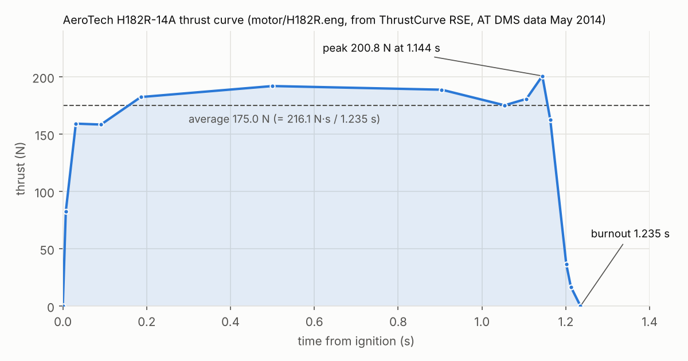
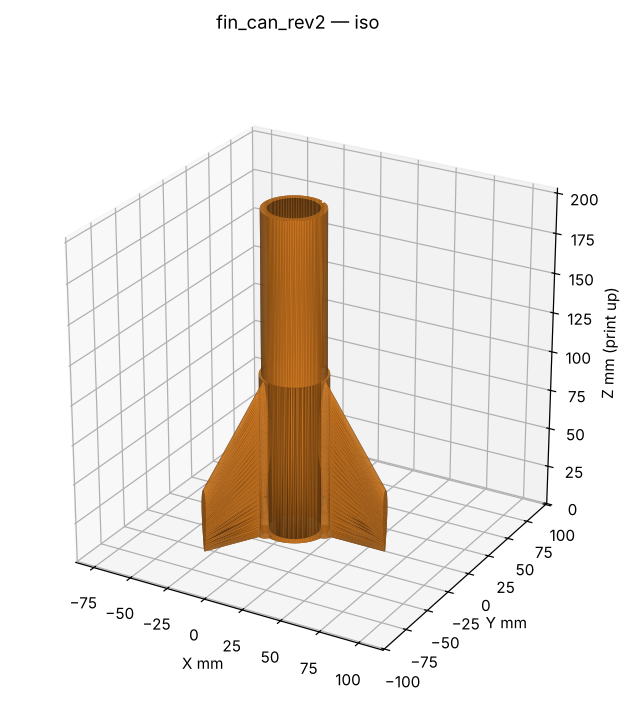
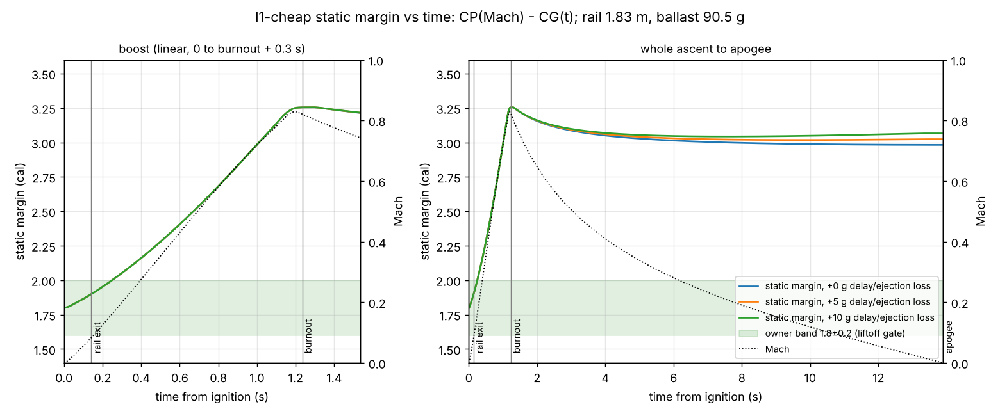

# l1-cheap — Design & Research Report
_Last updated: 2026-11-20 · 5741954_

> Living document, maintained by the `rocket-docs` agent. Every number is copied from a project source and cited inline. Labels ESTIMATE / PLACEHOLDER / PROPOSED / TBD are carried over from the sources. Flight numbers come from the current run of `.venv/bin/python sims/l1_cheap.py --allow-tbd` (2026-11-20; cited as **sim**). Where an older file disagrees, both are shown and the conflict is in §11.

---

## Briefing

**Goal:** Tripoli Level 1 certification flight, as cheaply as possible: **$100 cap including the motor**, launch **Palm Bay, FL, 2026-12-14** (goal.md).

**Rocket at a glance**

| | |
|---|---|
| Motor | AeroTech **H182R-14A**, 29 mm DMS single-use, owner-confirmed (design.yaml `motor.designation`) |
| Airframe | LOC BT-1.52 paper tube, 863 mm uncut; OD 41.275 mm nominal (PLACEHOLDER until measured) |
| Nose | 165 mm tangent ogive, printed PETG, 52.7 g ESTIMATE + **90.5 g ballast** (design.yaml) |
| Fin can | One-piece PETG, 3 fins (100/40/40 mm), **rev 2 DRAFT**: 171.8 g model, M3 insert bosses (out/fin_can/rev2) |
| Recovery | Single deploy on motor ejection (PROPOSED); owned 40 in chute, owned 750 lb Kevlar |
| Length / liftoff mass | 1128 mm / 715.3 g (sim) |
| Payload | None. Quasar-LR kept for a later build (payload.md) |

**Key performance (sim, PROVISIONAL: several masses are estimates)**
- Liftoff static margin **1.80 cal**: PASS against an aim of 1.8 (accept 1.6–2.0), gated at liftoff only.
- Apogee **1284 m (4212 ft)** at 13.89 s · Vmax **281.4 m/s, M 0.829** (subsonic).
- Rail exit 28.3 m/s (1.83 m rail) / 25.5 m/s (1.5 m rail); rail size TBD.
- Delay **12 s** recommended, giving 6.4 m/s at deploy (stability.md §3; sim).
- Balance check on the built rocket: **771 ± 8 mm** from the nose tip (design.yaml).

**Phase status**

| 0 Goal | 1 Feasibility | 2 Design | 3 BOM | 4 Budget | 5 Schedule | 6 Parts | 7 Build | 8 Flight |
|---|---|---|---|---|---|---|---|---|
| ✅ | ✅ Cond. GO | ✅ | ✅ | ⏳ not started | — | fin can rev 2 DRAFT; nose not generated | — | — |

**Top risks**
1. **Motor, liner and tube not measured.** The fin can stays DRAFT because tube OD, liner OD and thrust ring are placeholders, and the motor is a launch-day buy.
2. **Fin flutter unchecked.** PETG shear modulus G is TBD (aero.md §4).
3. **Deploy timing on a fixed charge.** 12 s keeps deploy ≤ 14.6 m/s over Cd ×0.85–1.3; knotted Kevlar is only good to ~27 m/s.

**Next steps**
- Phase 4 budget, with owner approval of the spend.
- Measure the tube OD, liner OD, motor case OD and thrust ring, then regenerate the fin can.
- Write `parts/nose_cone.py` and verify it. Owner to supply PETG G for the flutter check.
- Refresh the stale entries in stability.md, aero.md, bom.csv and payload.md (§11).

---

## 1. Requirements & Constraints

### 1.1 Mission and owner constraints (goal.md, design.yaml `owner`)

| Item | Value | Source |
|---|---|---|
| Certification | Tripoli L1 (member, uncertified); age 18+ confirmed | goal.md, feasibility.md §7 |
| Motor class | Cheapest 29 mm H with motor ejection | goal.md |
| Airframe | 38 mm class tube (LOC BT-1.52 chosen) | goal.md, feasibility.md §7 |
| Printed parts | Fin can and nose cone, PETG on Bambu P1S | goal.md |
| Stability | Target 1.8 cal, band ±0.2 cal, **gated at liftoff only** | design.yaml `owner.stability_*` |
| Budget | $100 total incl. motor, 5 % contingency held back ($95 spendable) | design.yaml `owner`, feasibility.md §4 |
| Filament | $13/kg PETG | goal.md |
| Launch / deadline | Palm Bay, FL, 2026-12-14 (24 days from 2026-11-20); club/prefecture name TBD | goal.md |

The owner wrote the stability band as "±2"; it is read as ±0.2 cal (design.yaml `owner.stability_band_cal`; skills/build-planner/SKILL.md marks it "CONFIRM").

### 1.2 Certification rules (feasibility.md §1, from secondary sources; check tripoli.org/Level1 before buying)

| Requirement | Status |
|---|---|
| Single certified H or I motor, 160.01–640 N·s | H182R 218 N·s, pass (motor.md §2) |
| Average thrust > 80 N (forum claim only) | 182 N label / 175 N RSE, pass |
| Rocket built by the flyer | plan |
| Witnesses: 2× L1 or 1× L2/L3; form to the prefect before flight | arrange at launch |
| Safe recovery, rocket flyable again | design for it |

### 1.3 Shop and printer constants (skills/SKILL.md)

| Constant | Value |
|---|---|
| BT-1.52 ID (measured = nominal) / OD nominal | 38.735 mm / 41.275 mm; `od_measured_mm` **TBD** |
| Fits in tube, per side | press 0.06 mm, snug-slip 0.09 mm |
| PETG density / interlayer shear | 1.27 g/cm³ / 15 MPa (approximate, weak direction) |
| Printer limit (P1S) | 256 × 256 × 256 mm, hard |
| Print profile | 0.2 mm layers, 6 wall loops (0.42 outer / 0.45 inner), 5 top / 3 bottom layers, elephant-foot comp. 0.15 mm |
| Verify mass tolerance | ±5 % (provisional) |
| Rail size | **TBD** (1010 or 1515, set by the club) |

---

## 2. Propulsion

### 2.1 Motor data: AeroTech H182R-14A, 29 mm DMS single-use (motor.md §1, design.yaml `motor`)

| Item | Spec sheet | RSE / .eng file | Design value used |
|---|---|---|---|
| Total impulse | 218 N·s | 216.1 N·s | sim uses the .eng curve |
| Average thrust | 182 N (218 / 1.2, derived) | 175.0 N (ThrustCurve calc. 175.4) | 175 (`motor.avg_thrust_n`) |
| Peak thrust | 192 N stated; ~205 N read from the plot | 200.8 N at 1.144 s | **205 N** structural (`motor.max_thrust_n`) |
| Burn time | 1.2 s | 1.235 s | 1.235 s |
| Loaded / propellant / burnout mass | 207 / 115 / 92 g (92 derived, ESTIMATE) | — | 207 / 92 g |
| Length | 203 mm | 203.2 mm | 203 mm |
| Delay | 14 s max, adjustable shorter | — | **TBD** in `motor.delay_s`; 12 s recommended (§6) |
| Case OD | **TBD** (not published; 29 mm is the class) | — | — |
| Thrust ring | **TBD** (presence, OD, thickness) | — | PLACEHOLDER 33.0 × 3.0 mm in the fin can model |

The three sources disagree on peak thrust. Structures use the highest, 205 N, read by eye from the spec-sheet plot (motor.md §1).

*Figure 1. H182R-14A thrust vs time, plotted from `projects/l1-cheap/motor/H182R.eng` (converted from the owner's ThrustCurve RSE file, AT DMS data May 2014). Integrating the file gives 216.1 N·s, 175.0 N average, 200.8 N peak at 1.144 s and burnout at 1.235 s, matching motor.md §1. Generated 2026-11-20 for this report.*

### 2.2 Selection rationale (feasibility.md §2–3)

| Option | Motor cost | Extra hardware | Verdict |
|---|---|---|---|
| **A. H182R-14A DMS** | $42.29–$56.40 | none | **Chosen** (owner, design.yaml `motor.designation`) |
| B. H128W / H180W / H220T reload | $34.99–$39.49 | RMS-29/180 case $108.79–$152.99 | Only with a borrowed case |
| H13ST DMS | $52.19–$57.99 | none | Excluded: ~13 N average thrust |

- The H182R is HAZMAT. Plan: **buy it from the club's launch-day vendor** and reserve it ahead (feasibility.md §3).
- It is often sold out (feasibility.md §2).

### 2.3 Delay
- Delay = t_apogee − t_burnout; the delay timer starts at burnout (recovery.md §6).
- Coast to apogee is 12.66 s (sim). Recommended: cut **14 → 12 s** with the AeroTech tool, borrowed at the field. 13 s is equally good (stability.md §3).
- Who at Palm Bay has the delay tool is still open (motor.md §4).

---

## 3. Aerodynamics

### 3.1 Fins (aero.md §1, design.yaml `aero`, `fin_can`)

| Item | Value | Status |
|---|---|---|
| Count | 3 | aero proposal |
| Root / tip chord | 100 / 40 mm (λ = 0.4) | aero proposal |
| Span | 40 mm (tuning range 30–50) | aero; stability kept 40 (`fin_span_request_mm: null`) |
| LE sweep | 60 mm; TE square and flush with the aft face | aero |
| Thickness | 5 mm | **provisional**, pending flutter |
| Section | NACA 4-digit symmetric, constant thickness, TE 0.84 mm (2 outer lines) | PROPOSED (fin_can) |
| Root fillet | r = 4 mm | PROPOSED (owner range 3–5 not confirmed) |

### 3.2 Barrowman centre of pressure (aero.md §2)

Reference point: the nose tip. Symbols: Ln nose length, Lb body length from nose base to aft end, d body diameter (41.275 mm), r = d/2, N fin count, s span, Cr/Ct root/tip chord, xs LE sweep. All lengths in mm.

- Nose: CNα,n = 2, X_n = k·Ln, with k = 0.466 tangent ogive, 0.5 Haack/VK/parabolic, 0.666 cone.
- Fins: CNα,f = K_fb · 4N(s/d)² / [1 + √(1 + (2 l_m/(Cr + Ct))²)], K_fb = 1 + r/(s + r), l_m = √(s² + (xs + Ct/2 − Cr/2)²). For s = 40: l_m = 50.0 mm, K_fb = 1.340, **CNα,f = 6.777**.
- Fin CP from the root LE: ΔX_f = xs(Cr + 2Ct)/(3(Cr + Ct)) + (1/6)[(Cr + Ct) − Cr·Ct/(Cr + Ct)] = **44.3 mm**.
- Total: **CP = (2·X_n + CNα,f·X_f) / (2 + CNα,f)**, with X_f = Ln + Lb − 55.7 mm for this fin set.

| Case | CP from nose tip | Source |
|---|---|---|
| aero.md headline: Ln 165, Lb 863 (fin can length not included) | 768.3 mm | aero.md §2, design.yaml `aero.cp_from_nose_tip_mm` |
| **Current geometry**: Lb 963 (863 tube + 100 exposed fin can) | **845.5 mm** (RocketPy 845.4 at M 0) | sim, design.yaml `stability.cp_from_nose_mm` |
| RocketPy, M ≥ 0.8 (compressibility factor capped at M 0.8) | 856.6 mm | sim |

The 768.3 mm value is stale for the rocket as now designed (§11).

### 3.3 Drag and Mach (aero.md §3)

Cd is an **ESTIMATE** from a component buildup using the OpenRocket technical-documentation methods:
- skin friction, turbulent or roughness-limited, at 60 µm roughness;
- base drag 0.12 + 0.13M²;
- fin LE/TE pressure drag.

Not included: rail buttons, nose wave drag and the transonic drag rise.

| M | 0.1 | 0.5 | 0.7 |
|---|---|---|---|
| Cd | 0.70 | 0.76 | 0.83 |

The sim holds Cd at 0.83 above M 0.7 (ASSUMPTION, design.yaml `stability.assumptions.cd_vs_mach`).
- **Current sim: Vmax 281.4 m/s, M 0.829, max q 47.7 kPa.** The flight is subsonic.
- aero.md §3 predicted 286–369 m/s, M 0.84–1.09 ("transonic"), for **assumed** structures of 300–500 g. That range predates the real mass budget and is stale (§11).

### 3.4 Flutter: TBD (aero.md §4)

Method: NACA TN 4197, as given in Apogee *Peak of Flight* #291.

V_f = a · √( G / [ 1.337·AR³·P·(λ + 1) / (2(AR + 2)(t/Cr)³) ] ), AR = s²/A_fin

Symbols: V_f flutter speed (m/s), a speed of sound (m/s), G shear modulus (Pa), P pressure (Pa), λ taper ratio, t thickness, Cr root chord.

PETG G is not in the shop constants, so aero.md inverts the formula to give the G each fin size would need.
- Conditions: worst-case Vmax 369 m/s, a = 339.3 m/s, P = 98.6 kPa. That Vmax is older and conservative next to the current 281.4 m/s.
- The 1.5× margin is aero's choice, not the owner's.

| s / t | G for V_f = Vmax | G for V_f = 1.5·Vmax |
|---|---|---|
| 40 / 4 mm | 124 MPa | 279 MPa |
| **40 / 5 mm** | **63 MPa** | **143 MPa** |
| 35 / 5 mm | 44 MPa | 98 MPa |
| 30 / 5 mm | 28 MPa | 64 MPa |

---

## 4. Structures & Manufacturing

### 4.1 Fin can: rev 2 (DRAFT, NOT PRINT-READY)

The fin can is one PETG part: 3 fins, motor-mount bore, liner seat, airframe shoulder, Kevlar groove and retention bosses (fin_can_design.md, parts/fin_can.py, out/fin_can/rev2/fin_can_rev2_spec.md).

| Parameter | Value | Status |
|---|---|---|
| Body OD | 41.275 mm | **PLACEHOLDER** (tube OD nominal) |
| Shoulder OD / length | 38.555 mm / 103 mm | derived (snug-slip PROPOSED) / FROM_STABILITY |
| Exposed length | 100 mm (= root chord) | FROM_AERO |
| Liner | LOC MMT-1.14 paper, ID 28.956 mm (CITED, third-party), length 203 mm | OWNER |
| Liner OD | 30.5 mm | **PLACEHOLDER** |
| Bore | 30.68 mm (liner OD + snug-slip) | derived from a placeholder |
| Thrust ring OD × thickness | 33.0 × 3.0 mm | **PLACEHOLDER** |
| Retention | **Option A**: one M3 heat-set insert per fin (3 total), Ø4.0 × 5.7 mm hole, in a faired boss at the fin root, aft end | OWNER (rev 2) |
| Insert radius / boss wall / fairing | 20.01 mm / 2.67 mm / 20 mm | derived / PROPOSED / PROPOSED |
| Washer min. OD | 11.02 mm (2 mm overlap rule applied to the placeholder ring) | derived |
| Kevlar anchor | Groove 3.0 × 2.6 mm in the shoulder OD, 60° between fins, epoxied under the tube | PROPOSED |
| Print | Aft face down, axis vertical; extents 93.2 × 107.6 × 203.0 mm; no supports | verify check 5 |

*Figure 2. Fin can rev 2, iso view in print orientation (aft face on the bed, Z up). Source: `out/fin_can/rev2/fin_can_rev2_iso.png`, `make.py fin_can --rev 2`, 2026-11-20.*

*Figure 3. Fin can rev 2, axial section through a fin (y = 0). Left: the bore wall. Right: the fin root, with the M3 insert hole entering from the aft face (bottom). The step at Z = 100 mm is where the shoulder starts. Source: `out/fin_can/rev2/fin_can_rev2_section.png`, 2026-11-20.*

**Verify results (out/fin_can/rev2/fin_can_rev2_verify.json): 5 / 5 PASS**

| # | Check | Result |
|---|---|---|
| 1 | Mesh integrity | PASS: watertight, 1 body, 137 055.7 mm³ |
| 2 | Mass | PASS: target 171.1 g ±5 %; reachable 171.0 g (0 %) – 174.1 g (100 %); 2.3 % infill hits the target |
| 3 | Mating interference | PASS: 0 mm³ with tube wall, liner + motor, and thrust ring (**all built from placeholder dimensions**) |
| 4 | Renders | PASS: iso, front and section written; iso and section reviewed for this report |
| 5 | Build volume | PASS: 93.2 / 107.6 / 203.0 mm vs 256 |

**Revisions**

| Rev | Change | Mass range (0–100 % infill) | Infill to hit 171.1 g |
|---|---|---|---|
| rev 1 | First geometry; **no motor retention** (open) | 170.5–173.0 g | 25.3 % |
| rev 2 | Option A M3 insert bosses at the 3 fin roots | 171.0–174.1 g | 2.3 % |

The sim uses the rev 2 model mass at 25 % infill, **171.8 g**, with its CG 79.8 mm forward of the aft face (design.yaml `stability.fin_can_model_*`).

**Loads vs. layers (fin can, printed axis-vertical)**: spec sheet rev 2, motor.md §3, aero.md §5

| Load | Direction vs layers | Bond loading |
|---|---|---|
| Motor thrust, ring on the aft face (+Z) | across layers | **compression** (good) |
| Fin root bending from side load | within layers (XY) | in-plane; interlayer only secondary |
| Kevlar anchor pull (+Z) on the epoxied groove | bond on vertical faces | in-plane shear, not peel |
| Ejection kick on the motor (−Z), through the screws into the inserts | across layers | **pull-out: shear + tension (weak direction)** |

### 4.2 Structural checks

**Bearing stress (thrust ring on the aft face):** σ = F / A, with σ stress (MPa), F force (N) and A bearing area (mm²).
- F = 205 N. The real annulus is TBD.
- Example only (bore 29 mm, ring 31 mm): A = π/4·(31² − 29²) = 94.2 mm², so σ = 2.2 MPa.
- 15 MPa would be reached at A = 13.7 mm² (motor.md §3).
- 15 MPa is the interlayer *shear* figure, used as a conservative reference, because the shop constants have no PETG compressive allowable.

**Retention pull-out** (motor.md §3a)
- Design load: p·A·3 = 0.103 MPa × 660.5 mm² = 68 N, ×3 = **205 N** (ESTIMATE; 15 psi assumed bay pressure, since the charge size is unpublished).
- Capacity per insert, plug shear: τ·π·D·L = 15 × π × 4.0 × 5.7 = **1074 N**. Here τ is the interlayer shear, D the hole diameter and L the insert length (mm).
- With SPIROL's installation knock-down to 25 %: 269 N per insert, **537 N for two, so SF 2.6**.
- Rev 2 carries **three** inserts. motor.md has not re-stated the capacity for three (§11).

**Fin root bending** (aero.md §5). Aero chose the load case: α = 5° at max q 81.8 kPa. That is an older worst case; the sim's max q is 47.7 kPa.
- F = q·S_ref·CNα·α = 47 N; spanwise centroid 17.1 mm; M = 0.805 N·m.
- σ = M/Z, with Z = Cr·t²/6 = 417 mm³, so **σ = 1.93 MPa** at t = 5 mm. τ = 1.5F/(Cr·t) = 0.14 MPa.
- That is a factor of 7.8 below 15 MPa even if all of σ crossed the layers. Flutter, not strength, sizes the fins.

**Interlayer net-area check for printed anchors** (recovery.md §4): σ = F·SF / A_net ≤ 15 MPa, so A_net ≥ F·SF / 15.
- 40 in chute, 953 N × 3 / 15: **191 mm²** for a 40 m/s deploy.
- **48 mm²** for a deploy at ≤ 20 m/s.

### 4.3 Mass model (walls + infill): skills/SKILL.md, verify check 2

m = ρ · (V_shell + f · V_interior)

Symbols:
- ρ = 1.27 g/cm³ (PETG).
- V_shell: the walls (a 2.67 mm band = 0.42 + 5 × 0.45) plus the top and bottom skins (cm³).
- V_interior: the infill region (cm³).
- f: infill fraction.

Rev 2: V_shell 134.67 cm³ and V_interior 2.39 cm³, giving 171.0 g at f = 0 and 174.1 g at f = 1.

### 4.4 Nose cone: PROPOSED, part module not written (nosecone.md)

| Item | Value | Status |
|---|---|---|
| Shape / length | Tangent ogive, 165 mm, fineness 4.0 | PROPOSED |
| Base OD | 41.275 mm | nominal; re-set to the measured tube OD |
| Shoulder | OD 38.555 mm, 40 mm long | PROPOSED |
| Wall | 2.2 mm (fully solid: < 2 × 2.67 mm) | PROPOSED |
| Aft bulkhead | 5 mm, integral; Kevlar strap holes + ballast fill port (sizes TBD; Kevlar 2.3 mm) | PROPOSED |
| Mass / CG | **52.7 g ESTIMATE** (25 % core infill; 51.7–55.5 g over 0–100 %), CG 119.9 mm from tip | ESTIMATE |
| Ballast cavity | 27.2 cm³ tip → 100 mm, fill CG 74.6 mm | nosecone.md §5 |
| Print | Tip up, bulkhead on the bed, 41.3 × 41.3 × 205 mm, no supports | |

**Loads vs. layers (nose, printed tip-up)**, nosecone.md §4. The snatch load pulls the strap aft (−Z):
- The web bends in-plane.
- The bulkhead-to-wall interface is within the layers.
- The shoulder wall carries the load forward in **Z tension across the layers**, which makes it the weak link.
- Its annulus is 251 mm², which reaches 15 MPa at 3.77 kN. At 343 N the stress is 1.4 MPa; at 1030 N it is 4.1 MPa.

`parts/nose_cone.py` does not exist, so the nose has **no verify run** (nosecone.md status).

---

## 5. Recovery

### 5.1 Scheme (recovery.md §1, design.yaml `recovery`)
- **Single deploy on the H182R-14A's own ejection charge.** PROPOSED; no electronics are flown.
- The charge size is unpublished, and a DMS charge can't be ground-tested on its own.
- The tube has 117.8 cm³ of free volume per 100 mm, so keep the motor-to-shoulder volume short.
- Recovery pack is about 120 mm long (ESTIMATE; pack test pending).

### 5.2 Parachute: owned 40 in (recovery.md §7)

Descent rate, flat canopy: **v = √( 2·m·g / (ρ·Cd·A) )**

Symbols:
- v: descent rate (m/s).
- m: descent mass (kg).
- g = 9.80665 m/s².
- ρ = 1.225 kg/m³ (ISA sea level).
- Cd: canopy drag coefficient (0.75 design value, 1.5 optimistic).
- A = πD²/4: canopy area (m²), circular assumed.

| 40 in chute | 450 g | 575 g | 700 g |
|---|---|---|---|
| Cd 0.75 | 3.44 m/s | 3.89 m/s | 4.29 m/s |
| Cd 1.5 | 2.43 m/s | 2.75 m/s | 3.04 m/s |
| Reefed to ~30 in, Cd 0.75 | 4.59 m/s | 5.19 m/s | 5.72 m/s |

- The table uses the main session's PLACEHOLDER range of 450–700 g. The sim burnout mass, **600.3 g**, falls inside it, but recovery has not recomputed at that mass.
- Recommendation: fly the 40 in **reefed** to cut drift; reefing is free and reversible. Fly it full size in light wind.
- Chute mass is ≤ 57 g (ESTIMATE); brand and type TBD; weigh it. Descent-rate target TBD (owner).

### 5.3 Opening load (recovery.md §3, §7)

**F = ½ · ρ · v² · Cd · A · Cx**, where Cx = 1.6 is the opening-shock factor (Knacke 1992), F is in N and v is the deploy speed (m/s).

| v at deploy (40 in, Cd 0.75) | 10 m/s | 20 | 30 | 40 |
|---|---|---|---|---|
| F | 60 N | 238 N | 536 N | 953 N |

Design case: 953 N × SF 3 (proposed) = **2860 N**. At the recommended 12 s delay, the deploy speed is 6.4 m/s (sim).

### 5.4 Shock cord and anchors
- **9KM DWLIFE Kevlar, 750 lb (3336 N), 2.3 mm, 2.91 g/m; 16 m owned.** Cut length is 3 × 1128 + 300 mm = 3.68 m, 10.7 g (sim mass budget).
- Knotted at 40 % efficiency, the cord holds 1334 N. That passes the 40 in case only up to a ~27 m/s deploy (445 N × 3). **Splice or sew the loops.**
- Layout: aft anchor, then the long run, then the chute loop about ⅓ from the nose end, then the nose eye. Z-fold the cord in tape bundles.
- Rev 2 aft anchor: Kevlar in an epoxied shoulder groove (§4.1). Nose: strap through the 5 mm bulkhead (§4.4).

### 5.5 Ejection protection
Estes recovery wadding is PROPOSED ($5.43–5.99). A Nomex 6×6 protector (~$5) is the reusable alternative (recovery.md §5).

---

## 6. Stability & Flight Simulation

**Tool:** RocketPy 1.13.0, `sims/l1_cheap.py`. Every number comes from design.yaml and the shop constants (sim docstring):
- an owner value is used when it is a number;
- otherwise the `stability.assumptions` value;
- otherwise the item is left out and the run is stamped PROVISIONAL.

Conditions: standard atmosphere, vertical rail, no wind.

### 6.1 Static margin
**SM = (CP − CG) / d**

Symbols: SM static margin (calibers); CP and CG measured from the nose tip (mm); d = 41.275 mm body diameter.

At liftoff: (845.5 − 771.2) / 41.275 = **1.80 cal** (sim).

### 6.2 Mass budget (sim, current; x from the nose tip)

| Item | g | x (mm) | Basis |
|---|---|---|---|
| Nose cone | 52.7 | 119.9 | nosecone.md, ESTIMATE |
| Ballast | 90.5 | 74.6 | stability choice (solved for 1.8 cal) |
| BT-1.52 tube, 863 mm | 93.6 | 596.5 | ESTIMATE 0.1085 g/mm (OpenRocket cardboard 0.68 g/cm³) |
| Fin can rev 2 (incl. fins) | 171.8 | 1048.2 | part model, verify mass at 25 % infill |
| Liner MMT-1.14 | 10.0 | 1026.5 | ESTIMATE; **OD 30.5 is a PLACEHOLDER** |
| Parachute 40 in | 57.0 | 865.0 | ESTIMATE ≤ 57 g |
| Kevlar 3.68 m | 10.7 | 865.0 | 2.91 g/m |
| Wadding | 2.0 | 915.0 | ESTIMATE |
| Epoxy | 10.0 | 976.5 | ESTIMATE |
| Rail buttons | 5.0 | 828.0 | ESTIMATE |
| Retention, 3 × (insert + screw + washer) | 5.0 | 1126.0 | ESTIMATE, not weighed |
| **Structure** | **508.3** | **667.2** | |
| Motor loaded / burnout | 207 / 92 | 1026.5 | motor.md |
| **Liftoff / burnout** | **715.3 / 600.3** | CG 771.2 / 722.3 | |

Without ballast the rocket is unstable: −0.63 cal at liftoff (stability.md §1, rev 3 basis).

### 6.3 Margin vs time

*Figure 4. Static margin, CP(Mach) − CG(t), from liftoff to apogee: 1.83 m rail, ballast 90.5 g, with 0 / 5 / 10 g of delay-grain and ejection mass loss (unpublished; the ASSUMPTION is 0 g). The shaded band is the owner's 1.8 ± 0.2 (liftoff gate). Source: `out/sims/l1_cheap_margin_vs_time.png`, regenerated 2026-11-20 with the stability baseline command. The copy on disk before this run showed the 89 g rev-1 + tape configuration.*

Method (stability.md §3a):
- CP(M) from RocketPy's Mach-dependent Barrowman.
- Propellant m(t) is impulse-proportional; it matches the RSE m(t) within 0.05 g.
- Propellant CG is at the motor midpoint.

**Key events (sim, +0 g delay/ejection loss)**

| Event | t (s) | Mach | CP (mm) | CG (mm) | Mass (g) | SM (cal) |
|---|---|---|---|---|---|---|
| Liftoff | 0.000 | 0.000 | 845.4 | 771.2 | 715.3 | **1.80 (minimum)** |
| Rail exit (1.83 m) | 0.142 | 0.083 | 845.5 | 767.1 | 704.1 | 1.90 |
| Max q = Vmax | 1.199 | 0.829 | 856.6 | 722.5 | 600.6 | 3.25 |
| Burnout | 1.235 | 0.821 | 856.6 | 722.3 | 600.3 | 3.25 |
| Coast, M 0.5 | 3.038 | 0.501 | 849.6 | 722.3 | 600.3 | 3.08 |
| Coast, M 0.3 | 5.635 | 0.300 | 846.9 | 722.3 | 600.3 | 3.02 |
| Apogee | 13.891 | 0.000 | 845.4 | 722.3 | 600.3 | 2.98 |

- The minimum margin is at liftoff: during boost, CP moves aft with Mach and CG moves forward as propellant burns.
- With 10 g of delay/ejection loss, the apogee margin is 3.07 cal. Liftoff is unchanged.
- The static burnout margin, 2.98 cal, is reported, not gated (owner). It sits near NASA SL's "≥ 3.0 over-stable" line. stability.md §3b argues weathercocking is minor at a 28 m/s rail exit.

### 6.4 Flight summary (sim)

| Quantity | Value |
|---|---|
| Apogee | **1284 m (4212 ft)** at 13.89 s |
| Burnout / coast to apogee | 1.235 s / 12.66 s |
| Vmax / Mach / max q | 281.4 m/s at 1.19 s / 0.829 / 47.7 kPa |
| Rail exit 1.5 m / 1.83 m | 25.5 m/s at 0.130 s / 28.3 m/s at 0.142 s (no rail-button geometry) |

### 6.5 Delay table (sim; recovery flags ≤ 20 m/s preferred, ≤ 27 m/s limit)

| Delay (s) | 14 | 13 | 12 | 11 | 10 | 9 | 8 | 6 | 4 |
|---|---|---|---|---|---|---|---|---|---|
| Altitude AGL (m) | 1275 | 1283 | 1282 | 1270 | 1249 | 1217 | 1174 | 1052 | 870 |
| Speed (m/s) | 12.7 ↓ | 3.4 ↓ | 6.4 ↑ | 16.3 ↑ | 26.5 ↑ | 37.2 | 48.5 | 74.6 | 109.0 |
| Flag | pref. | pref. | pref. | pref. | limit | too fast | too fast | too fast | too fast |

**Recommended delay: 12 s** (13 s equally good), stability.md §3.

### 6.6 Sensitivity (stability.md; these sweeps ran before rev 2, basis noted)
- **Cd** (90 g run, stability.md §3): at Cd × 0.85 / 1.15 / 1.30, the 12 s deploy speed is 14.6 / 0.5 / 6.2 m/s; 14 s reaches 22.0 m/s at × 1.30. Apogee spans ~1413–1096 m over Cd × 0.85–1.3 (design.yaml comment).
- **Liftoff aim** (rev 3, 89 g basis, §3b): aiming 1.5 → 1.8 → 2.0 cal needs 76.2 → 88.6 → 97.1 g of ballast and gives 1286 → 1285 → 1283 m apogee. Aim **1.8, accept 1.6–2.0**.
- **Nose mass** (§5): ballast absorbs nose error at −0.93 g per +1 g. Set the final ballast from the weighed nose.
- **Ballast vs CG:** about 1 g of nose ballast per 1 mm of CG shift (design.yaml `stability.ballast_g`).
- **Mass trade** (rev 2, §4): each extra 50 g of ballast cuts Vmax by ~15 m/s but apogee by only ~10–20 m.

---

## 7. Bill of Materials & Budget

### 7.1 BOM (bom.csv, Phase 3, reviewed by owner)

| Tag | Item | Qty | Mass (g) | Unit price (USD) |
|---|---|---|---|---|
| buy | AeroTech H182R-14A DMS (launch-day vendor) | 1 | 207 | 42.29–56.40 |
| buy | LOC BT-1.52 tube, 34 in | 1 | 93.6 ESTIMATE | 9.30 |
| buy | Estes recovery wadding | 1 pack | 2 ESTIMATE | 5.43–5.99 |
| buy | M3 brass heat-set inserts | 2 (pack of 100) | ~1 ESTIMATE | 10.99 / 100 |
| TBD | M3 screws + washers | 2 + 2 | ~3 ESTIMATE | TBD |
| print | Nose cone | 1 | 52.7 | 0.69 (PETG $13/kg × mass) |
| print | Fin can | 1 | 197.3 (stale) | 2.56 (from 197.3 g) |
| have | Ballast, 40 in chute, Kevlar, epoxy, PETG, glue stick, calipers, scale | — | — | 0 |
| borrow | AeroTech delay tool; pad, rail, controller (club) | — | — | 0 |
| owner-handled | Rail buttons, igniter, soldering iron | — | — | excluded |
| optional | Sandpaper / finish | — | — | 0 |

bom.csv predates fin can rev 2 and the liner decision; §11 lists the rows to update.

### 7.2 Budget: Phase 4 not started
- Cap $100 incl. motor; 5 % contingency leaves **$95 spendable** (feasibility.md §4).
- The altimeter (Quasar-LR, shared 50/50) is **outside** this budget (git 392a135).
- Owner-handled items (rail buttons, igniter, soldering iron) are excluded from the plan and the budget (bom.csv).
- No total is given here because some lines are still unpriced (screws/washers, liner, non-hazmat shipping). Phase 4 sets the total.

---

## 8. Schedule

Phase 5 (difficulty & schedule) has not started; there is no `schedule.md`.
- Deadline: launch 2026-12-14, 24 days from 2026-11-20 (goal.md).
- Known ordering constraint: the motor is a launch-day purchase, so its dimensions may not be in hand before the fin can is printed (fin_can_design.md, Risks).
- Project difficulty is 3 / 5: printed structural fin can, epoxy joints, single deploy on motor ejection (feasibility.md §5).

---

## 9. Verification & Test Plan

### 9.1 verify.py (skills/SKILL.md)

| # | Check | Pass condition | Fin can rev 2 | Nose cone |
|---|---|---|---|---|
| 1 | Mesh integrity | watertight, manifold, one body | PASS | not generated |
| 2 | Mass | walls + infill model within ±5 % of target | PASS (171.1 g target) | — |
| 3 | Mating interference | 0 mm³ with each mating solid | PASS (vs placeholders) | — |
| 4 | Renders | iso/front/section written and looked at | PASS | — |
| 5 | Build volume | ≤ 256 mm each axis | PASS | — |

A part is not "good" until every check passes and its renders have been reviewed (CLAUDE.md, skills/SKILL.md).

### 9.2 Measurements and fit tests before printing
- Tube OD (calipers): sets the fin can `body_od_mm` and the nose base OD (`od_measured_mm`).
- Liner MMT-1.14 OD: sets the fin can bore.
- Motor case OD, thrust ring OD and thickness, on a motor in hand (e.g. vendor stock): set the bore, the washer size and the mating check.
- Bore diametral clearance for the motor: owner to set (motor.md §4).

### 9.3 Weigh-and-balance
- Weigh the nose, tube, chute and Kevlar, then re-run the sim with the as-built masses (stability.md §9).
- Set the ballast from the weighed nose. It must pack densely enough to fit tip → 100 mm.
- **Ready-to-fly balance point: 771 ± 8 mm** from the nose tip, with motor in, chute packed and ballast in. If it is aft of 779 mm, add ~1 g of ballast per mm.
- A swing test checks the CP qualitatively; 845.5 mm is calculated, not measured.

### 9.4 Recovery and pre-flight
- Pack-test the real chute, cord and wadding, then set the bay length (recovery.md §6).
- Splice or sew the Kevlar end loops. Reef the chute if the wind is up.
- Cut the delay to 12 s with the AeroTech tool at the field.
- Arrange witnesses (2× L1 or 1× L2/L3) and give the cert form to the prefect before the flight (feasibility.md §1).
- Measure the descent rate on the flight to check the reefed-area estimate (recovery.md §7).

---

## 10. Decision Log

All dates 2026-11-20.

| Decision | By | Rationale / source |
|---|---|---|
| Goal: Tripoli L1, $100 incl. motor, 29 mm H, 38 mm tube, printed PETG fin can + nose, 1.8 cal | owner | goal.md |
| Owner is 18+; launch Palm Bay, FL, 2026-12-14 | owner | feasibility.md §7 |
| Airframe: buy LOC BT-1.52 34 in ($9.30); printed tube is the fallback | owner | feasibility.md §7 |
| Motor: **AeroTech H182R-14A** (no case to buy) | owner | design.yaml `motor.designation`; git f1494d0 |
| Recovery hardware: owned **40 in chute** and **750 lb Kevlar** | owner | recovery.md §7; git 9c72e0a |
| Payload: Quasar-LR scoped, then **no payload in this rocket**; kept for a later build | owner | payload.md; git b0bd19e |
| Altimeter cost (shared 50/50) **outside** the rocket budget | owner | git 392a135 |
| Rail buttons, igniter, soldering iron owner-handled, not tracked | owner | bom.csv; git bff07a0 |
| Owner has ballast, calipers, scale | owner | bom.csv; git aa449c0 |
| Stability band gates **liftoff only**; in-flight margin reported | owner | design.yaml `owner.stability_band_applies` |
| Liftoff aim 1.8 cal, accept 1.6–2.0 | stability (PROPOSED) | stability.md §3b |
| Motor liner: **LOC MMT-1.14 paper** | owner | design.yaml `fin_can.liner` |
| Retention: screws + inserts, then friction fit + tape, then **Option A, one M3 insert per fin in root bosses** | owner | motor.md §3a; git a581177; design.yaml `fin_can.retention` (supersedes friction fit) |
| Ballast re-solved to **90.5 g** for rev 2 | stability | design.yaml `stability.ballast_g` |
| Delay 12 s | stability (PROPOSED) | stability.md §3; `motor.delay_s` still TBD |
| Single deploy on motor ejection | recovery (PROPOSED) | design.yaml `recovery.deployment` |

---

## 11. Open Items & Placeholders

### 11.1 Placeholders that block printing (fin can rev 2 spec)
- `body_od_mm` 41.275: tube OD nominal; measure.
- `liner_od_mm` 30.5: measure the liner.
- `thrust_ring_od_mm` 33.0 / `thrust_ring_thk_mm` 3.0: measure the motor.
- Nose cone: `parts/nose_cone.py` not written; no verify run.

### 11.2 Stale or conflicting source entries
1. **stability.md** headline and §3–3b are rev 3 (89 g ballast, tape retention): 710 g, 1.81 cal, CG 770.8, burnout 3.01 cal, apogee 1285 m, Vmax 283.1 m/s. The current sim gives 90.5 g, 715.3 g, 1.80 cal, CG 771.2, 2.98 cal, 1284 m, 281.4 m/s.
2. The **design.yaml `stability` results block** still holds rev 3 values (liftoff 710 g, 1.81 cal, CG 770.8/721.4, apogee 1285, Vmax 283.1, rail exit 28.4, deploy 6.2 m/s), while `ballast_g` is already 90.5.
3. **stability.md** says retention is "friction fit + tape" and the payload is "PROVISIONAL Quasar-LR". Its §6 payload slot and the note to "re-derive when the payload bay is added" are also stale. The owner chose Option A inserts and no payload.
4. **Ballast packing density:** stability.md and design.yaml give ≥ 3.27 g/cm³ (computed for 89 g); bom.csv gives 96 g at ≥ 3.54 g/cm³. Neither has been re-stated for 90.5 g.
5. **aero.md / design.yaml `aero.max_velocity_m_s` 286–369 and `max_mach` 0.84–1.09** ("this rocket is transonic") came from assumed 300–500 g structures. The sim gives 281.4 m/s, M 0.829.
6. **`aero.cp_from_nose_tip_mm` 768.3** assumes Lb 863, without the fin can length. The current CP is 845.5 mm (Lb 963).
7. Flutter and fin root bending still use the old worst case (369 m/s, 81.8 kPa). That is conservative but not current.
8. **payload.md** has two contradictory banners: "no payload" (top) and "SUPERSEDED … there WILL be a payload". The latest owner decision is no payload.
9. **bom.csv:** fin can 197.3 g / $2.56 (now 171.8 g model); ballast 96 g; inserts and screws qty 2 (rev 2 needs 3 each); **no row for the MMT-1.14 liner**.
10. **fin_can_design.md:** 2 inserts around the bore, target 197.3 g, "verify.py doesn't exist yet", 7.2 m/s deploy. Rev 2 and the sim supersede all of these.
11. **Verify mass target 171.1 g** is the rev 1 model mass; the rev 2 model is 171.8 g at 25 % infill, and rev 2 hits 171.1 g only at 2.3 % infill. `stability.target_mass_g.fin_can` also still says 171.1.
12. **Retention capacity** (SF 2.6) was computed for 2 inserts; rev 2 has 3. Not re-stated.
13. **`motor.delay_s` is TBD**, while stability recommends 12 s and bom.csv already says "cut to 12 s".
14. **Recovery:** the descent table uses the 450–700 g placeholder range, and `recovery.deploy_velocity_m_s` is TBD. The sim gives 600.3 g and 6.4 m/s.
15. **Motor data:** peak thrust is 192 N (label), 205 N (plot) or 200.8 N (RSE); the design uses 205. Impulse is 218 vs 216.1 N·s; average thrust 182 vs 175.0 N.
16. **Rail-exit margin:** the same sim run prints 1.89 cal (RocketPy summary line) and 1.90 cal (key-event table).
17. The fin can mating check (0 mm³) was run against placeholder liner and ring geometry.

### 11.3 Owner inputs still TBD
- PETG shear modulus G, and the flutter margin to use.
- Club rail size (1010/1515), rail length and minimum rail-exit speed; club name; waiver altitude (apogee is 4212 ft).
- Descent-rate target; chute brand, type and mass; shock-cord safety factor.
- Bore clearance for the liner/motor; root fillet radius (3–5 mm).
- Confirm the stability band reading (±0.2 cal vs "±2").
- Confirm single deploy on motor ejection.
- Who holds the delay tool at Palm Bay; is an H182R reserved with the vendor?
- Epoxy type; ballast material and form; are M3 screws and washers owned?
- Tripoli L1 rules checked on tripoli.org (the current sources are secondary).

---

## 12. References

Accessed 2026-11-20 unless noted (as recorded in the project files).

**Motor & certification**
- AeroTech DMS H182R-14A spec sheet (owner-supplied); ThrustCurve RSE `motor/AeroTech_HP-H182R.rse` (owner)
- ThrustCurve HP-H182R — https://www.thrustcurve.org/motors/AeroTech/HP-H182R
- AeroTech H182R — https://aerotech-rocketry.com/products/product_907feaa5-d1fd-0d12-e28f-37e0cfa3bb8f
- AeroTech H128W — https://aerotech-rocketry.com/products/product_2df7f4ec-4f83-4bb0-01ce-b9a1932c0541
- AeroTech H13ST — https://aerotech-rocketry.com/products/product_b7697119-7d82-3db0-694e-7de6ea74dd90
- AeroTech RMS-29 hardware — https://aerotech-rocketry.com/collections/a-rms-29-hardware
- RouseTech RMS-29 — https://rousetech.net/collections/hardware/rms-29-mm/
- Sirius Rocketry H182R — https://www.siriusrocketry.biz/ishop/aerotech-high-power-h182r-14a-29mm-dms-hazmat-1509.html
- Apogee H182R — https://www.apogeerockets.com/Rocket_Motors/AeroTech_Motors/29mm_Motors_Single_Use/Aerotech_29mm_Motor_H182R-14A_SU
- rocket.supplies H182R — https://rocket.supplies/proddetail.php?prod=A081814
- Wildman H128W — https://wildmanrocketry.com/products/h128w
- TRA Certification Rules 2009 — https://laulima.hawaii.edu/access/content/group/7f13b953-c1b5-4532-00fe-072e1311e8a4/uslipub/USLI%20KFC%20Editor/DOCUMENTS/ROCKETRY%20RELATED/TRA_Certification_Rules_2009.pdf
- BYU Rocketry L1 — https://rocketry.byu.edu/join-us/level-1-cert
- Rocketry Forum (L1 avg thrust) — https://www.rocketryforum.com/goto/post?id=1926841
- NAR motor shipping — https://thisistheoldsite.nar.org/wp-content/uploads/2014/05/Shipping-Rocket-Motors.pdf

**Retention & inserts**
- Ejection charge calc — https://tonuonu.github.io/MyLevel1Peregrine/calculations/ejection-charges
- NAU capstone ejection/parachute — https://ceias.nau.edu/capstone/projects/ME/2026/F25toSp26_Rocket/files/AislinnJoyGacayan-ME476C-001-EjectionChargeandParachuteAnalysis.pdf
- 3D People inserts white paper — https://felix-manley-n4jm.squarespace.com/s/Threaded-Inserts-White-Paper-V1.pdf
- Sculpteo insert pull-out — https://www.sculpteo.com/en/3d-learning-hub/design-guidelines/pull-out-resistance-of-threaded-inserts-testing-and-results/
- SPIROL inserts in plastic — https://www.spirol.com/resources/white-papers/performance-expectations-for-threaded-inserts-in-plastic-assemblies/
- McMaster inserts — https://www.mcmaster.com/products/threaded-inserts/performance~any-orientation/ ; https://www.mcmaster.com/product/94459A769/
- accu-components hole chart — https://accu-components.com/p/488-threaded-insert-hole-size-charts-for-3d-printing-pla-petg-resin
- Prusa / CNC Kitchen M3 inserts — https://www.prusa3d.com/en/product/heat-set-inserts-m3-standard-100-pcs/
- Zoro 94459A130 — https://zoro.com/bsc-preferred-heat-set-inserts-for-plastic-brass-m3-x-05-mm-43-mm-installed-length-50pk-94459a130/i/G111638281
- MMT-1.14 ID, OpenRocket catalogue (third-party) — github.com/nrdptel/fusionspace-eridanus/issues/280

**Aerodynamics & stability**
- Barrowman CP method; OpenRocket technical documentation (drag buildup) — aero.md
- NACA TN 4197 flutter, via Apogee *Peak of Flight* #291 — aero.md
- RocketPy 1.13.0 — sims/l1_cheap.py
- RocketReviews, over-stability — https://rocketreviews.com/over-stability-230702231653.html
- MIT Rocket Team wiki (stability) — https://wikis.mit.edu/confluence/x/JGf_Bg
- NASA SL "Rocketry by the Numbers" (2023) — https://www.nasa.gov/wp-content/uploads/2023/09/nasa-sl-2024-arw-rocketry-by-the-numbers-508.pdf
- OpenRocket cardboard density — https://www.rocketryforum.com/goto/post?id=2317962 ; https://hub.wsu.edu/aerospace/wp-content/uploads/sites/204/2015/02/OpenRocket-Model.pdf

**Airframe**
- LOC BT-1.52 — https://wildmanrocketry.com/products/bt-1-52 ; https://www.csrocketry.com/building-supplies/loc-precision/cardboard-airframes/1.52-loc-airframe-38mm.html ; https://locprecision.com/products/cardboard-airframes

**Recovery**
- Instructables parachute calc — https://www.instructables.com/Calculating-the-Performance-of-a-Parachute
- NASA GRC recovery — https://www.grc.nasa.gov/WWW/k-12/VirtualAero/BottleRocket/airplane/rktvrecv.html
- Nakka App. K — https://nakka-rocketry.net/Appendix-K.htm
- Knacke 1992 opening factor, cited in — https://www.redalyc.org/journal/3094/309456744012/html
- Estes 24 in rip-stop — https://edu.estesrockets.com/products/rip-stop-parachute-24-inch
- Estes Pro Series II 24 / 30 in — https://estesrockets.com/products/pro-series-ii-24-inch-nylon-parachute ; https://estesrockets.com/products/pro-series-ii%e2%84%a2-30-inch-nylon-parachute
- Arizona Hobbies 24 / 30 in — https://arizonahobbies.com/products/pro-series-ii%E2%84%A2-24-inch-nylon-parachute ; https://arizonahobbies.com/products/pro-series-ii%e2%84%a2-30-inch-nylon-parachute
- 42 in chute mass — https://the-rocketman.com/?p=3121
- Shock-cord length — https://www.extension.purdue.edu/county/boone/4-H-Youth-Development/rocketry2011.pdf ; https://www.rocketryforum.com/threads/why-4x-the-length-of-rocket-for-shock-cord.129201/ ; https://ssi-wiki.stanford.edu/Special:MobileDiff/1557
- Knot strength — https://wikis.mit.edu/confluence/x/ckP_Bg ; https://link.springer.com/article/10.1007%2Fs40870-015-0015-5 ; https://www.cmcpro.com/?p=121806
- Wadding — https://www.schoolspecialty.com/estes-model-rocket-recovery-wadding-1006149 ; https://stemfinity.com/collections/estes-rockets/products/estes-recovery-wadding ; https://rainbowresource.com/product/000597/Recovery-Wadding-for-rockets.html ; https://store.hobbyetc.com/parts/view/123056
- Nomex protector — https://www.rocketryforum.com/threads/a-cornucopia-of-nomex-parachute-and-shock-cord-protectors.169577/
- Kevlar chute protector — https://giantleaprocketry.com/products/kevlar-chute-protector-up-to-2-6-airframe

**Payload (scoping only; not flown)**
- Eggtimer Quasar FAQ — https://eggtimerrocketry.com/quasar/
- Quasar User's Guide 1.02S — https://eggtimerrocketry.com/wp-content/uploads/2024/02/Eggtimer-Quasar-1_02s.pdf
- Quasar forum thread — https://www.rocketryforum.com/threads/the-eggtimer-quasar-a-wifi-enabled-gps-altimeter.175766/
- Eggtimer Apogee — https://www.rocketryforum.com/goto/post?id=2051607 ; https://contrailrockets.com/product/eggtimer-apogee-altimeter
- Estes Altimeter 2246 — https://estesrockets.com/product/002246-estes-altimeter/ ; https://edu.estesrockets.com/products/altimeter
- Jolly Logic AltimeterOne — https://locprecision.com/products/jolly-logic-altimeterone ; https://aeroconsystems.com/product/altimeter-one-by-jolly-logic
- Lucid RB02 beeper — https://lucidtechnologies.info/rb02_11.htm

---

## Changelog

- **2026-11-20 (5741954)**: first full build of this report (rocket-docs).
  - Briefing and §1–12 written from all project sources and the current sim run.
  - Figures added: H182R thrust curve (new, plotted from `H182R.eng`), fin can rev 2 iso and section, and margin vs time.
  - The margin plot in `out/sims/` was stale (89 g, rev 1 + tape), so it was regenerated with the stability baseline command before copying.

Project history (git log, all 2026-11-20):
- 6d16bdd → d816778 → 0241290 → 095784c: repo skeleton, shop rules, print settings; Phase 0 goal; Phase 1 feasibility.
- 44c87a1, 7003f60, 135e647: rocket subagents, shared design.yaml, RocketPy venv; launch date/site and tube decision.
- 10611b8 → 8437b9b: Phase 2 motor (H182R, real thrust curve), payload/recovery, nosecone, aero results.
- f1494d0, 9c72e0a: owner confirms H182R, Kevlar, 40 in chute; recovery re-sized.
- 7f29410 → b0bd19e: payload scoped for Quasar-LR, altimeter outside budget, then no payload.
- 415a24e, c7feb6c: retention sizing (2× M3 inserts); stability sim, mass budget, delay table.
- b789686 → aa449c0: Phase 3 BOM; owner-handled items; ballast, calipers, scale owned.
- 5465fab → e0d32a3: fin can design proposal; verify.py and make.py; fin can rev 1; stability re-solved with the real fin can.
- a581177: friction-fit retention; stability band gated at liftoff only.
- 7e1d2cd: fin can rev 2 (Option A insert bosses); stability re-solved, 90.5 g ballast.
- 5741954: rocket-docs agent and living-report rule.
